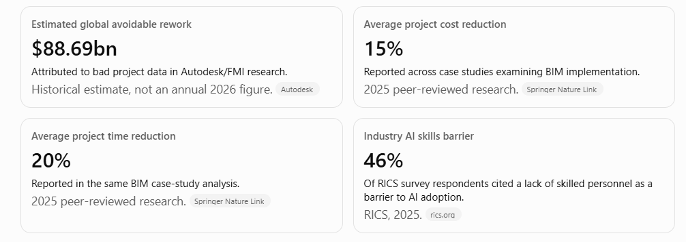
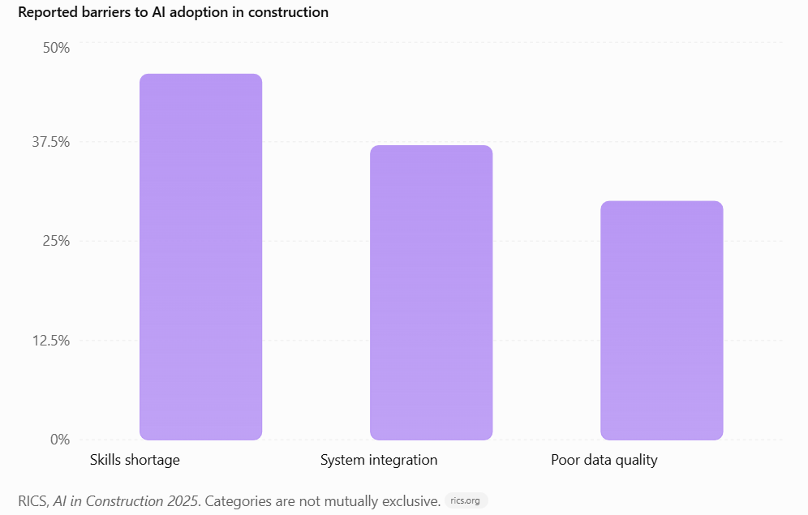
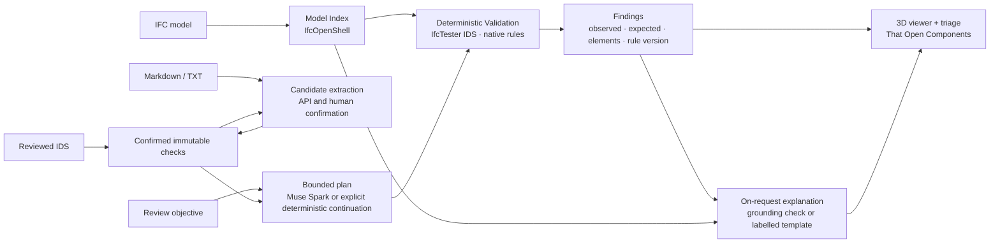
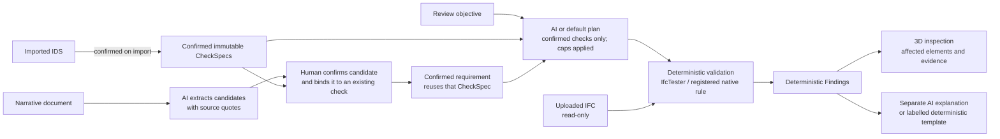

<div align="center">
  

**AI-native AEC model review, with deterministic evidence at its core.**

An AI-native BIM review system combining IFC analysis, buildingSMART IDS validation and deterministic checking with intelligent review workflows. Identify model deficiencies, examine affected building elements in 3D, and trace findings to their source requirements and supporting evidence.

[](https://github.com/natnew/BIM-Intelligence/actions/workflows/ci.yml)
[](https://github.com/natnew/BIM-Intelligence/releases)
[](./LICENSE)

[Get Started](#local-setup) | [Example Workflow](#intended-user-workflow) | [Tool](#technology-stack) | [Documentation](#documentation)


</div>

# BIM-Intelligence

**BIM Intelligence is an experimental AEC model-review application.** It helps an Architect or BIM
Coordinator compare one IFC model with confirmed information requirements, investigate
deterministic findings in 3D and request a separately labelled explanation.

> **Development status: pre-alpha; not release-approved.** The browser includes guided review
> objectives, model and finding investigation, recent sessions and an explanation interface. In
> one owner-approved synthetic [VERIFY-010 live acceptance run](./docs/EVALUATION.md#verify-010-live-planning-and-grounded-explanation-3-november-2026),
> Muse Spark selected a confirmed check and returned a grounded explanation. The preceding
> VERIFY-009 run failed at explanation generation; one subsequent pass does not establish
> reliability across models or objectives. Hosted CI, report export, the benchmark browser smoke,
> a recorded demonstration and submission checks remain outstanding. Federation and clash
> detection are not integrated. See [Development status](#development-status).

Designed for the Meta Global AI Developer Hackathon (26 October – 4 November 2026), the application
uses Meta Muse Spark through the Meta Model API for authorised Live planning and explanation;
Off and Replay modes do not make a live request.

---

## The professional problem

Before an architectural model is issued, someone has to confirm that it carries the information the project demands: the right property sets, agreed naming, correct classification codes, a valid spatial structure. Those demands live in prose — BIM Execution Plans and Exchange Information Requirements — and have to be turned into checks by hand. Checker output then arrives as hundreds of unexplained flags that a coordinator must triage without a clear line back to the clause that caused each one.

BIM Intelligence targets that gap for Architects, BIM Managers and BIM Coordinators.

Research in [Awesome AI for AEC Delivery](https://github.com/natnew/Awesome-AI-for-AEC-Delivery),
a curated collection of AI tools, platforms, datasets, research and standards for the AEC lifecycle,
supported the development of this project.



Owner-supplied graphic; cited sources are Autodesk, Springer Nature Link and RICS. The numerical
claims have not been independently checked.



Owner-supplied graphic; cited source: RICS, AI in Construction 2025. The numerical claims have not
been independently checked; categories are not mutually exclusive.

## Core innovation

- **Findings are deterministic.** IfcTester or a registered, versioned native rule creates each
  `Finding`; the language model cannot create one or declare compliance.
- **Muse Spark assists interpretation.** It can propose a plan over confirmed checks and draft an
  explanation from finding evidence. The backend also supports quote-verified narrative
  requirement candidates, although their confirmation workflow is not exposed in the browser.
- **Explanations are separate from findings.** The application validates the response and checks
  its citations and bounded identifiers against deterministic evidence. A failed or unavailable
  explanation becomes a labelled deterministic template. This grounding check is not a guarantee
  that every sentence is semantically correct.
- **Only confirmed requirements execute.** IDS specifications are confirmed on import, so the
  reviewer must check their suitability first. Narrative candidates require explicit human
  confirmation and can only reuse an existing confirmed `CheckSpec`.

## High-level architecture



A single Python (FastAPI) backend and a single-page TypeScript frontend; no microservices, queues or databases in the MVP. Full design: [docs/ARCHITECTURE.md](./docs/ARCHITECTURE.md).

## How requirement confirmation and verification work

BIM Intelligence separates requirement interpretation from model verification. An imported IDS is treated as a confirmed project specification. Requirements interpreted from narrative documents remain candidates until a person confirms them; a confirmed candidate can bind only to an existing confirmed, immutable `CheckSpec`. For a review objective, AI may propose a bounded plan, but the application checks it against confirmed checks and execution caps. A person does not need to approve every individual plan.



Only IfcTester or a registered native rule creates a `Finding`; AI explanations are separate, grounded outputs and never become findings. Review runs read the uploaded IFC but do not modify or re-save it.

- **Implemented:** IDS import, bounded review execution, deterministic findings, guided browser
  planning, on-request explanations and 3D inspection. Narrative extraction and confirmation are
  backend endpoints, not a complete browser workflow.
- **Evidence:** Fake/Replay and stubbed-provider tests cover safety paths. One authorised synthetic
  live plan and grounded explanation passed on the current source baseline; broader reliability,
  narrative extraction and integrated Replay behaviour remain unverified. `LLM_MODE=off` is the
  default.

These boundaries are recorded in [ADR-001](./docs/DECISIONS.md#adr-001-findings-are-deterministic-the-llm-never-asserts-model-facts), [ADR-008](./docs/DECISIONS.md#adr-008-human-confirmation-of-extracted-requirements), [ADR-015](./docs/DECISIONS.md#adr-015-contract-model-immutable-checkspec-content-addressed-finding-per-check-checkresult), [ADR-018](./docs/DECISIONS.md#adr-018-ids-import-establishes-confirmed-requirements-checks-are-hydrated-per-run-reviews-run-under-the-session-lock) and [ADR-020](./docs/DECISIONS.md#adr-020-t-5-meta-client-spend-ledger-and-human-gates).

## Technology stack

| Layer | Choice | Why |
|---|---|---|
| LLM | Meta **Muse Spark** (`muse-spark-1.3`) via the **Meta Model API**, called with the OpenAI Python SDK (`base_url=https://api.meta.ai/v1`) | Standard-mode provider; one authorised synthetic live planning and grounded-explanation workflow passed |
| BIM processing | **IfcOpenShell** 0.9, **IfcTester** 0.9 (IDS 1.0) | Implemented IFC ingestion and deterministic IDS/native validation |
| Backend | **Python 3.12**, **FastAPI**, **Pydantic v2**, **pytest** | Typed schemas shared with the frontend; synchronous review routes with explicit loading and result states |
| Frontend | **React**, **TypeScript**, **Three.js**, **That Open Components** 3.6 (`web-ifc`) | Browser-side IFC Fragments viewer with GlobalId selection and deterministic finding highlights |
| Evaluation | Synthetic benchmark generated with `ifcopenshell.api`, defect injection, replayable LLM recordings | Reproducible synthetic precision/recall and offline grounding-contract checks without API spend |

Verified versions and sources: [docs/ARCHITECTURE.md — Appendix B](./docs/ARCHITECTURE.md#appendix-b--verified-technology-facts-26-october-2026-viewer-packages-checked-29-october-2026).

IfcClash is not importable locally. `bcf-client` is installed as an IfcTester transitive
dependency, not used as a first-party application feature; its redistribution terms are unresolved.
Neither establishes an implemented clash or BCF workflow.

## Intended user workflow

1. **Create or reopen a session.** Upload one IFC and an appropriate IDS. Markdown and TXT can
   also be stored as source documents; PDF upload is not implemented.
2. **Review the requirements.** Imported IDS specifications become confirmed checks immediately.
   The browser lists them; narrative-candidate confirmation is currently an API-only workflow.
3. **Choose scope and an objective.** Select all confirmed requirements or a subset, optionally
   describe the objective, and request an AI review. Muse can select only the confirmed checks.
4. **Inspect the result.** The synchronous run records the plan source, check coverage and
   deterministic findings. Skipped, errored or inapplicable checks are not a compliance pass.
5. **Investigate in 3D.** Select a finding or element, inspect observed and expected evidence, and
   use Focus, Fit or Reset. Request an explanation explicitly; its AI or template source is shown.
6. **Handle failure deliberately.** If strict AI planning fails, retry or choose **Continue without
   AI**; the latter runs the selected checks without claiming to fulfil an unsupported objective.
   Complete report export is not yet available.

## Development status

| Area | Status |
|---|---|
| Architecture, requirements, decisions, delivery plan, evaluation design, risks, demo plan | Written — see [docs/](./docs) |
| Repository foundation: Python/FastAPI, Vite/React frontend, health panel and CI | **Done (Day 2)** — end-to-end review and AI-assisted workflows remain in progress |
| Domain schemas (`Finding`, `CheckSpec`, `Requirement`, `CheckResult`, `ReviewRun`, …), generated TypeScript contract, reproducible minimal IFC/IDS fixture | **Done (Day 2, T-0)** — see [ADR-015](./docs/DECISIONS.md#adr-015-contract-model-immutable-checkspec-content-addressed-finding-per-check-checkresult) |
| IFC ingestion: session store, read-only IFC loading and Model Index, `sessions` / `model` / `elements` endpoints with RFC 9457 errors | **Done (Day 3, T-1)** — tested on the minimal fixture and in-memory variants only; see [ADR-016](./docs/DECISIONS.md#adr-016-ingestion-contract-staged-upload-content-hash-etag-and-identifier-handling) |
| Deterministic IDS validation: IDS 1.0 import as confirmed requirements, per-check IfcTester execution, `Finding` / `CheckResult` normalisation, synchronous review run, `documents` / `requirements` / `reviews` / `findings` endpoints | **Done (Day 4, T-2)** — when both minimal-fixture IDS checks execute, they produce the two expected findings with byte-identical `findings.json` across repeated runs; see [ADR-018](./docs/DECISIONS.md#adr-018-ids-import-establishes-confirmed-requirements-checks-are-hydrated-per-run-reviews-run-under-the-session-lock) |
| T-3 viewer: local IFC rendering, GlobalId selection, version-pinned findings and element details | **Verified on the minimal fixture** — see [T-3 evidence](./docs/IMPLEMENTATION_PLAN.md#t-3--interactive-3d-bim-viewer) |
| T-4 deterministic review workflow: bounded default plan, explicit native classification-consistency check, pinned run and viewer hand-off | **Verified on the minimal fixture** — no LLM calls; T-6 has a local synthetic benchmark result, with hosted CI evidence outstanding |
| T-5 offline AI interfaces: quote-verified TXT/Markdown candidates, bounded objective planning, grounded explanations, Fake/Replay clients and persistent spend safeguards | **Implemented and offline-tested** — only existing confirmed CheckSpecs can be selected; full BEP-to-IDS authoring is out of scope |
| Meta API compatibility and integrated frontend AI panels | **Implemented; one synthetic live acceptance passed** — VERIFY-009 failed at explanation generation; VERIFY-010 subsequently passed live planning and grounding on the current source baseline. This does not establish general reliability or complete M2. |
| T-6 synthetic benchmark | **Measured locally** — 15 independently labelled P0 defects, seven clean controls; 1.000 precision/recall/F1 on this narrow IFC4 benchmark, byte-identical repeated findings and 14/14 IfcTester IDS entity agreement. This is not a general BIM accuracy or live model-quality result; hosted CI remains outstanding. See [docs/EVALUATION.md](./docs/EVALUATION.md). |
| T-7 product integration | **In progress** — Project Home, guided objectives, explanations, browser-local recent sessions and Fit/Reset/Focus are merged. Report export, one-click sample loading, the benchmark browser smoke and demo acceptance remain outstanding. |
| Federation and clash detection | **Feasibility only** — the synthetic FED-001 test harness exercises geometric intersection and alignment; there is no integrated two-model application, result matrix or federated viewer. A demonstration remains conditional on all delivery gates. |
| Hackathon rule verification | Outstanding (see [docs/REQUIREMENTS.md — Open items](./docs/REQUIREMENTS.md#7-open-items)) |

**Source baseline, 3 November 2026:** merged `main`
`588e6adf9ca71079eadc0e5b33422dc6605df743` is the candidate used by VERIFY-010. The recorded
FIX-003 offline suites passed 659 backend tests, with one live test skipped, and 150 frontend
tests on a pre-merge working tree based on `b95dadbe2d0475aa3c107227a9d0af2cae2c2c47`; they
were not freshly run on the final source SHA. The live acceptance was one synthetic scenario.
The hosted main workflow failed before jobs started, and this is **not release or submission
approval**. See [evaluation evidence](./docs/EVALUATION.md#8-results) and the
[demo plan](./docs/DEMO_PLAN.md).

## Development roadmap

See the authoritative [implementation plan](./docs/IMPLEMENTATION_PLAN.md), [changelog](./CHANGELOG.md) and [consolidated architecture review](./docs/BAKEOFF_ARCHITECTURE_REVIEW.md). M0–M4 are delivery milestones; T-0–T-8 are engineering tasks that contribute to one or more milestones, with T-1.1 as a corrective subtask. Read the mapping and task register before taking implementation work.

The owner-directed internal completion target is 3 November 2026; the submission date remains
4 November. The conditional scope, cutoff and delivery evidence are in
[docs/FINAL_48_HOUR_PLAN.md](./docs/FINAL_48_HOUR_PLAN.md). Neither T-7/M3 nor T-8/M4 is complete.

## Repository layout

| Path | Purpose |
|---|---|
| `backend/bim_intelligence/` | Python API, AI orchestration and BIM validation (installed from the root `pyproject.toml`) |
| `frontend/` | Interactive BIM review interface (Vite, React, TypeScript) |
| `tests/` | Unit, scenario and evaluation tests; small IFC/IDS fixtures |
| `datasets/` | Synthetic and permitted IFC test models with their requirement artefacts |
| `docs/` | Technical architecture, decisions and engineering plans |
| `.github/` | CI workflows, PR template and Dependabot configuration |
| `hackathon-private/` | Untracked event documents and project briefs (git-ignored) |
| `AGENTS.md` | Engineering rules for human and AI contributors |
| `.env.example` | Configuration variable names without secret values |

## Local setup

Recorded local checks used Windows, Python 3.12.12 and Node.js 24.19.0. The documentation
reconciliation checked the existing environment and a locked-install dry run, not a fresh clone or
installation. The repository was private at the latest visibility check.

**Prerequisites:** Python **3.10–3.12** (the project's adopted range); Node.js 20.19 or later in
the 20.x series, or 22.12 or later in the 22.x series. Node.js 24.19.0 was used for the recorded
local checks. A Meta Model API key is optional for the deterministic pipeline and required only
for an authorised Live session.

```bash
git clone https://github.com/natnew/BIM-Intelligence.git
cd BIM-Intelligence
cp .env.example .env            # LLM_MODE=off by default; Live requires explicit approval and opt-in

# Backend (from the repository root)
python -m venv .venv
# Windows: .venv\Scripts\activate   macOS/Linux: source .venv/bin/activate
pip install -e ".[dev]"
uvicorn bim_intelligence.api.main:app --reload --app-dir backend --host 127.0.0.1 --port 8000
# → http://127.0.0.1:8000/api/v1/health  and  /api/v1/docs

# Frontend (second terminal)
cd frontend
npm ci
npm run dev                     # http://localhost:5173, proxies /api to :8000
# If port 8000 is taken, start uvicorn on another port and set BIMI_API_ORIGIN, e.g.
# BIMI_API_ORIGIN=http://127.0.0.1:8001 npm run dev
```

In Windows PowerShell, use `Copy-Item .env.example .env` and
`.\.venv\Scripts\Activate.ps1` in place of the corresponding shell commands above.
Configuration variables are documented in [.env.example](./.env.example). The server refuses to
bind to a non-loopback address unless `ALLOW_REMOTE=true`, and rejects `-contributor` model ids
unless `ALLOW_CONTRIBUTOR_MODELS=true`.

### Configure an authorised Live demonstration

Obtain explicit owner approval for the particular session and use only synthetic or otherwise
authorised inputs. In the ignored backend `.env`, set `LLM_MODE=live`,
`ALLOW_LIVE_LLM=true` and `LLM_MODEL=muse-spark-1.3`; provide `MODEL_API_KEY` privately through
that file or the backend process environment. Never put a key in a command, screenshot or
repository file. Restart the backend after changing settings and confirm the displayed mode; the
health response does not test provider availability. The configuration switches are not approval
for a paid request.

Planning can send the objective, model summary and requirement metadata; an explicitly requested
explanation can also send selected element properties and finding evidence. The IFC file itself
is not sent. Do not send private project data without separate owner approval and applicable data
rights. Review the configured prices before use. The application reserves against a two-call
review cap, USD 0.10 per call and per review, and a USD 5 project ledger; these are application
controls, not provider-enforced billing limits. See [ADR-020](./docs/DECISIONS.md#adr-020-t-5-meta-client-spend-ledger-and-human-gates).

### Available sample inputs

The committed, executable synthetic pair is
[`tests/fixtures/minimal.ifc`](./tests/fixtures/minimal.ifc) and
[`tests/fixtures/minimal.ids`](./tests/fixtures/minimal.ids). Upload both manually; the IDS review
has two known findings when both imported checks execute. The separate
[synthetic benchmark](./docs/EVALUATION.md#7-reproduction)
is generated locally and is not a one-click browser sample. The `examples/` collections contain
descriptions, draft IDS files and other assets, but no tracked IFC models or verified one-click
catalogue; their source and redistribution rights need review.

### Review a model in the browser

With both servers running, open <http://localhost:5173>. The Project Home offers **New review**,
which creates a session on the server and walks through uploading one `.ifc` model and optional
`.ids`, `.md` or `.txt` requirement documents (IDS specifications become executable requirements;
Markdown/text is stored as source only), then opens the review workspace. **Open an existing session** accepts a session id (and optionally
a run id); `?session_id=…&run_id=…` deep links work the same way. Project Home can also reopen
up to eight recent sessions remembered in this browser and revalidated against the server. In the
workspace, choose the confirmed-check scope and **Run AI Review**. In Off mode or after another
planning failure, use the explicit **Continue without AI** action for a deterministic review.
Select a finding to highlight its element, or click an element to inspect its properties and
linked findings. A
session without confirmed executable requirements can be viewed but cannot run a review, and a run
recorded against a different model version is shown as a mismatch rather than loaded. Only
`.ifc` models are ingested; RVT, NWD and PDF files are rejected. Verified on 30 October 2026 with
the committed fixtures (see [docs/UI_CHANGELOG.md](./docs/UI_CHANGELOG.md), UI-003).

### Upload and inspect a model

With the backend running, the ingestion endpoints can be exercised from a shell (run on 28 October 2026 against the committed fixture):

```bash
BASE=http://127.0.0.1:8000/api/v1
SID=$(curl -s -X POST $BASE/sessions | python -c "import json,sys; print(json.load(sys.stdin)['id'])")
curl -s -F "file=@tests/fixtures/minimal.ifc" $BASE/sessions/$SID/model
# {"ifc_schema":"IFC4","model_hash":"f2bd0007…","project_name":"Minimal Project",
#  "counts":{"IfcBuilding":1,"IfcBuildingStorey":1,"IfcSite":1,"IfcWall":3},"storeys":[…]}
curl -s $BASE/sessions/$SID/elements/21KH8X9wHPWw7JLiY2NtSZ    # W-001: psets, classification, container
curl -fsS -D - $BASE/sessions/$SID/model/summary | grep -i '^etag:' # ETag: "<sha256 of the stored bytes>"
```

Uploads are stored byte-for-byte under `DATA_DIR/sessions/<uuid>/models/<sha256>/model.ifc` (git-ignored) beside the index and summary built from those bytes, capped at `MAX_IFC_MB`, and made active by a single atomic write of the session record, so no read can mix two model versions ([ADR-017](./docs/DECISIONS.md#adr-017-content-addressed-model-versions-with-single-pointer-publication)). Every model read carries `ETag` = the version's quoted SHA-256 and honours `If-Match`. Errors are `application/problem+json`; the full surface is in [docs/ARCHITECTURE.md §11](./docs/ARCHITECTURE.md#11-api-architecture-and-principal-endpoints).

### Import an IDS and run a deterministic review

Continuing in the same session (run on 29 October 2026 against the committed fixtures):

```bash
curl -s -F "file=@tests/fixtures/minimal.ids" $BASE/sessions/$SID/documents
# 201 {"sha256":"e602233d…","kind":"ids","title":"BIM Intelligence minimal fixture",
#      "requirements":[{"id":"REQ-001","title":"External walls carry a fire rating","status":"confirmed",
#                       "check":{"id":"bca0b103d592b6d2","kind":"ids","rule_id":"ids:External walls carry a fire rating",…}},
#                      {"id":"REQ-002","title":"Walls carry a classification reference",…}]}
RUN=$(curl -s -X POST $BASE/sessions/$SID/reviews | python -c "import json,sys; print(json.load(sys.stdin)['id'])")
curl -s $BASE/sessions/$SID/reviews/$RUN
# {"status":"completed","plan_source":"default",
#  "check_results":[{"check_id":"bca0b103d592b6d2","requirement_id":"REQ-001","status":"failed","applicable_count":2,"finding_ids":["3473dbb1b87e93bd"],…},
#                   {"check_id":"4f00f7fd6f41e4a6","requirement_id":"REQ-002","status":"failed","applicable_count":3,"finding_ids":["e062895b2cf67af1"],…}],
#  "input_manifest":{"model_hash":"f2bd0007…","ids_hashes":["e602233d…"],"requirement_revisions":{"REQ-001":1,"REQ-002":1},…},…}
curl -s "$BASE/sessions/$SID/findings?run_id=$RUN"
# [{"id":"e062895b2cf67af1","requirement_id":"REQ-002","category":"classification_requirement",
#   "elements":[{"global_id":"2qvnbd6oPPKR1ac5HegGTJ","express_id":79,"ifc_type":"IfcWall","name":"W-003","storey":"L00"}],
#   "observed":"The entity has no classification","expected":"Shall be classified using Uniclass 2015","method":"ids",…},
#  {"id":"3473dbb1b87e93bd","requirement_id":"REQ-001","category":"property_requirement",
#   "elements":[{"global_id":"0QWMtUzsnUUONCUGc8Sqsa","express_id":59,"ifc_type":"IfcWall","name":"W-002","storey":"L00"}],
#   "observed":"The property set does not contain the required property",
#   "expected":"FireRating data shall be provided in the dataset Pset_WallCommon","method":"ids",…}]
```

Each `<specification>` of the IDS becomes a confirmed `Requirement` bound to an immutable, content-addressed `CheckSpec`. The default plan deduplicates confirmed checks in stable order and applies `MAX_PLAN_CHECKS` and `MAX_TOOL_CALLS_PER_RUN`; skipped, errored or not-applicable checks make the run `partial`. Findings have no timestamps, so `findings.json` is byte-identical across repeated runs over the same inputs. This deterministic path makes no model-provider request ([ADR-018](./docs/DECISIONS.md#adr-018-ids-import-establishes-confirmed-requirements-checks-are-hydrated-per-run-reviews-run-under-the-session-lock)).

For the built-in P0 check that IDS 1.0 cannot express, explicitly add the parameter-free native classification-consistency requirement with `POST /sessions/$SID/requirements/native/classification-consistency`. In the browser, open the session from Project Home and select **Run AI Review**; if planning is unavailable, choose **Continue without AI** to run the selected checks. The model-version-pinned run and per-check coverage appear beside the viewer. The registered rule is `classification.consistent_by_type` v1.0.0. IDS continues to check classification presence/system, required properties and expressible naming patterns; no P1/P2 native rules are included. IDS boolean values should be written in lower case (`true`/`false`); see [RISKS.md R-DEP-08](./docs/RISKS.md).

## Testing

```bash
# Backend, from the repository root (no API calls in the default run)
ruff check . && ruff format --check .
mypy
pytest

# Frontend
cd frontend
npm run lint && npm run format:check && npm run typecheck
npm run types:check             # generated contract types are current (ADR-014)
npm test
npm run build
cd ..

# Secret scanning (requires Gitleaks CLI; all findings are redacted)
python scripts/secret_scan.py --staged   # staged changes, also used by .githooks/pre-commit
python scripts/secret_scan.py --working-tree # tracked and untracked non-ignored files
python scripts/secret_scan.py            # full repository Git history

# Regenerate committed artefacts after changing them (then re-run the checks above)
python scripts/export_schemas.py          # Pydantic schemas → frontend/src/api/generated/*.schema.json
(cd frontend && npm run types:generate)   # JSON Schema → frontend/src/api/generated/types.ts
python tests/fixtures/make_minimal_ifc.py # tests/fixtures/minimal.ifc + minimal.ids (byte-reproducible)

# Offline synthetic benchmark (generates ignored data/results; no network or Meta API calls)
python -c "import sys; sys.path.insert(0, 'tests'); from evaluation.run_eval import main; raise SystemExit(main())"
python -m pytest tests/unit/evaluation tests/evaluation/test_run_eval.py -q

# Evaluation results, scope and known gaps: docs/EVALUATION.md
BIMI_LIVE_LLM=1 BIMI_LIVE_APPROVAL=T5-META-MUSE-SPARK-SMOKE pytest tests/live/test_meta_smoke.py -m live
```

The live command is an exact one-request smoke test, not general authorisation. It additionally requires `LLM_MODE=live`, `ALLOW_LIVE_LLM=true`, a backend `MODEL_API_KEY` (read from the shell environment or the git-ignored `.env` in the working directory; never pass the key on the command line), and sufficient remaining application budget. Do not run it until the project owner approves that session. The repository-local staged hook at `.githooks/pre-commit` is enabled through the repository-local `core.hooksPath` setting and runs the redacted staged Gitleaks scan. This setting overrides the prior global hook path for this repository; the project owner approved that change. The hook was verified against an empty index (no staged files). The same test, lint and type-check commands run in CI on Ubuntu and Windows ([.github/workflows/ci.yml](./.github/workflows/ci.yml)). Evaluation design, metrics and thresholds: [docs/EVALUATION.md](./docs/EVALUATION.md).

## Documentation

| Document | Purpose |
|---|---|
| [docs/ARCHITECTURE.md](./docs/ARCHITECTURE.md) | Full technical architecture (20 sections, diagrams) |
| [docs/REQUIREMENTS.md](./docs/REQUIREMENTS.md) | Functional and non-functional requirements with traceability ids |
| [docs/DECISIONS.md](./docs/DECISIONS.md) | Architectural decision records and open questions |
| [docs/IMPLEMENTATION_PLAN.md](./docs/IMPLEMENTATION_PLAN.md) | Ten-day schedule, milestones, critical path, scope reduction |
| [docs/EVALUATION.md](./docs/EVALUATION.md) | Benchmark design, metrics, reproduction |
| [docs/RISKS.md](./docs/RISKS.md) | Risk register |
| [docs/DEMO_PLAN.md](./docs/DEMO_PLAN.md) | Three-minute demo storyline and fallbacks |
| [docs/FINAL_48_HOUR_PLAN.md](./docs/FINAL_48_HOUR_PLAN.md) | Final delivery dependencies, conditional gates, owners and release checklist |
| [docs/UI_SPEC.md](./docs/UI_SPEC.md) | Owner-directed UI specification, protected behaviour and visual verification process |
| [docs/UI_REFERENCES.md](./docs/UI_REFERENCES.md) | Owner-supplied UI reference and feedback register |
| [docs/UI_CHANGELOG.md](./docs/UI_CHANGELOG.md) | Append-only UI iteration decisions and evidence |
| [AGENTS.md](./AGENTS.md) | Engineering rules for human and AI contributors |
| [frontend/AGENTS.md](./frontend/AGENTS.md) | Mandatory guardrails for AI agents changing frontend UI |

## Hackathon context

Developed for the Meta Global AI Developer Hackathon, 26 October – 4 November 2026. The
authorised VERIFY-010 synthetic workflow exercised Muse Spark planning and a grounded explanation;
the official event rules and eligibility remain unverified. Any additional live call requires
separate explicit owner approval.

## Limitations

- The browser handles one IFC and IDS/Markdown/TXT source documents. Narrative-candidate
  confirmation, PDF upload, report export and a one-click sample are not implemented in the
  browser. Federation, multidisciplinary clash detection, voice input and image analysis are not
  integrated.
- One successful synthetic live scenario does not establish provider availability, planning
  relevance across objectives or the accuracy of explanation prose. Unsupported objectives and
  failed requests are surfaced rather than silently broadened.
- Detection coverage is bounded by the rule library and IDS facets; the system does not "notice" defect types it has no rule for.
- The ≥ 90 % precision and recall target was met on the 15-instance synthetic IFC4 benchmark; this small result is scoped to its labelled defects and does not establish accuracy on other models or live Muse Spark quality. See [docs/EVALUATION.md](./docs/EVALUATION.md#8-results).
- No authentication or verified hosted deployment; the current repository is private and public
  access requires an owner decision.

## Attribution and licences

Project code is released under the [MIT License](./LICENSE).

| Dependency | Licence | Note |
|---|---|---|
| IfcOpenShell, IfcTester | LGPL-3.0-or-later | Used as installed packages; no source vendored (IfcTester classifier to be confirmed) |
| IfcClash | Not importable locally | Optional candidate; verify package/version and licence before any approved addition |
| `bcf-client` | Unverified | Version 0.9.0 is a local IfcTester transitive dependency; resolve its conflicting licence metadata before redistributing an installed environment. See [third-party notices](./THIRD_PARTY_NOTICES.md). |
| That Open Components (`@thatopen/*`) | MIT | |
| Three.js | MIT | |
| `web-ifc` 0.0.77 | MPL-2.0 | Required by the selected IFC viewer stack. This is an exception to the repository's permissive-or-LGPL dependency preference; no source is vendored. Review the [upstream project](https://github.com/ThatOpen/engine_web-ifc) before distributing builds. |
| FastAPI, Pydantic, React, Vite | MIT | |
| xmlschema | MIT | Loads IfcTester's bundled IDS 1.0 XSD with remote imports disabled ([ADR-018](./docs/DECISIONS.md#adr-018-ids-import-establishes-confirmed-requirements-checks-are-hydrated-per-run-reviews-run-under-the-session-lock)) |
| buildingSMART IDS schema | See [buildingSMART/IDS](https://github.com/buildingSMART/IDS) | Standard reference only |

Meta, Muse and the Meta Model API are trademarks of Meta Platforms, Inc. Autodesk Revit,
Navisworks, Solibri and BIMcollab are referenced as prior art only. Distribution-specific
dependency notices and outstanding asset-rights checks are listed in
[THIRD_PARTY_NOTICES.md](./THIRD_PARTY_NOTICES.md).
