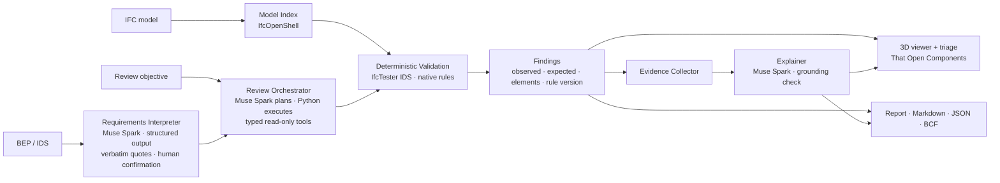

# BIM-Intelligence

**AI-native architectural BIM model review.** Upload an IFC model and your project's BIM Execution Plan, state what you want reviewed in plain language, and get deterministic, traceable findings — explained in context, highlighted in 3D, and exported as a review report.

> **Development status: architecture phase.** This repository currently contains the engineering design and plan only. No application code has been written, and no capability described below has been implemented or measured. See [Development status](#development-status).

Built for the Meta Global AI Developer Hackathon (26 October – 4 November 2026) using Meta Muse Spark via the Meta Model API.

---

## The professional problem

Before an architectural model is issued, someone has to confirm that it carries the information the project demands: the right property sets, agreed naming, correct classification codes, a valid spatial structure. Those demands live in prose — BIM Execution Plans and Exchange Information Requirements — and have to be turned into checks by hand. Checker output then arrives as hundreds of unexplained flags that a coordinator must triage without a clear line back to the clause that caused each one.

BIM Intelligence targets that gap for Architects, BIM Managers and BIM Coordinators.

## Core innovation

Most AI-in-BIM demonstrations put a language model in front of model data and ask it what is wrong. We do the opposite:

- **Findings are deterministic.** Every defect is produced by IfcTester (buildingSMART IDS) or a versioned Python rule. The model never asserts a model fact.
- **The model works on the parts that are genuinely linguistic:** reading the BEP into candidate requirements (with verbatim source quotes), turning a plain-language objective into a bounded review plan, and explaining findings from a structured evidence bundle.
- **Every explanation is grounded by a deterministic check** against that evidence before it is shown, and is labelled as AI-generated.
- **Nothing runs on an unconfirmed requirement.** A human confirms, edits or rejects each extracted requirement before it becomes a check.

The result is intended to be an assistant that behaves like a careful coordinator: it reads the project's own rules, runs the right checks, shows you the affected elements, and tells you why — without inventing anything.

## High-level architecture



A single Python (FastAPI) backend and a single-page TypeScript frontend; no microservices, queues or databases in the MVP. Full design: [docs/ARCHITECTURE.md](./docs/ARCHITECTURE.md).

## Technology stack

| Layer | Choice | Why |
|---|---|---|
| LLM | Meta **Muse Spark** (`muse-spark-1.3`) via the **Meta Model API**, called with the OpenAI Python SDK (`base_url=https://api.meta.ai/v1`) | Tool calling, JSON-schema structured output, 1M-token context; Standard mode does not train on submitted content |
| BIM processing | **IfcOpenShell** 0.9, **IfcTester** 0.9 (IDS 1.0), optional `ifcclash`, `bcf-client` | Reference openBIM tooling, pip-installable |
| Backend | **Python 3.12**, **FastAPI**, **Pydantic v2**, **pytest** | Typed schemas shared with the frontend; simple async API with SSE progress |
| Frontend | **React**, **TypeScript**, **Three.js**, **That Open Components** 3.6 (`web-ifc`) | MIT-licensed IFC viewer with Fragments pipeline and highlighting |
| Evaluation | Synthetic benchmark generated with `ifcopenshell.api`, defect injection, replayable LLM recordings | Reproducible precision/recall and grounding metrics without API spend |

Verified versions and sources: [docs/ARCHITECTURE.md — Appendix B](./docs/ARCHITECTURE.md#appendix-b--verified-technology-facts-26-october-2026).

## Intended user workflow

1. **Upload** an IFC (IFC2X3 or IFC4) and a simplified BEP (Markdown/TXT/PDF) and/or an IDS file.
2. **Confirm requirements** — review extracted candidates with their source quotes and compiled checks; confirm, edit or reject.
3. **State an objective** — e.g. "Check fire-rating and classification completeness on external walls and doors for Stage 4 issue."
4. **Watch the plan run** — the orchestrator selects checks from a bounded tool registry; progress streams live.
5. **Triage in 3D** — select a finding to highlight affected elements; see observed vs expected, the BEP quote and the grounded explanation.
6. **Export** a traceable report (requirement → rule → finding → element) with provenance.

## Development status

| Area | Status |
|---|---|
| Architecture, requirements, decisions, plan, evaluation design, risks, demo plan | Written — see [docs/](./docs) |
| Repository skeleton: Python project, FastAPI app with `/api/v1/health`, validated configuration, Vite/React frontend with a health panel, CI | **Done (Day 2)** — no review functionality yet |
| Domain schemas (`Finding`, `CheckSpec`, `Requirement`, `CheckResult`, `ReviewRun`, …), generated TypeScript contract, reproducible minimal IFC/IDS fixture | **Done (Day 2, T-0)** — see [ADR-015](./docs/DECISIONS.md#adr-015-contract-model-immutable-checkspec-content-addressed-finding-per-check-checkresult) |
| IFC ingestion: session store, read-only IFC loading and Model Index, `sessions` / `model` / `elements` endpoints with RFC 9457 errors | **Done (Day 3, T-1)** — tested on the minimal fixture and in-memory variants only; see [ADR-016](./docs/DECISIONS.md#adr-016-ingestion-contract-staged-upload-content-hash-etag-and-identifier-handling) |
| Validation rules, requirement extraction, orchestration, viewer, report | **Not started** |
| Benchmark and measured accuracy | **Not started** — no metrics exist yet |
| Hackathon rule verification | Outstanding (see [docs/REQUIREMENTS.md — Open items](./docs/REQUIREMENTS.md#7-open-items)) |

The ten-day schedule is in [docs/IMPLEMENTATION_PLAN.md](./docs/IMPLEMENTATION_PLAN.md).

## Repository layout

| Path | Purpose |
|---|---|
| `backend/bim_intelligence/` | Python API, AI orchestration and BIM validation (installed from the root `pyproject.toml`) |
| `frontend/` | Interactive BIM review interface (Vite, React, TypeScript) |
| `tests/` | Unit, scenario and evaluation tests; small IFC/IDS fixtures |
| `datasets/` | Synthetic and permitted IFC test models with their requirement artefacts |
| `docs/` | Technical architecture, decisions and engineering plans |
| `.github/` | CI workflows, PR template and Dependabot configuration |
| `hackathon-private/` | Untracked event documents and project briefs (git-ignored) |
| `AGENTS.md` | Engineering rules for human and AI contributors |
| `.env.example` | Configuration variable names without secret values |

## Local setup

Verified on Windows 11 with Python 3.12.12 and Node.js 24 (27 October 2026).

**Prerequisites:** Python **3.10–3.12** (IfcOpenShell publishes wheels for these versions only — Python 3.13+ will not install), Node.js 20+, a Meta Model API key for live LLM features (optional; the deterministic pipeline runs without one).

```bash
git clone https://github.com/natnew/BIM-Intelligence.git
cd BIM-Intelligence
cp .env.example .env            # edit MODEL_API_KEY if you want live LLM calls

# Backend (from the repository root)
python -m venv .venv
# Windows: .venv\Scripts\activate   macOS/Linux: source .venv/bin/activate
pip install -e ".[dev]"
uvicorn bim_intelligence.api.main:app --reload --app-dir backend --host 127.0.0.1 --port 8000
# → http://127.0.0.1:8000/api/v1/health  and  /api/v1/docs

# Frontend (second terminal)
cd frontend
npm install
npm run dev                     # http://localhost:5173, proxies /api to :8000
```

Configuration variables are documented in [.env.example](./.env.example). The server refuses to bind to a non-loopback address unless `ALLOW_REMOTE=true`, and rejects `-contributor` model ids unless `ALLOW_CONTRIBUTOR_MODELS=true`.

### Upload and inspect a model

With the backend running, the ingestion endpoints can be exercised from a shell (run on 28 October 2026 against the committed fixture):

```bash
BASE=http://127.0.0.1:8000/api/v1
SID=$(curl -s -X POST $BASE/sessions | python -c "import json,sys; print(json.load(sys.stdin)['id'])")
curl -s -F "file=@tests/fixtures/minimal.ifc" $BASE/sessions/$SID/model
# {"ifc_schema":"IFC4","model_hash":"f2bd0007…","project_name":"Minimal Project",
#  "counts":{"IfcBuilding":1,"IfcBuildingStorey":1,"IfcSite":1,"IfcWall":3},"storeys":[…]}
curl -s $BASE/sessions/$SID/elements/21KH8X9wHPWw7JLiY2NtSZ    # W-001: psets, classification, container
curl -sI $BASE/sessions/$SID/model/file | grep -i etag          # ETag: "<sha256 of the stored bytes>"
```

Uploads are stored byte-for-byte under `DATA_DIR/sessions/<uuid>/models/<sha256>/model.ifc` (git-ignored) beside the index and summary built from those bytes, capped at `MAX_IFC_MB`, and made active by a single atomic write of the session record, so no read can mix two model versions ([ADR-017](./docs/DECISIONS.md#adr-017-content-addressed-model-versions-with-single-pointer-publication)). Every model read carries `ETag` = the version's quoted SHA-256 and honours `If-Match`. Errors are `application/problem+json`; the full surface is in [docs/ARCHITECTURE.md §11](./docs/ARCHITECTURE.md#11-api-architecture-and-principal-endpoints).

## Testing

```bash
# Backend, from the repository root (no API calls in the default run)
ruff check . && ruff format --check .
mypy
pytest

# Frontend
cd frontend
npm run lint && npm run format:check && npm run typecheck
npm run types:check             # generated contract types are current (ADR-014)
npm test
npm run build
cd ..

# Regenerate committed artefacts after changing them (then re-run the checks above)
python scripts/export_schemas.py          # Pydantic schemas → frontend/src/api/generated/*.schema.json
(cd frontend && npm run types:generate)   # JSON Schema → frontend/src/api/generated/types.ts
python tests/fixtures/make_minimal_ifc.py # tests/fixtures/minimal.ifc + minimal.ids (byte-reproducible)

# Later in the plan (not yet implemented)
python tests/evaluation/run_eval.py --replay   # benchmark metrics from recorded LLM responses
BIMI_LIVE_LLM=1 pytest -m live                 # opt-in live API tests; requires key and spend approval
```

The same commands run in CI on Ubuntu and Windows ([.github/workflows/ci.yml](./.github/workflows/ci.yml)). Evaluation design, metrics and thresholds: [docs/EVALUATION.md](./docs/EVALUATION.md).

## Documentation

| Document | Purpose |
|---|---|
| [docs/ARCHITECTURE.md](./docs/ARCHITECTURE.md) | Full technical architecture (20 sections, diagrams) |
| [docs/REQUIREMENTS.md](./docs/REQUIREMENTS.md) | Functional and non-functional requirements with traceability ids |
| [docs/DECISIONS.md](./docs/DECISIONS.md) | Architectural decision records and open questions |
| [docs/IMPLEMENTATION_PLAN.md](./docs/IMPLEMENTATION_PLAN.md) | Ten-day schedule, milestones, critical path, scope reduction |
| [docs/EVALUATION.md](./docs/EVALUATION.md) | Benchmark design, metrics, reproduction |
| [docs/RISKS.md](./docs/RISKS.md) | Risk register |
| [docs/DEMO_PLAN.md](./docs/DEMO_PLAN.md) | Three-minute demo storyline and fallbacks |
| [AGENTS.md](./AGENTS.md) | Engineering rules for human and AI contributors |

## Hackathon context

Developed for the Meta Global AI Developer Hackathon, 26 October – 4 November 2026. The design uses Meta Muse Spark via the Meta Model API for planning, requirement interpretation and explanation. Event rules, judging criteria and submission constraints had not been verified at the time of writing and are tracked as open items.

## Limitations

- The MVP targets one architectural IFC, one simplified BEP and one IDS; multidisciplinary clash detection, voice input and image analysis are future work.
- Detection coverage is bounded by the rule library and IDS facets; the system does not "notice" defect types it has no rule for.
- Accuracy targets (≥ 90 % precision and recall on the labelled benchmark) are goals, not results, until published in [docs/EVALUATION.md](./docs/EVALUATION.md).
- No authentication or hosted deployment; local use only.

## Attribution and licences

Project code is released under the [MIT License](./LICENSE).

| Dependency | Licence | Note |
|---|---|---|
| IfcOpenShell, IfcTester, IfcClash, bcf-client | LGPL-3.0-or-later | Used as installed packages; no source vendored (IfcTester classifier to be confirmed) |
| That Open Components (`@thatopen/*`), `web-ifc`, Three.js | MIT | |
| FastAPI, Pydantic, React, Vite | MIT | |
| buildingSMART IDS schema | See [buildingSMART/IDS](https://github.com/buildingSMART/IDS) | Standard reference only |

Meta, Muse and the Meta Model API are trademarks of Meta Platforms, Inc. Autodesk Revit, Navisworks, Solibri and BIMcollab are referenced as prior art only; no proprietary code or assets are used.
