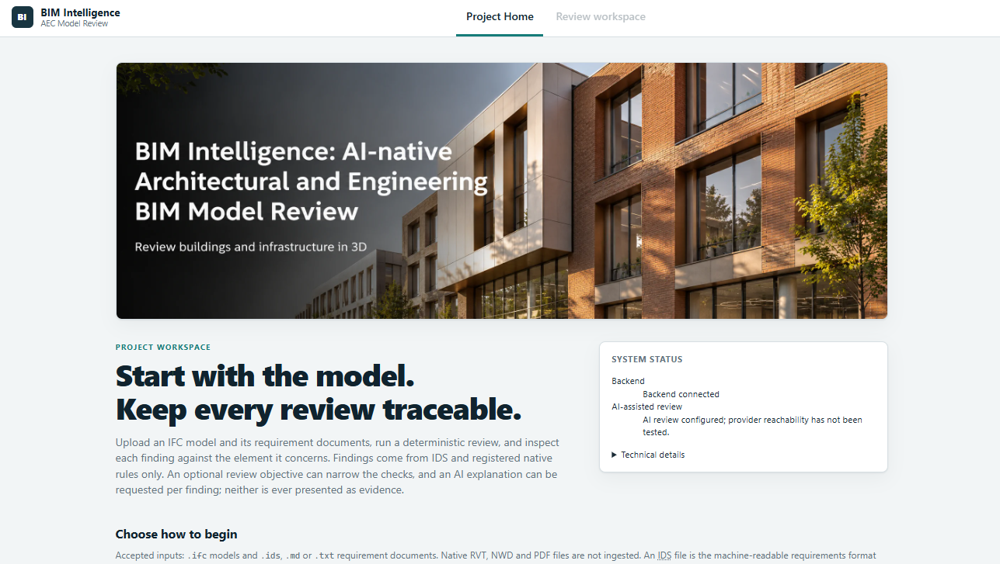
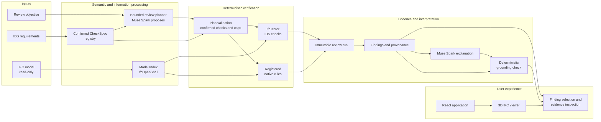

<div align="center">


# BIM Intelligence

**AI-native Architectural and Engineering BIM Model Review**

Review building information models against confirmed project requirements, identify information
deficiencies and investigate verified findings directly within a three-dimensional model.

_Meta Muse Spark assists review planning and evidence-grounded interpretation.<br>
Deterministic IFC validation establishes the findings._

[Overview](#what-bim-intelligence-does) · [How It Works](#how-it-works) · [Example Workflows](#example-workflows) · [Architecture](#architecture) · [Quick Start](#quick-start) · [Documentation](#documentation)

[](./LICENSE)



<sub>Project Home in the running application. The review workspace pairs the 3D viewer with requirements, findings and evidence.</sub>

</div>

> **Status:** experimental prototype built for the Meta Global AI Developer Hackathon
> (26 October – 4 November 2026). It is not release-approved; see
> [Status and limitations](#status-and-limitations).

---

## Why BIM Intelligence exists

Before a model is issued, architects, BIM managers and coordinators must confirm that it carries
the information the project requires: the right properties, agreed classifications and complete
element data. Those requirements are spread across an Information Delivery Specification (IDS), a
BIM Execution Plan (BEP), exchange requirements and other technical documents.

Checking them is repetitive, manual work across several disconnected tools. Checker output often
arrives as long lists of flags with no clear route back to the requirement that raised each one or
the element it concerns. A missing or wrongly populated property can quietly degrade information
quality and the technical decisions that depend on it downstream.

BIM Intelligence is designed to make that review faster to direct, easier to investigate and
traceable from requirement to element. It supports professional judgement; it does not establish
building safety or regulatory compliance.

## What BIM Intelligence does

BIM Intelligence connects six things that are usually handled separately:

- an uploaded **IFC building model**, read but never modified;
- **confirmed project information requirements**, imported from IDS;
- a **natural-language review objective**;
- **Muse Spark-assisted review planning**, restricted to confirmed, executable checks;
- **deterministic validation** with IfcTester and registered native Python rules; and
- **evidence-backed findings** inspected in an **interactive 3D viewer**, with **on-request,
  grounded AI explanations** kept separate from the findings themselves.

A reviewer uploads a model and its IDS, selects the confirmed requirements to review and describes
what they want to check. Muse Spark proposes a plan; the application accepts it only if every
proposed check is registered, confirmed and within execution limits. Deterministic engines then
run the checks and record each finding with the affected elements, expected and observed values and
the rule version. The reviewer selects a finding to highlight its element in 3D and may ask Muse
Spark to interpret it. That explanation is validated against the immutable evidence before it is
shown, and is always labelled separately from the finding.

The language model never creates a finding, performs the validation or declares compliance.

## Example workflows

Each example below uses the committed synthetic fixture
([`minimal.ifc`](./tests/fixtures/minimal.ifc) and [`minimal.ids`](./tests/fixtures/minimal.ids)).

| Professional task | User action | Application result |
|---|---|---|
| Verify required fire-rating information on walls | Import the IDS, select the fire-rating requirement and ask for a review of wall fire ratings | Muse Spark selects the confirmed check; IfcTester reports that wall **W-002** lacks `Pset_WallCommon.FireRating`, with expected and observed values |
| Identify missing classification references | Review the classification requirement | A deterministic finding identifies wall **W-003** as having no Uniclass 2015 classification |
| Review all confirmed requirements, or a subset | Choose the whole confirmed scope or individual requirements before running | A version-pinned run records the plan source, per-check coverage and every finding; skipped or inapplicable checks are reported, not treated as a pass |
| Investigate a finding and request an interpretation | Select the finding, inspect the highlighted element and request an explanation | A Muse Spark explanation that passes the grounding check, or a clearly labelled deterministic template if it does not |

These results show missing model information against a stated requirement. They are not evidence
of a fire-safety deficiency or a certification outcome.

Narrative requirement extraction from Markdown or TXT, with verbatim quotes and human confirmation,
is available through backend API endpoints; the complete browser workflow is not yet implemented.

## How it works

| Stage | What happens |
|---|---|
| **01 — Import** | Upload one IFC model and a reviewed IDS. Each IDS specification becomes a confirmed requirement bound to an immutable check. |
| **02 — Define** | Select the confirmed requirements in scope and describe the review objective in plain language. |
| **03 — Review** | Muse Spark proposes which checks to run. The application validates the plan, then executes it deterministically. |
| **04 — Investigate** | Inspect findings, affected elements and expected and observed values, with each element highlighted in 3D. |
| **05 — Interpret** | Request a grounded explanation with explicit provenance, or receive a labelled deterministic fallback. |

If AI planning is unavailable or fails, the reviewer can retry or choose **Continue without AI**.
That runs the selected checks deterministically, without claiming to fulfil the original objective.

## Architecture



The architecture separates **inference** from **verifiable execution**. Muse Spark works only at
two bounded points: proposing a plan over confirmed checks and interpreting a finding that already
exists. Everything that establishes a fact about the model — plan validation, IDS and native rule
execution, finding normalisation and grounding — is deterministic code. Review runs are pinned to
the model hash, requirement revisions and rule versions, and are published atomically, so an
explanation can never alter the findings it describes.

The system is one FastAPI process and one single-page frontend, with file-system storage and no
additional services, queues or databases. Full design:
[docs/ARCHITECTURE.md](./docs/ARCHITECTURE.md).

## Quick start

**Prerequisites:** Python 3.10–3.12 (3.12 recommended); Node.js 20.19+ (20.x) or 22.12+ (22.x).
No API key is required for the deterministic workflow.

```bash
git clone https://github.com/natnew/BIM-Intelligence.git
cd BIM-Intelligence
cp .env.example .env            # LLM_MODE=off by default

# 1. Install and start the backend (from the repository root)
python -m venv .venv
source .venv/bin/activate       # Windows PowerShell: .\.venv\Scripts\Activate.ps1
pip install -e ".[dev]"
uvicorn bim_intelligence.api.main:app --reload --app-dir backend --host 127.0.0.1 --port 8000

# 2. Install and start the frontend (second terminal)
cd frontend
npm ci
npm run dev                     # http://localhost:5173, proxies /api to :8000
```

On Windows PowerShell, use `Copy-Item .env.example .env` in place of `cp`. If port 8000 is in use,
start the backend on another port and set `BIMI_API_ORIGIN` (for example
`http://127.0.0.1:8001`) before `npm run dev`. API documentation is served at
<http://127.0.0.1:8000/api/v1/docs>.

**Run the deterministic example**

1. Open <http://localhost:5173> and choose **New review**.
2. Upload [`tests/fixtures/minimal.ifc`](./tests/fixtures/minimal.ifc) and
   [`tests/fixtures/minimal.ids`](./tests/fixtures/minimal.ids).
3. In the review workspace, keep both confirmed requirements in scope and select
   **Run AI Review**. In the default AI Off mode, choose **Continue without AI**.
4. Select each finding to highlight W-002 (missing fire rating) and W-003 (missing classification)
   in the viewer, and inspect their expected and observed values.

Requesting an explanation in Off mode returns a labelled deterministic template. Other input
formats: Markdown and TXT are stored as source documents; RVT, NWD and PDF files are rejected.

### Muse-assisted Live mode

Development defaults to **AI Off**, which makes no provider request. A genuine Muse-assisted
demonstration requires all of the following in the ignored backend `.env`: `LLM_MODE=live`,
`ALLOW_LIVE_LLM=true`, `LLM_MODEL=muse-spark-1.3` and a valid Meta Model API key in
`MODEL_API_KEY`. Never place a key in a command, screenshot or tracked file. Restart the backend
and confirm the displayed mode; the health check does not test provider availability.

Live requests are billed by Meta, so enable Live mode only with your own API key and budget, and
only send synthetic data or data you have the right to share with a third-party provider. Planning can send
the objective, a model summary and requirement metadata; an explanation can also send selected
element properties and finding evidence. The IFC file itself is not sent. The application reserves
against a two-call review cap, USD 0.10 per call and per review, and a USD 5 project ledger. These
are application safeguards, not provider-enforced billing limits
([ADR-020](./docs/DECISIONS.md#adr-020-meta-client-spend-ledger-and-live-mode-safeguards)). All
variables are documented in [`.env.example`](./.env.example).

<details>
<summary><strong>Exercise the API from a shell</strong></summary>

<br>

Recorded against the committed fixtures on 28–29 October 2026; responses are abbreviated.

```bash
BASE=http://127.0.0.1:8000/api/v1
SID=$(curl -s -X POST $BASE/sessions | python -c "import json,sys; print(json.load(sys.stdin)['id'])")
curl -s -F "file=@tests/fixtures/minimal.ifc" $BASE/sessions/$SID/model
# {"ifc_schema":"IFC4","model_hash":"f2bd0007…","project_name":"Minimal Project",
#  "counts":{"IfcBuilding":1,"IfcBuildingStorey":1,"IfcSite":1,"IfcWall":3},…}
curl -s -F "file=@tests/fixtures/minimal.ids" $BASE/sessions/$SID/documents
# 201 {"kind":"ids","requirements":[{"id":"REQ-001","title":"External walls carry a fire rating",
#      "status":"confirmed",…},{"id":"REQ-002","title":"Walls carry a classification reference",…}]}
RUN=$(curl -s -X POST $BASE/sessions/$SID/reviews | python -c "import json,sys; print(json.load(sys.stdin)['id'])")
curl -s "$BASE/sessions/$SID/findings?run_id=$RUN"
# [{"requirement_id":"REQ-002","elements":[{"name":"W-003",…}],
#   "observed":"The entity has no classification","expected":"Shall be classified using Uniclass 2015","method":"ids",…},
#  {"requirement_id":"REQ-001","elements":[{"name":"W-002",…}],
#   "observed":"The property set does not contain the required property",
#   "expected":"FireRating data shall be provided in the dataset Pset_WallCommon","method":"ids",…}]
```

Uploads are stored byte-for-byte under a content-addressed, session-scoped directory and published
by a single atomic write
([ADR-017](./docs/DECISIONS.md#adr-017-content-addressed-model-versions-with-single-pointer-publication)).
Model reads carry an `ETag` and honour `If-Match`; errors use `application/problem+json`. Findings
carry no timestamps, so `findings.json` is byte-identical across repeated runs over the same inputs
([ADR-018](./docs/DECISIONS.md#adr-018-ids-import-establishes-confirmed-requirements-checks-are-hydrated-per-run-reviews-run-under-the-session-lock)).

The registered native rule `classification.consistent_by_type` v1.0.0 covers a check IDS 1.0
cannot express; add it with
`POST /sessions/$SID/requirements/native/classification-consistency`. The full endpoint surface is
in [ARCHITECTURE §11](./docs/ARCHITECTURE.md#11-api-architecture-and-principal-endpoints).

</details>

## Meta Muse Spark integration

Muse Spark (`muse-spark-1.3`, via the Meta Model API) is integral to how a reviewer directs and
understands a review. Its contribution is deliberately bounded to two verified capabilities:

- **Review planning.** Muse Spark interprets the reviewer's objective and selects from the confirmed,
  permissible checks. The application rejects unknown, unconfirmed or duplicate checks and enforces
  execution caps before anything runs.
- **Grounded explanation.** Muse Spark interprets a deterministic finding. Its structured response
  is schema-validated and its citations and identifiers are checked against the immutable evidence;
  a response that fails becomes a labelled deterministic template.


## Technology stack

| Technology | Responsibility |
|---|---|
| Meta Muse Spark 1.3 | Bounded review planning and grounded finding explanation |
| Meta Model API | Provider endpoint (`https://api.meta.ai/v1`), called through the OpenAI Python SDK in the `llm` package only |
| Python 3.12 · FastAPI | Single backend process exposing the review API |
| Pydantic v2 | Domain schemas, exported as the TypeScript contract for the frontend |
| IfcOpenShell 0.9 | Read-only IFC loading and Model Index construction |
| IfcTester 0.9 | Deterministic execution of IDS checks |
| buildingSMART IDS 1.0 | Machine-readable requirement format imported as confirmed checks |
| React · TypeScript | Single-page review application |
| Three.js · That Open Components 3.6 | Browser-side IFC rendering, element selection and finding highlights |
| pytest · Vitest | Backend and frontend test suites |

Verified versions and sources:
[ARCHITECTURE Appendix B](./docs/ARCHITECTURE.md#appendix-b--verified-technology-facts).


## Status and limitations

BIM Intelligence is an experimental prototype developed for the hackathon and is not
release-approved. Current boundaries:

- One IFC model per review session.
- Validation coverage is limited to IDS facets and one registered native rule; the system does not
  detect defect types it has no rule for.
- Narrative requirement extraction and confirmation are backend endpoints, not a complete browser
  workflow; PDF upload is not implemented.
- No integrated multidisciplinary federation or clash-detection interface; a synthetic
  feasibility harness exists only as a test.
- No completed report-export experience and no one-click sample loader.
- Production-scale reliability, provider availability and explanation accuracy beyond the recorded
  scenario are not established.
- No authentication or hosted deployment.
- Distribution and asset-rights checks remain open; see
  [THIRD_PARTY_NOTICES.md](./THIRD_PARTY_NOTICES.md).

Release history is recorded in the [changelog](./CHANGELOG.md).

## Roadmap

The following is **planned work**, not implemented functionality:

- Broader requirement and validation coverage, including further native rules.
- A complete browser workflow for narrative requirement review and human confirmation.
- Multidisciplinary BIM coordination across federated models.
- Stronger comparison of model versions and their evidence.
- Improved reporting and information traceability across project delivery.

## Development and testing

The default test run makes no API calls. From the repository root, with the virtual environment
active:

```bash
ruff check .
ruff format --check .
mypy
pytest
```

From `frontend/`:

```bash
npm run lint
npm run format:check
npm run typecheck
npm run types:check             # generated contract types are current (ADR-014)
npm test
npm run build
```

<details>
<summary><strong>Benchmark, generated artefacts, secret scanning and the gated live test</strong></summary>

<br>

```bash
# Offline synthetic benchmark (generates ignored data/results; no network or Meta API calls)
python -c "import sys; sys.path.insert(0, 'tests'); from evaluation.run_eval import main; raise SystemExit(main())"
python -m pytest tests/unit/evaluation tests/evaluation/test_run_eval.py -q

# Regenerate committed artefacts after changing them, then re-run the checks above
python scripts/export_schemas.py          # Pydantic schemas → frontend/src/api/generated/*.schema.json
(cd frontend && npm run types:generate)   # JSON Schema → frontend/src/api/generated/types.ts
python tests/fixtures/make_minimal_ifc.py # tests/fixtures/minimal.ifc + minimal.ids (byte-reproducible)

# Secret scanning (requires the Gitleaks CLI; findings are redacted)
python scripts/secret_scan.py --staged        # staged changes; also run by .githooks/pre-commit
python scripts/secret_scan.py --working-tree  # tracked and untracked non-ignored files
python scripts/secret_scan.py                 # full Git history

# Opt-in live smoke test: makes one billed Meta Model API request
BIMI_LIVE_LLM=1 BIMI_LIVE_APPROVAL=T5-META-MUSE-SPARK-SMOKE pytest tests/live/test_meta_smoke.py -m live
```

The live test also requires `LLM_MODE=live`, `ALLOW_LIVE_LLM=true`, a backend `MODEL_API_KEY`
supplied through the environment or the ignored `.env`, and remaining application budget. The same
lint, type and test commands are configured in [CI](./.github/workflows/ci.yml) on Ubuntu and
Windows.

</details>

| Path | Purpose |
|---|---|
| `backend/bim_intelligence/` | FastAPI backend, AI orchestration and BIM validation |
| `frontend/` | Review interface (Vite, React, TypeScript) |
| `tests/` | Unit, scenario and evaluation tests, with small IFC/IDS fixtures |
| `datasets/` | Synthetic and permitted IFC test models and requirement artefacts |
| `docs/` | Technical architecture and architectural decision records |

Contributors, human or AI, must follow [AGENTS.md](./AGENTS.md); frontend changes also follow
[frontend/AGENTS.md](./frontend/AGENTS.md).

## Documentation

| Document | Purpose |
|---|---|
| [Architecture](./docs/ARCHITECTURE.md) | Full technical design, components and API |
| [Technical decisions](./docs/DECISIONS.md) | Architectural decision records and open questions |
| [Third-party notices](./THIRD_PARTY_NOTICES.md) | Dependency and asset inventory, with open distribution obligations |
| [Licence](./LICENSE) | MIT licence for project code |

Background research for the project is collected in
[Awesome AI for AEC Delivery](https://github.com/natnew/Awesome-AI-for-AEC-Delivery).

## Attribution and licence

Project code is released under the [MIT License](./LICENSE).

| Dependency | Licence | Note |
|---|---|---|
| IfcOpenShell, IfcTester | LGPL-3.0-or-later | Used as installed packages; no source vendored (IfcTester classifier to be confirmed) |
| `bcf-client` | Unverified | IfcTester transitive dependency (0.9.0), not a first-party feature; resolve its conflicting licence metadata before redistributing an installed environment |
| That Open Components (`@thatopen/*`), Three.js | MIT | |
| `web-ifc` 0.0.77 | MPL-2.0 | Required by the IFC viewer stack; an accepted exception to the permissive-or-LGPL preference ([ADR-007](./docs/DECISIONS.md#adr-007-browser-side-geometry-with-that-open-components)). No source is vendored; review the [upstream project](https://github.com/ThatOpen/engine_web-ifc) before distributing builds |
| FastAPI, Pydantic, React, Vite | MIT | |
| xmlschema | MIT | Loads IfcTester's bundled IDS 1.0 XSD with remote imports disabled |
| buildingSMART IDS schema | See [buildingSMART/IDS](https://github.com/buildingSMART/IDS) | Standard reference only |

IfcClash is not used. Meta, Muse and the Meta Model API are trademarks of Meta Platforms, Inc.
Distribution-specific notices and outstanding asset-rights checks are listed in
[THIRD_PARTY_NOTICES.md](./THIRD_PARTY_NOTICES.md).
