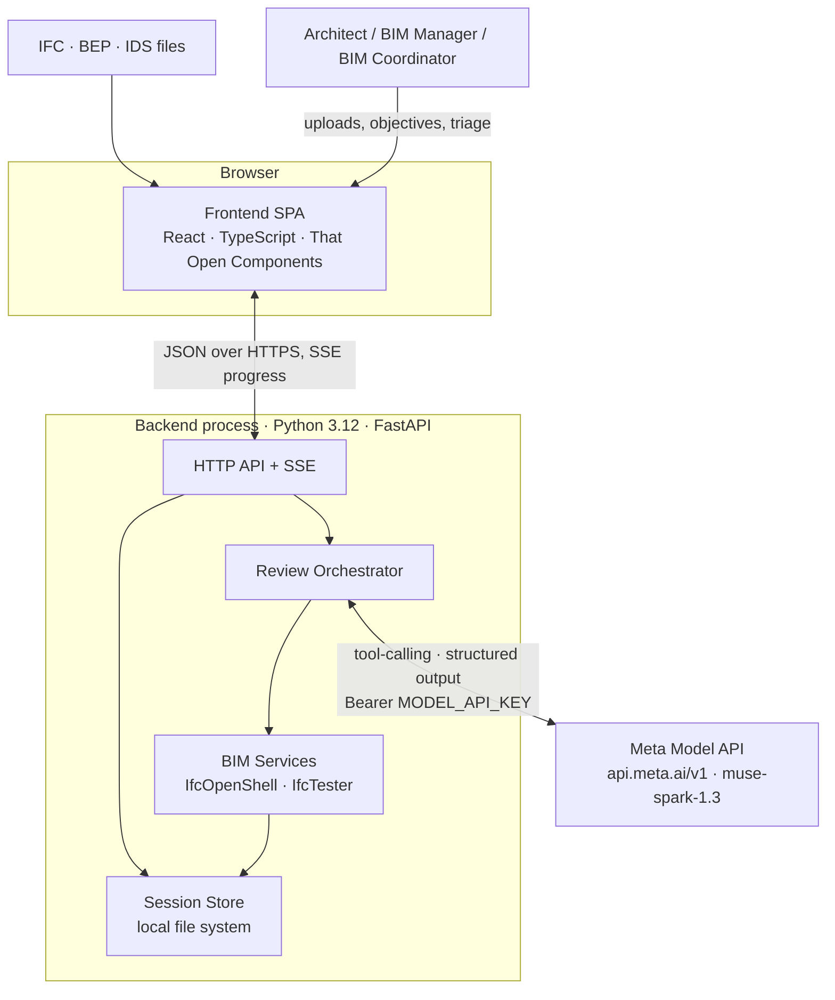
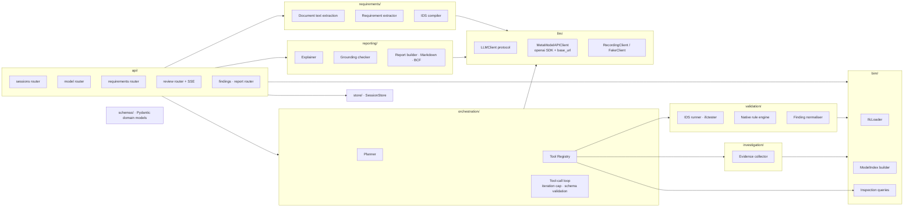
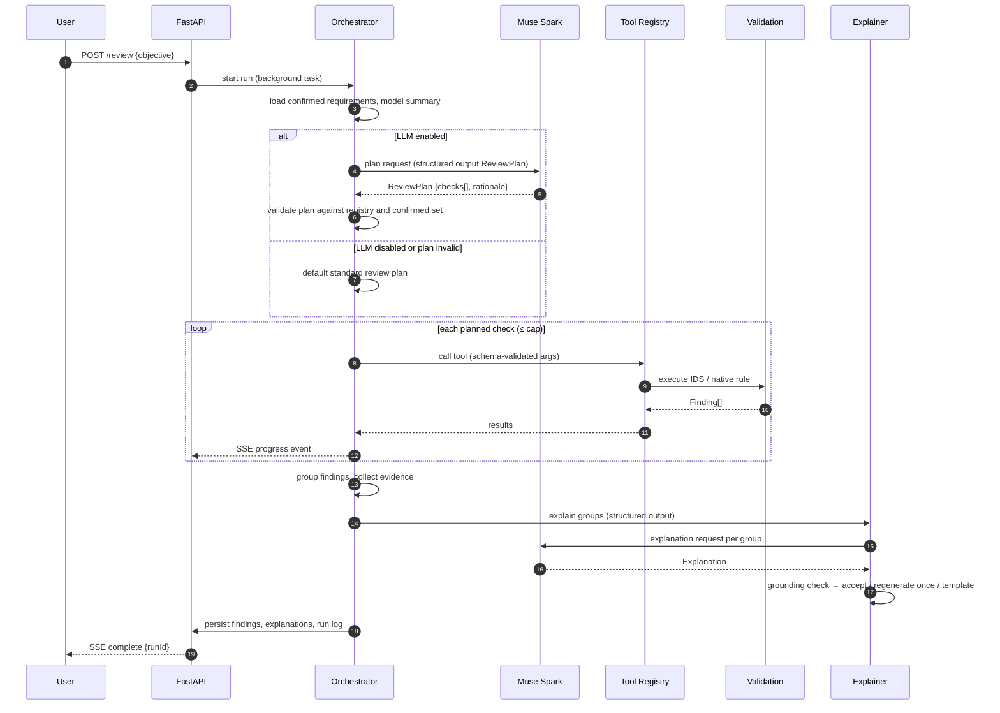
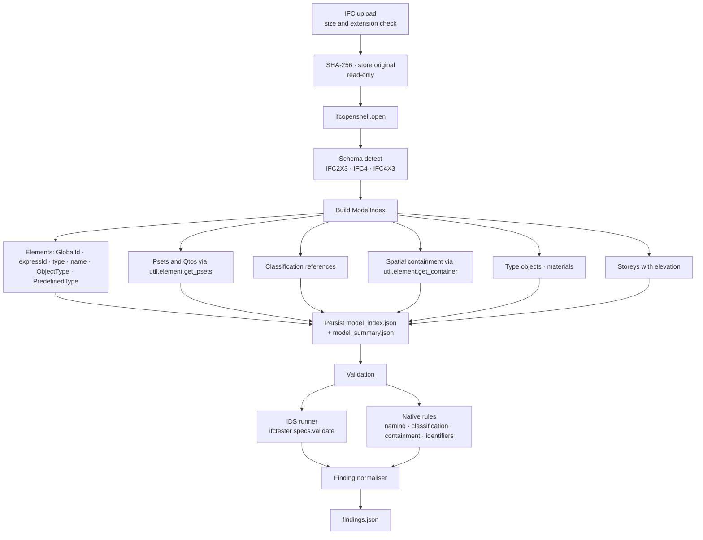
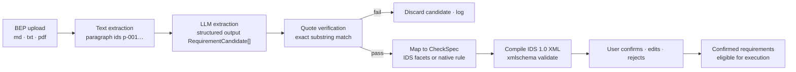
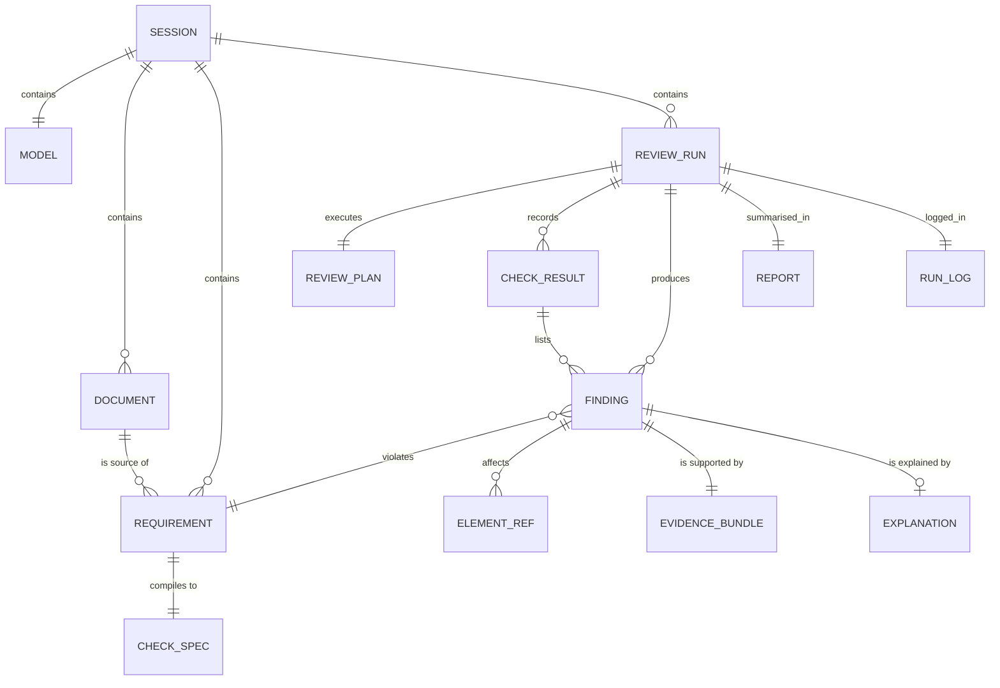
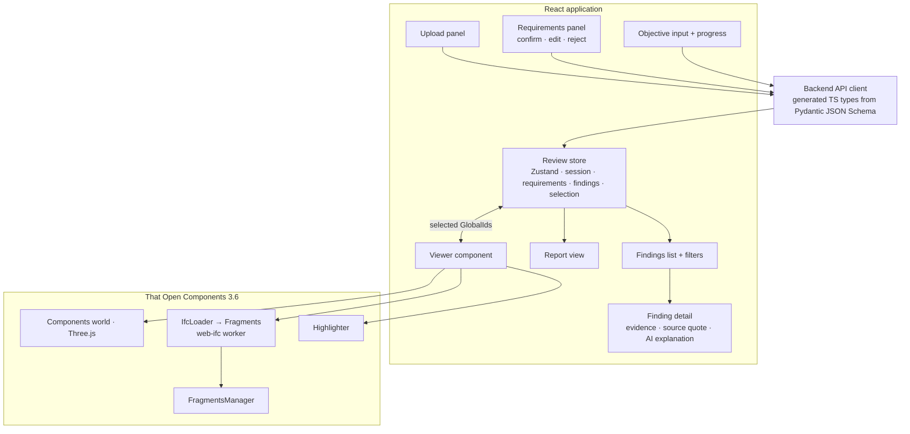
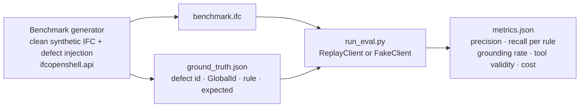

# BIM Intelligence — Technical Architecture

**Version:** 0.2 (architecture baseline 26 October 2026; §8.1, §10.2, §11 and §14 updated 28 October 2026 for the implemented ingestion slice and its T-1.1 publication hardening)
**Status:** Partially implemented. Rows and paragraphs marked *Implemented* or ✓ are backed by unit tests; every other statement about behaviour describes design intent, not measured results.
**Audience:** Engineers and coding agents implementing the MVP during the Meta Global AI Developer Hackathon (26 October – 4 November 2026).

Notation used in this document:

- **DECISION** — an architectural decision adopted for the MVP (rationale in [DECISIONS.md](./DECISIONS.md)).
- **PROPOSAL** — a design that requires experimental validation before it is adopted.
- **ASSUMPTION** — an unverified premise; tracked in [REQUIREMENTS.md](./REQUIREMENTS.md) and [RISKS.md](./RISKS.md).

Requirement identifiers (`FR-…`, `NFR-…`, `C-…`) refer to [REQUIREMENTS.md](./REQUIREMENTS.md).

---

## 1. Executive technical overview

BIM Intelligence is an AI-native review assistant for architectural IFC models. It is designed to let an Architect, BIM Manager or BIM Coordinator state a review objective in plain language, have the system select and run the appropriate deterministic checks against the model and the project's own information requirements, and then inspect the findings in a 3D viewer with grounded explanations and a traceable report.

The architecture rests on one invariant that every component enforces:

> **Findings are produced only by deterministic code. The language model may plan, propose, explain and summarise — it may never assert a model fact that deterministic inspection has not produced.**

Consequences of that invariant:

| Concern | Deterministic Python | LLM (Meta Muse Spark via Meta Model API) |
|---|---|---|
| Reading IFC properties, relationships, geometry | ✔ IfcOpenShell | ✘ never |
| Executing checks (IDS, native rules) | ✔ IfcTester + rule engine | ✘ never |
| Deciding *which* checks to run for a stated objective | ✔ default plan always available | ✔ proposes a bounded plan from the tool registry |
| Extracting requirements from a BEP | ✔ source-quote verification, IDS compilation | ✔ proposes candidate requirements with verbatim quotes |
| Collecting evidence for a finding | ✔ | ✘ |
| Explaining a finding and recommending a fix | ✔ templated fallback, grounding check | ✔ drafts prose from the evidence bundle |
| Writing the report | ✔ assembles from JSON | ✔ optional narrative summary (grounded) |

The system is a **single Python process** (FastAPI) plus a **single-page TypeScript frontend** (React + That Open Components). There are no microservices, no message queue and no database in the MVP; session state lives on the local file system. This is the smallest architecture that supports a credible end-to-end demonstration and leaves clean seams for later hardening.

---

## 2. Problem statement and professional workflow

### 2.1 The professional problem

Before a model is issued (ISO 19650 "shared" or "published" state), the authoring team must confirm that it carries the information the project's Exchange Information Requirements (EIR) and BIM Execution Plan (BEP) demand: correct classification, required property sets, agreed naming, valid spatial structure and freedom from obvious coordination conflicts. In practice this is done with a mix of commercial model checkers (Solibri, Navisworks, Revit Model Checker), hand-written rule sets, and spreadsheets. The pain points are well known:

1. Project requirements live in prose documents; turning them into executable rules is slow and error-prone.
2. Checker output is voluminous and poorly explained; coordinators spend time triaging rather than fixing.
3. Rule libraries are generic; project-specific intent is lost.
4. Traceability from a flagged element back to the clause that demanded the information is weak.

### 2.2 The target workflow


The human remains in control at two mandatory points: **requirement confirmation** (FR-REQ-04) and **finding triage**. The orchestrator can never execute a check derived from an unconfirmed requirement.

### 2.3 What the system is not

- Not a model authoring tool (C-04: the IFC is never modified).
- Not a code-compliance engine; building-regulation checking is out of scope.
- Not a general assistant; prompts are task-bound (C-03).

---

## 3. Functional requirements

Authoritative list: [REQUIREMENTS.md §3](./REQUIREMENTS.md#3-functional-requirements). Summary of the P0 set the architecture must satisfy:

| Group | P0 requirements |
|---|---|
| Ingestion | FR-ING-01..04 |
| Requirements | FR-REQ-01..07 |
| Validation | FR-VAL-01..04, FR-VAL-07 |
| Explanation | FR-EXP-01..03, FR-EXP-05 |
| Visualisation | FR-VIS-01..05 |
| Reporting | FR-REP-01..02 |

---

## 4. Non-functional requirements

Authoritative list: [REQUIREMENTS.md §4](./REQUIREMENTS.md#4-non-functional-requirements). The architecturally significant ones:

- **NFR-01 Determinism** drives the separation of the rule engine from any LLM path.
- **NFR-03 Grounding** drives the evidence-bundle data model and the post-generation checker.
- **NFR-05 Cost** and **NFR-06 Bounded tool execution** drive the single-orchestrator design with a hard iteration cap.
- **NFR-08 Privacy** drives model-id validation (Standard-mode Muse models only).
- **NFR-10 Graceful degradation** drives the "no-LLM default plan" and templated explanations.
- **NFR-11 Portability** pins Python to 3.10–3.12.

---

## 5. System context and component diagram

### 5.1 Context



The **execution boundary** is the backend process. Only it holds the API key, reads IFC files, and calls the LLM. The browser receives derived JSON and loads the IFC a second time for geometry (see §12 for why).

### 5.2 Backend components



---

## 6. Component responsibilities

| Component | Responsibility | LLM? | Key dependencies |
|---|---|---|---|
| **api/** | HTTP surface, request validation, SSE progress stream, error mapping. No business logic. | No | FastAPI, Pydantic |
| **schemas/** | Single source of truth for domain models (`Session`, `ModelSummary`, `ElementRef`, `Requirement`, `CheckSpec`, `Finding`, `Evidence`, `Explanation`, `Report`, `RunLog`). JSON Schema exported for tools and frontend types. | No | Pydantic v2 |
| **store/** | `SessionStore` — create/read session directories; stage, validate and publish content-addressed model versions under a per-session file lock; activate a version with one atomic write of the session record; recover abandoned staging (ADR-017). | No | stdlib |
| **bim/** | Open IFC with IfcOpenShell; build `ModelIndex` (elements, psets, classifications, containment, types, materials, storey elevations, bounding boxes where cheap); read-only inspection queries used as tools. | No | ifcopenshell 0.9 |
| **requirements/** | Extract text from BEP (Markdown/TXT; PDF via `pypdf`); call LLM for `RequirementCandidate[]`; verify quotes; compile confirmed candidates to IDS 1.0 XML (via `ifctester.ids` authoring classes) or to native rule configurations. | Yes (extraction) | ifctester, pypdf |
| **validation/** | Run IDS via IfcTester; run native rules; normalise to `Finding`. Pure functions of (ModelIndex, IFC file, CheckSpec). | No | ifctester |
| **investigation/** | Build `EvidenceBundle` per finding: element record, container, siblings and their status, property statistics, source requirement. | No | bim/ |
| **orchestration/** | Interpret objective → `ReviewPlan`; execute the plan through the tool registry; run tool-call loop with caps; emit progress events; fall back to default plan. | Yes (planning) | llm/, Tool Registry |
| **llm/** | `LLMClient` protocol: `complete_structured(messages, schema)`, `complete_with_tools(messages, tools)`. Implementations: Meta Model API (OpenAI SDK), Fake (tests), Recording/Replay (evaluation). Token accounting. | — | openai ≥ 1.x |
| **reporting/** | Explain findings (LLM structured output) → grounding check → fallback template; assemble `Report`; render Markdown; optional BCF 3.0 via `bcf-client`. | Yes (prose) | bcf-client (P2) |
| **frontend/** | Upload, requirement confirmation UI, objective input, progress, findings list and detail, 3D viewer with highlight sync, report view. | No | React, TS, @thatopen/* 3.6, three ≥ 0.182, web-ifc ≥ 0.0.77 |
| **tests/evaluation/** and **datasets/** | Benchmark generator (defect injection), ground truth, metrics runner, LLM replay fixtures. | Replay only | ifcopenshell.api |

---

## 7. Agent and tool orchestration

### 7.1 Why one orchestrator, not six agents

The brief lists six logical responsibilities. Only three benefit from LLM reasoning (planning, requirement extraction, explanation). The remainder are deterministic services. **DECISION:** implement a single orchestrator with a typed, read-only tool registry, and treat the "Requirements Interpreter" and "Explainer" as separate structured-output calls outside the tool loop. Rationale: fewer LLM calls (NFR-05), simpler failure analysis, no inter-agent message protocol to debug in ten days. See [DECISIONS.md ADR-003](./DECISIONS.md#adr-003-single-orchestrator-with-typed-tool-registry).

### 7.2 Orchestration sequence



### 7.3 Tool registry

Tools are plain Python functions with Pydantic argument and result models. The registry exports their JSON Schema to the LLM and validates arguments before execution (NFR-06).

| Tool | Arguments | Returns | Side effects |
|---|---|---|---|
| `get_model_summary` | — | schema, counts by type, storeys, classification systems present, pset names present | none |
| `list_confirmed_requirements` | — | requirement ids, titles, check types | none |
| `query_elements` | `ifc_type`, optional `storey`, `name_pattern`, `limit` | `ElementRef[]` | none |
| `get_element` | `global_id` | element record with psets, classification, container | none |
| `run_ids_validation` | `requirement_ids[]` | `Finding[]` | writes findings to session |
| `run_native_rule` | `rule_id`, `params` | `Finding[]` | writes findings to session |
| `summarise_findings` | optional filters | counts by rule, severity, storey | none |

**Design constraints**

- All tools are **read-only with respect to the IFC** (C-04). Two tools write findings into the session store; that write is visible in the run log.
- Hard caps: `MAX_TOOL_CALLS_PER_RUN` (default 12), `MAX_PLAN_CHECKS` (default 10), per-tool timeouts.
- Unknown tool names and schema-invalid arguments are rejected, logged and surfaced as a plan error; they are never silently retried with model-generated corrections more than once.
- The LLM never receives raw IFC content; it receives summaries, counts and bounded element lists.

### 7.4 Planner prompt contract

The planner call uses structured output (JSON Schema, strict mode) with the `ReviewPlan` schema:

```json
{
  "objective_summary": "string",
  "checks": [
    {"tool": "run_ids_validation | run_native_rule", "arguments": {}, "reason": "string"}
  ],
  "out_of_scope": ["string"],
  "assumptions": ["string"]
}
```

The orchestrator then **filters** the plan: tools must exist; `requirement_ids` must be confirmed; `rule_id` must be registered; the check count must be within cap. A plan that is empty after filtering falls back to the default plan and the UI shows why (NFR-10).

### 7.5 Protocol choice

**DECISION:** use the Chat Completions protocol (`POST /v1/chat/completions`) through the `openai` Python SDK with `base_url="https://api.meta.ai/v1"`, because it is the most widely tested OpenAI-compatible surface and supports tool calling and `response_format={"type": "json_schema"}`. **PROPOSAL:** evaluate the Responses API if cross-turn reasoning replay proves useful for multi-step planning. Model default: `muse-spark-1.3`; `muse-wonder-1.0` available behind a configuration flag but not used in the MVP (cost ×3–5, preview status).

---

## 8. IFC ingestion and validation pipeline



### 8.1 Model Index

The Model Index is a denormalised JSON snapshot built once per upload. It exists so that tools and native rules operate on a fast, in-memory structure rather than re-walking the IFC graph, and so that the frontend can request element records without the backend holding an IfcOpenShell file open per request.

**Implemented (T-1, `bim/`).** `open_ifc` accepts IFC2X3, IFC4 and IFC4X3 and raises `IfcLoadError` / `UnsupportedSchemaError` otherwise; messages never contain storage paths. `build_index` indexes every `IfcProduct` (including spatial elements) and `IfcTypeObject` in express-id order, reading values through `ifcopenshell.util` so the index agrees with IfcOpenShell by construction: property and quantity sets with instance-versus-type provenance (`PropertyValue.inherited`), classification references resolved per system, the direct or aggregate-inherited container and the containing storey. Records are keyed by `express_id` with a `GlobalId → [express_id]` multimap: duplicates are kept and reported in `duplicate_global_ids`, `by_global_id()` raises `AmbiguousGlobalIdError`, and GlobalIds failing the 22-character check are recorded in `malformed_global_ids` with the record carrying `global_id=None` ([ADR-016](./DECISIONS.md#adr-016-ingestion-contract-staged-upload-content-hash-etag-and-identifier-handling)). Materials and storey elevations are not yet indexed.

**Ingestion contract.** `ingest_model` takes the session's model lock, writes the upload into a private staging directory while hashing and size-capping it, parses and indexes from the staged copy, writes `model_index.json` and `model_summary.json` beside it, validates the set and publishes it as one immutable version directory `models/{sha256}/` with a single rename; the session record is then pointed at that hash in one atomic write ([ADR-017](./DECISIONS.md#adr-017-content-addressed-model-versions-with-single-pointer-publication)). A rejected or interrupted upload therefore never replaces a previously indexed model and never leaves a mixed version, a second upload during the first is refused with 409, and every read serves bytes, index and summary from the same version directory.

**DECISION:** geometry is **not** processed on the backend in the MVP. Bounding boxes and storey assignment by elevation (FR-VAL-05) are deferred to P1 and, if implemented, use `ifcopenshell.geom.iterator` on a worker thread with a time budget. Rendering happens entirely in the browser (§12).

### 8.2 IDS validation

IfcTester is the reference IDS 1.0 implementation maintained alongside IfcOpenShell. The runner:

1. Loads the IDS (`ifctester.ids.open`) or builds it from confirmed requirements (`ifctester.ids.Ids`, `Specification`, facet classes).
2. Calls `specs.validate(ifc_file)`.
3. Walks specification → requirement → failed entities and emits one `Finding` per (requirement, entity), carrying IfcTester's own `reason` text as `observed`.
4. Optionally writes IfcTester's JSON report alongside for cross-checking (FR-VAL-01 acceptance).

### 8.3 Native rules

Native rules cover checks that IDS cannot express or that are clearer in code. Each rule is a class with `id`, `version`, `params_schema`, `run(index) -> Finding[]`.

| Rule id | Purpose | Requirement |
|---|---|---|
| `naming.pattern` | Names match regex per IFC type or storey | FR-VAL-03 |
| `classification.present` | Every instance of configured types has a reference in the configured system | FR-VAL-04 |
| `classification.consistent_by_type` | Instances of the same IfcTypeObject share one classification code | FR-VAL-04 |
| `property.required` | Pset/property present and non-placeholder (`""`, `"-"`, `"TBC"`, `"?"`) | FR-VAL-02 |
| `spatial.contained` | Element has a containing storey/space | FR-VAL-05 (P1) |
| `spatial.storey_matches_elevation` | Element placement Z within storey band (requires geometry, P1) | FR-VAL-05 (P1) |
| `relationship.opening_hosted` | Doors/windows fill an opening in a host | FR-VAL-05 (P1) |
| `identity.unique_global_id` | No duplicate or malformed GlobalIds | FR-VAL-06 (P1) |

Rules are versioned; the version is written into each Finding (FR-REP-02) so that benchmark results are reproducible.

---

## 9. Document interpretation and requirement verification



### 9.1 Requirement candidate schema (abridged)

```json
{
  "id": "REQ-007",
  "title": "External walls carry fire rating",
  "statement": "All external walls shall have Pset_WallCommon.FireRating populated.",
  "source": {"document_id": "bep-01", "location": "p-034", "quote": "…verbatim…"},
  "check": {
    "kind": "ids",
    "applicability": [{"facet": "entity", "name": "IFCWALL"}, {"facet": "property", "pset": "Pset_WallCommon", "name": "IsExternal", "value": "TRUE"}],
    "requirements": [{"facet": "property", "pset": "Pset_WallCommon", "name": "FireRating", "cardinality": "required"}]
  },
  "confidence": 0.82,
  "status": "proposed"
}
```

### 9.2 Safeguards

- **Verbatim quote check** (FR-REQ-02) is deterministic and rejects any candidate whose quote is not an exact substring of the extracted text. This blocks fabricated requirements at source.
- **IDS compilation** validates against the IDS 1.0 XSD; uncompilable candidates are downgraded to `informational`.
- **Human confirmation** (FR-REQ-04) is mandatory. The confirmation UI shows the quote next to the compiled check.
- **Confidence** is the model's self-report and is displayed only as a sorting aid; it is never used to auto-confirm.

**PROPOSAL:** chunked extraction for long BEPs is unnecessary given the 1M-token context of Muse Spark, but token cost scales with document length; the extractor should accept a page/section range filter.

---

## 10. Data models and evidence traceability

### 10.1 Entity relationships



### 10.2 Core schemas

Implemented models live in `backend/bim_intelligence/schemas/` and are exported to `frontend/src/api/generated/` (ADR-014, ADR-015). Models not yet implemented are marked *planned*.

| Model | Fields (abridged) | Notes |
|---|---|---|
| `Session` | `id` (UUID4), `created_at`, `status` ∈ created/model_ready, `model_hash`, `document_hashes` | directory `data/sessions/{id}/`; `model_ready` ⇔ `model_hash` present; `model_hash` is the pointer to the active version directory `models/{model_hash}/` (ADR-017); never carries paths |
| `ElementRef` | `global_id` (nullable), `express_id`, `ifc_type`, `name`, `storey` | the only way to refer to an element; GlobalId is the viewer key, `express_id` the fallback identity |
| `ElementRecord` | `ref`, `object_type`, `predefined_type`, `type_ref`, `container`, `psets{set: {name: {value, inherited}}}`, `classifications[] {system, identification, name, inherited}` | the Model Index entry served by `GET /elements/{globalId}`; `inherited=true` marks values that come from the type object (C-03) |
| `ModelSummary` | `ifc_schema`, `model_hash`, `project_name`, `counts{IfcClass: n}`, `storeys[]` | produced once per upload; counts cover indexed `IfcProduct` and `IfcTypeObject` instances |
| `Requirement` | `id`, `title`, `statement`, `origin` ∈ document/ids/builtin, `source`, `check`, `status`, `confidence`, `revision`, `confirmed_revision`, `confirmed_by`, `confirmed_at` | status ∈ proposed/confirmed/edited/rejected/informational; executable only when `confirmed_revision == revision` |
| `CheckSpec` | `id` (content hash), `kind` (ids/native), `rule_id`, `rule_version`, `ids_specification` or `params` | immutable; plans reference it by `id` only |
| `Finding` | `id` (content hash), `check_id`, `requirement_id`, `rule_id`, `rule_version`, `facet_index`, `severity`, `category`, `elements[]`, `observed`, `expected`, `method` ∈ {ids, native} | `method` can never be `llm` (FR-VAL-07); no timestamp or run id, so `findings.json` is byte-reproducible (NFR-01) |
| `CheckResult` | `check_id`, `requirement_id`, `status` ∈ passed/failed/error/skipped/not_applicable, `applicable_count`, `finding_ids[]`, `diagnostics[]` | execution outcome, never a defect |
| `ReviewPlan` | `checks[] {check_id, reason}` | the planner's output; no parameters |
| `ReviewRun` | `id`, `session_id`, `status` ∈ queued/running/completed/partial/failed/interrupted, `plan`, `plan_source` ∈ llm/default, `check_results[]`, `input_manifest`, `created_at`, `finished_at` | the only record carrying timestamps |
| `ProblemDetail` | `type`, `title`, `status`, `detail`, `instance`, `correlation_id` | RFC 9457 body for every error response |
| `EvidenceBundle` *(planned)* | `finding_id`, `element_records[]`, `container`, `siblings[]` with status, `property_stats`, `requirement_source` | everything an explanation may cite |
| `Explanation` *(planned)* | `finding_group_id`, `summary`, `probable_cause`, `corrective_action`, `cited_global_ids[]`, `cited_properties[]`, `generated_by` {model id, prompt version}, `grounding` {status, violations[]} | labelled AI-generated (FR-EXP-05) |
| `Report` *(planned)* | session metadata, model summary, requirements table, findings with evidence and explanations, traceability matrix, provenance | canonical JSON; Markdown rendered from it |
| `RunLog` *(planned)* | plan, tool calls (name, args, duration, result size), token usage, grounding results, errors, timings | one per run (NFR-09) |

### 10.3 Traceability chain

Every finding can be traced in both directions:

`Document paragraph → Requirement (quote) → CheckSpec (IDS XML or rule+params) → Finding (observed/expected, method, rule version) → ElementRef (GlobalId) → Explanation (cited ids ⊆ evidence)`

The report's traceability matrix is generated from these links; nothing in the report is hand-written.

### 10.4 Grounding check

The grounding checker is deterministic and runs on every explanation:

1. Every `cited_global_ids` entry must be in the evidence bundle's element set.
2. Every `cited_properties` entry (`Pset.Name`) must appear in the evidence bundle's element records or requirement.
3. Numeric values quoted in the summary are matched against evidence values (tolerant string match); unmatched numbers fail.
4. On failure: regenerate once with the violations appended to the prompt; on second failure, emit the templated explanation and record `grounding.status = "fallback"`.

---

## 11. API architecture and principal endpoints

Base path `/api/v1`. JSON everywhere; errors follow a single `ProblemDetail` schema (`type`, `title`, `status`, `detail`, `instance`, `correlation_id`) served as `application/problem+json`. Every response carries `X-Correlation-ID` (echoed from the request when well-formed, otherwise generated). Rows marked ✓ are implemented and unit-tested; the others are design intent.

| Method | Path | Purpose | Requirement |
|---|---|---|---|
| `GET` | `/health` ✓ | Liveness, versions, LLM reachability flag (no key exposure) | NFR-09 |
| `POST` | `/sessions` ✓ | Create review session; 201 with `Location` | — |
| `GET` | `/sessions/{sid}` ✓ | Session status and model hash (never paths) | — |
| `POST` | `/sessions/{sid}/model` ✓ | Upload IFC (multipart, `.ifc` only, ≤ `MAX_IFC_MB`); returns `ModelSummary` with `ETag` = the new version's quoted SHA-256; 409 `model-locked` while another upload is in progress; 413/415/422 as `ProblemDetail`; re-upload replaces the active version atomically (ADR-017) | FR-ING-01..03 |
| `GET` | `/sessions/{sid}/model/summary` ✓ | Model summary of the active version; `ETag` = quoted SHA-256; `If-Match` mismatch → 412 | FR-ING-02 |
| `GET` | `/sessions/{sid}/model/file` ✓ | Stored IFC bytes, `application/x-step`, `ETag` = quoted SHA-256 that always describes the body, `If-None-Match` → 304, `If-Match` mismatch → 412 (C-07); the viewer's geometry source | FR-VIS-01 |
| `GET` | `/sessions/{sid}/elements/{globalId}` ✓ | `ElementRecord` from the active version's index; `ETag` = quoted SHA-256; 400 malformed id, 404 unknown, 409 when the GlobalId is duplicated, 412 on `If-Match` mismatch | FR-ING-04 |
| `GET` | `/sessions/{sid}/elements?ifc_type=&storey=&limit=` | Element list | FR-ING-02 |
| `POST` | `/sessions/{sid}/documents` | Upload BEP (md/txt/pdf) or IDS (xml) | FR-REQ-01, FR-REQ-05 |
| `POST` | `/sessions/{sid}/requirements/extract` | Run LLM extraction for a document; returns candidates | FR-REQ-02..03 |
| `GET` | `/sessions/{sid}/requirements` | List requirements | — |
| `PATCH` | `/sessions/{sid}/requirements/{rid}` | Confirm / edit / reject | FR-REQ-04 |
| `POST` | `/sessions/{sid}/reviews` | Start a review run `{objective, use_llm}`; returns `runId` | FR-REQ-06..07 |
| `GET` | `/sessions/{sid}/reviews/{runId}/events` | SSE stream of progress events | FR-VIS-05 |
| `GET` | `/sessions/{sid}/reviews/{runId}` | Run status, plan, counts | — |
| `GET` | `/sessions/{sid}/findings?run_id=&severity=&rule_id=&storey=` | Findings list | FR-VIS-02 |
| `GET` | `/sessions/{sid}/findings/{fid}` | Finding with evidence and explanation | FR-VIS-04 |
| `POST` | `/sessions/{sid}/findings/{fid}/explain` | (Re)generate explanation | FR-EXP-02 |
| `GET` | `/sessions/{sid}/reviews/{runId}/report?format=json\|md` | Report | FR-REP-01 |
| `GET` | `/sessions/{sid}/reviews/{runId}/report?format=bcf` | BCF 3.0 zip (P2) | FR-REP-03 |

**Asynchrony.** Review runs execute as FastAPI `BackgroundTasks` in the same process; progress is pushed over Server-Sent Events. **DECISION:** no task queue in the MVP. **PROPOSAL:** if IFC indexing of large models blocks the event loop, move `bim/` work to a `ProcessPoolExecutor`.

**Authentication.** None in the MVP (localhost only). The API must refuse to start bound to a non-loopback interface unless `ALLOW_REMOTE=true` is set, to prevent accidental exposure of uploaded project files.

---

## 12. Frontend and 3D visualisation architecture



### 12.1 Key decisions

- **DECISION:** the browser loads the IFC itself using That Open Components' `IfcLoader` (web-ifc in a worker) and converts to Fragments. The backend does not serve geometry. This avoids a second geometry pipeline and keeps the backend free of mesh processing.
- **DECISION:** the join key between backend findings and viewer objects is the **IFC GlobalId**. The viewer builds a `GlobalId → fragment/local id` map after load. **PROPOSAL (Day-1 spike):** confirm the exact 3.6 API for GlobalId lookup and `Highlighter` selection by id set; docs were unreachable from the research sandbox, so method names in this document are placeholders until verified.
- **DECISION:** Vite + React 19 + TypeScript strict (as scaffolded by the current `create-vite` template, with `oxlint` and Prettier); Zustand for the small amount of shared state once more than one panel needs it; no router beyond a single page with panels.
- Frontend types are generated from the backend's Pydantic JSON Schema (`model_json_schema()` → `json-schema-to-typescript`) so that `Finding`, `Requirement` and `Explanation` are identical on both sides (C-07).

### 12.2 States to handle

Every panel renders loading, empty, error and success states. Degraded mode (LLM unavailable) is shown as a persistent banner; AI explanations are labelled; deterministic findings carry a "verified by rule `<id> v<version>`" chip (FR-EXP-05).

---

## 13. Security, privacy and credential handling

| Area | Design |
|---|---|
| Secrets | `MODEL_API_KEY` from environment only (`.env` is git-ignored; `.env.example` lists names). Never logged; `/health` reports only `llm_configured: true/false`. |
| Model data privacy | Only Standard-mode model ids permitted by default (NFR-08). Configuration rejects ids ending `-contributor` unless `ALLOW_CONTRIBUTOR_MODELS=true`. The LLM receives summaries, bounded element lists and document text — never the raw IFC file. |
| Uploads | Extension allow-list (`.ifc`, `.ids`, `.md`, `.txt`, `.pdf`), size limits (`MAX_IFC_MB`, `MAX_DOC_MB`), stored under `data/sessions/{uuid}/models/{sha256}/` with the original hash as the directory name; path traversal impossible because filenames are replaced by fixed names and versions are addressed only by a validated SHA-256. |
| Least privilege | Tool registry is read-only against the model; no shell, no file-system tools exposed to the LLM. |
| Network | Outbound calls only to `LLM_BASE_URL`. No telemetry. Server binds to `127.0.0.1` unless explicitly overridden. |
| Prompt injection | BEP text is untrusted input. Extraction prompts instruct the model to treat document content as data; outputs are validated by schema and verbatim-quote check; nothing in the document can cause a tool call because extraction runs outside the tool loop. |
| Confidential material | `hackathon-private/` is git-ignored; public docs summarise rather than copy it (brief §10). |
| Dependencies | Pinned in `pyproject.toml` and `package-lock.json`; licence table in README (NFR-15). |

---

## 14. Error handling and fallback behaviour

| Failure | Behaviour |
|---|---|
| IFC fails to open | 422 `ifc-unreadable` with IfcOpenShell's message (storage paths scrubbed); a previously indexed model in the session is left untouched and the session remains usable for a new upload. *Implemented (T-1).* |
| Unsupported or unknown `FILE_SCHEMA` | 422 `unsupported-ifc-schema` naming the declared schema. IFC2X3, IFC4 and IFC4X3 are accepted; geometry support is a viewer concern (§12). *Implemented (T-1).* |
| Upload too large / wrong extension / missing field | 413 `upload-too-large` / 415 `unsupported-upload` / 422 `request-validation`. The size cap is enforced while the staged file is written; nothing is published. *Implemented (T-1).* |
| Failure while indexing, serialising or publishing an upload | The staging directory is removed and the previously active version remains whole; a failure between the version-directory rename and the pointer swap leaves a complete, inactive version that a later prune removes. No reader can observe a partial or mixed version (ADR-017). *Implemented (T-1.1).* |
| Second upload while one is in progress | 409 `model-locked`; the request is refused immediately rather than queued, and readers are not blocked. *Implemented (T-1.1).* |
| Client pinned to a replaced version (`If-Match`) | 412 `model-version-mismatch` naming the active hash; the client reloads the model rather than mixing versions. *Implemented (T-1.1).* |
| Process interrupted mid-upload | Abandoned staging directories are removed by the next upload to the session and by the startup sweep; they are never served. *Implemented (T-1.1).* |
| Duplicate GlobalId in the model | Both records are indexed; `GET /elements/{globalId}` returns 409 `ambiguous-global-id` listing the express ids; a future `identity.unique_global_id` rule turns it into a `Finding` (FR-VAL-06). *Implemented (T-1).* |
| Storage read/write failure | 500 `storage-failure` with a generic detail; the cause is logged server-side with the correlation id. *Implemented (T-1).* |
| LLM unreachable / 401 / 429 / timeout | Planner → default plan; extractor → error surfaced to user, no candidates; explainer → templated explanation with `grounding.status="fallback"`. UI shows degraded banner. Retries: exponential backoff, max 2, only on 429/5xx. |
| Plan references unknown tool or unconfirmed requirement | Item dropped, logged as `plan_violation`; if plan empty → default plan. |
| Tool argument schema invalid | Rejected, one corrective re-prompt, then dropped. |
| Tool-call cap reached | Remaining planned checks are recorded as `CheckResult.status="skipped"`; the run ends `partial`, never `completed`; log `cap_reached` (ADR-015). |
| Grounding failure | Regenerate once, then template. Never ship ungrounded prose. |
| IfcTester exception on a specification | That check's `CheckResult.status="error"` with the message in `diagnostics`; no finding is created; other specifications continue (ADR-015, superseding the earlier `check_error` finding category). |
| Frontend fails to load IFC | Findings list and report remain usable; viewer shows error and retry. |

All errors are structured (`ProblemDetail`) with `type = https://github.com/natnew/BIM-Intelligence/problems/<slug>` (the same non-resolving, project-scoped URI convention as the schema bundle's `$id`) and are written to the run log with correlation id = `runId` once runs exist.

---

## 15. Observability and diagnostics

- **Structured logging** (JSON lines) with `session_id`, `run_id`, component, event. Default sink: `data/sessions/{sid}/runs/{runId}/run.log.jsonl`.
- **Run log** (NFR-09): plan, every tool call with arguments and durations, token usage per LLM call (from API `usage`), grounding outcomes, errors.
- **Cost estimate** per run computed from token usage and configured price table (`LLM_PRICE_INPUT_PER_M`, `LLM_PRICE_OUTPUT_PER_M`), shown in UI and report.
- **Replay** — the `RecordingClient` stores every LLM request/response pair; `ReplayClient` serves them back, making evaluation runs deterministic and free.
- **Health endpoint** reports library versions (ifcopenshell, ifctester), configured model id, and LLM reachability (cached, non-billable `GET /v1/models` if available; otherwise configuration presence only).
- **PROPOSAL:** OpenTelemetry tracing is unnecessary for the MVP; the run log is sufficient and inspectable.

---

## 16. Evaluation and testing architecture

Full design: [EVALUATION.md](./EVALUATION.md). Architectural hooks:



| Layer | Tooling | What it proves |
|---|---|---|
| Unit | pytest | Model Index correctness vs direct IfcOpenShell reads; each native rule on hand-built fixtures; IDS compiler output validates against XSD; grounding checker on adversarial cases; tool registry rejects bad calls; config rejects contributor models. |
| Scenario | pytest + FakeClient | End-to-end review on the benchmark with a scripted plan; default plan with LLM disabled; degraded-mode behaviour. |
| Benchmark | `tests/evaluation/run_eval.py` | Precision/recall per rule category against ground truth (NFR-02); determinism across two runs (NFR-01). |
| Agent reliability | recorded live runs, replayed | Plan validity rate, tool-call schema validity, grounding pass rate, token cost per run. |
| Frontend | Vitest + React Testing Library; Playwright smoke | Findings panel states; viewer loads benchmark and highlights a known GlobalId. |

Live LLM calls in tests are opt-in (`BIMI_LIVE_LLM=1`) and require authorisation (C-06).

---

## 17. Performance and API cost considerations

| Concern | Approach |
|---|---|
| IFC indexing time | Single pass over `by_type("IfcProduct")`; psets via `get_psets`; cache `model_index.json`. Target < 60 s for ~50 MB (NFR-04, ASSUMPTION). Geometry excluded from MVP. |
| Browser rendering | Fragments conversion in worker; large models may need `web-ifc` coordinate-to-origin and LOD settings; benchmark model is small by design. |
| LLM calls per run | 1 planner + ⌈groups⌉ explanations (grouped by rule × type × storey, FR-EXP-04) ≈ ≤ 10 for the benchmark. |
| Token budget | Planner input: model summary (~2k tokens) + requirement titles. Explanation input: evidence bundle (~1–3k tokens). Document extraction: full BEP text (simplified BEP ~5–20k tokens). Default budget 150k input tokens/run (NFR-05). |
| Indicative cost | At published Standard pricing for Muse Spark ($1.25/M input, $4.25/M output), a benchmark run is of the order of a few cents; a BEP extraction a fraction of a cent to a few cents. Figures are indicative from the pricing page and must be re-checked. |
| Caching | Explanations cached by `(finding_group_hash, prompt_version, model_id)`; re-runs on an unchanged model reuse them. |

---

## 18. Deployment options

| Option | When | Notes |
|---|---|---|
| **Local development (DECISION for hackathon)** | All development and the live demo | `uvicorn` on `127.0.0.1:8000`, Vite dev server on `5173` proxying `/api`. Single machine, no auth. |
| Docker Compose | Reproducible judge/review environment | Two containers (backend, frontend static via nginx). Backend image must use `python:3.12` (IfcOpenShell wheels). Optional for submission. |
| Static frontend + hosted backend | Post-hackathon | Requires auth, object storage for IFC, process isolation for IfcOpenShell, and a task queue. Explicitly **out of scope** (brief §10: no production deployment). |

---

## 19. Technical risks and mitigations

Full register: [RISKS.md](./RISKS.md). Top architectural risks:

| Risk | Mitigation in the architecture |
|---|---|
| That Open Components 3.6 selection/GlobalId API differs from assumptions | Day-1 spike; viewer isolated behind a `ViewerAdapter` interface so the join logic is replaceable. |
| IfcOpenShell wheels only for Python ≤ 3.12 | Pin 3.12 in `pyproject.toml`, `.python-version`, CI and Dockerfile. |
| LLM proposes invalid plans or fabricates facts | Plan filtering, schema validation, grounding checker, default plan, templated explanations. |
| Requirement extraction quality on free-form BEP text | Verbatim quote check, human confirmation, IDS upload path as a bypass. |
| Hackathon rules unverified (model usage, submission format) | Tracked as OPEN-02; architecture already centres on Meta models. |
| Cost overrun from repeated live runs | Replay client for tests; token budget per run; explanation cache. |

---

## 20. MVP boundaries and future extensions

### In scope (MVP, P0)

- One architectural IFC (IFC2X3 or IFC4), one simplified BEP, one IDS.
- Requirement extraction with confirmation; IDS and native validation for required properties, naming and classification.
- Deterministic findings, grounded explanations, 3D highlighting, JSON/Markdown report.
- Default plan without LLM; degraded mode.

### P1 (after P0 is stable)

- Relationship checks needing geometry (storey by elevation), opening/host checks, identifier checks.
- Finding grouping, explanation cache, CI performance timing.

### P2 (stretch)

- BCF 3.0 export via `bcf-client`.
- Two-model clash detection via `ifcclash` as an additional native tool.
- Responses API evaluation; `muse-wonder-1.0` for long-horizon planning.

### Future (not scheduled)

- Voice objectives via `muse-voice-transcribe-1.0`; image-based analysis; IFC4X3 geometry; multi-user sessions; persistence beyond the file system; authentication and hosted deployment.

---

## Appendix A — Recommended repository structure

```
BIM-Intelligence/
├── backend/
│   └── bim_intelligence/
│       ├── api/              # FastAPI routers, request/response models, SSE
│       ├── orchestration/    # planner, tool registry, tool loop, prompts/
│       ├── llm/              # LLMClient protocol, Meta Model API client, fake, recording/replay
│       ├── bim/              # IFC loading, ModelIndex, inspection queries
│       ├── requirements/     # document text extraction, extractor, IDS compiler
│       ├── validation/       # IDS runner, native rules, finding normaliser
│       ├── investigation/    # evidence collector
│       ├── reporting/        # explainer, grounding, report builder, BCF export
│       ├── schemas/          # Pydantic domain models (single source of truth)
│       ├── store/            # SessionStore
│       ├── config.py         # Settings (pydantic-settings), model-id validation
│       └── logging.py
├── frontend/
│   ├── scripts/              # generate-types.mjs (JSON Schema → TypeScript, with --check)
│   ├── src/
│   │   ├── api/              # client; generated/ holds the committed schema bundle and types
│   │   ├── components/       # panels (presentation only)
│   │   ├── state/            # hooks and shared store
│   │   ├── viewer/           # ViewerAdapter, That Open Components setup
│   │   └── test/             # Vitest setup
│   ├── package.json          # committed lockfile alongside
│   └── vite.config.ts
├── scripts/
│   └── export_schemas.py     # Pydantic → frontend/src/api/generated/*.schema.json, with --check
├── tests/
│   ├── unit/                 # mirrors backend package layout
│   ├── scenario/             # end-to-end review runs with FakeClient
│   ├── fixtures/             # small hand-built IFC and IDS files and the scripts that generate them
│   └── evaluation/           # run_eval.py, LLM recordings for replay, runs/ (git-ignored)
├── datasets/
│   ├── generate.py           # synthetic benchmark generator and defect injector
│   ├── synthetic/            # committed benchmark IFC, IDS, BEP and ground truth
│   └── permitted/            # openly licensed samples with recorded licences
├── docs/
├── .github/                  # CI workflows, PR template, Dependabot
├── data/                     # git-ignored runtime sessions
├── hackathon-private/        # git-ignored confidential briefs
├── pyproject.toml            # single Python project: deps, ruff, mypy, pytest (package-dir = backend)
├── .python-version           # 3.12
├── .env.example
├── AGENTS.md
├── README.md
└── LICENSE
```

The Python project is defined once at the repository root with `package-dir = {"" = "backend"}`, so `pip install -e .` from the root installs `bim_intelligence` and `pytest` discovers `tests/` without path manipulation. Directories under `backend/bim_intelligence/` beyond `api/` are created when their first module is implemented.

## Appendix B — Verified technology facts (26 October 2026)

| Item | Fact | Source |
|---|---|---|
| Meta Model API base URL | `https://api.meta.ai/v1`; Bearer auth; env convention `MODEL_API_KEY` | dev.meta.ai/docs/quickstart, /docs/authentication |
| Protocols | Responses, Chat Completions, Messages (Anthropic-compatible) | dev.meta.ai/docs/protocols |
| Models | `muse-spark-1.3` (recommended), `muse-wonder-1.0` (preview); 1,048,576-token context; text/image/video/audio/PDF input; tool calling; JSON-schema structured output | dev.meta.ai/docs/models |
| SDK | No Meta Python SDK; use `openai` package with `base_url` | dev.meta.ai/docs/quickstart |
| Privacy | Standard mode: content not used for training; `-contributor` ids opt in to training | dev.meta.ai/docs/models, /docs/pricing-rate-limits |
| Pricing (Spark, Standard) | $1.25 / $4.25 per 1M input/output tokens | dev.meta.ai/docs/pricing-rate-limits |
| IfcOpenShell | 0.9.0.post1; wheels cp310–cp312 (win_amd64, win_arm64, manylinux, macOS); LGPL-3.0-or-later | pypi.org/project/ifcopenshell |
| IfcTester | 0.9.0; IDS 1.0; reporters Json/Html/Bcf/Sqlite/Ods/Console | docs.ifcopenshell.org/ifctester.html |
| IDS | Schema 1.0.0; facets Entity, Attribute, Classification, Property, Material, PartOf | github.com/buildingSMART/IDS |
| IfcClash | 0.9.0; depends only on ifcopenshell (+ scikit-learn optional) | pypi.org/project/ifcclash |
| bcf-client | 0.9.0; `bcf.v3` module | pypi.org/project/bcf-client |
| That Open Components | `@thatopen/components` 3.6.0, `components-front` 3.6.0, `fragments` 3.6.0, `ui` 3.4.17; MIT; peer `three >= 0.182.0`, `web-ifc >= 0.0.77` | registry.npmjs.org |
| FastAPI / Pydantic | 0.162.0 / 2.14.1; `model_json_schema()` | pypi.org, docs.pydantic.dev |
