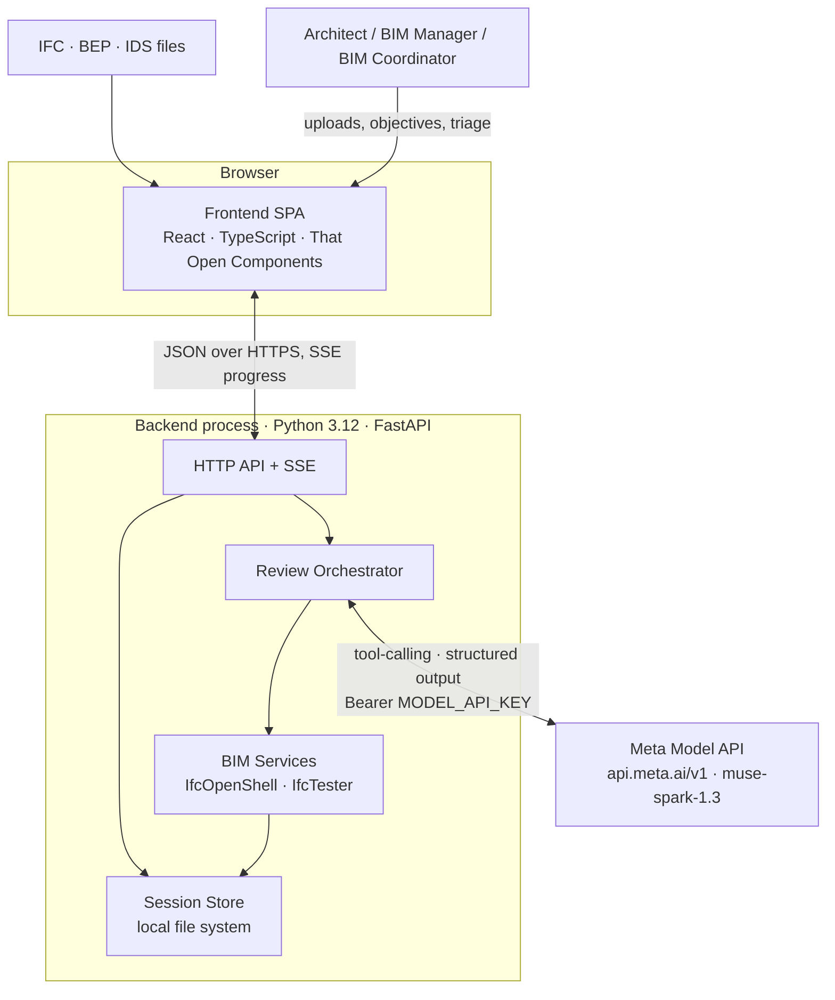
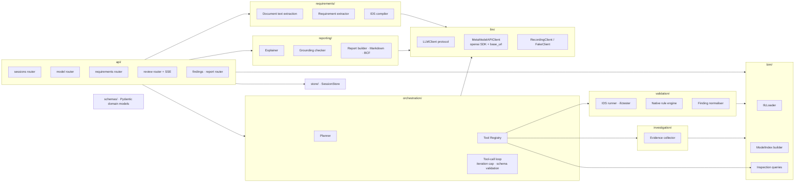
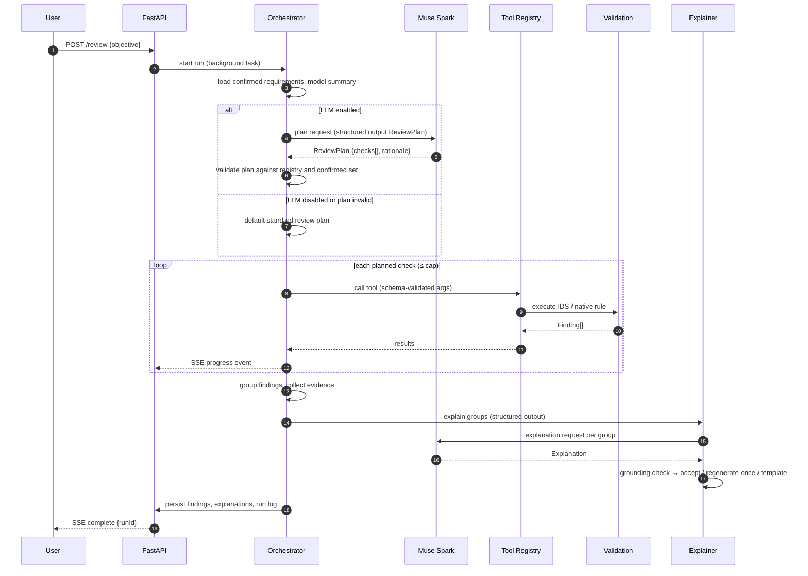
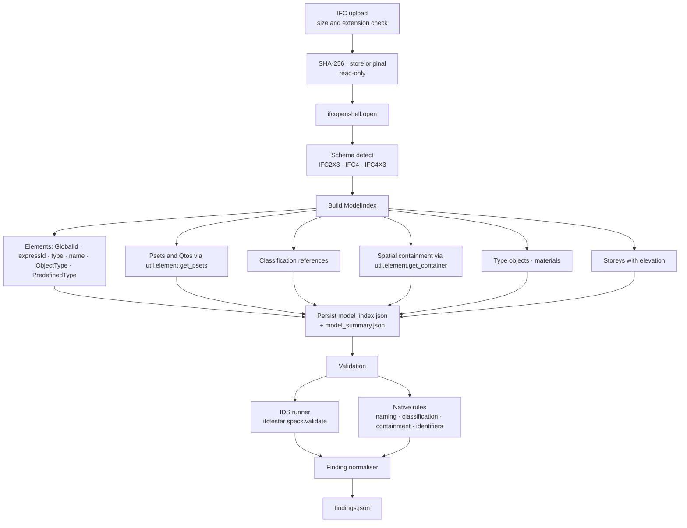
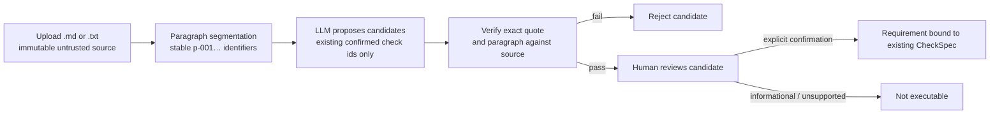
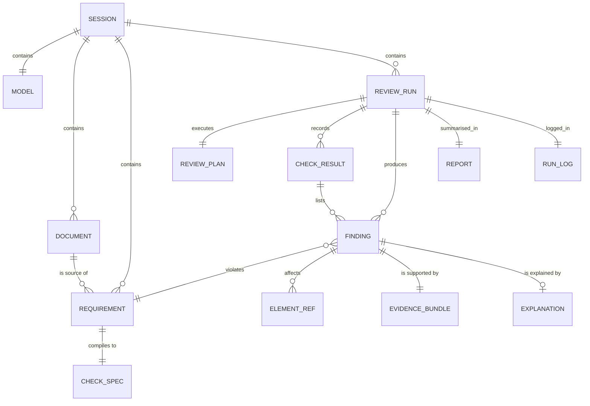
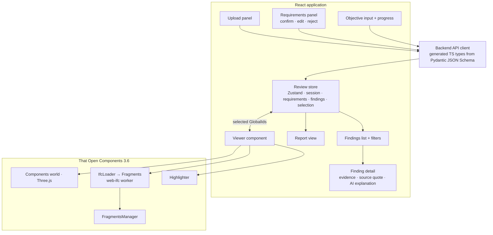
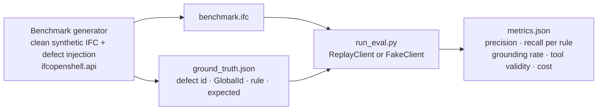
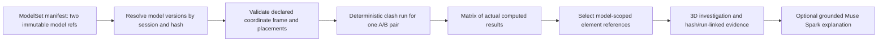

# BIM Intelligence — Technical Architecture

**Version:** 0.4 (architecture baseline 26 October 2026; §8.1, §10.2, §11 and §14 updated 28 October 2026 for T-1.1; §8.2, §10.2, §11, §12 and §14 updated 29 October 2026 for T-2–T-4; §7, §9–§11 and §13–§17 updated for the T-5 offline implementation)
**Status:** Partially implemented. Rows and paragraphs marked *Implemented* or ✓ are backed by unit tests; every other statement about behaviour describes design intent, not measured results.
**Audience:** Engineers and coding agents implementing the MVP during the Meta Global AI Developer Hackathon (26 October – 4 November 2026).

**Release-baseline clarification, 1 November 2026:** UI-004A is merged, including the verified
single-model camera and selection controls. Objective planning and grounded explanations have
offline-tested backend/API-client paths but no connected browser controls. Recent-session history,
one-click sample loading and report export are not implemented. FED-001 is a synthetic test
harness, not an integrated federation or clash feature. See
[EVALUATION.md](./EVALUATION.md#release-001-offline-verification--1-november-2026).

Notation used in this document:

- **DECISION** — an architectural decision adopted for the MVP (rationale in [DECISIONS.md](./DECISIONS.md)).
- **PROPOSAL** — a design that requires experimental validation before it is adopted.
- **ASSUMPTION** — an unverified premise; tracked in [REQUIREMENTS.md](./REQUIREMENTS.md) and [RISKS.md](./RISKS.md).

Requirement identifiers (`FR-…`, `NFR-…`, `C-…`) refer to [REQUIREMENTS.md](./REQUIREMENTS.md).

---

## 1. Executive technical overview

BIM Intelligence is an AI-native review assistant for architectural IFC models. It is designed to let an Architect, BIM Manager or BIM Coordinator state a review objective in plain language, have the system select and run the appropriate deterministic checks against the model and the project's own information requirements, and then inspect the findings in a 3D viewer with grounded explanations and a traceable report.

The architecture rests on one invariant that every component enforces:

> **Findings are produced only by deterministic code. The language model may plan, propose, explain and summarise — it may never assert a model fact that deterministic inspection has not produced.**

Consequences of that invariant:

| Concern | Deterministic Python | LLM (Meta Muse Spark via Meta Model API) |
|---|---|---|
| Reading IFC properties, relationships, geometry | ✔ IfcOpenShell | ✘ never |
| Executing checks (IDS, native rules) | ✔ IfcTester + rule engine | ✘ never |
| Deciding *which* checks to run for a stated objective | ✔ default plan always available | ✔ proposes a bounded plan from the tool registry |
| Extracting requirements from a BEP | ✔ source-quote verification, IDS compilation | ✔ proposes candidate requirements with verbatim quotes |
| Collecting evidence for a finding | ✔ | ✘ |
| Explaining a finding and recommending a fix | ✔ templated fallback, grounding check | ✔ drafts prose from the evidence bundle |
| Writing the report | ✔ assembles from JSON | ✔ optional narrative summary (grounded) |

The system is a **single Python process** (FastAPI) plus a **single-page TypeScript frontend** (React + That Open Components). There are no microservices, no message queue and no database in the MVP; session state lives on the local file system. This is the smallest architecture that supports a credible end-to-end demonstration and leaves clean seams for later hardening.

---

## 2. Problem statement and professional workflow

### 2.1 The professional problem

Before a model is issued (ISO 19650 "shared" or "published" state), the authoring team must confirm that it carries the information the project's Exchange Information Requirements (EIR) and BIM Execution Plan (BEP) demand: correct classification, required property sets, agreed naming, valid spatial structure and freedom from obvious coordination conflicts. In practice this is done with a mix of commercial model checkers (Solibri, Navisworks, Revit Model Checker), hand-written rule sets, and spreadsheets. The pain points are well known:

1. Project requirements live in prose documents; turning them into executable rules is slow and error-prone.
2. Checker output is voluminous and poorly explained; coordinators spend time triaging rather than fixing.
3. Rule libraries are generic; project-specific intent is lost.
4. Traceability from a flagged element back to the clause that demanded the information is weak.

### 2.2 The target workflow


The human remains in control at two mandatory points: **requirement confirmation** (FR-REQ-04) and **finding triage**. The orchestrator can never execute a check derived from an unconfirmed requirement.

### 2.3 What the system is not

- Not a model authoring tool (C-04: the IFC is never modified).
- Not a code-compliance engine; building-regulation checking is out of scope.
- Not a general assistant; prompts are task-bound (C-03).

---

## 3. Functional requirements

Authoritative list: [REQUIREMENTS.md §3](./REQUIREMENTS.md#3-functional-requirements). Summary of the P0 set the architecture must satisfy:

| Group | P0 requirements |
|---|---|
| Ingestion | FR-ING-01..04 |
| Requirements | FR-REQ-01..07 |
| Validation | FR-VAL-01..04, FR-VAL-07 |
| Explanation | FR-EXP-01..03, FR-EXP-05 |
| Visualisation | FR-VIS-01..05 |
| Reporting | FR-REP-01..02 |

---

## 4. Non-functional requirements

Authoritative list: [REQUIREMENTS.md §4](./REQUIREMENTS.md#4-non-functional-requirements). The architecturally significant ones:

- **NFR-01 Determinism** drives the separation of the rule engine from any LLM path.
- **NFR-03 Grounding** drives the evidence-bundle data model and the post-generation checker.
- **NFR-05 Cost** and **NFR-06 Bounded tool execution** drive the single-orchestrator design with a hard iteration cap.
- **NFR-08 Privacy** drives model-id validation (Standard-mode Muse models only).
- **NFR-10 Graceful degradation** drives the "no-LLM default plan" and templated explanations.
- **NFR-11 Portability** pins Python to 3.10–3.12.

---

## 5. System context and component diagram

### 5.1 Context



The **execution boundary** is the backend process. Only it holds the API key, reads IFC files, and calls the LLM. The browser receives derived JSON and loads the IFC a second time for geometry (see §12 for why).

### 5.2 Backend components



---

## 6. Component responsibilities

| Component | Responsibility | LLM? | Key dependencies |
|---|---|---|---|
| **api/** | HTTP surface, request validation, SSE progress stream, error mapping. No business logic. | No | FastAPI, Pydantic |
| **schemas/** | Single source of truth for domain models (`Session`, `ModelSummary`, `ElementRef`, `Requirement`, `CheckSpec`, `Finding`, `Evidence`, `Explanation`, `Report`, `RunLog`). JSON Schema exported for tools and frontend types. | No | Pydantic v2 |
| **store/** | `SessionStore` — create/read session directories; stage, validate and publish content-addressed model versions under a per-session file lock; activate a version with one atomic write of the session record; recover abandoned staging (ADR-017). | No | stdlib |
| **bim/** | Open IFC with IfcOpenShell; build `ModelIndex` (elements, psets, classifications, containment, types, materials, storey elevations, bounding boxes where cheap); read-only inspection queries used as tools. | No | ifcopenshell 0.9 |
| **requirements/** | Store IDS, Markdown and TXT sources; import IDS as confirmed requirements; propose quote-verified narrative candidates and bind only human-confirmed candidates to an existing confirmed `CheckSpec`. New narrative criteria are not authored. *Implemented (T-2/T-4/T-5 offline path).* | Yes (extraction) | validation/ |
| **validation/** | Compile IDS 1.0 documents to `CheckSpec`s and hydrate them back; run IDS via IfcTester; run registered native rules; normalise to `Finding`. Pure functions of (ModelIndex, IFC file, CheckSpec). *Implemented (T-2): IDS compiler, runner and normaliser; T-4: `classification.consistent_by_type` v1.0.0.* | No | ifctester, xmlschema |
| **investigation/** | Build `EvidenceBundle` per finding: element record, container, siblings and their status, property statistics, source requirement. | No | bim/ |
| **orchestration/** | Filter optional objective plans to confirmed immutable check ids; execute synchronously with a deterministic default fallback and bounded checks. *Implemented (T-4/T-5 offline path); no free-running tool loop.* | Yes (planning) | llm/ |
| **llm/** | `LLMClient.complete(messages, response_model, max_output_tokens, purpose, run_id) -> Completion[T]`; `LiveClient` alone uses OpenAI SDK networking, `FakeClient` is in-memory, `RecordingClient` stores response data and a request hash (not prompts), `ReplayClient` is offline. Persistent spend ledger and token usage accounting. | — | openai ≥ 1.x |
| **reporting/** | Produce separately labelled explanations from a verified `Finding`, matching requirement and pinned Model Index; validate element citations and values or return a deterministic template. Explanations are not stored in `findings.json`. *Implemented (T-5 offline path).* | Yes (prose) | schemas/ |
| **frontend/** | Upload, requirement confirmation UI, objective input, progress, findings list and detail, 3D viewer with highlight sync, report view. | No | React, TS, @thatopen/* 3.6, three ≥ 0.182, web-ifc ≥ 0.0.77 |
| **tests/evaluation/** and **datasets/** | Benchmark generator (defect injection), ground truth, metrics runner, LLM replay fixtures. | Replay only | ifcopenshell.api |

---

## 7. Agent and tool orchestration

### 7.1 Why one orchestrator, not six agents

The brief lists six logical responsibilities. Only three benefit from LLM reasoning (planning, requirement extraction, explanation). The remainder are deterministic services. **DECISION:** implement a single orchestrator with a typed, read-only tool registry, and treat the "Requirements Interpreter" and "Explainer" as separate structured-output calls outside the tool loop. Rationale: fewer LLM calls (NFR-05), simpler failure analysis, no inter-agent message protocol to debug in ten days. See [DECISIONS.md ADR-003](./DECISIONS.md#adr-003-single-orchestrator-with-typed-tool-registry).

### 7.2 Orchestration sequence



### 7.3 Tool registry

Tools are plain Python functions with Pydantic argument and result models. The registry exports their JSON Schema to the LLM and validates arguments before execution (NFR-06).

| Tool | Arguments | Returns | Side effects |
|---|---|---|---|
| `get_model_summary` | — | schema, counts by type, storeys, classification systems present, pset names present | none |
| `list_confirmed_requirements` | — | requirement ids, titles, check types | none |
| `query_elements` | `ifc_type`, optional `storey`, `name_pattern`, `limit` | `ElementRef[]` | none |
| `get_element` | `global_id` | element record with psets, classification, container | none |
| `run_ids_validation` | `requirement_ids[]` | `Finding[]` | writes findings to session |
| `run_native_rule` | `rule_id`, `params` | `Finding[]` | writes findings to session |
| `summarise_findings` | optional filters | counts by rule, severity, storey | none |

**Design constraints**

- All tools are **read-only with respect to the IFC** (C-04). Two tools write findings into the session store; that write is visible in the run log.
- Hard caps: `MAX_TOOL_CALLS_PER_RUN` (default 12), `MAX_PLAN_CHECKS` (default 10), per-tool timeouts.
- Unknown tool names and schema-invalid arguments are rejected, logged and surfaced as a plan error; they are never silently retried with model-generated corrections more than once.
- The LLM never receives raw IFC content; it receives summaries, counts and bounded element lists.

### 7.4 Planner prompt contract

The planner call uses structured output (JSON Schema, strict mode) with the `ReviewPlan` schema:

```json
{
  "objective_summary": "string",
  "checks": [
    {"tool": "run_ids_validation | run_native_rule", "arguments": {}, "reason": "string"}
  ],
  "out_of_scope": ["string"],
  "assumptions": ["string"]
}
```

The orchestrator then **filters** the plan against current confirmed checks and the execution cap. A plan that references an unknown, duplicate or excessive check is rejected; when no supplied check represents the objective, the API returns a typed unsupported-scope response rather than broadening the request to the default plan.

### 7.5 Protocol choice

**DECISION:** use the Chat Completions protocol (`POST /v1/chat/completions`) through the `openai` Python SDK with `base_url="https://api.meta.ai/v1"`. The client requests JSON-object mode and validates the returned schema locally. **PROPOSAL:** evaluate the Responses API if cross-turn reasoning replay proves useful for multi-step planning. Model default: `muse-spark-1.3`; configuration may select other non-Contributor ids, subject to owner approval and current pricing. One basic live smoke is owner-reported; provider-side strict JSON-schema support and live BIM workflows remain unverified.

### 7.6 T-5 implementation boundary

The implemented T-5 client is offline-first. `LLMClient` defines one generic, schema-validated `complete` method returning `Completion[T]` with typed usage and model metadata. `FakeClient` validates in-memory responses, `ReplayClient` reads matching response fixtures, and `RecordingClient` stores only the validated response, request hash, purpose, schema name and usage. Neither Fake nor Replay can issue network requests. `LiveClient` alone constructs the OpenAI client; configuration pins its base URL to `https://api.meta.ai/v1` and model id to the Standard-mode default `muse-spark-1.3`.

The default `BIMI_ENVIRONMENT=development` and `LLM_MODE=off` construct no live client. Live mode additionally requires `ALLOW_LIVE_LLM=true` and `MODEL_API_KEY`; the key remains a backend `SecretStr`. Retries default to zero and one process-wide file lock prevents concurrent live calls. `BIMI_ENVIRONMENT=production` is an explicit configuration profile that requires Live mode, the Standard-mode `muse-spark-1.3` model, the key and live opt-in, and rejects contributor models. It is not a public-deployment approval: the application has no authentication. Prompts are versioned files; model output is schema-validated before application logic sees it. The model receives no tool executor, file-system access, shell or arbitrary network capability.

Planning takes an optional review objective and may return only unique confirmed `CheckSpec` ids with explanations. An objective requires an accepted AI plan by default. A caller may explicitly set `ai_required=false` to permit deterministic fallback after a provider or plan failure, or set `continue_without_ai=true` to deliberately skip planning and run the deterministic plan. Unsupported scope is a typed 422 and is never broadened to the default plan. Optional `selected_checks` constrain planning and execution to current confirmed checks, each pinned to its `requirement_id`, `check_id` and `requirement_revision`; stale selections are rejected before execution. Strict failures return safe typed metadata and publish no run or findings. Each published run records planning mode, actual model when available, whether a provider request was attempted, outcome, fallback reason, selected scope and executed check ids. Historical runs remain readable with `provenance=null` and are not assigned a mode from current settings. Requirements extraction and explanations use separate structured requests, not calls in a model-directed tool loop.

Muse Spark Standard prices are configurable in `Settings` (input, cached input and output USD per million tokens). Before each request the application estimates input from UTF-8 bytes plus message overhead and reserves the full output cap. The default input target is 8,000 tokens, output cap 500, per-review call cap two, per-call and per-review budget USD 0.10, and cumulative project ledger USD 5. The ledger persists under `DATA_DIR/llm/`, uses a cross-process file lock, charges the full reservation when usage is unavailable, and reconciles provider usage when returned. Corrupt or unavailable accounting fails closed. These are **application-level safeguards**, not provider-enforced account spending caps; deleting runtime data or using another application is outside this control. Safe aggregate status is available at `GET /api/v1/llm/budget`; prompts and credentials are not returned.

The currently implemented request size at the configured ceiling estimates to USD 0.012125 uncached at the default published rates. No live call has been made, so Meta compatibility with this model, endpoint and structured-output schema remains unverified. An owner-approved one-request smoke test is required to resolve that risk; see [ADR-020](./DECISIONS.md#adr-020-t-5-meta-client-spend-ledger-and-human-gates) and OQ-02/OQ-07.

---

## 8. IFC ingestion and validation pipeline



### 8.1 Model Index

The Model Index is a denormalised JSON snapshot built once per upload. It exists so that tools and native rules operate on a fast, in-memory structure rather than re-walking the IFC graph, and so that the frontend can request element records without the backend holding an IfcOpenShell file open per request.

**Implemented (T-1, `bim/`).** `open_ifc` accepts IFC2X3, IFC4 and IFC4X3 and raises `IfcLoadError` / `UnsupportedSchemaError` otherwise; messages never contain storage paths. `build_index` indexes every `IfcProduct` (including spatial elements) and `IfcTypeObject` in express-id order, reading values through `ifcopenshell.util` so the index agrees with IfcOpenShell by construction: property and quantity sets with instance-versus-type provenance (`PropertyValue.inherited`), classification references resolved per system, the direct or aggregate-inherited container and the containing storey. Records are keyed by `express_id` with a `GlobalId → [express_id]` multimap: duplicates are kept and reported in `duplicate_global_ids`, `by_global_id()` raises `AmbiguousGlobalIdError`, and GlobalIds failing the 22-character check are recorded in `malformed_global_ids` with the record carrying `global_id=None` ([ADR-016](./DECISIONS.md#adr-016-ingestion-contract-staged-upload-content-hash-etag-and-identifier-handling)). Materials and storey elevations are not yet indexed.

**Ingestion contract.** `ingest_model` takes the session's model lock, writes the upload into a private staging directory while hashing and size-capping it, parses and indexes from the staged copy, writes `model_index.json` and `model_summary.json` beside it, validates the set and publishes it as one immutable version directory `models/{sha256}/` with a single rename; the session record is then pointed at that hash in one atomic write ([ADR-017](./DECISIONS.md#adr-017-content-addressed-model-versions-with-single-pointer-publication)). A rejected or interrupted upload therefore never replaces a previously indexed model and never leaves a mixed version, a second upload during the first is refused with 409, and every read serves bytes, index and summary from the same version directory.

**DECISION:** geometry is **not** processed on the backend in the MVP. Bounding boxes and storey assignment by elevation (FR-VAL-05) are deferred to P1 and, if implemented, use `ifcopenshell.geom.iterator` on a worker thread with a time budget. Rendering happens entirely in the browser (§12).

### 8.2 IDS validation

IfcTester is the reference IDS 1.0 implementation maintained alongside IfcOpenShell. The design: load the IDS (`ifctester.ids.open`) or build it from confirmed requirements, call `specs.validate(ifc_file)`, walk specification → requirement → failed entities and emit one `Finding` per (requirement, entity), and keep IfcTester's JSON report available for cross-checking (FR-VAL-01 acceptance).

**Implemented (T-2/T-4, `validation/`, `requirements/`, `orchestration/`; [ADR-018](./DECISIONS.md#adr-018-ids-import-establishes-confirmed-requirements-checks-are-hydrated-per-run-reviews-run-under-the-session-lock), [ADR-019](./DECISIONS.md#adr-019-t-4-native-rule-scope-and-bounded-deterministic-execution)).** The slice refines that design in three places:

1. **Import compiles, it does not keep the document executable.** `validation.compile_ids` validates the upload against IfcTester's bundled IDS 1.0 XSD (loaded with remote schema imports disabled, so no outbound request is made) and turns every `<specification>` into one immutable `CheckSpec` whose payload is the element in XML Canonical Form with indentation removed; `rule_version` is the content hash of that payload and `rule_id` is `ids:<identifier or name>`. `requirements.import_ids_document` wraps each check in a `Requirement` with `origin="ids"`, `status="confirmed"`, `revision=confirmed_revision=1` and a `source` whose `quote` is the verbatim specification name, stores the document under `documents/{sha256}.ids`, and is idempotent on content (FR-REQ-05).
2. **Each check is hydrated from its own payload and run in isolation.** `validation.run_ids_check` re-checks that the payload still hashes to `rule_version`, decodes it through the same XSD into a single-specification `ifctester.ids.Ids`, calls `Ids.validate(model)` (IfcTester's public entry point, which also resets its property caches) and normalises the result. A specification whose `ifcVersion` does not list the model's schema is `skipped`, not run; a required or optional specification with no applicable entity is `not_applicable`; a prohibited specification yields one `prohibited_entity` finding per matching entity; any exception raised inside the engine — or a check whose payload was altered after confirmation — is `error` with the message in `diagnostics`, and the next check still runs. Findings carry IfcTester's own `reason` as `observed`, the facet's rendered requirement text as `expected`, a `category` derived from the facet type (`property_requirement`, `classification_requirement`, …) and the element reference taken from the Model Index of the same version, so the viewer, `GET /elements/{globalId}` and `findings.json` agree by construction. The unit tests cross-check the normalised findings against `ifctester.reporter.Json` element for element.
3. **A review pins one version for its whole duration.** `orchestration.run_review` takes the session's model lock (ADR-017 §4), resolves the active `ModelVersion` once, refuses a pinned `If-Match` hash that is not active (412), builds the default plan (every executable requirement, once per `CheckSpec`, in requirement-id order), records the `InputManifest`, opens the IFC read-only from the version directory, runs the checks and publishes `runs/{runId}/run.json` and `findings.json` with one rename. `MAX_PLAN_CHECKS` bounds the plan and `MAX_TOOL_CALLS_PER_RUN` bounds actual executions. Checks outside either cap receive `skipped` results; a check error does not stop later checks. `error`, `skipped` and `not_applicable` outcomes make the run `partial`, never a successful coverage claim. An upload or a second review in the meantime is 409 `model-locked`; nothing can prune the version while the lock is held. The run is synchronous; ADR-013 (background task and SSE) remains the design once runs are long enough to need it.

Verified on the committed fixture: `minimal.ids` imports as two confirmed requirements; a review produces two `CheckResult`s with status `failed` and exactly two findings — W-002 fails the FireRating specification, W-003 fails the classification specification and is not applicable to the first — and two consecutive runs write byte-identical `findings.json` ([tests/unit/validation](../tests/unit/validation), [tests/unit/orchestration](../tests/unit/orchestration), [tests/unit/api/test_reviews.py](../tests/unit/api/test_reviews.py)).

### 8.3 Native rules

Native rules cover checks that IDS 1.0 cannot express. A rule is registered by a stable id and version, receives an immutable confirmed `CheckSpec`, and inspects the `ModelIndex` for the pinned model only. Its applicability and evidence are deterministic; a malformed or unsupported CheckSpec is an `error` `CheckResult`, never a finding.

| Rule id | Version | Applicability and behaviour | Requirement |
|---|---|---|---|
| `classification.consistent_by_type` | `1.0.0` | Applies to each indexed occurrence whose `IfcTypeObject` has one or more classification references. Compares sorted `(system, identification-or-name)` sets on the occurrence and its type; emits one native finding for each differing occurrence with the observed and expected codes. No applicable classified type yields `not_applicable`. The CheckSpec accepts no parameters. | FR-VAL-04 |

This is the only native rule shipped in T-4. IDS remains responsible for required-property checks (including values and cardinality), classification presence/system and naming patterns expressible by its Attribute facet. This avoids duplicate IDS/native findings for the same confirmed requirement and leaves the one-`Requirement`/one-`CheckSpec` contract intact. The rule is explicitly confirmed as a built-in requirement through `POST /sessions/{sid}/requirements/native/classification-consistency`; repeating the request is idempotent. No P1/P2 native rules are implemented.

---

## 9. Document interpretation and requirement verification



### 9.1 Requirement candidate schema (abridged)

```json
{
  "id": "content-derived-candidate-id",
  "title": "Classification consistency",
  "statement": "Classifications shall remain consistent.",
  "source": {
    "document_id": "64-lowercase-hex-sha256",
    "location": "p-002",
    "quote": "Classifications shall remain consistent."
  },
  "document_kind": "markdown",
  "check_id": "existing-confirmed-check-id",
  "confidence": 0.82,
  "status": "proposed"
}
```

### 9.2 Safeguards

- **T-5 supported source formats:** `.txt` and `.md` are stored byte-for-byte; the current API does not parse PDF. IDS import remains its separate, schema-validated path.
- **Verbatim quote check** is deterministic: the quote must occur in the full stored source and in the named paragraph. Candidate ids are derived from document hash, paragraph id and quote; confirmation repeats source-hash, quote and paragraph checks.
- **Existing CheckSpec only:** the model cannot return criteria, parameters or IDS facets. Candidates with no confirmed check mapping are `informational`; unknown check ids and unsupported quotations are rejected. T-5 does not author or compile new IDS criteria, so full FR-REQ-03 remains open.
- **Human confirmation** is a distinct API request. It can only bind a proposed candidate to the same already-confirmed check id; review execution still requires the resulting confirmed `Requirement`.
- **Confidence** is model self-report only and never auto-confirms a candidate.

**PROPOSAL:** chunked extraction for long BEPs is unnecessary given the 1M-token context of Muse Spark, but token cost scales with document length; the extractor should accept a page/section range filter.

---

## 10. Data models and evidence traceability

### 10.1 Entity relationships



### 10.2 Core schemas

Implemented models live in `backend/bim_intelligence/schemas/` and are exported to `frontend/src/api/generated/` (ADR-014, ADR-015). Models not yet implemented are marked *planned*.

| Model | Fields (abridged) | Notes |
|---|---|---|
| `Session` | `id` (UUID4), `created_at`, `status` ∈ created/model_ready, `model_hash`, `document_hashes` | directory `data/sessions/{id}/`; `model_ready` ⇔ `model_hash` present; `model_hash` is the pointer to the active version directory `models/{model_hash}/` (ADR-017); never carries paths |
| `ElementRef` | `global_id` (nullable), `express_id`, `ifc_type`, `name`, `storey` | the only way to refer to an element; GlobalId is the viewer key, `express_id` the fallback identity |
| `ElementRecord` | `ref`, `object_type`, `predefined_type`, `type_ref`, `container`, `psets{set: {name: {value, inherited}}}`, `classifications[] {system, identification, name, inherited}` | the Model Index entry served by `GET /elements/{globalId}`; `inherited=true` marks values that come from the type object (C-03) |
| `ModelSummary` | `ifc_schema`, `model_hash`, `project_name`, `counts{IfcClass: n}`, `storeys[]` | produced once per upload; counts cover indexed `IfcProduct` and `IfcTypeObject` instances |
| `Requirement` | `id`, `title`, `statement`, `origin` ∈ document/ids/builtin, `source`, `check`, `status`, `confidence`, `revision`, `confirmed_revision`, `confirmed_by`, `confirmed_at` | status ∈ proposed/confirmed/edited/rejected/informational; executable only when `confirmed_revision == revision`. *Implemented (T-2)* for `origin="ids"`: confirmed at import, `source.document_id` = the IDS hash, `source.quote` = the verbatim specification name |
| `CheckSpec` | `id` (content hash), `kind` (ids/native), `rule_id`, `rule_version`, `ids_specification` or `params` | immutable; plans reference it by `id` only. *Implemented (T-2)* for `kind="ids"`: `ids_specification` is the C14N `<specification>` element, `rule_version` its content hash |
| `Finding` | `id` (content hash), `check_id`, `requirement_id`, `rule_id`, `rule_version`, `facet_index`, `severity`, `category`, `elements[]`, `observed`, `expected`, `method` ∈ {ids, native} | `method` can never be `llm` (FR-VAL-07); no timestamp or run id, so `findings.json` is byte-reproducible (NFR-01). *Implemented (T-2)* for `method="ids"`; *T-4* for `method="native"` and `classification_inconsistent` |
| `CheckResult` | `check_id`, `requirement_id`, `status` ∈ passed/failed/error/skipped/not_applicable, `applicable_count`, `finding_ids[]`, `diagnostics[]` | execution outcome, never a defect. *Implemented (T-2/T-4)*: IDS and native checks produce outcomes; the runner also records skipped checks at either configured cap and continues after per-check errors |
| `ReviewPlan` | `checks[] {check_id, reason}` | The planner's ordered output; no parameters. *Implemented (T-2/T-5.1).* |
| `ReviewRequest` | `objective`, `ai_required`, `continue_without_ai`, `selected_checks[]` | Objective planning is strict by default; optional fallback and deliberate deterministic continuation are distinct. Selected checks pin the current confirmed requirement revision. *Implemented (T-5.1).* |
| `SelectedCheck` | `check_id`, `requirement_id`, `requirement_revision` | User-selected scope, validated against current confirmed requirements before planning and execution. *Implemented (T-5.1).* |
| `ReviewProvenance` | `ai_planning_requested`, `provider_request_attempted`, `mode`, `model`, `outcome`, `fallback_reason`, `deterministic_fallback`, `selected_check_ids[]`, `executed_check_ids[]` | Persisted on new runs; absent/null on historical runs rather than inferred. *Implemented (T-5.1).* |
| `ReviewRun` | `id`, `session_id`, `status` ∈ queued/running/completed/partial/failed/interrupted, `plan`, `plan_source` ∈ llm/default, optional `provenance`, `check_results[]`, `input_manifest`, `created_at`, `finished_at` | The only record carrying timestamps. *Implemented (T-2/T-4/T-5.1):* synchronous runs end `completed` or `partial`; `input_manifest` carries the model hash, IDS hashes, confirmed requirement revisions and rule versions. |
| `DocumentImport` | `sha256`, `kind` ∈ {ids, text, markdown}, `title`, `requirements[]` | what `POST /documents` returns: identity and any requirements established. Narrative uploads return an empty list; candidate extraction is separate. *Implemented (T-2/T-5)* |
| `ProblemDetail` | `type`, `title`, `status`, `detail`, `instance`, `correlation_id` | RFC 9457 body for every error response |
| `EvidenceBundle` *(planned)* | `finding_id`, `element_records[]`, `container`, `siblings[]` with status, `property_stats`, `requirement_source` | everything an explanation may cite |
| `Explanation` | `finding_id`, `summary`, `probable_cause`, `corrective_action`, `citations[]`, `source`, `grounding_status`, optional `model`, `fallback_reason` | separately labelled interpretation; each citation binds the finding, GlobalId, requirement, rule, expected and observed values. The schema enforces consistent labels: `ai_generated` requires `grounding_status=passed`, a model id and no `fallback_reason`; `deterministic_template` requires `grounding_status=fallback`, no model and one `fallback_reason` (`ai_disabled`, `unsupported_evidence`, `budget_limit`, `ai_request_failed`, `ai_output_invalid`, `grounding_failed`). Never persisted with deterministic findings. *Implemented (T-5).* |
| `Report` *(planned)* | session metadata, model summary, requirements table, findings with evidence and explanations, traceability matrix, provenance | canonical JSON; Markdown rendered from it |
| `RunLog` *(planned)* | plan, tool calls (name, args, duration, result size), token usage, grounding results, errors, timings | one per run (NFR-09) |

### 10.3 Traceability chain

Every finding can be traced in both directions:

`Document paragraph → Requirement (quote) → CheckSpec (IDS XML or rule+params) → Finding (observed/expected, method, rule version) → ElementRef (GlobalId) → Explanation (cited ids ⊆ evidence)`

The report's traceability matrix is generated from these links; nothing in the report is hand-written.

### 10.4 Grounding check

The T-5 implementation grounds one element per AI-generated explanation. Every citation must match the deterministic finding id, element GlobalId, requirement id, rule id, expected value and observed value; the GlobalId must resolve in the model index. The prose is rejected if it mentions an unsupported GlobalId, requirement id or numeric value. Multi-element findings use the deterministic template rather than permitting evidence to be mixed between elements. There is no regeneration loop: invalid output, unavailable clients or grounding failure immediately use the deterministic fallback. Explanations remain separate from the immutable finding artifact.

Before any evidence is assembled, the explanation endpoint verifies provenance under the session's model lock. It checks that:

- the stored run id matches the requested run and the run belongs to the session;
- the finding is recorded by exactly one of the run's check results and agrees with that result's check and requirement ids;
- the run's input manifest names the requirement revision, which is still stored and confirmed;
- the confirmed `CheckSpec` id, rule id and rule version match the finding and the manifest;
- an IDS/document requirement has a source reference, and any source document is among the
  manifest's document hashes (built-in requirements need no document);
- the model index is the run's pinned model version and every indexed finding element still has the recorded GlobalId, type, name and storey.

Any disagreement is refused rather than explained. The single bounded model call runs only after the lock is released, because published runs and model versions are immutable. *Implemented and offline-tested (T-5).*

---

## 11. API architecture and principal endpoints

Base path `/api/v1`. JSON everywhere; errors follow a single `ProblemDetail` schema (`type`, `title`, `status`, `detail`, `instance`, `correlation_id`) served as `application/problem+json`. Every response carries `X-Correlation-ID` (echoed from the request when well-formed, otherwise generated). Rows marked ✓ are implemented and unit-tested; the others are design intent.

| Method | Path | Purpose | Requirement |
|---|---|---|---|
| `GET` | `/health` ✓ | Liveness, versions, LLM reachability flag (no key exposure) | NFR-09 |
| `POST` | `/sessions` ✓ | Create review session; 201 with `Location` | — |
| `GET` | `/sessions/{sid}` ✓ | Session status and model hash (never paths) | — |
| `POST` | `/sessions/{sid}/model` ✓ | Upload IFC (multipart, `.ifc` only, ≤ `MAX_IFC_MB`); returns `ModelSummary` with `ETag` = the new version's quoted SHA-256; 409 `model-locked` while another upload is in progress; 413/415/422 as `ProblemDetail`; re-upload replaces the active version atomically (ADR-017) | FR-ING-01..03 |
| `GET` | `/sessions/{sid}/model/summary` ✓ | Model summary of the active version; `ETag` = quoted SHA-256; `If-Match` mismatch → 412 | FR-ING-02 |
| `GET` | `/sessions/{sid}/model/file` ✓ | Stored IFC bytes, `application/x-step`, `ETag` = quoted SHA-256 that always describes the body, `If-None-Match` → 304, `If-Match` mismatch → 412 (C-07); the viewer's geometry source | FR-VIS-01 |
| `GET` | `/sessions/{sid}/elements/{globalId}` ✓ | `ElementRecord` from the active version's index; `ETag` = quoted SHA-256; 400 malformed id, 404 unknown, 409 when the GlobalId is duplicated, 412 on `If-Match` mismatch | FR-ING-04 |
| `GET` | `/sessions/{sid}/elements?ifc_type=&storey=&limit=` | Element list | FR-ING-02 |
| `POST` | `/sessions/{sid}/documents` ✓ | Upload IDS 1.0 (`.ids`), Markdown (`.md`) or UTF-8 text (`.txt`); IDS creates confirmed requirements, narrative input is stored as source only. Narrative parsing errors return 422; other extensions 415; size limit 413; session lock 409 | FR-REQ-01, FR-REQ-05 |
| `POST` | `/sessions/{sid}/requirements/extract` ✓ | Extract narrative candidates from a stored text/Markdown document; exact quotes and paragraph ids are verified; 503 when LLM mode is off or unavailable. Creates no requirements | FR-REQ-02..03 |
| `POST` | `/sessions/{sid}/requirements/confirm-candidate` ✓ | Explicitly confirm a proposed candidate bound to the same existing confirmed CheckSpec; revalidate content hash and quote; informational candidates are rejected | FR-REQ-04 |
| `GET` | `/sessions/{sid}/requirements` ✓ | List requirements with status, revision, source and `CheckSpec` | — |
| `POST` | `/sessions/{sid}/requirements/native/classification-consistency` ✓ | Explicitly confirm and register the parameter-free P0 native rule as a built-in requirement; 201 when added, 200 when already present; 409 while the session is locked | FR-VAL-04 |
| `PATCH` | `/sessions/{sid}/requirements/{rid}` | Confirm / edit / reject | FR-REQ-04 |
| `POST` | `/sessions/{sid}/reviews` ✓ | Start a synchronous run. An objective (1–4,000 visible characters) requires an accepted AI plan by default; `ai_required=false` explicitly permits deterministic fallback on provider/plan failure, while `continue_without_ai=true` explicitly skips planning. Strict failures return typed `ProblemDetail` metadata and publish no run/findings. Unsupported scope is 422, never a broader default review. `selected_checks` pins scope to currently confirmed check/revision tuples; stale scope is 422. New runs persist actual mode, model when available, provider-attempt status, planning/fallback outcome and selected/executed check ids. No objective uses the deterministic default. `MAX_PLAN_CHECKS` and `MAX_TOOL_CALLS_PER_RUN` cap execution; unselected checks are recorded `skipped`. 201 with terminal `ReviewRun`; `If-Match` pins the model. | FR-REQ-06..07, FR-AI-01 |
| `GET` | `/sessions/{sid}/reviews/{runId}/events` | SSE stream of progress events | FR-VIS-05 |
| `GET` | `/sessions/{sid}/reviews/{runId}` ✓ | The published run: status, plan, per-check results, input manifest | — |
| `GET` | `/sessions/{sid}/findings?run_id=&severity=&rule_id=&storey=` ✓ | Findings of one run in canonical order; `run_id` required, the other filters optional; 400 malformed run id, 404 unknown run | FR-VIS-02 |
| `POST` | `/sessions/{sid}/reviews/{runId}/findings/{fid}/explanation` ✓ | Return a separately labelled, grounded explanation or a labelled deterministic fallback for one finding the run recorded (§10.4). 400 malformed session/run id; 404 unknown session, run or finding (including a finding from another run); 409 `explanation-provenance-mismatch` when stored run, requirement, check, source or model evidence disagrees; 412 `model-version-mismatch` when `If-Match` names a version other than the run's model. Never writes `run.json` or `findings.json` | FR-EXP-02..05, FR-AI-01 |
| `GET` | `/llm/budget` ✓ | Safe aggregate application-level ledger status only; no prompts or secrets. 503 when pricing or ledger state is unavailable | NFR-05 |
| `GET` | `/sessions/{sid}/findings/{fid}` | Finding with evidence and explanation | FR-VIS-04 |
| `POST` | `/sessions/{sid}/findings/{fid}/explain` | (Re)generate explanation | FR-EXP-02 |
| `GET` | `/sessions/{sid}/reviews/{runId}/report?format=json\|md` | Report | FR-REP-01 |
| `GET` | `/sessions/{sid}/reviews/{runId}/report?format=bcf` | BCF 3.0 zip (P2) | FR-REP-03 |

**Asynchrony.** Review runs are designed to execute as FastAPI `BackgroundTasks` in the same process with progress pushed over Server-Sent Events. **DECISION:** no task queue in the MVP. *Implemented (T-2/T-4):* the bounded deterministic IDS/native default review runs synchronously inside the request and returns the terminal run; the background-task and SSE path is added when planner and explanation work makes runs long enough to need it. **PROPOSAL:** if IFC indexing of large models blocks the event loop, move `bim/` work to a `ProcessPoolExecutor`.

**CORS.** The browser may send `If-Match` and `If-None-Match`; neither is a CORS-safelisted request header, so both are in the preflight allow-list alongside `Content-Type` and `X-Correlation-ID`, and `ETag` is exposed to scripts. *Implemented (T-2, regression test `tests/unit/api/test_cors.py`).*

**Authentication.** None in the MVP (localhost only). The API must refuse to start bound to a non-loopback interface unless `ALLOW_REMOTE=true` is set, to prevent accidental exposure of uploaded project files.

The review workspace can initiate a review (the **Run review** action; introduced in T-4 as "Run standard review") for its session. It first reads the model summary, sends its ETag as `If-Match`, then loads the returned run and findings through the existing version-pinned endpoints. The workspace shows the run status and per-check outcomes, including diagnostics for skipped, not-applicable and error checks.

---

## 12. Frontend and 3D visualisation architecture



### 12.1 Key decisions

- **DECISION:** the browser loads the IFC itself using That Open Components' `IfcLoader` (web-ifc in a worker) and converts to Fragments. The backend does not serve geometry. This avoids a second geometry pipeline and keeps the backend free of mesh processing.
- **DECISION:** the join key between backend findings and viewer objects is the **IFC GlobalId**. `IfcViewer` resolves ids with `getLocalIdsByGuids` and `getGuidsByLocalIds`, and applies issue selection with `Highlighter.highlightByID`. These That Open Components 3.6 APIs were exercised against the minimal IFC in the browser (OQ-01).
- **DECISION:** Vite + React 19 + TypeScript strict (as scaffolded by the current `create-vite` template, with `oxlint` and Prettier); the T-3 workspace shares selection through local React state, with no global store or router added for this single-page slice.
- Frontend types are generated from the backend's Pydantic JSON Schema (`model_json_schema()` → `json-schema-to-typescript`) so that `Finding`, `Requirement` and `Explanation` are identical on both sides (C-07).

### 12.2 States to handle

Every panel renders loading, empty, error and success states. Degraded mode (LLM unavailable) is shown as a persistent banner; AI explanations are labelled; deterministic findings carry a "verified by rule `<id> v<version>`" chip (FR-EXP-05).

### 12.3 T-3 viewer and T-4 review entry point

The T-3 workspace uses the existing model, review-run, findings and element endpoints. T-4 adds a **Run standard review** action (labelled **Run review** since UI-003, which also replaced manual session/run-id entry with a Project Home that creates sessions and uploads models and documents through the existing endpoints): it reads the model summary, sends its ETag as `If-Match` to the review endpoint, then loads that returned run and findings through the existing version-aware client. A review run is accepted only when its session and immutable `input_manifest.model_hash` match the active model summary. The model file and subsequent element lookups use that summary's `If-Match` ETag, and the summary is rechecked after loading the model and findings. A mismatch fails visibly instead of combining data from different model versions.

The findings list highlights the finding's affected GlobalIds with a dedicated deterministic viewer style. Selecting a rendered object resolves its GlobalId, loads that element's record and selects the first matching finding in the API's canonical order. Element details show identity, storey and a bounded property list with inherited-value provenance. Empty findings, loading, API/version errors and viewer-load errors are exposed in the interface.

Viewer-specific imports remain inside `frontend/src/viewer/`, and the viewer module is code-split and loaded when a review workspace opens. The Fragments worker is bundled from `@thatopen/fragments/worker?url`; `predev` and `prebuild` copy the pinned `web-ifc` WASM files into ignored `frontend/public/web-ifc/`, and the IFC loader is configured to read them from `/web-ifc/`. The IFC remains read-only. The T-4 action starts the bounded synchronous default review; the workspace displays run status and per-check outcomes while preserving T-3 model selection and finding highlights.

**Verification evidence (29 October 2026).** The minimal fixture rendered in the browser; selecting its W-002 finding highlighted the corresponding wall and displayed GlobalId `0QWMtUzsnUUONCUGc8Sqsa`. Clicking the model selected W-001 and then W-002, populated element details, and restored the matching finding when the affected wall was clicked. Frontend API and selection coordination tests are recorded in the T-3 task entry in `docs/IMPLEMENTATION_PLAN.md`.

---

## 13. Security, privacy and credential handling

| Area | Design |
|---|---|
| Secrets | `MODEL_API_KEY` is a backend `SecretStr`, loaded only at runtime. `.env` and private configuration remain ignored; `/health`, budget diagnostics, errors and recordings do not expose the key. Live requires `LLM_MODE=live`, the key and `ALLOW_LIVE_LLM=true`. |
| Model data privacy | Standard-mode ids are accepted by default; `-contributor` is rejected unless explicitly overridden. The model receives summaries, confirmed requirements, narrative source text or evidence for the requested operation — never raw IFC bytes. |
| Uploads | IFC `.ifc`; IDS `.ids`; narrative `.md` and `.txt` only. Upload size limits use `MAX_IFC_MB` and `MAX_DOC_MB`. Session model paths are fixed and content-addressed. |
| Least privilege | No model-exposed tools are implemented in T-5; plans contain check IDs only. The model cannot access a file system, shell or arbitrary network. |
| Network | Only `LiveClient` can call the OpenAI SDK; `LLM_BASE_URL` is restricted to `https://api.meta.ai/v1`. No telemetry. Server binds to `127.0.0.1` unless explicitly overridden. |
| Prompt injection | BEP/TXT/Markdown content is untrusted. Extraction runs outside a tool loop; output is schema-validated and quoted text/paragraph ids are checked against the stored document. Candidate confirmation is required before execution. |
| Spending | Persistent, lock-protected application ledger reserves cost before requests and reconciles usage. Default `LLM_MODE=off`, retries zero, at most two live calls per review. These safeguards cannot cap provider account billing; the project owner must separately approve each live test. |
| Secret scanning | Gitleaks workflow in CI plus repository scripts and a staged pre-commit hook. Scanner output is redacted; one narrowly scoped allowlist covers a known synthetic GlobalId false positive. |
| Confidential material | `hackathon-private/` is git-ignored; public docs summarise rather than copy it (brief §10). |
| Dependencies | Pinned in `pyproject.toml` and `package-lock.json`; licence table in README (NFR-15). |

---

## 14. Error handling and fallback behaviour

| Failure | Behaviour |
|---|---|
| IFC fails to open | 422 `ifc-unreadable` with IfcOpenShell's message (storage paths scrubbed); a previously indexed model in the session is left untouched and the session remains usable for a new upload. *Implemented (T-1).* |
| Unsupported or unknown `FILE_SCHEMA` | 422 `unsupported-ifc-schema` naming the declared schema. IFC2X3, IFC4 and IFC4X3 are accepted; geometry support is a viewer concern (§12). *Implemented (T-1).* |
| Upload too large / wrong extension / missing field | 413 `upload-too-large` / 415 `unsupported-upload` / 422 `request-validation`. The size cap is enforced while the staged file is written; nothing is published. *Implemented (T-1).* |
| Failure while indexing, serialising or publishing an upload | The staging directory is removed and the previously active version remains whole; a failure between the version-directory rename and the pointer swap leaves a complete, inactive version that a later prune removes. No reader can observe a partial or mixed version (ADR-017). *Implemented (T-1.1).* |
| Second upload while one is in progress | 409 `model-locked`; the request is refused immediately rather than queued, and readers are not blocked. *Implemented (T-1.1).* The same answer is given to an upload, an IDS import or a second review while a review holds the lock. *Implemented (T-2).* |
| Client pinned to a replaced version (`If-Match`) | 412 `model-version-mismatch` naming the active hash; the client reloads the model rather than mixing versions. *Implemented (T-1.1; T-2 for `POST /reviews`, checked under the lock).* |
| Process interrupted mid-upload | Abandoned staging directories are removed by the next upload to the session and by the startup sweep; they are never served. *Implemented (T-1.1).* |
| Duplicate GlobalId in the model | Both records are indexed; `GET /elements/{globalId}` returns 409 `ambiguous-global-id` listing the express ids; a future `identity.unique_global_id` rule turns it into a `Finding` (FR-VAL-06). *Implemented (T-1).* |
| Storage read/write failure | 500 `storage-failure` with a generic detail; the cause is logged server-side with the correlation id. *Implemented (T-1).* |
| Uploaded IDS is malformed, not IDS 1.0 or has no specification | 422 `ids-invalid` naming the first violation (no source dump, no paths); nothing is stored and the session's requirements are unchanged. *Implemented (T-2).* |
| Review requested without a model, or without a confirmed requirement | 404 `model-not-found` / 409 `no-executable-checks`; no run is recorded, so an empty run can never read as compliance. *Implemented (T-2).* |
| Specification declares an IFC schema the model is not written in | That check's `CheckResult.status="skipped"` with the declared and actual schema in `diagnostics`; the check is not executed and nothing passes by default. *Implemented (T-2).* |
| Required specification matches no entity | `CheckResult.status="not_applicable"`, `applicable_count=0`, no finding. *Implemented (T-2).* |
| Confirmed check's stored payload no longer hashes to its `rule_version` | `CheckResult.status="error"` naming the check; it is never executed as a weaker check. *Implemented (T-2).* |
| Narrative document invalid UTF-8 or empty | 422 response; no narrative document is stored. |
| Narrative extraction unavailable / malformed output | The extraction endpoint returns a sanitized 503 or rejects the invalid candidate output; it creates no `Requirement`. |
| LLM unavailable, output invalid, or plan rejected | Planner keeps the deterministic default plan (`plan_source=default`); explanation returns its deterministic template with a `fallback_reason`. Retry count defaults to zero. |
| Whitespace-only review objective | 422 `request-validation` before any planner request or run is recorded. *Implemented (T-5).* |
| Explanation requested for a finding the run did not record | 404 `finding-not-found`; nothing is explained. *Implemented (T-5).* |
| Explanation evidence disagrees with the run (other session, changed requirement revision or check, rejected requirement, source outside the manifest, missing or altered model version) | 409 `explanation-provenance-mismatch`; no evidence is sent to the model. *Implemented (T-5).* |
| Explanation `If-Match` names a model version other than the run's | 412 `model-version-mismatch` naming the run's model version. *Implemented (T-5).* |
| Plan contains unknown, duplicate, unconfirmed or excess check | The entire proposal is rejected and the deterministic default plan is used; execution still resolves check ids server-side. |
| `MAX_PLAN_CHECKS` or `MAX_TOOL_CALLS_PER_RUN` reached | Every confirmed check not executed within a cap is recorded as `CheckResult.status="skipped"`; the run ends `partial`, never `completed`. *Implemented (T-4).* |
| Grounding failure or multi-element finding | AI text is discarded and a deterministic explanation template is returned; explanations are not written to `findings.json`. *Implemented (T-5).* |
| Live request exceeds a budget or input/output cap | Reject before network access. The persistent ledger prevents concurrent reservations from reusing allowance. |
| Provider usage is missing | Charge the maximum reservation and fail closed for the request. |
| Budget ledger is corrupt, unavailable or locked | Live requests and budget-status diagnostics fail closed; no implicit fresh ledger is created over unreadable state. |
| Live provider error or timeout | SDK retries default to zero; only a sanitized error type is surfaced. A reservation is conservatively charged if usage is unavailable. |
| IDS or native check exception | That check's `CheckResult.status="error"` with the message in `diagnostics`; no finding is created; later checks continue and the run ends `partial`. *Implemented (T-2/T-4).* |
| Frontend fails to load IFC | Findings list and report remain usable; viewer shows error and retry. |

All errors are structured (`ProblemDetail`) with `type = https://github.com/natnew/BIM-Intelligence/problems/<slug>` (the same non-resolving, project-scoped URI convention as the schema bundle's `$id`) and are written to the run log with correlation id = `runId` once runs exist.

---

## 15. Observability and diagnostics

- **Budget ledger** (`DATA_DIR/llm/budget.json`) records request ids, run ids, input/output/cached token counts when reported, estimates, actual calculated costs, model and outcome. It stores no prompts or API key. Writes and reservations are lock-protected.
- **Safe diagnostics** (`GET /api/v1/llm/budget`) expose only project budget, spend, active reservation total, remaining amount and request count. They do not expose prompts, model output or key state.
- **Replay** — recordings store a request hash rather than raw prompts and a validated/scrubbed response. Recordings live under an ignored runtime path; Replay reads them offline.
- **Health endpoint** reports configuration presence only; it performs no model network call and never returns `MODEL_API_KEY`.
- **PROPOSAL:** OpenTelemetry tracing is unnecessary for the MVP; the run log is sufficient and inspectable.

---

## 16. Evaluation and testing architecture

Full design: [EVALUATION.md](./EVALUATION.md). Architectural hooks:



| Layer | Tooling | What it proves |
|---|---|---|
| Unit | pytest | Model Index correctness vs direct IfcOpenShell reads; each native rule on hand-built fixtures; IDS compiler output validates against XSD; grounding checker on adversarial cases; tool registry rejects bad calls; config rejects contributor models. |
| Scenario | pytest + FakeClient | End-to-end review on the benchmark with a scripted plan; default plan with LLM disabled; degraded-mode behaviour. |
| Benchmark | `tests/evaluation/run_eval.py` | Precision/recall per rule category against ground truth (NFR-02); determinism across two runs (NFR-01). |
| Agent reliability | recorded live runs, replayed | Plan validity rate, tool-call schema validity, grounding pass rate, token cost per run. |
| Frontend | Vitest + React Testing Library; Playwright smoke | Findings panel states; viewer loads benchmark and highlights a known GlobalId. |

Default pytest and CI must not make live requests. The smoke test is marked `live` and requires both `-m live`, `BIMI_LIVE_LLM=1` and the per-session approval token `BIMI_LIVE_APPROVAL=T5-META-MUSE-SPARK-SMOKE`, plus valid live settings. None of those authorisations has been supplied or exercised for this implementation.

---

## 17. Performance and API cost considerations

| Concern | Approach |
|---|---|
| IFC indexing time | Single pass over `by_type("IfcProduct")`; psets via `get_psets`; cache `model_index.json`. Target < 60 s for ~50 MB (NFR-04, ASSUMPTION). Geometry excluded from MVP. |
| Browser rendering | Fragments conversion in worker; large models may need `web-ifc` coordinate-to-origin and LOD settings; benchmark model is small by design. |
| LLM calls per review | At most two live calls, enforced by the persistent ledger; extraction calls are bounded by the cumulative project budget and per-request caps. No model-directed loop or parallel live call. |
| Token caps | Input target ≤ 8,000 estimated tokens and output ≤ 500 tokens per request. Input is estimated from UTF-8 bytes plus message overhead; exceeding the target is rejected before the request. |
| Configured pricing | Muse Spark Standard defaults: $1.25/M uncached input, $0.15/M cached input and $4.25/M output. Recheck [Meta's published pricing](https://dev.meta.ai/docs/pricing-rate-limits) before enabling live mode. Values are configuration, not constants in the accounting engine. |
| Worst-case request estimate | 8,000 uncached input tokens plus 500 output tokens = **$0.012125**. Default per-call/per-review application limit is $0.10; cumulative project ledger is $5.00. Actual provider usage is reconciled; if usage is missing, the reserved estimate is charged. |
| Safeguard limitation | The ledger is an application control, not a provider-enforced account cap or billing guarantee. It cannot constrain spend made outside this application or after local runtime data is deliberately removed. No live usage has been measured. |

---

## 18. Deployment options

| Option | When | Notes |
|---|---|---|
| **Local development (DECISION for hackathon)** | All development and the live demo | `uvicorn` on `127.0.0.1:8000`, Vite dev server on `5173` proxying `/api`. Single machine, no auth. |
| Docker Compose | Reproducible judge/review environment | Two containers (backend, frontend static via nginx). Backend image must use `python:3.12` (IfcOpenShell wheels). Optional for submission. |
| Static frontend + hosted backend | Post-hackathon | Requires auth, object storage for IFC, process isolation for IfcOpenShell, and a task queue. Explicitly **out of scope** (brief §10: no production deployment). |

---

## 19. Technical risks and mitigations

Full register: [RISKS.md](./RISKS.md). Top architectural risks:

| Risk | Mitigation in the architecture |
|---|---|
| That Open Components 3.6 selection/GlobalId API differs from assumptions | T-3 verified the current lookup and highlighting APIs in the browser; isolate viewer-library imports in `frontend/src/viewer/` and repeat the browser check on upgrades. |
| IfcOpenShell wheels only for Python ≤ 3.12 | Pin 3.12 in `pyproject.toml`, `.python-version`, CI and Dockerfile. |
| LLM proposes invalid plans or fabricates facts | Plan filtering, schema validation, grounding checker, default plan, templated explanations. |
| Requirement extraction quality on free-form BEP text | Verbatim quote check, human confirmation, IDS upload path as a bypass. |
| Hackathon rules unverified (model usage, submission format) | Tracked as OPEN-02; architecture already centres on Meta models. |
| Cost overrun from repeated live runs | Replay client for tests; token budget per run; explanation cache. |

---

## 20. MVP boundaries and future extensions

### In scope (MVP, P0)

- One architectural IFC (IFC2X3 or IFC4), one simplified BEP, one IDS.
- Requirement extraction with confirmation; IDS and native validation for required properties, naming and classification.
- Deterministic findings, grounded explanations, 3D highlighting, JSON/Markdown report.
- Default plan without LLM; degraded mode.

### P1 (after P0 is stable)

- Relationship checks needing geometry (storey by elevation), opening/host checks, identifier checks.
- Finding grouping, explanation cache, CI performance timing.

### P2 (stretch)

- BCF 3.0 export via `bcf-client`.
- Two-model clash detection via `ifcclash` as an additional native tool.
- Responses API evaluation; `muse-wonder-1.0` for long-horizon planning.

### Future (not scheduled)

- Voice objectives via `muse-voice-transcribe-1.0`; image-based analysis; IFC4X3 geometry; multi-user sessions; persistence beyond the file system; authentication and hosted deployment.

---

## Appendix A — Recommended repository structure

```
BIM-Intelligence/
├── backend/
│   └── bim_intelligence/
│       ├── api/              # FastAPI routers, request/response models, SSE
│       ├── orchestration/    # planner, tool registry, tool loop, prompts/
│       ├── llm/              # LLMClient protocol, Meta Model API client, fake, recording/replay
│       ├── bim/              # IFC loading, ModelIndex, inspection queries
│       ├── requirements/     # document text extraction, extractor, IDS import → Requirement
│       ├── validation/       # IDS compiler and runner, native rules, finding normaliser
│       ├── investigation/    # evidence collector
│       ├── reporting/        # explainer, grounding, report builder, BCF export
│       ├── schemas/          # Pydantic domain models (single source of truth)
│       ├── store/            # SessionStore
│       ├── config.py         # Settings (pydantic-settings), model-id validation
│       └── logging.py
├── frontend/
│   ├── scripts/              # generate-types.mjs (JSON Schema → TypeScript, with --check)
│   ├── src/
│   │   ├── api/              # client; generated/ holds the committed schema bundle and types
│   │   ├── components/       # panels (presentation only)
│   │   ├── state/            # hooks and shared store
│   │   ├── viewer/           # ViewerAdapter, That Open Components setup
│   │   └── test/             # Vitest setup
│   ├── package.json          # committed lockfile alongside
│   └── vite.config.ts
├── scripts/
│   └── export_schemas.py     # Pydantic → frontend/src/api/generated/*.schema.json, with --check
├── tests/
│   ├── unit/                 # mirrors backend package layout
│   ├── scenario/             # end-to-end review runs with FakeClient
│   ├── fixtures/             # small hand-built IFC and IDS files and the scripts that generate them
│   └── evaluation/           # run_eval.py, LLM recordings for replay, runs/ (git-ignored)
├── datasets/
│   ├── generate.py           # synthetic benchmark generator and defect injector
│   ├── synthetic/            # committed benchmark IFC, IDS, BEP and ground truth
│   └── permitted/            # openly licensed samples with recorded licences
├── docs/
├── .github/                  # CI workflows, PR template, Dependabot
├── data/                     # git-ignored runtime sessions
├── hackathon-private/        # git-ignored confidential briefs
├── pyproject.toml            # single Python project: deps, ruff, mypy, pytest (package-dir = backend)
├── .python-version           # 3.12
├── .env.example
├── AGENTS.md
├── README.md
└── LICENSE
```

The Python project is defined once at the repository root with `package-dir = {"" = "backend"}`, so `pip install -e .` from the root installs `bim_intelligence` and `pytest` discovers `tests/` without path manipulation. Directories under `backend/bim_intelligence/` beyond `api/` are created when their first module is implemented.

## Appendix B — Verified technology facts (26 October 2026; viewer packages checked 29 October 2026)

| Item | Fact | Source |
|---|---|---|
| Meta Model API base URL | `https://api.meta.ai/v1`; Bearer auth; env convention `MODEL_API_KEY` | dev.meta.ai/docs/quickstart, /docs/authentication |
| Protocols | Responses, Chat Completions, Messages (Anthropic-compatible) | dev.meta.ai/docs/protocols |
| Models | `muse-spark-1.3` (recommended), `muse-wonder-1.0` (preview); 1,048,576-token context; text/image/video/audio/PDF input; tool calling; JSON-schema structured output | dev.meta.ai/docs/models |
| SDK | No Meta Python SDK; use `openai` package with `base_url` | dev.meta.ai/docs/quickstart |
| Privacy | Standard mode: content not used for training; `-contributor` ids opt in to training | dev.meta.ai/docs/models, /docs/pricing-rate-limits |
| Pricing (Spark, Standard) | $1.25 / $4.25 per 1M input/output tokens | dev.meta.ai/docs/pricing-rate-limits |
| IfcOpenShell | 0.9.0.post1; wheels cp310–cp312 (win_amd64, win_arm64, manylinux, macOS); LGPL-3.0-or-later | pypi.org/project/ifcopenshell |
| IfcTester | 0.9.0; IDS 1.0; reporters Json/Html/Bcf/Sqlite/Ods/Console | docs.ifcopenshell.org/ifctester.html |
| IDS | Schema 1.0.0; facets Entity, Attribute, Classification, Property, Material, PartOf | github.com/buildingSMART/IDS |
| IfcClash | 0.9.0; depends only on ifcopenshell (+ scikit-learn optional) | pypi.org/project/ifcclash |
| bcf-client | 0.9.0; `bcf.v3` module | pypi.org/project/bcf-client |
| That Open Components | `@thatopen/components`, `components-front` and `fragments` 3.6.0; MIT; peer `three >= 0.182.0`, `web-ifc >= 0.0.77` | frontend package lock; registry.npmjs.org |
| Three.js | 0.182.0; MIT | frontend package lock; registry.npmjs.org |
| web-ifc | 0.0.77; MPL-2.0 | frontend package metadata; [upstream project](https://github.com/ThatOpen/engine_web-ifc) |
| FastAPI / Pydantic | 0.162.0 / 2.14.1; `model_json_schema()` | pypi.org, docs.pydantic.dev |

---

## 21. Day 7 delivery contract: bounded coordination extension

**Status (1 November 2026):** The existing single-model review flow remains the implemented
baseline. The following two-model coordination path is an owner-approved, conditional proposal,
not an implemented feature or a change to the current session contract. Its feasibility gate and
delivery limits are recorded in [DECISIONS.md ADR-021–ADR-025](./DECISIONS.md) and the
[48-hour plan](./FINAL_48_HOUR_PLAN.md).

### 21.1 Preserve the existing single-model flow

The existing flow remains:

```text
one IFC upload -> one Session -> one immutable active model version
-> ModelIndex -> confirmed IDS/native checks -> deterministic Findings
-> version-pinned viewer and element evidence
```

The `Session` continues to reference one active IFC version. Existing model ETags, atomic
publication, read-only IFC handling, confirmed check semantics, finding identity and the T-3/T-4
viewer workflow are unchanged. A second discipline is never uploaded by replacing the first
model's active version.

### 21.2 Conditional ModelSet data flow

Only if the feasibility gate passes, the narrow extension is:



The manifest is separate from `Session` and references two already uploaded immutable model
versions by `(session_id, model_hash)`. Each member also has a manifest-scoped member ID, an
explicit discipline label, its declared source frame and units, and placement metadata sufficient
to validate its transform into the set's common frame. The common frame has an explicit ID and
units. Placement representation and supported IFC placement cases must be verified in the
feasibility spike; do not assume support or invent library calls. Missing, stale, unsupported or
ambiguous placement fails closed before geometry runs.

An element identity is scoped as `(member_id, model_hash, GlobalId)`. If the IFC entity has no
GlobalId, the only permitted fallback is `(member_id, model_hash, ifc_type, express_id)`. Neither
GlobalId nor express ID alone is unique across models or versions.

### 21.3 Smallest proposed API boundary (not implemented)

No Pydantic model, generated TypeScript type or endpoint is added by this documentation change.
After feasibility and contract review, the minimum proposed interface is:

| Operation | Proposed input | Required behaviour |
|---|---|---|
| `POST /coordination-sets` | Two member references `{member_id, session_id, model_hash, discipline, source_frame, placement}` and `{common_frame_id, common_units}` | Persist only the manifest and immutable references; reject missing/stale versions, unsupported member count, invalid labels or unsafe sizes. Do not copy or modify IFC bytes. |
| `POST /coordination-sets/{set_id}/clash-runs` | Explicit pair `{member_a_id, member_b_id}`, algorithm/version, tolerance with units, exclusions and declared entity scope | Verify both model hashes and alignment; run one deterministic pair only; reject unknown or unsupported alignment and incomplete settings. |
| `GET /coordination-sets/{set_id}/clash-runs/{run_id}` | Set and run identity | Return the exact run state, provenance, computed matrix rows, raw intersections/groups and model-scoped element references. A failed or unrun analysis never returns success-shaped zero counts. |

The manifest contract must state whether transforms are relative or absolute and how their
coordinate frame and units are represented. The selected algorithm must define its accepted entity
scope, tolerance semantics, exclusions, deterministic grouping and error mapping before a version
is fixed. Unknown properties remain forbidden, consistent with the existing schema policy. These
are proposal fields, not confirmed implementation details or confirmed IfcOpenShell methods.

Each run/result records: set and run IDs; both member IDs and immutable SHA-256 hashes; algorithm
name/version; explicit tolerance and units; exclusions; placement assumptions; tested IFC entity
scope; status; and the actual computed counts and element references. Distinguish:

- **Raw intersections:** computed geometric contacts/overlaps for the selected pair.
- **Grouped clashes:** deterministic clusters of raw intersections under a declared grouping rule.
- **Coordination issues:** human-assessed actionable work; never inferred from every intersection.

Expose distinct states for unavailable, not analysed, completed with zero clashes, analysis error,
and results available. A count exists only for a successful run. Do not manufacture a clash
coordinate, intersection, count, grouping or status from an LLM.

### 21.4 Frontend integration boundary

If enabled, **Clash Matrix** and **3D Investigation** are modes within the existing BIM
Intelligence application shell and retain its approved palette, typography, Project Home and
single-model review workflow. They do not replace the information-quality findings register or
create a second product. A selected matrix row carries the exact run ID, two member IDs, two model
hashes and the actual element references; the 3D investigation loads only those pinned versions.
Evidence stays available alongside the viewport on desktop.

Use the existing viewer integration boundary in `frontend/src/viewer/`. Do not assume that
That Open Components 3.6 can load or transform two models together until a focused spike verifies
the installed API. Selection styling is neutral and distinct from deterministic issue severity.
Fit All, Reset View and Focus Selection are exposed only if supported and tested. Keep explicit
loading/error/unavailable/zero/results states, and never show invented loading percentages.

The existing dashboard remains the only source of information-quality `Finding` records.
Coordination results have their own traceable contract and no authority to alter confirmed
`CheckSpec` criteria. Optional Muse Spark explanations use the existing client and grounding/
budget safeguards, cite computed evidence, and remain visibly separate from both Findings and
geometric result data.

### 21.5 Feasibility evidence at the checked-out baseline

The current `pyproject.toml` permits IfcOpenShell and IfcTester but does not declare IfcClash.
The checked-out Windows virtual environment reports IfcOpenShell **0.9.0.post1**, IfcTester
**0.9.0**, and no installed `ifcclash` distribution/import. The repository has no ModelSet,
alignment validator, clash runner, result matrix or federated viewer contract. The exact geometric
capability and two-model viewer behaviour are therefore **not yet demonstrated**. No package is
installed and no API method is asserted here. A dependency addition needs explicit owner approval,
licence review, an ADR and a bounded test plan; otherwise the coordination gate is no-go.

**Subsequent feasibility result:** FED-001 now tests synthetic two-model alignment and
IfcOpenShell geometric intersections in `tests/feasibility/`. This does not add a production
ModelSet, alignment service, clash runner, result matrix or federated viewer; the complete
coordination demonstration gate remains unmet. The paragraph above records the earlier baseline,
not the later test-harness result.

### 21.6 Sample and private-data boundary

`examples/` does not exist on the checked-out baseline. If a rights-cleared example is approved,
use it for tracked manifests, attribution/provenance, preparation instructions and only genuinely
redistributable small assets. Do not broaden binary IFC allow-lists or copy private models merely
to populate that directory. Keep private IFCs, evaluation inputs and unapproved third-party assets
in the owner-managed, git-ignored `local-private/` layout; no placeholder directories are created.
The preferred external federation candidate is Duplex Apartment, subject to model compatibility
and explicit rights verification. The one-click synthetic demo is the safe fallback and must
identify its inputs as synthetic; it does not demonstrate federation unless two separately
verified models and an actual clash run are present.
