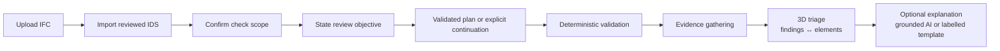
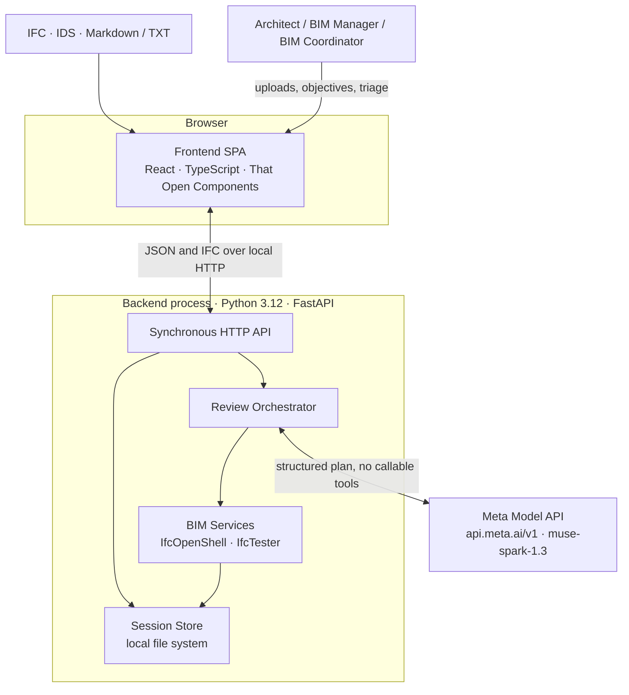
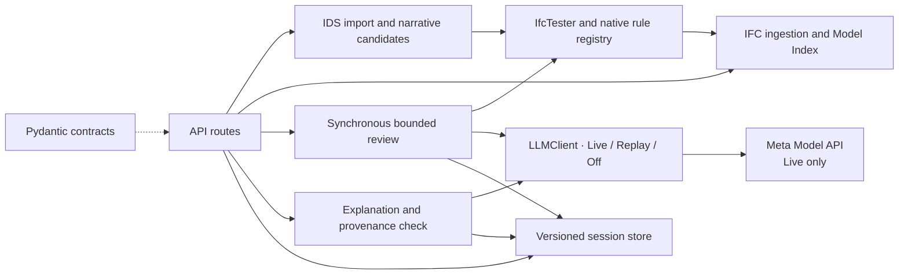
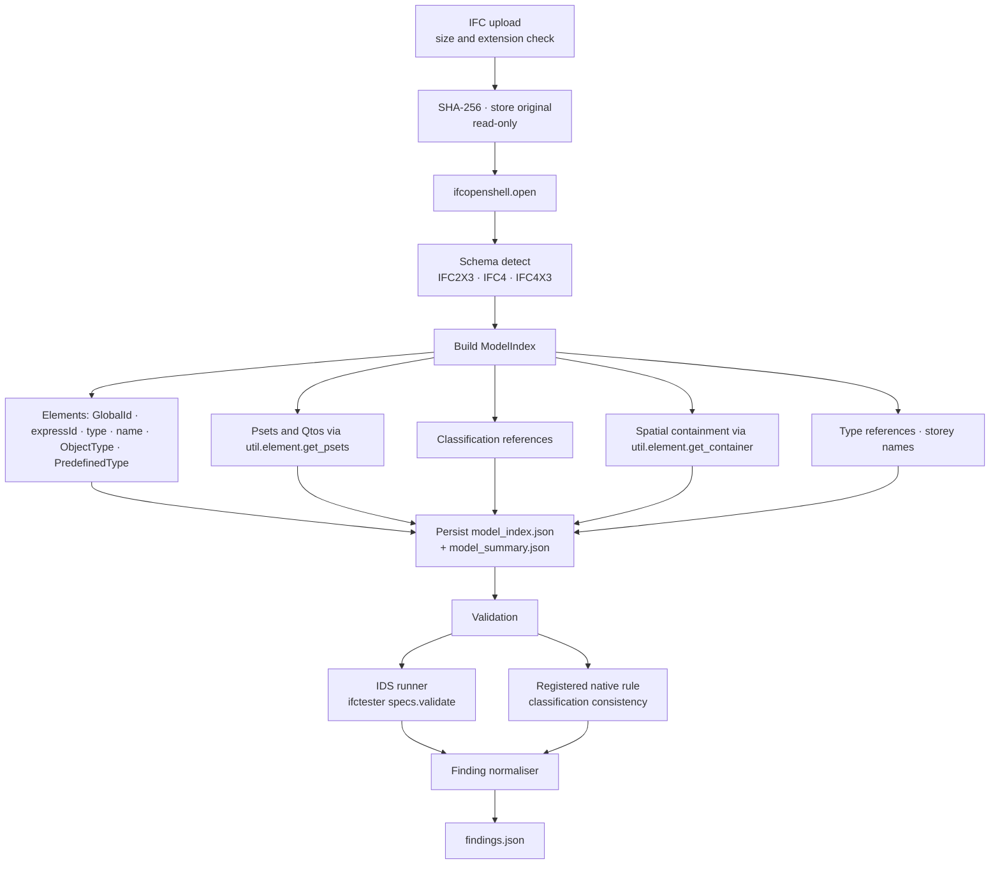
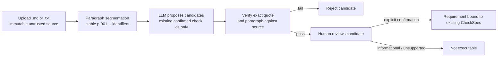
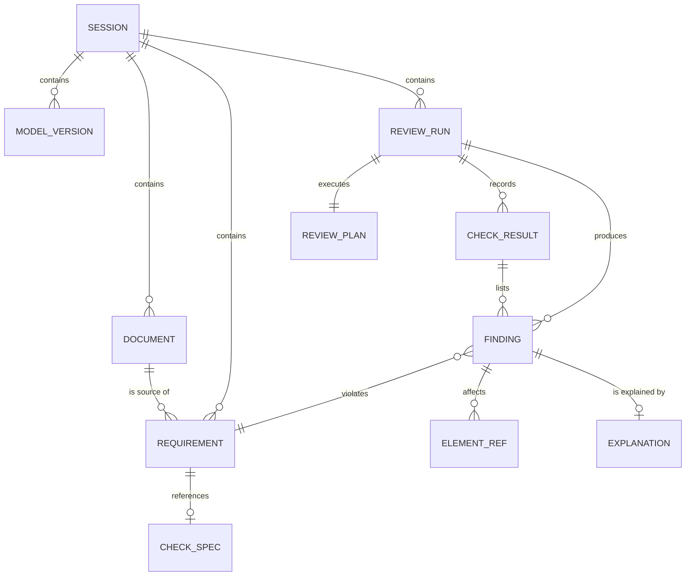
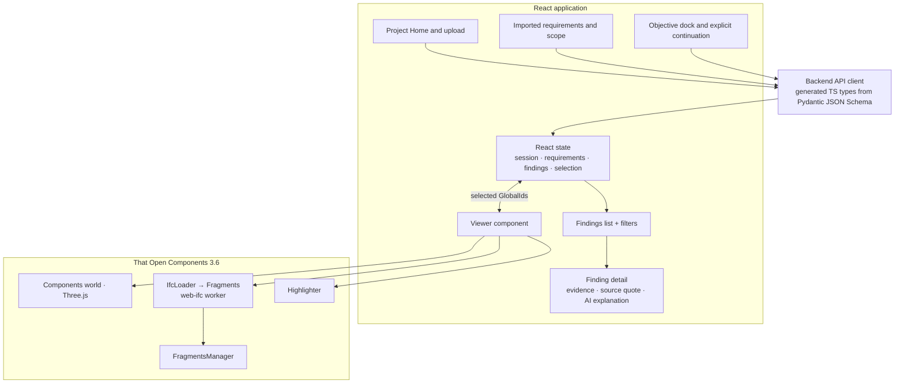
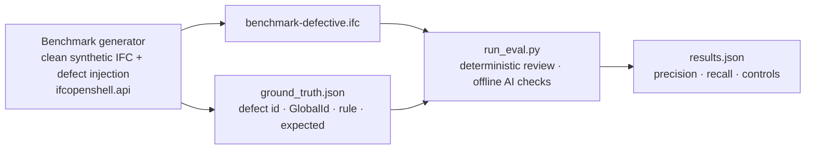
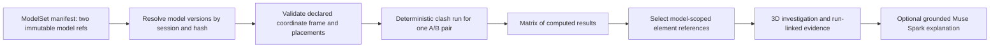

# BIM Intelligence — Technical Architecture

This document describes how BIM Intelligence is built: its components, data model, API, security
model and failure behaviour. Implemented behaviour is distinguished from planned work throughout.
The reasoning behind each major choice is recorded in [DECISIONS.md](./DECISIONS.md).

Notation:

- **DECISION:** an adopted architectural decision (rationale in [DECISIONS.md](./DECISIONS.md)).
- **PROPOSAL:** a design that needs validation before it is adopted.
- **ASSUMPTION:** a premise that has not yet been confirmed.

---

## 1. Executive technical overview

BIM Intelligence is an AI-assisted review application for architectural IFC models. An architect,
BIM manager or BIM coordinator selects confirmed requirements, optionally asks Meta Muse Spark for
a bounded plan, runs deterministic checks and inspects the findings in a 3D viewer. Separately
labelled explanations are available on request.

The architecture rests on one invariant that every component enforces:

> **Findings are produced only by deterministic code. The language model may plan, propose and
> explain; it may never assert a model fact that deterministic inspection has not produced.**

| Concern | Deterministic Python | LLM (Meta Muse Spark via the Meta Model API) |
|---|---|---|
| Reading IFC properties, relationships and geometry | ✔ IfcOpenShell | ✘ never |
| Executing checks (IDS, native rules) | ✔ IfcTester and the rule registry | ✘ never |
| Deciding *which* checks to run for an objective | ✔ validates confirmed check ids; explicit deterministic continuation | ✔ proposes a bounded plan |
| Extracting requirements from narrative documents | ✔ source-quote verification; human confirmation | ✔ proposes candidates with verbatim quotes |
| Collecting evidence for a finding | ✔ | ✘ |
| Explaining a finding | ✔ grounding check; labelled template fallback | ✔ drafts prose from the evidence |
| Writing a report | Planned | Planned, subject to grounding |

The system is a **single Python process** (FastAPI) and a **single-page TypeScript frontend**
(React and That Open Components). There are no microservices, queues or databases; session state
lives on the local file system.

---

## 2. Problem statement and professional workflow

### 2.1 The professional problem

Before a model is issued (the ISO 19650 "shared" or "published" state), the authoring team must
confirm that it carries the information the project's Exchange Information Requirements (EIR) and
BIM Execution Plan (BEP) demand: correct classification, required property sets, agreed naming and
a valid spatial structure. In practice this is done with commercial model checkers, hand-written
rule sets and spreadsheets, and the pain points are well known:

1. Project requirements live in prose documents, and turning them into executable rules is slow and
   error-prone.
2. Checker output is voluminous and poorly explained, so coordinators spend time triaging rather
   than fixing.
3. Rule libraries are generic, and project-specific intent is lost.
4. Traceability from a flagged element back to the clause that demanded the information is weak.

### 2.2 The target workflow



The browser imports IDS specifications as confirmed checks, so the reviewer must judge their
suitability before import. Narrative candidate extraction and human confirmation are available
through the API, and can bind only to an existing confirmed check. The orchestrator cannot execute
an unconfirmed requirement. Report and BCF export are planned.

### 2.3 What the system is not

- Not a model-authoring tool: the IFC is never modified.
- Not a code-compliance engine: building-regulation checking is out of scope.
- Not a general assistant: prompts are bound to a specific task.

---

## 3. Functional scope

| Area | Implemented | Planned |
|---|---|---|
| Ingestion | IFC2X3, IFC4 and IFC4X3 upload; content-addressed versions; Model Index; element lookup | Materials, storey elevations, bounding boxes |
| Requirements | IDS 1.0 import as confirmed requirements; narrative candidate extraction and confirmation (API) | Narrative confirmation in the browser; authoring new IDS criteria; PDF input |
| Validation | IfcTester IDS checks; the `classification.consistent_by_type` native rule; bounded execution | Further native rules, including geometry-dependent checks |
| AI assistance | Bounded review planning; grounded explanations; spend ledger | Iterative planning; explanation caching |
| Visualisation | 3D viewer, finding and element selection, Focus, Fit and Reset | Full element tree; multi-model scenes |
| Reporting | Per-run findings and provenance through the API | JSON/Markdown report; BCF export |

---

## 4. Quality attributes

The architecturally significant ones:

- **Determinism** separates the rule engine from any model path; repeated runs over the same inputs
  give byte-identical findings.
- **Grounding** drives the evidence data model and the post-generation citation check.
- **Bounded cost and execution** drive the single-orchestrator design with hard caps on checks,
  calls and spend.
- **Privacy** drives model-id validation (Standard-mode Muse models only) and the rule that the IFC
  file is never sent to a provider.
- **Graceful degradation** means the deterministic review and templated explanations work with AI
  switched off.
- **Portability** keeps Python at 3.10–3.12, the versions IfcOpenShell publishes wheels for.

---

## 5. System context and component diagram

### 5.1 Context



The backend process is the execution boundary for reviews and model calls, and it alone holds the
API key. The browser receives the version-pinned IFC bytes to render geometry locally (§12); the
model provider receives selected summaries or evidence, never the IFC file.

### 5.2 Backend components



---

## 6. Component responsibilities

| Component | Responsibility | LLM? | Key dependencies |
|---|---|---|---|
| **api/** | HTTP surface, request validation and error mapping. Routers contain no business logic; reviews run synchronously. | No | FastAPI, Pydantic |
| **schemas/** | Domain models such as `Session`, `ModelSummary`, `Requirement`, `CheckSpec`, `Finding`, `ReviewRun` and `Explanation`, exported as JSON Schema for the frontend types. | No | Pydantic v2 |
| **store/** | `SessionStore`: creates and reads session directories; stages, validates and publishes content-addressed model versions under a per-session file lock; activates a version with one atomic write; recovers abandoned staging (ADR-017). | No | stdlib |
| **bim/** | Opens the IFC with IfcOpenShell and builds a read-only `ModelIndex` of element identity, property sets, classifications, types and containment. | No | ifcopenshell 0.9 |
| **requirements/** | Stores IDS, Markdown and TXT sources; imports IDS as confirmed requirements; proposes quote-verified narrative candidates and binds only human-confirmed candidates to an existing confirmed `CheckSpec`. | Yes (extraction) | validation/ |
| **validation/** | Compiles IDS 1.0 documents to `CheckSpec`s and hydrates them back; runs IDS checks with IfcTester and the registered native rule; normalises the results to `Finding`s. | No | ifctester, xmlschema |
| **orchestration/** | Validates objective plans against confirmed check ids and executes bounded checks synchronously. Strict AI failures publish no run. There is no free-running tool loop. | Yes (planning) | llm/ |
| **llm/** | `LLMClient.complete(messages, response_model, max_output_tokens, purpose, run_id) -> Completion[T]`. `LiveClient` alone uses the network; `FakeClient` is in-memory; `RecordingClient` stores the validated response and a request hash (not prompts); `ReplayClient` is offline. Persistent spend ledger and usage accounting. | — | openai |
| **reporting/** | Produces separately labelled explanations from a verified `Finding`, its requirement and the pinned Model Index; validates citations and values or returns a deterministic template. Explanations are never stored in `findings.json`. | Yes (prose) | schemas/ |
| **frontend/** | Upload, imported requirements, scope and objective, explicit continuation, findings, on-request explanations and 3D selection; recent-session ids are remembered in the browser. | No | React, TypeScript, @thatopen/* 3.6, three ≥ 0.182, web-ifc ≥ 0.0.77 |
| **tests/evaluation/** and **datasets/** | Synthetic benchmark generator with defect injection, ground truth, metrics runner and replay fixtures. | Replay only | ifcopenshell.api |

A richer `EvidenceBundle` (sibling elements, property statistics) is planned; explanation evidence
is currently assembled from the pinned finding, requirement and Model Index.

---

## 7. Agent and tool orchestration

### 7.1 Why one orchestrator, not several agents

Planning, requirement extraction and explanation are separate structured-output calls. The
orchestrator selects and executes bounded, confirmed checks, and exposes no callable tools to the
model. The more general typed tool registry in
[ADR-003](./DECISIONS.md#adr-003-single-orchestrator-with-typed-tool-registry) is an adopted design
boundary, not an implemented model-directed tool loop.

### 7.2 Orchestration sequence

```mermaid
sequenceDiagram
    autonumber
    participant U as User
    participant API as FastAPI
    participant O as Orchestrator
    participant L as AI client
    participant V as Validation
    participant X as Explainer

    U->>API: POST review with objective and pinned scope
    API->>O: synchronously load confirmed checks and model version
    opt AI planning requested
        O->>L: structured plan request
        L-->>O: proposed check ids and reasons
        O->>O: validate schema, scope, uniqueness and caps
    end
    alt strict planning failure
        O-->>API: typed failure; no run published
        API-->>U: retry or explicitly continue without AI
    else accepted plan or explicit deterministic continuation
        loop each bounded check
            O->>V: execute confirmed IDS or registered native rule
            V-->>O: check result and deterministic findings
        end
        O->>API: atomically publish run and findings
        API-->>U: terminal run and provenance
    end
    opt user requests an explanation for a published finding
        U->>API: POST finding explanation
        API->>X: verify pinned finding and evidence
        opt AI available
            X->>L: structured explanation request
            L-->>X: explanation draft
            X->>X: schema and deterministic grounding checks
        end
        X-->>U: labelled AI explanation or deterministic template
    end
```

### 7.3 CheckSpec and native-rule registry

Imported IDS specifications and the explicitly registered `classification.consistent_by_type`
v1.0.0 native rule are represented by immutable `CheckSpec`s. Server-side code resolves each
confirmed check and its stored criteria; model output supplies neither code nor arguments. The
runner enforces `MAX_PLAN_CHECKS` (default 10) and `MAX_TOOL_CALLS_PER_RUN` (default 12), recording
omitted checks as skipped. All execution is read-only with respect to the IFC.

### 7.4 Planner prompt contract

The planner requests a JSON Schema response format without the optional strict flag; local
Pydantic and plan validation remain authoritative. The `ReviewPlan` shape is:

```json
{
  "checks": [
    {"check_id": "confirmed-check-id", "reason": "why this check is relevant"}
  ]
}
```

The orchestrator **filters** the plan against the current confirmed checks and the execution cap.
A plan that references an unknown, duplicate or excess check is rejected. When no supplied check
fits the objective, the API returns a typed unsupported-scope response rather than broadening the
request to the default plan.

### 7.5 Protocol choice

**DECISION:** use Chat Completions (`POST /v1/chat/completions`) through the `openai` Python SDK at
`https://api.meta.ai/v1`. Planning and explanation requests use a non-strict JSON Schema response
format, `max_completion_tokens` of 2,000 and low reasoning effort (ADR-027, ADR-028); local
validation is kept. One live synthetic scenario has returned a valid plan and a grounded
explanation (ADR-029). Strict provider-side schema support and the Responses API have not been
evaluated.

### 7.6 Model client and Live-mode boundary

`LLMClient` defines one generic, schema-validated `complete` method returning `Completion[T]` with
typed usage and model metadata. `FakeClient` validates in-memory responses, `ReplayClient` reads
matching response fixtures, and `RecordingClient` stores only the validated response, request hash,
purpose, schema name and usage. Neither Fake nor Replay can make network requests. `LiveClient`
alone constructs the OpenAI client; configuration pins its base URL to `https://api.meta.ai/v1` and
defaults the model to the Standard-mode `muse-spark-1.3`.

The default `BIMI_ENVIRONMENT=development` and `LLM_MODE=off` construct no live client. Live mode
additionally requires `ALLOW_LIVE_LLM=true` and `MODEL_API_KEY`, which stays a backend `SecretStr`.
Retries default to zero, and a process-wide file lock prevents concurrent live calls.
`BIMI_ENVIRONMENT=production` is a configuration profile that requires Live mode, the Standard-mode
`muse-spark-1.3` model, the key and the live opt-in, and rejects Contributor models. It is not a
deployment approval: the application has no authentication. Prompts are versioned files, and model
output is schema-validated before application logic sees it. The model has no tool executor,
file-system access, shell or network capability.

Planning takes an optional review objective and may return only unique confirmed `CheckSpec` ids
with reasons. An objective requires an accepted AI plan by default. A caller may set
`ai_required=false` to allow deterministic fallback after a provider or plan failure, or
`continue_without_ai=true` to skip planning deliberately. Unsupported scope is a typed 422, never
broadened to the default plan. Optional `selected_checks` restrict planning and execution to
current confirmed checks, each pinned to its `requirement_id`, `check_id` and
`requirement_revision`; stale selections are rejected before execution. Strict failures return safe
typed metadata and publish no run or findings. Each run records the planning mode, the model when
available, whether a provider request was attempted, the outcome, any fallback reason, and the
selected and executed check ids. Older runs remain readable with `provenance=null`.

Muse Spark prices are configurable in `Settings` (input, cached input and output, in USD per
million tokens). Before each request the application estimates input from UTF-8 bytes plus message
overhead and reserves the full output allowance. The default input limit is 8,000 tokens; planning
and explanations each allow 2,000 completion tokens, and other workflows 500. The limits are two
calls per review, USD 0.10 per call and per review, and USD 5 in total. The ledger under
`DATA_DIR/llm/` uses a cross-process file lock, charges the full reservation when usage is
unavailable and reconciles returned usage; corrupt or unavailable accounting fails closed. These are
**application safeguards**, not provider billing caps. Safe aggregate status is available at
`GET /api/v1/llm/budget`. See
[ADR-020](./DECISIONS.md#adr-020-meta-client-spend-ledger-and-live-mode-safeguards).

---

## 8. IFC ingestion and validation pipeline



### 8.1 Model Index

The Model Index is a denormalised JSON snapshot built once per upload, so that native rules work on
a fast in-memory structure rather than re-walking the IFC graph, and so that the frontend can request
element records without the backend holding an IfcOpenShell file open per request.

`open_ifc` accepts IFC2X3, IFC4 and IFC4X3 and raises `IfcLoadError` or `UnsupportedSchemaError`
otherwise; messages never contain storage paths. `build_index` indexes every `IfcProduct`
(including spatial elements) and `IfcTypeObject` in express-id order, reading values through
`ifcopenshell.util` so that the index agrees with IfcOpenShell by construction: property and
quantity sets with instance-versus-type provenance (`PropertyValue.inherited`), classification
references per system, the direct or aggregate-inherited container and the containing storey.
Records are keyed by `express_id` with a `GlobalId → [express_id]` multimap: duplicates are kept
and reported in `duplicate_global_ids`, `by_global_id()` raises `AmbiguousGlobalIdError`, and
GlobalIds that fail the 22-character check are recorded in `malformed_global_ids` with
`global_id=None` ([ADR-016](./DECISIONS.md#adr-016-ingestion-contract-staged-upload-content-hash-etag-and-identifier-handling)).
Materials and storey elevations are not indexed yet.

**Ingestion contract.** `ingest_model` takes the session's model lock, writes the upload into a
private staging directory while hashing and size-capping it, parses and indexes the staged copy,
writes `model_index.json` and `model_summary.json` beside it, validates the set and publishes it as
one immutable version directory `models/{sha256}/` with a single rename. The session record is then
pointed at that hash in one atomic write
([ADR-017](./DECISIONS.md#adr-017-content-addressed-model-versions-with-single-pointer-publication)).
A rejected or interrupted upload therefore never replaces an indexed model or leaves a mixed
version, a second concurrent upload is refused with 409, and every read serves bytes, index and
summary from the same version directory.

**DECISION:** geometry is **not** processed on the backend. Bounding boxes and storey assignment by
elevation are planned and, if added, would use `ifcopenshell.geom.iterator` on a worker thread with
a time budget. Rendering happens entirely in the browser (§12).

### 8.2 IDS validation

IfcTester is the reference IDS 1.0 implementation maintained alongside IfcOpenShell
([ADR-018](./DECISIONS.md#adr-018-ids-import-establishes-confirmed-requirements-checks-are-hydrated-per-run-reviews-run-under-the-session-lock),
[ADR-019](./DECISIONS.md#adr-019-native-rule-scope-and-bounded-deterministic-execution)).

1. **Import compiles; it does not keep the document executable.** `validation.compile_ids`
   validates the upload against IfcTester's bundled IDS 1.0 XSD (with remote schema imports
   disabled, so no outbound request is made) and turns every `<specification>` into one immutable
   `CheckSpec` whose payload is the element in XML Canonical Form with indentation removed;
   `rule_version` is the content hash of that payload and `rule_id` is `ids:<identifier or name>`.
   `requirements.import_ids_document` wraps each check in a `Requirement` with `origin="ids"`,
   `status="confirmed"`, `revision = confirmed_revision = 1` and a `source` quoting the
   specification name, stores the document under `documents/{sha256}.ids`, and is idempotent on
   content.
2. **Each check is hydrated from its own payload and run in isolation.** `validation.run_ids_check`
   re-checks that the payload still hashes to `rule_version`, decodes it into a single-specification
   `ifctester.ids.Ids`, calls `Ids.validate(model)` (IfcTester's public entry point, which also
   resets its property caches) and normalises the result. A specification whose `ifcVersion` does
   not list the model's schema is `skipped`; a required or optional specification with no
   applicable entity is `not_applicable`; a prohibited specification yields one `prohibited_entity`
   finding per matching entity; and any engine exception, or a payload altered after confirmation,
   is `error` with the message in `diagnostics`, after which the next check still runs. Findings
   carry IfcTester's `reason` as `observed`, the facet's rendered requirement as `expected`, a
   `category` from the facet type (`property_requirement`, `classification_requirement`, …) and the
   element reference from the Model Index of the same version, so the viewer,
   `GET /elements/{globalId}` and `findings.json` agree by construction. Unit tests cross-check the
   findings against `ifctester.reporter.Json` element for element.
3. **A review pins one version for its whole duration.** `orchestration.run_review` takes the
   session's model lock, resolves the active `ModelVersion` once, refuses a pinned `If-Match` hash
   that is not active (412), builds the plan, records the `InputManifest`, opens the IFC read-only
   from the version directory, runs the checks and publishes `runs/{runId}/run.json` and
   `findings.json` with one rename. `MAX_PLAN_CHECKS` bounds the plan and `MAX_TOOL_CALLS_PER_RUN`
   the executions; checks outside either cap are `skipped`, and an error does not stop later checks.
   `error`, `skipped` and `not_applicable` outcomes make the run `partial`, never a coverage claim.
   An upload or second review in the meantime is 409 `model-locked`. Runs are synchronous
   ([ADR-013](./DECISIONS.md#adr-013-synchronous-in-process-review-runs-no-task-queue)).

On the committed fixture, `minimal.ids` imports as two confirmed requirements, and a review gives
two `failed` check results and exactly two findings: W-002 fails the fire-rating specification, and
W-003 fails the classification specification and is outside the first one's scope. Repeated runs
write byte-identical `findings.json`
([tests/unit/validation](../tests/unit/validation), [tests/unit/orchestration](../tests/unit/orchestration),
[tests/unit/api/test_reviews.py](../tests/unit/api/test_reviews.py)).

### 8.3 Native rules

Native rules cover checks that IDS 1.0 cannot express. A rule is registered by a stable id and
version, receives an immutable confirmed `CheckSpec`, and inspects the `ModelIndex` of the pinned
model only. Its applicability and evidence are deterministic; a malformed or unsupported
`CheckSpec` is an `error` result, never a finding.

| Rule id | Version | Applicability and behaviour |
|---|---|---|
| `classification.consistent_by_type` | `1.0.0` | Applies to each indexed occurrence whose `IfcTypeObject` has one or more classification references. Compares sorted `(system, identification-or-name)` sets on the occurrence and its type, and emits one finding for each differing occurrence, with the observed and expected codes. No applicable classified type gives `not_applicable`. The `CheckSpec` takes no parameters. |

This is the only native rule. IDS remains responsible for required properties (including values and
cardinality), classification presence and system, and naming patterns its Attribute facet can
express, which avoids duplicate findings for one confirmed requirement. The rule is added as a
built-in requirement through `POST /sessions/{sid}/requirements/native/classification-consistency`;
repeating the request is idempotent.

---

## 9. Document interpretation and requirement verification



### 9.1 Requirement candidate schema (abridged)

```json
{
  "id": "content-derived-candidate-id",
  "title": "Classification consistency",
  "statement": "Classifications shall remain consistent.",
  "source": {
    "document_id": "64-lowercase-hex-sha256",
    "location": "p-002",
    "quote": "Classifications shall remain consistent."
  },
  "document_kind": "markdown",
  "check_id": "existing-confirmed-check-id",
  "confidence": 0.82,
  "status": "proposed"
}
```

### 9.2 Safeguards

- **Supported formats:** `.txt` and `.md` are stored byte for byte; PDF is not parsed. IDS import
  is a separate, schema-validated path.
- **Verbatim quote check:** deterministic. The quote must occur in the stored source and in the
  named paragraph. Candidate ids derive from the document hash, paragraph id and quote, and
  confirmation repeats the hash, quote and paragraph checks.
- **Existing `CheckSpec` only:** the model cannot return criteria, parameters or IDS facets.
  Candidates with no confirmed-check mapping are `informational`; unknown check ids and unsupported
  quotations are rejected. New IDS criteria are not authored.
- **Human confirmation** is a separate API request, and can only bind a proposed candidate to the
  same already-confirmed check id.
- **Confidence** is the model's self-report and never confirms a candidate automatically.

**PROPOSAL:** chunked extraction, or a section filter for long BEPs. Each request is currently
limited to 8,000 estimated input tokens, so an oversized document can be rejected before a request
is made.

---

## 10. Data models and evidence traceability

### 10.1 Entity relationships



An explanation is an on-request response, not part of the immutable finding record. `EvidenceBundle`,
`Report` and a dedicated `RunLog` are planned.

### 10.2 Core schemas

Models live in `backend/bim_intelligence/schemas/` and are exported to
`frontend/src/api/generated/` (ADR-014, ADR-015). Models not yet implemented are marked *planned*.

| Model | Fields (abridged) | Notes |
|---|---|---|
| `Session` | `id` (UUID4), `created_at`, `status` ∈ created/model_ready, `model_hash`, `document_hashes` | Directory `data/sessions/{id}/`; `model_ready` ⇔ `model_hash` present; `model_hash` points to the active version directory `models/{model_hash}/` (ADR-017); never carries paths. |
| `ElementRef` | `global_id` (nullable), `express_id`, `ifc_type`, `name`, `storey` | The only way to refer to an element; GlobalId is the viewer key and `express_id` the fallback identity. |
| `ElementRecord` | `ref`, `object_type`, `predefined_type`, `type_ref`, `container`, `psets{set: {name: {value, inherited}}}`, `classifications[] {system, identification, name, inherited}` | The Model Index entry served by `GET /elements/{globalId}`; `inherited=true` marks values from the type object. |
| `ModelSummary` | `ifc_schema`, `model_hash`, `project_name`, `counts{IfcClass: n}`, `storeys[]` | Produced once per upload; counts cover indexed `IfcProduct` and `IfcTypeObject` instances. |
| `Requirement` | `id`, `title`, `statement`, `origin` ∈ document/ids/builtin, `source`, `check`, `status`, `confidence`, `revision`, `confirmed_revision`, `confirmed_by`, `confirmed_at` | `status` ∈ proposed/confirmed/edited/rejected/informational; executable only when `confirmed_revision == revision`. IDS requirements are confirmed at import, with `source.document_id` the IDS hash and `source.quote` the specification name. |
| `CheckSpec` | `id` (content hash), `kind` (ids/native), `rule_id`, `rule_version`, `ids_specification` or `params` | Immutable; plans reference it by `id` only. For `kind="ids"`, `ids_specification` is the canonical `<specification>` element and `rule_version` its content hash. |
| `Finding` | `id` (content hash), `check_id`, `requirement_id`, `rule_id`, `rule_version`, `facet_index`, `severity`, `category`, `elements[]`, `observed`, `expected`, `method` ∈ {ids, native} | `method` can never be `llm`; no timestamp or run id, so `findings.json` is byte-reproducible. |
| `CheckResult` | `check_id`, `requirement_id`, `status` ∈ passed/failed/error/skipped/not_applicable, `applicable_count`, `finding_ids[]`, `diagnostics[]` | An execution outcome, never a defect. |
| `ReviewPlan` | `checks[] {check_id, reason}` | The planner's ordered output; no parameters. |
| `ReviewRequest` | `objective`, `ai_required`, `continue_without_ai`, `selected_checks[]` | Objective planning is strict by default; optional fallback and deliberate continuation are distinct. |
| `SelectedCheck` | `check_id`, `requirement_id`, `requirement_revision` | User-selected scope, validated against the current confirmed requirements before planning and execution. |
| `ReviewProvenance` | `ai_planning_requested`, `provider_request_attempted`, `mode`, `model`, `outcome`, `fallback_reason`, `deterministic_fallback`, `selected_check_ids[]`, `executed_check_ids[]` | Recorded on each run; `null` on older runs rather than inferred. |
| `ReviewRun` | `id`, `session_id`, `status` ∈ queued/running/completed/partial/failed/interrupted, `plan`, `plan_source` ∈ llm/default, `provenance`, `check_results[]`, `input_manifest`, `created_at`, `finished_at` | The only record with timestamps. Synchronous runs end `completed` or `partial`; `input_manifest` records the model hash, IDS hashes, requirement revisions and rule versions. |
| `DocumentImport` | `sha256`, `kind` ∈ {ids, text, markdown}, `title`, `requirements[]` | What `POST /documents` returns. Narrative uploads return an empty list; candidate extraction is separate. |
| `ProblemDetail` | `type`, `title`, `status`, `detail`, `instance`, `correlation_id` | RFC 9457 body for every error response. |
| `Explanation` | `finding_id`, `summary`, `probable_cause`, `corrective_action`, `citations[]`, `source`, `grounding_status`, `model`, `fallback_reason` | Each citation binds the finding, GlobalId, requirement, rule, and expected and observed values. `ai_generated` requires `grounding_status=passed`, a model id and no fallback reason; `deterministic_template` requires `grounding_status=fallback`, no model and one `fallback_reason` (`ai_disabled`, `unsupported_evidence`, `budget_limit`, `token_limit`, `ai_request_failed`, `ai_output_invalid`, `grounding_failed`). Never stored with findings. |
| `EvidenceBundle` *(planned)* | `finding_id`, `element_records[]`, `container`, `siblings[]`, `property_stats`, `requirement_source` | Everything an explanation may cite. |
| `Report` *(planned)* | Session metadata, model summary, requirements, findings with evidence and explanations, traceability matrix, provenance | Canonical JSON with a Markdown rendering. |
| `RunLog` *(planned)* | Plan, check executions, token usage, grounding results, errors, timings | One per run. |

### 10.3 Traceability chain

Every finding can be traced in both directions:

`Document paragraph → Requirement (quote) → CheckSpec (IDS XML or rule) → Finding (observed/expected, method, rule version) → ElementRef (GlobalId) → Explanation (cited ids ⊆ evidence)`

The run manifest and finding records preserve these links. A complete report with a traceability
matrix is planned.

### 10.4 Grounding check

Each AI explanation is grounded against one element. Every citation must match the finding id,
element GlobalId, requirement id, rule id, and expected and observed values, and the GlobalId must
resolve in the Model Index. The prose is rejected if it mentions an unsupported GlobalId,
requirement id or numeric value. Multi-element findings use the deterministic template rather than
risk mixing evidence between elements. There is no regeneration loop: invalid output, an unavailable
client or a grounding failure falls back to the template immediately.

Before any evidence is assembled, the explanation endpoint verifies provenance under the session's
model lock. It checks that:

- the stored run matches the requested run and belongs to the session;
- exactly one of the run's check results records the finding, with matching check and requirement
  ids;
- the run's input manifest names the requirement revision, which is still stored and confirmed;
- the confirmed `CheckSpec` id, rule id and rule version match the finding and the manifest;
- an IDS or document requirement has a source reference, and any source document is among the
  manifest's document hashes (built-in requirements need no document);
- the Model Index is the run's pinned model version, and every finding element still has its
  recorded GlobalId, type, name and storey.

Any disagreement is refused rather than explained. The single model call runs after the lock is
released, because published runs and model versions are immutable.

---

## 11. API architecture and principal endpoints

Base path `/api/v1`. JSON throughout; errors use the `ProblemDetail` schema served as
`application/problem+json`. Every response carries `X-Correlation-ID` (echoed from the request when
well-formed, otherwise generated). Rows marked ✓ are implemented and tested; the others are planned.

| Method | Path | Purpose |
|---|---|---|
| `GET` | `/health` ✓ | Liveness, versions and safe configuration diagnostics, including the mode and whether a key is configured; no provider check and no key exposure. |
| `POST` | `/sessions` ✓ | Create a review session; 201 with `Location`. |
| `GET` | `/sessions/{sid}` ✓ | Session status and model hash (never paths). |
| `POST` | `/sessions/{sid}/model` ✓ | Upload an IFC (multipart, `.ifc`, ≤ `MAX_IFC_MB`); returns `ModelSummary` with `ETag` = the new version's quoted SHA-256. 409 `model-locked` while another upload is in progress; 413, 415 and 422 as `ProblemDetail`. A re-upload replaces the active version atomically (ADR-017). |
| `GET` | `/sessions/{sid}/model/summary` ✓ | Summary of the active version; `ETag` = quoted SHA-256; `If-Match` mismatch → 412. |
| `GET` | `/sessions/{sid}/model/file` ✓ | The stored IFC bytes (`application/x-step`) with an `ETag` that always describes the body; `If-None-Match` → 304, `If-Match` mismatch → 412. The viewer's geometry source. |
| `GET` | `/sessions/{sid}/elements/{globalId}` ✓ | `ElementRecord` from the active version's index; 400 malformed id, 404 unknown, 409 duplicated GlobalId, 412 on `If-Match` mismatch. |
| `GET` | `/sessions/{sid}/elements?ifc_type=&storey=&limit=` | Element list (planned). |
| `POST` | `/sessions/{sid}/documents` ✓ | Upload IDS 1.0 (`.ids`), Markdown (`.md`) or UTF-8 text (`.txt`). IDS creates confirmed requirements; narrative input is stored as source only. 422 on parse errors, 415 other extensions, 413 too large, 409 while locked. |
| `POST` | `/sessions/{sid}/requirements/extract` ✓ | Extract narrative candidates from a stored document, verifying quotes and paragraph ids; 503 when AI is off or unavailable. Creates no requirements. |
| `POST` | `/sessions/{sid}/requirements/confirm-candidate` ✓ | Confirm a proposed candidate bound to the same existing confirmed `CheckSpec`, re-validating the content hash and quote; informational candidates are rejected. |
| `GET` | `/sessions/{sid}/requirements` ✓ | List requirements with status, revision, source and `CheckSpec`. |
| `POST` | `/sessions/{sid}/requirements/native/classification-consistency` ✓ | Register the native classification-consistency rule as a built-in requirement; 201 when added, 200 when already present, 409 while locked. |
| `PATCH` | `/sessions/{sid}/requirements/{rid}` | Confirm, edit or reject (planned). |
| `POST` | `/sessions/{sid}/reviews` ✓ | Start a synchronous run. An objective (1–4,000 visible characters) requires an accepted AI plan by default; `ai_required=false` allows deterministic fallback on provider or plan failure, and `continue_without_ai=true` skips planning. Strict failures return typed `ProblemDetail` metadata and publish nothing; unsupported scope is 422, never a broader review. `selected_checks` pins scope to current confirmed check revisions; stale scope is 422. With no objective, the deterministic default plan runs. Returns 201 with the terminal `ReviewRun`; `If-Match` pins the model. |
| `GET` | `/sessions/{sid}/reviews/{runId}` ✓ | The published run: status, plan, per-check results, input manifest and provenance. |
| `GET` | `/sessions/{sid}/findings?run_id=&severity=&rule_id=&storey=` ✓ | Findings of one run in canonical order; `run_id` required; 400 malformed run id, 404 unknown run. |
| `POST` | `/sessions/{sid}/reviews/{runId}/findings/{fid}/explanation` ✓ | A labelled, grounded explanation or deterministic template for one finding the run recorded (§10.4). 404 unknown session, run or finding; 409 `explanation-provenance-mismatch` when stored evidence disagrees; 412 `model-version-mismatch` on an `If-Match` for another version. Never writes `run.json` or `findings.json`. |
| `GET` | `/llm/budget` ✓ | Safe aggregate ledger status; no prompts or secrets; 503 when pricing or the ledger is unavailable. |
| `GET` | `/sessions/{sid}/reviews/{runId}/events` | Server-Sent Events progress stream (planned; see ADR-013). |
| `GET` | `/sessions/{sid}/reviews/{runId}/report?format=json\|md\|bcf` | Report and BCF 3.0 export (planned). |

**Asynchrony.** Reviews are synchronous and return a terminal run
([ADR-013](./DECISIONS.md#adr-013-synchronous-in-process-review-runs-no-task-queue)). Background
execution with a progress stream is the planned approach for large models.

**CORS.** The browser may send `If-Match` and `If-None-Match`, which are not CORS-safelisted, so both
are in the preflight allow-list alongside `Content-Type` and `X-Correlation-ID`, and `ETag` is
exposed to scripts (`tests/unit/api/test_cors.py`).

**Authentication.** None (local use only). The server refuses to bind to a non-loopback interface
unless `ALLOW_REMOTE=true`, to prevent accidental exposure of uploaded project files.

The review workspace submits the selected confirmed-check revisions and the model ETag. A strict AI
failure offers a retry or explicit deterministic continuation, and the resulting run and findings
are loaded through version-pinned endpoints.

---

## 12. Frontend and 3D visualisation architecture



### 12.1 Key decisions

- **DECISION:** the browser loads the IFC itself with That Open Components' `IfcLoader` (web-ifc in
  a worker) and converts it to Fragments. The backend serves no geometry.
- **DECISION:** the join key between backend findings and viewer objects is the **IFC GlobalId**.
  `IfcViewer` resolves ids with `getLocalIdsByGuids` and `getGuidsByLocalIds` and highlights with
  `Highlighter.highlightByID`; these That Open Components 3.6 APIs were verified in the browser
  against the minimal fixture.
- **DECISION:** Vite, React 19 and strict TypeScript, with `oxlint` and Prettier. Selection is
  shared through local React state; there is no global store or router.
- Frontend types are generated from the backend's Pydantic JSON Schema, so `Finding`,
  `Requirement` and `Explanation` are identical on both sides.

### 12.2 States to handle

The workspace shows loading, empty, error and result states, per-check coverage, and the actual
plan and explanation source. AI-planning failures offer an explicit choice rather than silently
claiming success. A full accessibility audit is outstanding.

### 12.3 Viewer and review workspace

Project Home creates sessions, uploads inputs and reopens recent sessions remembered in the
browser. The review workspace provides the objective dock and revision-pinned scope. A review run is
accepted only when its session and immutable `input_manifest.model_hash` match the active model
summary. The model file and later element lookups use that summary's ETag with `If-Match`, and the
summary is rechecked after the model and findings load; a mismatch fails visibly instead of
combining versions.

Selecting a finding highlights its affected GlobalIds with a dedicated style. Selecting a rendered
object resolves its GlobalId, loads its element record and selects the first matching finding in
canonical order. Element details show identity, storey and a bounded property list with
inherited-value provenance. Empty findings, loading, API and version errors and viewer-load errors
are all shown in the interface.

Viewer imports stay inside `frontend/src/viewer/`, and the viewer module is code-split and loaded
when a workspace opens. The Fragments worker is bundled from `@thatopen/fragments/worker?url`;
`predev` and `prebuild` copy the pinned `web-ifc` WASM files into the ignored
`frontend/public/web-ifc/`, and the loader reads them from `/web-ifc/`. Focus, Fit, Reset and
two-way finding/element selection are implemented; the model browser lists storeys rather than a
complete element tree.

---

## 13. Security, privacy and credential handling

| Area | Design |
|---|---|
| Secrets | `MODEL_API_KEY` is a backend `SecretStr`, loaded at runtime only. `.env` is git-ignored; `/health`, budget diagnostics, errors and recordings never expose the key. Live mode requires `LLM_MODE=live`, the key and `ALLOW_LIVE_LLM=true`. |
| Model data privacy | Standard-mode model ids by default; `-contributor` ids are rejected unless explicitly allowed. The model receives summaries, confirmed requirements, narrative source text or finding evidence for the requested operation, never the IFC file. |
| Uploads | `.ifc`, `.ids`, `.md` and `.txt` only, with `MAX_IFC_MB` and `MAX_DOC_MB` limits. Stored paths are fixed and content-addressed; session ids are validated before use. |
| Least privilege | No tools are exposed to the model; plans contain check ids only. The model has no file-system, shell or network access. |
| Network | Only `LiveClient` uses the OpenAI SDK, and `LLM_BASE_URL` is restricted to `https://api.meta.ai/v1`. The IDS schema loads offline. No telemetry. The server binds to `127.0.0.1` unless explicitly overridden. |
| Prompt injection | Narrative document content is untrusted. Extraction runs outside a tool loop, output is schema-validated, and quotes and paragraph ids are checked against the stored document. Candidates must be confirmed by a person before they can run. |
| Spending | A persistent, lock-protected ledger reserves cost before each request and reconciles usage. Planning and explanations each allow up to 2,000 completion tokens at low reasoning effort; other workflows 500. Defaults: `LLM_MODE=off`, zero retries, at most two live calls per review, USD 0.10 per call and per review, USD 5.00 in total. These safeguards cannot cap provider account billing. |
| Response diagnostics | The ledger records only safe metadata: model id, response id, finish reason, completion tokens, reasoning tokens, whether visible content was returned, and the outcome. Never prompts, completion or refusal text, or credentials. |
| Secret scanning | Gitleaks in CI, repository scripts and a staged pre-commit hook. Output is redacted; one narrowly scoped allow-list entry covers a known synthetic GlobalId false positive. |
| Private material | Private models and documents stay outside the repository; `local-private/` is git-ignored for this purpose. |
| Dependencies | Version ranges in `pyproject.toml` and a locked `package-lock.json`; licences in [THIRD_PARTY_NOTICES.md](../THIRD_PARTY_NOTICES.md). |

---

## 14. Error handling and fallback behaviour

| Failure | Behaviour |
|---|---|
| IFC fails to open | 422 `ifc-unreadable` with IfcOpenShell's message (paths removed); any previously indexed model is untouched. |
| Unsupported or unknown `FILE_SCHEMA` | 422 `unsupported-ifc-schema` naming the declared schema. IFC2X3, IFC4 and IFC4X3 are accepted. |
| Upload too large, wrong extension or missing field | 413 `upload-too-large`, 415 `unsupported-upload` or 422 `request-validation`. The size cap is enforced while the staged file is written; nothing is published. |
| Failure while indexing, serialising or publishing an upload | The staging directory is removed and the active version stays whole; a failure between the directory rename and the pointer swap leaves a complete, inactive version. No reader can observe a partial or mixed version (ADR-017). |
| Second upload while one is in progress | 409 `model-locked`, immediately rather than queued; readers are not blocked. The same applies to an upload, IDS import or second review while a review holds the lock. |
| Client pinned to a replaced version (`If-Match`) | 412 `model-version-mismatch` naming the active hash; the client reloads rather than mixing versions. |
| Process interrupted mid-upload | Abandoned staging directories are removed by the next upload and by the start-up sweep, and are never served. |
| Duplicate GlobalId in the model | Both records are indexed; `GET /elements/{globalId}` returns 409 `ambiguous-global-id` listing the express ids. |
| Storage read or write failure | 500 `storage-failure` with a generic detail; the cause is logged on the server with the correlation id. |
| Uploaded IDS malformed, not IDS 1.0, or with no specification | 422 `ids-invalid` naming the first violation; nothing is stored. |
| Review requested without a model, or without a confirmed requirement | 404 `model-not-found` or 409 `no-executable-checks`; no run is recorded, so an empty run can never read as compliance. |
| Specification declares a schema the model does not use | That check is `skipped`, with the declared and actual schema in `diagnostics`. |
| Required specification matches no entity | `not_applicable`, `applicable_count=0`, no finding. |
| A confirmed check's payload no longer hashes to its `rule_version` | `error` naming the check; it is never executed as a weaker check. |
| Narrative document is empty or not valid UTF-8 | 422; nothing is stored. |
| Narrative extraction unavailable or malformed | A sanitised 503, or the invalid candidate output is rejected; no `Requirement` is created. |
| Strict objective planning unavailable, invalid, truncated, refused or filtered | A typed planning failure; no run or findings are published, and the caller can explicitly continue without AI. `token_limit` identifies an exhausted completion allowance; `invalid_output` is reserved for visible content that fails validation. Refusal and filter text is never kept. |
| Whitespace-only review objective | 422 `request-validation` before any planning request. |
| Explanation requested for a finding the run did not record | 404 `finding-not-found`. |
| Explanation evidence disagrees with the run | 409 `explanation-provenance-mismatch`; nothing is sent to the model. |
| Explanation `If-Match` names another model version | 412 `model-version-mismatch` naming the run's version. |
| Plan contains an unknown, duplicate, unconfirmed or excess check | The plan is rejected; strict requests publish no run. The default plan is used only when the caller allows fallback or continues without AI. |
| `MAX_PLAN_CHECKS` or `MAX_TOOL_CALLS_PER_RUN` reached | Every check not executed is `skipped`, and the run ends `partial`, never `completed`. |
| Grounding failure or multi-element finding | The AI text is discarded and the deterministic template is returned. |
| Request would exceed a budget or the input limit | Rejected before any network access. A response that exhausts its completion allowance is classified `token_limit`. |
| Provider usage missing | The full reservation is charged. |
| Budget ledger corrupt, unavailable or locked | Live requests and budget diagnostics fail closed; no fresh ledger is created over unreadable state. |
| Provider error or timeout | No retries by default; only a sanitised error type is surfaced. |
| IDS or native check raises an exception | That check is `error` with the message in `diagnostics`; no finding is created; later checks continue; the run ends `partial`. |
| Frontend fails to load the IFC | The viewer shows an error with a retry. |

Every error is a `ProblemDetail` with `type = https://github.com/natnew/BIM-Intelligence/problems/<slug>`,
the same project-scoped, non-resolving URI convention as the schema bundle's `$id`.

---

## 15. Observability and diagnostics

- **Budget ledger** (`DATA_DIR/llm/budget.json`): request and run ids, input, output and cached
  token counts when reported, estimates, calculated costs, model and outcome. No prompts or API
  key. Writes and reservations are lock-protected.
- **Safe diagnostics** (`GET /api/v1/llm/budget`): total budget, spend, active reservations,
  remaining amount and request count only.
- **Replay recordings** store a request hash rather than raw prompts, and a validated response.
  They live under an ignored runtime path and are read offline.
- **Health endpoint**: service and library versions, configured mode and model, and whether a key
  is configured. It makes no model call and never returns the key.
- **Correlation ids** on every response tie client reports to server logs.
- **PROPOSAL:** OpenTelemetry tracing is unnecessary at this scale; a per-run log is planned
  instead.

---

## 16. Evaluation and testing architecture

The benchmark is described in [datasets/README.md](../datasets/README.md).



| Layer | Tooling | What it shows |
|---|---|---|
| Unit | pytest | Model Index construction, the native rule, IDS validation, plan filtering, grounding and configuration boundaries on the covered fixtures. |
| Scenario | pytest + `FakeClient` | Full fixture reviews, scripted plans and offline failure paths. |
| Benchmark | `tests/evaluation/run_eval.py` | Precision and recall per rule family against ground truth, and determinism across runs. |
| AI integration | Fake and Replay client tests; one opt-in live smoke test | Offline contract checks. Live behaviour is shown only for the recorded scenario (ADR-029). |
| Frontend | Vitest + React Testing Library; browser checks on the fixture | Panel and mocked-viewer behaviour. An automated browser test of the benchmark is planned. |

The default test run and CI make no live requests. The live smoke test is marked `live` and needs
`-m live`, `BIMI_LIVE_LLM=1`, `BIMI_LIVE_APPROVAL=T5-META-MUSE-SPARK-SMOKE` and valid live settings;
it makes a billed request.

---

## 17. Performance and API cost considerations

| Concern | Approach |
|---|---|
| IFC indexing time | A single pass over `by_type("IfcProduct")`, property sets via `get_psets`, and a cached `model_index.json`. **ASSUMPTION:** under 60 s for a model of about 50 MB. Geometry is excluded. |
| Browser rendering | Fragments conversion in a worker; large models may need `web-ifc` coordinate-to-origin and level-of-detail settings. The benchmark model is small by design. |
| LLM calls per review | At most two live calls, enforced by the ledger; extraction calls are bounded by the total budget and per-request limits. No model-directed loop or parallel live calls. |
| Token limits | Input ≤ 8,000 estimated tokens per request. Output ≤ 500 tokens by default; planning (`LLM_MAX_PLANNING_OUTPUT_TOKENS`) and explanations (`LLM_MAX_EXPLANATION_OUTPUT_TOKENS`) allow ≤ 2,000 at low reasoning effort. Requests over the input limit are rejected before they are sent. |
| Configured pricing | Muse Spark Standard defaults: USD 1.25 per million uncached input tokens, USD 0.15 cached input and USD 4.25 output. Check [Meta's published pricing](https://dev.meta.ai/docs/pricing-rate-limits) before enabling Live mode; the values are configuration. |
| Worst-case request cost | 8,000 input plus 500 output tokens = **USD 0.012125**; a 2,000-token planning or explanation request = **USD 0.01850**; one of each in a review = **USD 0.03700**. Limits: USD 0.10 per call and per review, USD 5.00 in total. |
| Safeguard limitation | The ledger is an application control, not a provider-enforced cap. It cannot limit spend outside the application or after local data is deleted, and recorded costs are application accounting, not provider billing. |

---

## 18. Deployment options

| Option | Status | Notes |
|---|---|---|
| **Local development (DECISION)** | Supported | `uvicorn` on `127.0.0.1:8000` and the Vite dev server on `5173`, proxying `/api`. Single machine, no authentication. |
| Docker Compose | Proposal | Would give a reproducible review environment; the backend image would use `python:3.12` for the IfcOpenShell wheels. |
| Static frontend with a hosted backend | Out of scope | Would need authentication, object storage for IFC files, process isolation for IfcOpenShell and a task queue. |

---

## 19. Technical risks and mitigations

| Risk | Mitigation |
|---|---|
| That Open Components' selection or GlobalId API changes | The current lookup and highlighting APIs are verified in the browser; viewer imports are isolated in `frontend/src/viewer/`; repeat the browser check on upgrades. |
| IfcOpenShell wheels exist only for Python ≤ 3.12 | Python is pinned in `pyproject.toml`, `.python-version` and CI. |
| The model proposes invalid plans or fabricates facts | Plan filtering, schema validation, the grounding check, the default plan and templated explanations. |
| Requirement extraction quality on free-form BEP text | Verbatim quote checks, human confirmation, and IDS upload as the primary path. |
| Provider behaviour varies across objectives or models | Local validation is kept regardless of provider behaviour; strict requests fail visibly; the deterministic review works with AI off. |
| Cost overrun from repeated live runs | Replay client for tests; fail-closed reservations; per-review call and spend limits; explanations only on request. |

---

## 20. Scope and future extensions

### Current scope

- One IFC model per session (IFC2X3, IFC4 or IFC4X3) and IDS 1.0 requirements.
- IDS and native validation for required properties, naming and classification.
- Deterministic findings, grounded explanations and 3D highlighting.
- AI-assisted planning with an explicit deterministic path when AI is off or unavailable.
- Narrative requirement extraction and confirmation through the API.

### Next

- Narrative requirement confirmation in the browser.
- JSON and Markdown reports.
- Geometry-dependent checks (storey by elevation, openings and hosts) and identity checks.
- Finding grouping and explanation caching.

### Later

- BCF 3.0 export through `bcf-client`.
- Two-model coordination and clash detection (§21).
- Evaluation of the Responses API and other Muse models for planning.
- Voice objectives, image-based analysis, IFC4X3 geometry, multi-user sessions, a database, and
  authenticated hosted deployment.

---

## 21. Planned extension: multi-model coordination

Not implemented. This section records the design boundary from
[ADR-021](./DECISIONS.md#adr-021-bounded-model-federation-is-separate-from-a-session) and
[ADR-022](./DECISIONS.md#adr-022-deterministic-geometric-coordination-results).

### 21.1 The single-model flow is unchanged

```text
one IFC upload -> one Session -> one immutable active model version
-> ModelIndex -> confirmed IDS/native checks -> deterministic Findings
-> version-pinned viewer and element evidence
```

A `Session` keeps one active IFC version. A second discipline is never uploaded by replacing the
first model's version.

### 21.2 ModelSet data flow



The manifest is separate from `Session` and references two uploaded model versions by
`(session_id, model_hash)`. Each member has a manifest-scoped id, a discipline label, its source
frame and units, and the placement needed to validate its transform into the set's common frame.
Missing, stale, unsupported or ambiguous placement fails before any geometry runs.

An element is identified as `(member_id, model_hash, GlobalId)`, with
`(member_id, model_hash, ifc_type, express_id)` as the only fallback. Neither a GlobalId nor an
express id alone is unique across models or versions.

### 21.3 Proposed API

| Operation | Input | Behaviour |
|---|---|---|
| `POST /coordination-sets` | Two members `{member_id, session_id, model_hash, discipline, source_frame, placement}` and `{common_frame_id, common_units}` | Store only the manifest and immutable references; reject missing or stale versions, the wrong member count or unsafe sizes. IFC bytes are never copied or modified. |
| `POST /coordination-sets/{set_id}/clash-runs` | A pair `{member_a_id, member_b_id}`, algorithm and version, tolerance with units, exclusions and entity scope | Verify both hashes and the alignment, then run one deterministic pair; reject unsupported alignment or incomplete settings. |
| `GET /coordination-sets/{set_id}/clash-runs/{run_id}` | Set and run identity | The run state, provenance, result matrix, raw intersections and groups, and model-scoped element references. A failed or unrun analysis never returns zero counts. |

Each run records the set and run ids, both member ids and hashes, the algorithm and version, the
tolerance and units, exclusions, placement assumptions, the tested entity scope, the status, and the
computed counts and element references. Results distinguish raw intersections, deterministic groups
of them, and human-assessed coordination issues. The model never creates clash coordinates,
intersections, counts, groups or statuses.

### 21.4 Frontend boundary

A clash matrix and 3D investigation would be modes within the existing application shell, not a
second product. A selected matrix row carries the run id, both member ids and hashes, and the element
references, and the investigation loads only those versions. Whether That Open Components 3.6 can
load and transform two models together must be verified before this is built. Coordination results
have their own contract and never alter confirmed checks or appear as findings.

### 21.5 Current evidence

`ifcclash` is not a dependency. A synthetic test harness in `tests/feasibility/` exercises two-model
alignment and IfcOpenShell geometric intersections; there is no production model set, alignment
service, clash runner, result matrix or multi-model viewer.

---

## Appendix A — Repository structure

```
BIM-Intelligence/
├── backend/
│   └── bim_intelligence/
│       ├── api/              # FastAPI routers
│       ├── orchestration/    # planner, bounded runner and prompts/
│       ├── llm/              # LLMClient protocol, Meta client, fake, recording and replay, budget ledger
│       ├── bim/              # IFC loading, ingestion and the ModelIndex
│       ├── requirements/     # IDS import, native requirements, narrative candidates
│       ├── validation/       # IDS compiler and runner, native rules, finding normaliser
│       ├── reporting/        # explanations, grounding and prompts/
│       ├── schemas/          # Pydantic domain models (single source of truth)
│       ├── store/            # SessionStore and file locking
│       └── config.py         # Settings and configuration validation
├── frontend/
│   ├── scripts/              # type generation and WASM copy scripts
│   ├── src/
│   │   ├── api/              # client; generated/ holds the committed schema bundle and types
│   │   ├── components/       # panels and pages
│   │   ├── state/            # hooks and shared state
│   │   ├── viewer/           # That Open Components integration
│   │   └── test/             # Vitest set-up
│   ├── package.json          # with a committed lockfile
│   └── vite.config.ts
├── scripts/
│   ├── export_schemas.py     # Pydantic → frontend/src/api/generated/*.schema.json, with --check
│   └── secret_scan.py        # redacted Gitleaks wrapper
├── tests/
│   ├── unit/                 # mirrors the backend package layout
│   ├── scenario/             # end-to-end reviews with FakeClient
│   ├── fixtures/             # small IFC and IDS fixtures and the scripts that generate them
│   ├── evaluation/           # benchmark generator, run_eval.py and runs/ (git-ignored)
│   ├── feasibility/          # synthetic multi-model geometry harness
│   └── live/                 # opt-in live smoke test
├── datasets/                 # synthetic (generated, ignored) and permitted sample data
├── examples/                 # example project descriptions and draft IDS files
├── docs/                     # architecture and decision records
├── .github/                  # CI, PR template, Dependabot and Copilot customisations
├── data/                     # git-ignored runtime sessions
├── pyproject.toml            # Python project: dependencies, ruff, mypy, pytest
├── .python-version           # 3.12
├── .env.example
├── AGENTS.md
├── README.md
└── LICENSE
```

The Python project is defined once at the repository root with `package-dir = {"" = "backend"}`,
so `pip install -e .` from the root installs `bim_intelligence`, and `pytest` discovers `tests/`
without path changes.

## Appendix B — Verified technology facts

| Item | Fact | Source |
|---|---|---|
| Meta Model API base URL | `https://api.meta.ai/v1`; bearer authentication; key in `MODEL_API_KEY` | [Meta quickstart](https://dev.meta.ai/docs/quickstart) |
| Protocols | Responses, Chat Completions, Messages (Anthropic-compatible) | [Meta protocols](https://dev.meta.ai/docs/protocols) |
| Models | `muse-spark-1.3` (recommended), `muse-wonder-1.0` (preview); 1,048,576-token context; text, image, video, audio and PDF input; tool calling; JSON Schema structured output | [Meta models](https://dev.meta.ai/docs/models) |
| SDK | No Meta Python SDK; use the `openai` package with `base_url` | [Meta quickstart](https://dev.meta.ai/docs/quickstart) |
| Privacy | Standard mode: content not used for training; `-contributor` ids opt in to training | [Meta pricing and rate limits](https://dev.meta.ai/docs/pricing-rate-limits) |
| Pricing (Muse Spark, Standard) | USD 1.25 / 4.25 per million input / output tokens | [Meta pricing and rate limits](https://dev.meta.ai/docs/pricing-rate-limits) |
| IfcOpenShell | 0.9.0.post1; wheels for cp310–cp312; LGPL-3.0-or-later | [PyPI](https://pypi.org/project/ifcopenshell/) |
| IfcTester | 0.9.0; IDS 1.0; JSON, HTML, BCF, SQLite, ODS and console reporters | [IfcTester docs](https://docs.ifcopenshell.org/ifctester.html) |
| IDS | Schema 1.0.0; Entity, Attribute, Classification, Property, Material and PartOf facets | [buildingSMART/IDS](https://github.com/buildingSMART/IDS) |
| IfcClash | 0.9.0; depends on ifcopenshell (scikit-learn optional); not installed | [PyPI](https://pypi.org/project/ifcclash/) |
| bcf-client | 0.9.0; `bcf.v3` module; installed with IfcTester, unused | [PyPI](https://pypi.org/project/bcf-client/) |
| That Open Components | `@thatopen/components`, `components-front` and `fragments` 3.6.0; MIT; peers `three >= 0.182.0`, `web-ifc >= 0.0.77` | `frontend/package-lock.json` |
| Three.js | 0.182.0; MIT | `frontend/package-lock.json` |
| web-ifc | 0.0.77; MPL-2.0 | [ThatOpen/engine_web-ifc](https://github.com/ThatOpen/engine_web-ifc) |
| FastAPI / Pydantic | 0.162.0 / 2.14 | `pyproject.toml` ranges; resolved versions in [THIRD_PARTY_NOTICES.md](../THIRD_PARTY_NOTICES.md) |
