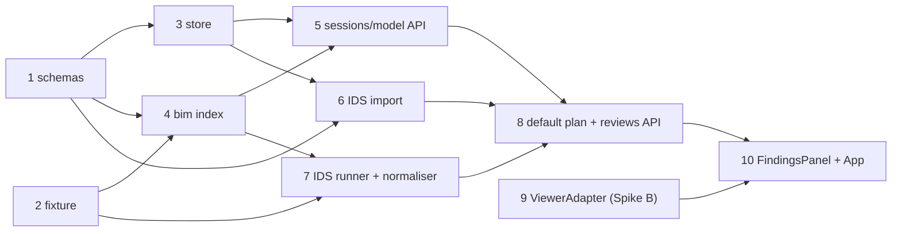

# Bakeoff Round 2 — Consolidated Architecture Audit and Implementation Readiness

**Reviewed:** 27 October 2026 (Day 2 of 10), commit `a4cc3f3` on `main` (47 tracked files).
**Deadline assessed:** 4 November 2026 (a Wednesday).
**Provenance:** this document consolidates three independent architecture reviews of the same commit. Where the reviews disagreed, the repository and upstream sources were re-checked and the disagreement is resolved explicitly in [§5.0](#50-disagreements-between-the-independent-reviews-resolved). Nothing here is inherited from a review without re-verification against the files cited.
**Scope limits:** `hackathon-private/` is absent; rows marked **ASSUMED** in [REQUIREMENTS.md](./REQUIREMENTS.md) remain unverified. No dependencies were installed and no tests were executed for this review (see [§2.4](#24-validation-performed-by-this-review)).

Evidence conventions:

- **D-nn (CONFIRMED DEFECT)** — observable today in repository files, or in an upstream source or registry fetched on 27 October 2026.
- **W-nn (RISK)** — a design weakness that will materialise during implementation unless addressed; the code it concerns does not exist yet.
- File references are repository-relative; `§` is a section of the cited document.

---

## 1. Executive assessment

The architecture is sound and should be kept. Its central invariant — a `Finding` is created only by IfcTester or a versioned native rule, while Muse Spark interprets, plans and explains behind deterministic gates ([ARCHITECTURE.md §1](./ARCHITECTURE.md), [ADR-001](./DECISIONS.md), [ADR-009](./DECISIONS.md)) — is the right design for a BIM review product. The single-process, file-system, one-orchestrator topology ([ADR-003](./DECISIONS.md), [ADR-006](./DECISIONS.md), [ADR-013](./DECISIONS.md)) is the smallest that can carry the demo.

What exists is a disciplined but thin scaffold: validated configuration, `/api/v1/health`, a React health panel, CI and 27 unit tests ([§2](#2-existing-implementation-inventory)). No IFC, IDS, LLM, orchestration or viewer code exists; M0 is incomplete.

Five contracts must be fixed *before* the code that depends on them: the orchestration paradigm (W-01); binding each planned check to an immutable confirmed `CheckSpec` so a plan can never weaken what the user approved (W-03); content-addressed `Finding` identity and canonical ordering so NFR-01 is testable (W-04); a per-check `CheckResult` so an error, cap hit or zero applicability never reads as compliance (W-05); and a shared per-run model-call budget, since per-finding explanations already exceed NFR-05's cap (W-06).

The two highest external risks are now characterised. That Open Components 3.6 exposes the GlobalId join the design needs (`guidsToModelIdMap`, `highlightByID`), but its default loader fetches WASM and the Fragments worker from unpkg.com at runtime — a demo-day single point of failure that must be vendored (W-02). Meta's strict structured-output mode is opt-in with a defined schema subset; non-strict output with local Pydantic validation is the safe default (W-12).

Documentation contains confirmed errors: the README's wheel claim is false (PyPI ships py310–py315), every weekday label in the plan is off by one, four "no code exists" statements are stale, and the benchmark has 14 P0 positives, not 15–20 (D-01…D-04).

**Verdict: feasible by 4 November, conditional on the LLM-free vertical slice ([§7](#7-first-vertical-slice-implementation-plan)) being green by 29 October.**

---

## 2. Existing implementation inventory

### 2.1 Backend (`backend/bim_intelligence/`, installed from the root `pyproject.toml`)

| File | What it does | Tests | Assessment |
|---|---|---|---|
| [config.py](../backend/bim_intelligence/config.py) | `Settings` (pydantic-settings) with 22 fields: Meta API, `LLMMode` (`live`/`replay`/`off`, default `off`), orchestration caps (`max_tool_calls_per_run=12`, `max_plan_checks=10`, `max_input_tokens_per_run`), price table, server binding, upload limits, logging. Validators: non-empty model id; `-contributor` rejection unless `ALLOW_CONTRIBUTOR_MODELS`; `live` requires a key; non-loopback `BIMI_HOST` refused unless `ALLOW_REMOTE`; comma-separated `CORS_ORIGINS`. `get_settings()` is `lru_cache`d. | [test_config.py](../tests/unit/test_config.py): 15 functions, 23 cases after parametrisation | **Good.** Implements ADR-010, NFR-07, NFR-08. `SecretStr` prevents key echo. No per-run model-call cap exists (W-06). |
| [api/main.py](../backend/bim_intelligence/api/main.py) | `create_app(settings)` factory; CORS; `/api/v1` prefix; binds `dependency_overrides[get_settings]`; **module-level `app = create_app()`**. | [test_health.py](../tests/unit/test_health.py): 4 tests incl. settings-injection regression | **Good**, one hygiene defect (D-06). No `ProblemDetail` handler yet. |
| [api/health.py](../backend/bim_intelligence/api/health.py) | `GET /health` → version, `llm_mode`, `llm_model`, `llm_configured` (presence only), `ifcopenshell`/`ifctester` distribution versions via `importlib.metadata`. | as above | Matches AGENTS.md §8. Does not implement the "LLM reachability" flag described in ARCHITECTURE §11/§15 (D-09). |
| `__init__.py`, `api/__init__.py`, `py.typed` | Version string, docstrings, typing marker. | — | — |

**Not present** (all listed in [ARCHITECTURE.md Appendix A](./ARCHITECTURE.md#appendix-a--recommended-repository-structure)): `schemas/`, `store/`, `bim/`, `requirements/`, `validation/`, `investigation/`, `orchestration/` (and `prompts/`), `llm/`, `reporting/`, `logging.py`. No `tests/fixtures/`, `tests/scenario/`, `tests/evaluation/`, `datasets/generate.py`, `datasets/synthetic/`. 18 of the 19 endpoints in [ARCHITECTURE.md §11](./ARCHITECTURE.md) are unbuilt.

### 2.2 Frontend (`frontend/`)

| File | What it does | Assessment |
|---|---|---|
| [package.json](../frontend/package.json) | React 19, Vite 8, TypeScript 7, Vitest 5, oxlint, Prettier; committed lockfile. **No** `@thatopen/*`, `three`, `web-ifc`, `camera-controls`, `zustand`, and no schema-generation script (ADR-014). | Scaffold only. |
| [vite.config.ts](../frontend/vite.config.ts) | Dev proxy `/api` → `127.0.0.1:8000`; jsdom test environment. | Correct. |
| [tsconfig.app.json](../frontend/tsconfig.app.json) | `strict`, `noUncheckedIndexedAccess`, `exactOptionalPropertyTypes`, `erasableSyntaxOnly`. | Stricter than AGENTS.md §5 requires; good. |
| [src/api/client.ts](../frontend/src/api/client.ts) | Hand-written `HealthResponse` and `fetchHealth` with `ApiError`; explicitly provisional pending ADR-014. | Appropriate. |
| [src/state/useHealth.ts](../frontend/src/state/useHealth.ts), [src/components/HealthPanel.tsx](../frontend/src/components/HealthPanel.tsx) | Discriminated-union state hook; panel renders loading/error/success and a `degraded` badge for `off`. | Fetch/state/presentation separation is right. |
| [HealthPanel.test.tsx](../frontend/src/components/HealthPanel.test.tsx) | 4 Vitest/RTL tests. | — |

### 2.3 Repository infrastructure

| File | Assessment |
|---|---|
| [pyproject.toml](../pyproject.toml) | Single root project, `package-dir = backend`; ruff (E,F,I,B,UP,N,SIM,RUF; line 100); mypy strict overrides for `schemas.*`, `validation.*`, `orchestration.*`; `ignore_missing_imports` for `ifcopenshell.*`/`ifctester.*`; pytest `live` marker; `DeprecationWarning` as error for first-party code. Dependency ranges are wide (`ifcopenshell>=0.8.0,<0.10`, `ifctester>=0.8.0,<0.10`, `openai>=1.40,<3.0`, `python-multipart>=0.0.9` unbounded) and there is no lock or constraints file (W-09). |
| [.github/workflows/ci.yml](../.github/workflows/ci.yml) | Backend matrix Ubuntu + Windows on Python 3.12; frontend **Ubuntu only** on Node 20/22; hygiene job refuses tracked `hackathon-private/`, `data/`, `.env`, stray `.ifc`; gitleaks. **Good.** |
| [.gitignore](../.gitignore), [.env.example](../.env.example), [pull_request_template.md](../.github/pull_request_template.md), [dependabot.yml](../.github/dependabot.yml), `.python-version` | Consistent with AGENTS.md §8–9. One ineffective variable in `.env.example` (D-08). |
| [datasets/README.md](../datasets/README.md) | Clear synthetic/permitted policy; "No datasets exist yet" is accurate. |

### 2.4 Validation performed by this review

- All 47 tracked files read. Test count by inspection = 27 (23 + 4), matching the Day 2 claim in [IMPLEMENTATION_PLAN.md §2](./IMPLEMENTATION_PLAN.md).
- Dependencies were **not** installed and `pytest`, `ruff`, `mypy`, `vitest` and `vite build` were **not** executed here; the Day 2 record of those commands passing was not independently reproduced.
- Upstream facts fetched on 27 October 2026 and used below: PyPI JSON for `ifcopenshell` (0.9.0.post1, `requires_python >=3.10,<3.16`, wheels py310–py315 on win_amd64/win_arm64/manylinux/macOS) and `ifctester` (0.9.0, LGPLv3+, `requires_dist` includes `xmlschema`, `numpy`, `odfpy`, `pystache`, `bcf-client`, `flask`); `ifctester/ids.py` on the IfcOpenShell `v0.8.0` branch; npm metadata for `@thatopen/components@3.6.0` and `@thatopen/fragments@3.6.0`; `engine_components` `IfcLoader` and `FragmentsManager` sources; `engine_fragment` `FragmentsModels` source. Weekdays were computed, not assumed.

---

## 3. Architecture strengths supported by repository evidence

| # | Strength | Evidence |
|---|---|---|
| S-01 | **Deterministic-findings invariant is enforceable, not aspirational.** `Finding.method ∈ {ids, native}`; only two tools write findings; the PR template carries the check. | [ARCHITECTURE.md §1, §10.2](./ARCHITECTURE.md); [ADR-001](./DECISIONS.md); [pull_request_template.md](../.github/pull_request_template.md) |
| S-02 | **Three deterministic gates on LLM output** — verbatim quote check, plan filter against registry and confirmed set, grounding check with regenerate-once-then-template. Each is cheap and testable with a defined fallback. | [ARCHITECTURE.md §7.4, §9.2, §10.4, §14](./ARCHITECTURE.md) |
| S-03 | **Degraded mode is first-class.** `LLM_MODE=off` is the default; default plan and templated explanations keep the product usable; the UI already shows a `degraded` badge. | [config.py](../backend/bim_intelligence/config.py); [HealthPanel.tsx](../frontend/src/components/HealthPanel.tsx); NFR-10 |
| S-04 | **Safety defaults are implemented and tested.** Loopback-only binding, contributor-model rejection, key-presence-only health, `.env` hermeticity in tests. | [config.py](../backend/bim_intelligence/config.py); [test_config.py](../tests/unit/test_config.py); [conftest.py](../tests/conftest.py) |
| S-05 | **Explicit dependency injection.** `create_app(settings)` plus `dependency_overrides` is already the test seam, with a regression test. | [main.py](../backend/bim_intelligence/api/main.py); [test_health.py](../tests/unit/test_health.py) |
| S-06 | **Schema-as-contract with a stated generation path** (Pydantic → JSON Schema → TS); `client.ts` marks hand-written types as provisional. | [ADR-014](./DECISIONS.md); [client.ts](../frontend/src/api/client.ts) |
| S-07 | **Correct choice of reference validator.** IfcTester is the IDS 1.0 reference implementation; FR-VAL-01 requires element-for-element agreement with its own report, giving a free baseline. The verified API shape supports the design ([§4 W-04, W-05](#4-technical-weaknesses-and-risks-ranked-by-severity)). | [ADR-004](./DECISIONS.md); [EVALUATION.md §6](./EVALUATION.md) |
| S-08 | **Browser-side geometry, backend-side semantics** avoids a second mesh pipeline. The GlobalId join key is correct and now verified against the 3.6 API. | [ADR-007](./DECISIONS.md); [ARCHITECTURE.md §12.1](./ARCHITECTURE.md) |
| S-09 | **Honest documentation posture.** DECISION / PROPOSAL / ASSUMPTION are distinguished; EVALUATION §8 is deliberately empty; limitations are enumerated. | [ARCHITECTURE.md](./ARCHITECTURE.md) notation block; [EVALUATION.md §8–9](./EVALUATION.md); [README.md](../README.md) Limitations |
| S-10 | **Scope-reduction ladder with a "never cut" list** protects integrity guarantees under schedule pressure; **repository hygiene is automated** (CI refuses private/runtime artefacts; gitleaks). | [IMPLEMENTATION_PLAN.md §5](./IMPLEMENTATION_PLAN.md); [ci.yml](../.github/workflows/ci.yml) |

---

## 4. Technical weaknesses and risks, ranked by severity

Severity reflects impact on delivering a credible MVP by 4 November.

### Severity: High

**W-01 — Orchestration paradigm is specified two ways. (design inconsistency CONFIRMED)**
[ADR-003](./DECISIONS.md) and [ARCHITECTURE.md §7.4](./ARCHITECTURE.md) describe *plan-then-execute*: one structured-output call returns a `ReviewPlan` whose `checks[].tool` is restricted to `run_ids_validation | run_native_rule`; Python executes it. But [§5.2](./ARCHITECTURE.md) draws a "Tool-call loop", [§6](./ARCHITECTURE.md) says the orchestrator "run[s] tool-call loop with caps", [§7.3](./ARCHITECTURE.md) exports **seven** tools' JSON Schema "to the LLM" (five of which can never appear in a `ReviewPlan`), and [§14](./ARCHITECTURE.md) specifies "one corrective re-prompt" on invalid tool arguments, which only makes sense in a loop. Two caps exist for one mechanism (`max_tool_calls_per_run=12`, `max_plan_checks=10`). The AGENTS.md §6 registry tests ("unknown tool, invalid args, cap") differ materially between the two designs. → C-01.

**W-02 — Viewer asset plumbing, identity bridge and benchmark geometry are the highest-risk frontend integration. (network behaviour CONFIRMED upstream)**
Verified from `engine_components` source (`packages/core/src/fragments/IfcLoader/index.ts`, `FragmentsManager/index.ts`) and `engine_fragment` (`FragmentsModels/index.ts`):
- `IfcLoader.setup({ autoSetWasm: true })` and `load()` call `autoSetWasm()`, which fetches `https://unpkg.com/@thatopen/components@…/package.json` and sets `wasm.path` to `https://unpkg.com/web-ifc@…/`.
- `IfcLoader.load()` throws `"You need to initialize fragments first."` unless `FragmentsManager.init(workerURL)` has run; the documented `FragmentsManager.getWorker()` fetches `https://unpkg.com/@thatopen/fragments@…/dist/Worker/worker.mjs`. The underlying `FragmentsModels` constructor falls back to a bundled worker via `new URL("./Worker/worker.mjs", import.meta.url)` when no URL is supplied.
- Consequence: the default viewer depends on a third-party CDN, contradicting the "outbound calls only to `LLM_BASE_URL`" posture ([ARCHITECTURE.md §13](./ARCHITECTURE.md), NFR-07) and absent from the live-demo fallback list ([DEMO_PLAN.md §5](./DEMO_PLAN.md)).
- The GlobalId join exists (`FragmentsManager.guidsToModelIdMap(guids)`, `modelIdMapToGuids(map)`), so [ARCHITECTURE.md §12.1](./ARCHITECTURE.md)'s "placeholders until verified" can be closed — but Fragments *local ids must not be assumed to equal IFC express ids*, and elements without geometry (types, storeys, non-`IfcRoot` entities) will have no fragment to highlight.
- [EVALUATION.md §2.1](./EVALUATION.md) specifies the synthetic benchmark's semantics but **not geometry**. A model generated with `ifcopenshell.api` without representations and placements indexes and validates correctly but renders **nothing** in web-ifc, breaking FR-VIS-01/03 and the demo's viewer segment. → C-04.

**W-03 — Planned checks are not bound to an immutable confirmed `CheckSpec`, and the IDS and native paths overlap. (design gap CONFIRMED)**
[ARCHITECTURE.md §7.3](./ARCHITECTURE.md) lets `run_native_rule(rule_id, params)` take model-supplied `params`, while the plan filter ([§7.4](./ARCHITECTURE.md)) only checks that tools exist, `requirement_ids` are confirmed and `rule_id` is registered. A schema-valid call could therefore check a weaker condition (different pset, looser regex, narrower applicability) than the user confirmed, violating the intent of FR-REQ-04. Separately, `property.required`, `naming.pattern` and `classification.present` ([§8.3](./ARCHITECTURE.md)) are all expressible as IDS 1.0 facets; a requirement compiled to IDS *and* a default plan that runs the native family flags the same element twice with different `rule_id`/`method`. [EVALUATION.md §3](./EVALUATION.md) matches on `rule_id`, so the duplicate is either a false positive or a double-counted true positive, and the UI shows two chips for one defect. → C-02.

**W-04 — `Finding` identity, ordering and timestamp placement are unspecified, so NFR-01 cannot be tested as written. (upstream fact CONFIRMED)**
NFR-01 demands "byte-identical `findings.json` (excluding timestamps)", but [ARCHITECTURE.md §10.2](./ARCHITECTURE.md) puts `created_at` **on** `Finding` and gives no `Finding.id` derivation. Upstream (`ifctester/ids.py` v0.8.0 branch, lines 205–206, 271–272): `Specification.failed_entities` and `passed_entities` are **`set[entity_instance]`**; only `facet.failures` is an ordered `list[FacetFailure]` and `applicable_entities` an ordered list. A normaliser that iterates `failed_entities` will emit findings in hash order, which varies between processes. → C-03.

**W-05 — Check errors, cap hits and specification-level IDS outcomes are conflated with defect findings. (design conflict CONFIRMED; upstream behaviour CONFIRMED)**
[ARCHITECTURE.md §14](./ARCHITECTURE.md) turns an IfcTester exception into a `check_error` *finding category* and lets a cap hit "complete with what it has". Neither is a verified defect, and a run that silently skipped checks must not read as compliant or pollute precision. Upstream, `Specification.validate()` (lines 282–327) gives a *required* specification with **zero applicable entities** `status=False` and every requirement facet `status=False` but appends **no** `FacetFailure`; a *prohibited* specification fails when applicable entities exist, again with no per-facet failure. A normaliser that only walks `facet.failures` silently drops both; one that turns zero-applicability into a defect invents one. → C-05.

**W-06 — NFR-05's ten-call cap is not enforced and conflicts with per-finding explanations. (design conflict CONFIRMED)**
[REQUIREMENTS.md NFR-05](./REQUIREMENTS.md) caps a benchmark review at ≤ 10 LLM calls. [config.py](../backend/bim_intelligence/config.py) has `max_tool_calls_per_run`, `max_plan_checks`, `max_input_tokens_per_run` and `llm_max_retries` but **no model-call cap**; a tool-call cap is not a model-call cap. With 18 benchmark defects, one planner call plus per-finding explanations plus grounding regenerations plus SDK retries exceeds 10 several times over before grouping (FR-EXP-04) is applied. → C-06.

**W-07 — Schedule. (CONFIRMED)**
Today is Day 2. M0 is incomplete: schemas, store, `bim/`, sessions/model API and both Day-1 spikes are carried to Day 3 ([IMPLEMENTATION_PLAN.md §2](./IMPLEMENTATION_PLAN.md)). The critical path (schemas → validation → benchmark → orchestrator → frontend → report) is seven items for eight days with one engineer; W-02 adds unbudgeted geometry work; the Day 9 buffer is already consumed by the Day 1→3 carry-over.

### Severity: Medium

**D-01 — Public claim about IfcOpenShell wheels is false. (CONFIRMED)**
[README.md line 100](../README.md): "IfcOpenShell publishes wheels for these versions only — Python 3.13+ will not install"; [ADR-005](./DECISIONS.md) lines 97 and 101 ("cp310–cp312 wheels only"); [ARCHITECTURE.md Appendix B](./ARCHITECTURE.md); [pyproject.toml line 11](../pyproject.toml); [RISKS.md R-DEP-01](./RISKS.md). PyPI JSON fetched 27 October 2026 lists `ifcopenshell-0.9.0.post1` wheels for **py310 through py315** with `requires_python >=3.10,<3.16`. The 3.12 pin remains a sound engineering choice (that is where it is tested); the stated *reason* is wrong, in the most prominent setup line of the README, contrary to AGENTS.md §2.6. → C-10.

**D-02 — Four "no code exists" statements are stale. (CONFIRMED)**
[README.md line 5](../README.md) ("No application code has been written") contradicts its own status table at line 75 ("Done (Day 2)"); [ARCHITECTURE.md line 4](./ARCHITECTURE.md); [IMPLEMENTATION_PLAN.md line 4](./IMPLEMENTATION_PLAN.md) ("nothing implemented") contradicts its Day 2 "Shipped" list; [AGENTS.md line 9](../AGENTS.md) ("implementation not started"). [REQUIREMENTS.md line 3](./REQUIREMENTS.md) should say "no review functionality". → C-10.

**D-03 — Every weekday label in the plan is wrong by one day. (CONFIRMED)**
[IMPLEMENTATION_PLAN.md](./IMPLEMENTATION_PLAN.md) line 3 says "Sunday 26 October – Wednesday 4 November"; the Day 1–10 headings run "Sun 26 Oct … Tue 4 Nov". In 2026, 26 October is **Monday**, 27 October **Tuesday** and 4 November **Wednesday**. The dates are right; the day names are not. Harmless for a solo engineer, damaging for a public plan. → C-10.

**D-04 — Benchmark supplies 14 P0 positives, not 15–20, and one defect is assigned to a rule that cannot detect it. (CONFIRMED)**
[EVALUATION.md §2.2](./EVALUATION.md): D01–D14 are P0 (4 + 2 + 4 + 4 = 14); D15–D17 are P1; D18 is a zero-finding control. NFR-02 and [IMPLEMENTATION_PLAN.md Day 4](./IMPLEMENTATION_PLAN.md) promise "15–20 defects across the four P0 rule families". D16 ("contain 1 wall in the wrong storey") is listed under `spatial.contained`, which per [ARCHITECTURE.md §8.3](./ARCHITECTURE.md) checks only that a container exists; wrong-storey detection is `spatial.storey_matches_elevation`, which requires geometry. With 14 positives one miss costs ~7 points of recall, so the ≥ 90 % threshold means "at most one miss" and no confidence interval is reported. → C-12.

**D-05 — `requirements/` is given an IfcTester dependency that AGENTS.md forbids. (CONFIRMED)**
[ARCHITECTURE.md §6](./ARCHITECTURE.md) line 209: `requirements/` "compile[s] confirmed candidates to IDS 1.0 XML (via `ifctester.ids` authoring classes)"; dependency column lists `ifctester`. [AGENTS.md §3](../AGENTS.md): "`bim/` and `validation/` are the **only** packages that import `ifcopenshell` / `ifctester`." One of them must change before the compiler is written. → C-10.

**W-08 — The viewer has no documented way to obtain the stored IFC. (design gap CONFIRMED)**
[ARCHITECTURE.md §5.1](./ARCHITECTURE.md) says the browser "loads the IFC a second time for geometry", but the endpoint table in [§11](./ARCHITECTURE.md) has no `GET …/model/file`. The SPA can hold the upload `File` for the page lifetime only; a reload, a second tab, or the "fresh session" rehearsal in [DEMO_PLAN.md §6](./DEMO_PLAN.md) has no geometry source. Serving the stored bytes also guarantees viewer and validator see the same model hash. → C-07.

**W-09 — Dependency ranges are wide for libraries whose internals the normaliser depends on; no lock for the demo machine. (CONFIRMED)**
[pyproject.toml](../pyproject.toml): `ifcopenshell>=0.8.0,<0.10`, `ifctester>=0.8.0,<0.10`, `openai>=1.40,<3.0`, `python-multipart>=0.0.9` (no upper bound). The normaliser will read `Specification.failed_entities`, `facet.failures[*].reason` and `Ids.to_xml()` — non-semver internal API. All prose says 0.9 ([README.md](../README.md), [ADR-004](./DECISIONS.md)); [ARCHITECTURE.md §13](./ARCHITECTURE.md) says dependencies are "pinned". `ifctester` 0.9.0 also pulls `flask`, `bcf-client`, `odfpy`, `pystache`, `numpy` and `xmlschema` (PyPI `requires_dist`), so the install footprint is larger than the design implies; `xmlschema` is therefore available transitively, but a direct import in first-party code needs a mypy override. → C-08.

**W-10 — The grounding check as specified both over-rejects and under-validates. (RISK)**
[ARCHITECTURE.md §10.4](./ARCHITECTURE.md) rule 3: "Numeric values quoted in the summary are matched against evidence values". A naive extractor comparing prose numbers to scalar property values rejects legitimate strings such as `REI 60`, `L01`, Uniclass `EF_25_10`, `REQ-007`, and derived counts ("3 of 8 external walls"), forcing almost every explanation into template fallback. Conversely, citation-set membership plus number matching does not validate *associations* (right value on the wrong element or property), negation, `probable_cause` or `corrective_action`, so a draft can cite valid identifiers while asserting a false fact. → C-09.

**W-11 — Verbatim quote check needs normalisation for PDF and Markdown input. (RISK)**
[ARCHITECTURE.md §9.2](./ARCHITECTURE.md): the quote must be "an exact substring of the extracted text". `pypdf` and Markdown extraction introduce non-breaking spaces, soft hyphens, smart quotes and mid-sentence line breaks; models normalise these in JSON output. Raw `quote in text` will reject genuine quotations from real BEPs. → C-09.

**W-12 — Strict-mode structured output: documented, one decision remains. (RISK, partly resolved)**
Meta's documentation (`dev.meta.ai/docs/structured-output`, read by two of the three reviews): `response_format={"type":"json_schema", …}` on Chat Completions; `strict` **defaults to `false`**; the strict subset requires a plain-object root, no `allOf`/`oneOf`, `anyOf` only below root, `additionalProperties: false` on every object and `required` listing every property; limits include depth 10 and no recursive `$ref`. Pydantic's default `model_json_schema()` emits neither `additionalProperties: false` nor all-required, and an untyped `params: dict[str, Any]` or `arguments: {}` ([§7.4](./ARCHITECTURE.md), [§10.2](./ARCHITECTURE.md)) cannot satisfy a closed-object rule. The non-strict path with local Pydantic validation ([RISKS.md R-DEP-03](./RISKS.md) fallback) is safe and should be the default. → C-11.

**W-13 — `ModelIndex` scope and keying. (RISK)**
[ARCHITECTURE.md §8.1](./ARCHITECTURE.md) does not state which entity classes are indexed. P0 naming (FR-VAL-03; benchmark D09 renames a storey, D10 a door *type*) needs `IfcTypeObject` and spatial elements, not just `IfcProduct`. A GlobalId-keyed dictionary silently overwrites duplicates, defeating D17/`identity.unique_global_id` and making viewer selection ambiguous. `ifcopenshell.util.element.get_psets()` inherits type properties by default and includes an `id` key per pset; instance-versus-type provenance must be preserved for `classification.consistent_by_type` and for honest evidence. → C-03, C-05.

**W-14 — SSE from a worker thread; late subscribers; event-loop blocking. (RISK)**
`BackgroundTasks` runs a synchronous callable in the threadpool; events pushed into an `asyncio.Queue` from that thread must use `loop.call_soon_threadsafe` or the SSE generator never wakes. An `async def` orchestrator calling synchronous IfcTester or `openai` blocks the loop and freezes SSE. An `off`/`replay` run can finish in under 100 ms — before `EventSource` connects — so an unbuffered pub/sub misses events or hangs waiting for a `complete` that already fired. [ADR-013](./DECISIONS.md) mentions none of these. → C-13.

**W-15 — Evaluation methodology. (RISK)**
Beyond D-04: matching on `(rule_id, set(GlobalIds))` cannot distinguish two property requirements failing on the same element; negatives are undefined (all rule × element combinations would inflate true negatives); the defect set and the rules share an author, so the benchmark measures internal consistency, not generalisation; D18's expected outcome depends on BEP wording. [EVALUATION.md §9](./EVALUATION.md) acknowledges the synthetic-data limitation but not authorship circularity. → C-12.

### Severity: Low

**D-06 — Module-level `app = create_app()` reads the developer's real environment at import. (CONFIRMED)**
[api/main.py](../backend/bim_intelligence/api/main.py) last line. [conftest.py](../tests/conftest.py) disables `.env` per test, but `from bim_intelligence.api.main import …` in [test_health.py](../tests/unit/test_health.py) executes at collection, before any fixture. A developer `.env` with `LLM_MODE=live` and no key, or `BIMI_HOST=0.0.0.0`, errors the module at import, contradicting the conftest docstring. → C-14.

**D-07 — Test isolation covers 10 of 22 settings. (CONFIRMED)**
[conftest.py](../tests/conftest.py) `ENV_VARS` lists 10 names; [config.py](../backend/bim_intelligence/config.py) declares 22 fields (`LLM_RECORDINGS_DIR`, `LLM_TIMEOUT_SECONDS`, `LLM_MAX_RETRIES`, `MAX_*`, `LLM_PRICE_*`, `LOG_*` are not cleared). A shell variable such as `MAX_PLAN_CHECKS=1` changes test behaviour silently. Iterate `Settings.model_fields` instead. → C-14.

**D-08 — `VITE_API_BASE_URL` in the root `.env.example` has no effect. (CONFIRMED)**
Vite reads `frontend/.env*`, not the repository root. Setting it to the suggested absolute origin bypasses the dev proxy and depends on CORS (`http://localhost:5173` only; a browser at `127.0.0.1:5173` fails). → C-10.

**D-09 — `/health` documentation overstates the implementation. (CONFIRMED)**
[ARCHITECTURE.md §11](./ARCHITECTURE.md) and [§15](./ARCHITECTURE.md) describe an "LLM reachability flag" via `GET /v1/models`; [health.py](../backend/bim_intelligence/api/health.py) reports configuration presence only. The documented design would make `/health` an outbound call even in `LLM_MODE=off`. → C-10.

**D-10 — Appendix B omits a peer dependency. (CONFIRMED)**
`@thatopen/components@3.6.0` peers (npm, 27 October 2026): `three >= 0.182.0`, `web-ifc >= 0.0.77`, `camera-controls >= 3.1.2`, `@thatopen/fragments ~3.6.0`. `camera-controls` is missing from [ARCHITECTURE.md Appendix B](./ARCHITECTURE.md) and [README.md](../README.md). → C-10.

**D-11 — README testing block and CI claim. (CONFIRMED)**
[README.md §Testing](../README.md): the "Later in the plan" Python commands follow `cd frontend`, so the block fails if pasted whole; "The same commands run in CI on Ubuntu and Windows" is true for the backend only — [ci.yml](../.github/workflows/ci.yml) runs frontend jobs on Ubuntu. → C-10.

**D-12 — The remote-binding guard validates `Settings.bimi_host`, not Uvicorn's `--host`. (CONFIRMED)**
[config.py](../backend/bim_intelligence/config.py) `_guard_remote_binding` is correct as configuration validation, but the README command `uvicorn … --host 127.0.0.1` means any `--host 0.0.0.0` bypasses it; [README.md](../README.md) says "The server refuses to bind to a non-loopback address", which no launcher enforces. → C-14.

**D-13 — ADR-004 / OQ-05 can be closed.** PyPI classifier for `ifctester` 0.9.0 is `License :: OSI Approved :: GNU Lesser General Public License v3 or later (LGPLv3+)`. → C-10.

**W-16 — Terminology: "read-only tool registry".** [AGENTS.md §8](../AGENTS.md) and [ARCHITECTURE.md §13](./ARCHITECTURE.md) say the registry is read-only; [§7.3](./ARCHITECTURE.md) says two tools "write findings to session". Both are true in their own sense (read-only against the IFC and the model); say so once. → C-10.

**W-17 — ADR-014 generation step does not exist.** [package.json](../frontend/package.json) has no generator or drift-check script; the ADR promises generation "during build" and a Python-free frontend build. Decide now: commit generated types and add a separate regenerate/check command (recommended), rather than making the frontend build secretly require Python. → C-10, slice step 1.

---

## 5. Specific proposed changes, with justification

### 5.0 Disagreements between the independent reviews, resolved

| Topic | Positions | Resolution and evidence |
|---|---|---|
| PyPI wheel coverage | One review: 0.9.0.post1 wheels for py310–py315. Another: stable wheels are 0.8.x. | **py310–py315 is correct.** PyPI JSON fetched 27 Oct 2026 lists `ifcopenshell-0.9.0.post1` wheels for py310, py311, py312, py313, py314, py315; `ifctester` 0.9.0. The "0.8.x" claim is wrong. D-01 stands; C-10 rewords the prerequisite. |
| Viewer join key | GlobalId via `guidsToModelIdMap`/`highlightByID`; or `express_id` via `getFragmentMap`; or a warning that Fragments local ids ≠ express ids. | **GlobalId remains the contract key** (ADR-007, FR-VIS-03); the 3.6 API for it is verified. `ElementRef.express_id` is retained as a diagnostic and for duplicate-GUID disambiguation, never as the viewer join, because the local-id ≠ express-id warning is valid for the Fragments pipeline. Elements for which `guidsToModelIdMap` returns nothing are shown as "not renderable", never approximated. |
| Check errors and zero applicability | Add `Finding` categories `no_applicable_elements` / `prohibited_present`; or model them in a per-check `CheckResult`, not as defect findings. | **Per-check `CheckResult`.** A required specification with no applicable entities is *not applicable*, not a defect; an exception is an *error*; neither may enter `findings.json` or the precision denominator (ADR-001, NFR-02). A prohibited specification with applicable entities **is** a defect with real elements and becomes ordinary findings (`category="prohibited_entity"`, one per applicable entity, ordered by `applicable_entities`). This supersedes the `check_error` finding category in [ARCHITECTURE.md §14](./ARCHITECTURE.md). |
| Vertical-slice fixture | Two walls; three walls with two specs and two findings; three walls with one external-wall spec so one wall is non-applicable. | **Three walls, two specifications, applicability exercised** ([§7 step 2](#7-first-vertical-slice-implementation-plan)): W-001 external and compliant, W-002 external and missing `FireRating`, W-003 internal (not applicable to the FireRating spec) and lacking a classification. Two findings from two specs test canonical ordering; W-003 tests non-applicability; all three walls have extruded geometry so the viewer slice is real. |
| Model-call budget | Omitted by one review; a shared per-run attempt budget by another. | **Adopt the shared budget** (C-06). NFR-05's figure is confirmed unenforceable today, so the omission was a gap. |
| Orchestration paradigm | All three: plan-then-execute. One review flags an alternative if visible tool calling is a judging requirement. | **Plan-then-execute (C-01)**, with the normalisation rule that if function-call transport is ever exercised, the `tool_calls` array is validated through the *same* plan filter and counted against the same caps. Owner decision noted as Q-04. |
| Python lock file | Commit `requirements-lock.txt`; versus record a tested pair only. | **Owner decision (Q-10).** Both reviews agree on narrowing the ranges to `>=0.9.0,<0.10` (C-08); the lock is the only point of divergence and touches AGENTS.md's rule against speculative files. |
| Test inventory | 27 cases; or 18 config tests. | **27** (15 functions, 23 parametrised cases, plus 4 health tests), verified by inspection of [test_config.py](../tests/unit/test_config.py) and [test_health.py](../tests/unit/test_health.py). |
| Document structure | One review added an eleventh "Documentation consistency" section. | **Ten sections**, as the brief requires; documentation findings are D-01…D-13 in §4 and C-10 in §5. |

### 5.1 Ranked changes

Ordered by when they must land. None adds a service, framework or database. **Owner decision required** is marked where a change touches an adopted ADR or public positioning (AGENTS.md §9).

**C-01 — Resolve W-01: adopt plan-then-execute explicitly; defer any LLM-driven investigation loop to P2.** *(Day 3 documentation; shapes Day 6 code)*
Amend [ARCHITECTURE.md §5.2, §6, §7.3, §14](./ARCHITECTURE.md): the planner is **one** structured-output call producing `ReviewPlan`; the prompt is pre-loaded with the model summary and confirmed requirement list, so `get_model_summary` and `list_confirmed_requirements` are prompt-context builders and `query_elements`/`get_element` serve the evidence collector and the HTTP API, not the model, in the MVP. Collapse the caps: `MAX_PLAN_CHECKS` bounds the plan; `MAX_TOOL_CALLS_PER_RUN` becomes the execution cap on plan items. Replace "one corrective re-prompt" with "one *plan* regeneration with violations appended, then default plan". Record as **ADR-015** superseding the loop language in ADR-003 (never edit the adopted text), with the P2 proposal: a bounded (≤ 5 call) tool-calling turn for *investigation* after findings exist. *Justification:* removes R-DEP-04 for the MVP, halves the Day 6 test matrix, makes the AGENTS.md §6 registry tests unambiguous; the AI-native narrative is unchanged. **Owner decision** if visible tool calling is required for judging (Q-04).

**C-02 — Resolve W-03: plans select confirmed check ids; one engine per requirement.** *(Day 3, `schemas/` and plan filter)*
- `ReviewPlan.checks[]` carries `{check_id, reason}` only. The orchestrator resolves `check_id` server-side to the immutable confirmed `CheckSpec` (kind, applicability, expected values, `rule_version`, content hash). `run_native_rule` and `run_ids_validation` take a `CheckSpec`, never model-supplied `params`. Built-in standard checks (the default plan) are versioned built-in requirements so every `Finding` has valid provenance.
- An edit to a requirement invalidates confirmation until the user re-confirms that revision (`Requirement.revision` + `confirmed_revision`); `edited` is never executable (closes the ADR-008/FR-REQ-04 ambiguity).
- A `Requirement` compiles to **exactly one** `CheckSpec`. Ownership for P0: IDS owns property presence/value (`Pset_*`), classification presence, and naming patterns expressible as `Attribute Name` patterns; native owns `classification.consistent_by_type` and all P1 rules. Keep native `property.required`/`naming.pattern` only if their richer `observed/expected` text is judged worth the duplication, and then only for requirements compiled to `native`.
- Evaluation matches on `(check_id, element GlobalId)`; dedupe by `(check_id, facet_index, global_id)` before scoring.
*Justification:* the model can choose *which* confirmed checks run but can never alter *what* a check asserts; eliminates double counting; keeps FR-VAL-01's baseline meaningful. **Owner decision** on retaining the two overlapping native rules (Q-06).

**C-03 — Resolve W-04 and W-13: content-addressed `Finding` ids, canonical ordering, run-level timestamps, honest index keying.** *(Day 3, `schemas/`, normaliser, `bim/`)*
- `Finding.id = sha1(check_id | rule_version | facet_index | sorted(global_ids))[:16]`; no UUIDs. Move `created_at` from `Finding` to `ReviewRun`. Serialise `findings.json` with `sort_keys=True`, findings sorted by `(check_id, facet_index, global_ids[0])`.
- The normaliser iterates `facet.failures` (ordered) and `applicable_entities` (ordered) and sorts; it never relies on `failed_entities` set order.
- `ModelIndex` indexes `IfcProduct`, `IfcTypeObject` and `IfcSpatialElement`; stores records by `express_id` with a `GlobalId → [express_id]` multimap so duplicates are detectable (D17) and ambiguous lookups fail explicitly; records pset provenance (instance vs inherited type) and strips the `id` key `get_psets()` adds. `ElementRef.global_id: str | None` with `express_id` always present; the viewer ignores refs without a GlobalId.
*Justification:* NFR-01 becomes a two-line byte-equality test; `Finding.id` is a stable cache and React key; type/storey naming defects become detectable.

**C-04 — Resolve W-02: vendor viewer binaries; make geometry part of the benchmark definition.** *(Spike B, Day 3; generator, Day 4)*
- `FragmentsManager.init(workerUrl)` with a **local** worker URL — a Vite `?url` import or `new URL(..., import.meta.url)` of `@thatopen/fragments/dist/Worker/worker.mjs`, or a copy under `frontend/public/` — **not** `FragmentsManager.getWorker()`.
- `IfcLoader.setup({ autoSetWasm: false, wasm: { path: "/wasm/", absolute: true } })` with `web-ifc.wasm` copied from `node_modules/web-ifc/` into `frontend/public/wasm/` by an npm `postinstall`/`prebuild` script. CI asserts the built bundle contains no `unpkg.com` string.
- Add "renders in web-ifc with ≥ 1 visible mesh per storey" to [EVALUATION.md §2.4](./EVALUATION.md); the generator creates representations (`ifcopenshell.api.geometry.add_wall_representation` / `add_slab_representation`, door/window representations) and placements (`edit_object_placement`), plus openings and `IfcRelFillsElement` so D15–D16 and `relationship.opening_hosted` have something to test.
- Add "CDN unavailable" to [DEMO_PLAN.md §5](./DEMO_PLAN.md) — closed by the vendoring above. Add `camera-controls` to the install list (D-10).
*Justification:* turns two runtime network dependencies into build-time assets, aligning with [ARCHITECTURE.md §13](./ARCHITECTURE.md) and removing the one failure mode that can break the demo while every backend test passes.

**C-05 — Resolve W-05: per-check `CheckResult`, run states, single writer.** *(Day 3, `schemas/`; Day 6, orchestrator)*
- `CheckResult {check_id, status ∈ passed|failed|error|skipped|not_applicable, applicable_count, finding_ids[], diagnostics[]}`; `ReviewRun {id, status ∈ queued|running|completed|partial|failed|interrupted, plan, plan_source ∈ llm|default, check_results[], input_manifest{model_hash, ids_hashes, requirement_revisions, rule_versions}, created_at, finished_at}`.
- Required specification with zero applicable entities → `not_applicable` (warning in UI, never a finding). Prohibited specification with applicable entities → one finding per applicable entity, `category="prohibited_entity"`. IfcTester exception → `error` with the message in `diagnostics`; other checks continue. Cap reached → remaining checks `skipped`; run status `partial`.
- The orchestrator is the single writer for a run; tools return results and never persist. `findings.json` and `run.json` are published by atomic replace *before* the terminal status is written. A second `POST /reviews` while one is active, or a model re-upload during a run, returns `409` as `ProblemDetail`.
*Justification:* "verified" means a completed deterministic check over approved inputs; partial coverage is visible in UI, report and metrics instead of reading as compliance. Supersedes the `check_error` finding category in [ARCHITECTURE.md §14](./ARCHITECTURE.md). **Owner decision** to record this as an ADR note (Q-12).

**C-06 — Resolve W-06: one shared per-run model-call budget.** *(Day 5, `llm/` and `config.py`)*
Add `MAX_LLM_CALLS_PER_RUN` (default 10, matching NFR-05) counted at the client wrapper so planner calls, plan regeneration, explanation calls, grounding regenerations and *application* retries all draw from one allowance; disable SDK-level retries (`max_retries=0`) and apply the application policy only, so retries are never invisible. Reserve before each request; when the allowance or `MAX_INPUT_TOKENS_PER_RUN` is insufficient, remaining explanations use the deterministic template and the run log records `budget_exhausted`. Group explanations by `(check_id, facet_index)` (FR-EXP-04) and generate lazily on selection where the budget is tight. *Justification:* makes NFR-05 enforceable rather than aspirational, and makes degraded output visible. **Owner decision** whether NFR-05 should instead be raised for the full benchmark (Q-09).

**C-07 — Resolve W-08: add `GET /sessions/{sid}/model/file`.** *(Day 3, with the model router)*
Read-only streaming download of the stored IFC (`application/x-step`, fixed filename, size bounded by what was accepted on upload, `ETag` = model SHA-256). Document in [§11](./ARCHITECTURE.md). The viewer loads from this URL on session open; the upload path may short-circuit with the in-memory `File` but must compare hashes.

**C-08 — Resolve W-09: narrow the openBIM dependencies.** *(Day 3)*
`ifcopenshell>=0.9.0,<0.10`, `ifctester>=0.9.0,<0.10`, `python-multipart>=0.0.9,<1.0`. Replace "pinned" with "bounded" in [ARCHITECTURE.md §13](./ARCHITECTURE.md). Note the `flask`/`numpy` transitive footprint in the README. If first-party code imports `xmlschema` directly, add it to the mypy override. Lock file: **owner decision** (Q-10).

**C-09 — Resolve W-10 and W-11: structured claims, token-set grounding, normalised quotes.** *(Day 5–6, `requirements/`, `reporting/`)*
- Quote verification: normalise both document text and candidate quote (collapse whitespace runs, map `“”‘’` → `""''`, `–—` → `-`, strip soft hyphens and NBSP) before substring matching; store `paragraph_id` and the raw slice; verify the quote against the identified paragraph, not anywhere in the document. Say in [§9.2](./ARCHITECTURE.md) that the check rejects *fabricated quotations*, not false interpretations.
- Grounding: `Explanation` carries `cited_global_ids[]`, `cited_properties[]` and `cited_values[]` as structured fields; each is checked by set inclusion against the `EvidenceBundle` (elements and siblings; `Pset.Property` names present; observed/expected values, storey names, counts). For free-text numbers in `summary`, `probable_cause` and `corrective_action`, the allowed token set is every numeric substring (`\d+(?:\.\d+)?`) extracted from **every string** in the bundle and the requirement (so `REI 60` contributes `60`, `L01` contributes `01` and `1`, sibling counts contribute their integers), plus small ordinals. Factual sentences that bind a value to an element or property are rendered deterministically from the structured citations; `probable_cause`/`corrective_action` are labelled as interpretation and checked for undeclared identifiers and numbers only. Templates pass through the same checker.
*Justification:* keeps NFR-03 100 % deterministic without rejecting valid architectural strings, and stops a valid citation list from implying a verified prose claim. Adversarial fixtures in AC-17.

**C-10 — Documentation corrections.** *(Day 3, one commit)*
D-01: "developed and tested on Python 3.12; newer interpreters have PyPI wheels but are untested here" in README, ADR-005 (append a dated note; do not edit the decision), Appendix B, `pyproject.toml` comment, RISKS R-DEP-01. D-02: README line 5, ARCHITECTURE line 4, IMPLEMENTATION_PLAN line 4, AGENTS.md line 9, REQUIREMENTS line 3 → "architecture and scaffold phase; no review functionality yet; M0 partial". D-03: correct every weekday label (Mon 26 Oct … Wed 4 Nov) without moving the deadline. D-05: move IDS authoring/XSD validation behind a `validation/ids_compiler.py` entry point that `requirements/` calls, or obtain approval to amend AGENTS.md §3. D-08: move `VITE_API_BASE_URL` to `frontend/.env.example` or delete it; state that the dev proxy is the supported path. D-09: remove "LLM reachability" from §11/§15 or mark it P2 and gated on `LLM_MODE != off`. D-10: add `camera-controls` to Appendix B and the README stack table. D-11: split the README testing block by working directory; say frontend CI runs on Ubuntu. D-13: close OQ-05 and update the licence table. W-16: one sentence in §7.3. W-17: state that generated types are committed and checked for drift by a separate command. Also correct ADR-007's "IFC guarantees the GlobalId join" to "IFC *requires* unique GlobalIds; real uploads can violate this and are reported".

**C-11 — Resolve W-12: non-strict structured output by default; LLM-facing schemas shaped for strict mode.** *(Day 5, `llm/`, `schemas/`)*
`LLMClient.complete_structured()` sends `response_format={"type":"json_schema","json_schema":{"name":…,"schema": Model.model_json_schema()}}` **without** `strict`, validates with `Model.model_validate_json()`, and retries once with the validation error appended (within the C-06 budget). No LLM-facing schema uses `dict[str, Any]`, `oneOf`/`allOf`, recursive `$ref` or depth > 10 (`ReviewPlan.checks[].check_id` per C-02 removes the `arguments: {}` object). Promote to `strict: true` only if Spike A shows the SDK's transformed schema is accepted. Implement `FakeClient`/`ReplayClient` before any live call; replay keys include canonical inputs, prompt and schema versions and model id, and recordings are synthetic and sanitised.

**C-12 — Resolve D-04 and W-15: repair the evaluation contract before generating the benchmark.** *(Day 4)*
Add at least one more P0 positive per family to reach ≥ 15 P0 positives, enumerating controls and P1 cases separately; reassign D16 to `spatial.storey_matches_elevation` (P1) or mark it explicitly unimplemented. Keep D05 honest: removing the whole `Pset_WallCommon` also removes `IsExternal`, so define D05's applicability population independently or it is a correct non-applicability result, not a miss. Define negatives as applicable `(check, element)` pairs; report TP/FP/FN with denominators per family; report Wilson 95 % intervals; record `benchmark.ifc` SHA-256 in `ground_truth.json`; state the authorship-circularity limitation in [EVALUATION.md §9](./EVALUATION.md); rewrite D18 precisely ("`IsExternal=FALSE` wall named `W-EXT-…` must **not** be flagged by a `Pset_WallCommon.IsExternal=TRUE` applicability"). Publish raw grounding rejection/regeneration/template rates alongside shipped-output compliance.

**C-13 — Resolve W-14: unify progress with the run log; replay on connect.** *(Day 6)*
The orchestrator runs as a synchronous callable in the threadpool, **appends** each numbered progress event to `runs/{runId}/run.log.jsonl` (already required by NFR-09) and signals an `asyncio.Event` via `loop.call_soon_threadsafe`. The SSE endpoint first replays persisted events from the client's `Last-Event-ID`, then tails; if the run is already terminal it emits the remaining events and closes. One persistence path, reconnect for free (closes R-PER-04), and a crash mid-run leaves a complete log.

**C-14 — Hygiene fixes D-06, D-07, D-12.** *(Day 3, small)*
Remove module-level `app`; run with `uvicorn --factory bim_intelligence.api.main:create_app` and update README and the `main.py` docstring (tests already use the factory). In `conftest.py`, derive the variables to clear from `Settings.model_fields` (upper-cased). Add a `python -m bim_intelligence` launcher (or document `--host` must match `BIMI_HOST`) so the README's "refuses to bind" sentence is true; until then, reword it as configuration validation. Implement `ProblemDetail` and correlation ids with the first upload endpoint rather than retrofitting.

---

## 6. Components that should remain unchanged

| Component | Why it should stay |
|---|---|
| Deterministic-findings invariant and `Finding.method ∈ {ids, native}` (ADR-001); read-only IFC (C-04) | Correct, enforceable, and the project's differentiator. |
| Single orchestrator (ADR-003) — *as clarified by C-01* | Six agents would add calls, failure modes and protocol work with no capability gain. |
| OpenAI SDK against `api.meta.ai/v1`, Chat Completions first (ADR-002, ADR-012) | Matches Meta's own documentation examples. |
| IfcOpenShell + IfcTester (ADR-004); Python 3.12 development policy (ADR-005, rationale corrected by C-10) | Verified API supports the design; the reference validator gives a free baseline. |
| File-system `SessionStore`, no database (ADR-006) — *with C-05's single-writer discipline* | Right for one user and one run at a time; the interface is the seam for later. |
| Browser-side geometry with That Open Components (ADR-007) — *with C-04* | `guidsToModelIdMap` / `highlightByID` / `modelIdMapToGuids` make the GlobalId join direct. |
| Human confirmation (ADR-008); grounding check (ADR-009); Standard-mode ids (ADR-010) | Integrity guarantees; ADR-010 is already implemented and tested. |
| Background tasks + SSE (ADR-013) — *with C-13* | No queue is justified for one user and one run. |
| Pydantic → JSON Schema → TS (ADR-014) — *with W-17's commit-and-check* | Cheap; `client.ts` already anticipates it. |
| `config.py`, `api/main.py` factory, `/health`, CI, `.gitignore`, PR template | Well built; only C-14 adjustments. |
| Denormalised `ModelIndex` snapshot; no backend geometry in the MVP ([ARCHITECTURE.md §8.1](./ARCHITECTURE.md)) | Avoids holding SWIG pointers across requests and keeps OpenCASCADE out of the request path. |
| Scope-reduction ladder and "never cut" list ([IMPLEMENTATION_PLAN.md §5](./IMPLEMENTATION_PLAN.md)); P1/P2 deferral | Apply it; do not rewrite it. |

---

## 7. First vertical-slice implementation plan

**Goal:** prove the deterministic spine and both high-risk external integrations with **zero LLM calls**, by end of Day 4 (Thursday 29 October).

**Slice:** *Upload IFC + upload IDS → run all confirmed IDS checks (default plan) → `findings.json` + `run.json` → findings list → click a finding → elements highlight in the viewer → click an element → its finding is shown.*

Requirements exercised: FR-ING-01, FR-ING-03, FR-ING-04, FR-REQ-05, FR-REQ-07, FR-VAL-01, FR-VAL-07, FR-VIS-01, FR-VIS-03 (both directions), NFR-01, NFR-07, NFR-10.

### 7.1 Immediate next engineering task (T-0)

Before any other code: **`schemas/` + fixture**, because every subsequent step consumes both.

1. `backend/bim_intelligence/schemas/` — `ElementRef`, `ModelSummary`, `Requirement` (+ `CheckSpec`, `revision`), `Finding` (content-addressed `id` per C-03; `method: Literal["ids","native"]`), `CheckResult`, `ReviewRun`, `ProblemDetail`, under `mypy --strict`. `scripts/export_schemas.py` → `frontend/src/api/generated/*.ts`, committed, with an `npm run types:check` drift command.
2. `tests/fixtures/make_minimal_ifc.py` (committed script and committed outputs `minimal.ifc`, `minimal.ids`): IFC4, one storey `L00`, three walls **with extruded geometry and placements**: `W-001` (`IsExternal=TRUE`, `FireRating="REI 60"`, classified), `W-002` (`IsExternal=TRUE`, no `FireRating`, classified), `W-003` (`IsExternal=FALSE`, `FireRating="REI 30"`, **no classification**). `minimal.ids`: spec 1 — `FireRating` required where `IFCWALL` and `Pset_WallCommon.IsExternal=TRUE`; spec 2 — a classification reference required on every `IFCWALL`. Expected: exactly two findings (`W-002` / spec 1, `W-003` / spec 2), `W-003` non-applicable to spec 1, fixture SHA-256 and GlobalIds fixed.
3. Failing tests first: `tests/unit/schemas/test_finding.py` (AC-10, AC-18) and `tests/unit/fixtures/test_minimal_fixture.py` (hash, counts, GlobalIds).

**Definition of done for T-0:** `ruff check . && ruff format --check . && mypy && pytest` green; generated TS committed; fixture renders in a scratch web-ifc page (manual, screenshot in the PR).

### 7.2 Build order (each step has a failing test first)

| Step | Package / file | Contents | Depends on |
|---|---|---|---|
| 1 | `schemas/`, `scripts/export_schemas.py` | T-0 above. | — |
| 2 | `tests/fixtures/` | T-0 above. | ifcopenshell installed |
| 3 | `store/session_store.py` | `create()`, `path_for()`, atomic `write_json()`, `read_json()`, `store_upload()` with SHA-256; fixed filenames `model.ifc`, `requirements.json`, `runs/{runId}/{run.json,findings.json,run.log.jsonl}`; `active_run` guard for 409. | 1 |
| 4 | `bim/loader.py`, `bim/model_index.py` | `open_ifc(path)` with `IfcLoadError`; `build_index(file)` per C-03 (products, types, spatial elements; `express_id`-keyed with GlobalId multimap; pset provenance); `summary()`. | 1, 2 |
| 5 | `api/sessions.py`, `api/model.py`, `api/errors.py` | `POST /sessions`, `GET /sessions/{sid}`, `POST /sessions/{sid}/model` (extension + size checks; **sync `def`** so indexing runs in the threadpool), `GET …/model/summary`, `GET …/model/file` (C-07), `GET …/elements/{globalId}`; `ProblemDetail` handlers and correlation ids. | 3, 4 |
| 6 | `requirements/ids_import.py`, `validation/ids_compiler.py`, `api/documents.py` | `POST /sessions/{sid}/documents` accepting `.ids` only for this slice; `ifctester.ids.open(path, validate=True)` behind the `validation/` entry point (D-05); each `Specification` → `Requirement(status=confirmed, check.kind=ids, revision=1)`. | 1, 3 |
| 7 | `validation/ids_runner.py`, `validation/normaliser.py` | `run_check(ifc_file, check_spec) → CheckResult + list[Finding]` walking `facet.failures` (ordered) and `applicable_entities`, handling required-with-zero-applicable (`not_applicable`), prohibited (`prohibited_entity` findings) and exceptions (`error`); `rule_id="ids:{spec.name}"`, `rule_version=sha1(spec xml)[:8]`, `observed=failure.reason`, `expected=facet.to_string(...)`; canonical sort. Cross-check test against `ifctester.reporter.Json(ids).report()`. | 2, 4 |
| 8 | `orchestration/default_plan.py`, `orchestration/runner.py`, `api/reviews.py`, `api/findings.py` | Default plan = all confirmed `CheckSpec`s; `POST /sessions/{sid}/reviews` with `use_llm=false` runs in a background task; single writer; `run.json` + `findings.json` + `run.log.jsonl`; `GET …/reviews/{runId}`; `GET …/findings?run_id=`; 409 on concurrent run. SSE deferred to Day 6 (C-13). | 5, 6, 7 |
| 9 | `frontend/src/viewer/ViewerAdapter.ts`, `viewer/Viewer.tsx` | Install `@thatopen/components@3.6.0`, `components-front@3.6.0`, `fragments@3.6.0`, `three`, `web-ifc`, `camera-controls`; `FragmentsManager.init(localWorkerUrl)`; `IfcLoader.setup({ autoSetWasm:false, wasm:{path:"/wasm/",absolute:true} })`; `loadFromUrl(url)`; `highlightGlobalIds(ids) → {highlighted, unmapped}` via `guidsToModelIdMap` + `Highlighter.highlightByID`; `onSelect(cb)` via `Highlighter.events.select.onHighlight` + `modelIdMapToGuids`; `dispose()` for StrictMode remount. | npm install (C-04) |
| 10 | `frontend/src/components/FindingsPanel.tsx`, `state/useSession.ts`, `App.tsx` | Upload IFC + IDS, "Run standard review", run status incl. `partial`/`not_applicable`, findings list with four states, click → highlight; viewer click → finding row selected. | 8, 9 |

Spike A (one live Muse Spark structured-output call, recorded to `tests/evaluation/recordings/`) runs **in parallel** once OQ-07 spend approval exists; it is not on this slice's critical path. Step 9 is Spike B made permanent and can start on Day 3 alongside steps 1–4.

### 7.3 Why this slice, and the gates after it

It touches every layer the demo needs, de-risks the two integrations the team cannot control (IfcTester internals, That Open asset pipeline), produces the first real `findings.json` for NFR-01, and leaves the LLM layer (Days 5–6) to be added behind interfaces that already have deterministic consumers. Suggested gates (not effort guarantees): slice green 29 October; P0 rule families, repaired benchmark and `run_eval.py` 30 October; BEP extraction, confirmation UI, planner, budgeted grounded explanations and SSE 31 October–1 November; report, degraded-mode acceptance and real-browser smoke 2 November; rehearsal 3 November; submission 4 November. If the slice is late, apply scope-reduction options 3, 5 and 7 of [IMPLEMENTATION_PLAN.md §5](./IMPLEMENTATION_PLAN.md) immediately rather than on Day 8, and treat finding grouping, PDF ingestion, Playwright and BCF as already cut — with the owner's explicit decision wherever a P0 requirement is lost.

---

## 8. Exact acceptance criteria and tests

All tests below are **required future evidence**, not claims of existing tests. None makes a live API call.

### 8.1 Vertical slice (Day 4 exit)

| ID | Criterion | Test |
|---|---|---|
| AC-01 | `POST /sessions/{sid}/model` with `tests/fixtures/minimal.ifc` returns 201 and a `ModelSummary` with `schema="IFC4"`, `counts["IfcWall"]==3`, one storey. Oversized, `.txt`, or malformed uploads return 413/415/422 as `ProblemDetail`; the stored filename is never derived from the client filename. | `tests/unit/api/test_model.py` (FR-ING-01, NFR-07) |
| AC-02 | `sha256(data/sessions/{sid}/model.ifc) == sha256(fixture)` before and after a review run. | `tests/unit/store/test_session_store.py` (FR-ING-03, C-04) |
| AC-03 | `ModelIndex` for `minimal.ifc`: for every product, `psets` equals `ifcopenshell.util.element.get_psets(el)` minus `id` keys, with inherited values flagged; `container.global_id` equals `get_container(el).GlobalId`; type objects and the storey are indexed; a fixture variant with a duplicated GlobalId keeps both records and makes `by_global_id()` raise an explicit ambiguity error. | `tests/unit/bim/test_model_index.py` (FR-ING-02, FR-VAL-06) |
| AC-04 | `GET /elements/{unknown}` → 404 `ProblemDetail`; known GlobalId → record with psets, classification, container. | `tests/unit/api/test_elements.py` (FR-ING-04) |
| AC-05 | Uploading `minimal.ids` yields exactly 2 `Requirement`s with `status="confirmed"`, `check.kind="ids"`, `revision=1`; an IDS failing XSD validation → 422. | `tests/unit/requirements/test_ids_import.py` (FR-REQ-05) |
| AC-06 | `run_check()` on the fixture yields exactly 2 findings (`FireRating` missing on `W-002`; classification missing on `W-003`), `method=="ids"`; spec 1's `CheckResult.applicable_count==2`; the set of `(spec name, GlobalId)` equals the failures in `ifctester.reporter.Json(ids).report()`. | `tests/unit/validation/test_ids_runner.py` (FR-VAL-01, FR-VAL-07) |
| AC-07 | A required specification with no applicable entities yields `CheckResult.status=="not_applicable"` and **zero** findings; a prohibited specification with applicable entities yields one `category="prohibited_entity"` finding per entity; a specification whose facet raises yields `status=="error"` with the message in `diagnostics`, and the remaining specifications still run. | same file (C-05) |
| AC-08 | Two consecutive runs on the same session produce byte-identical `findings.json`; `run.json` differs only in `id`, `created_at`, `finished_at`. | `tests/scenario/test_determinism.py` (NFR-01) |
| AC-09 | With `LLM_MODE=off`, `POST /reviews` completes with `plan_source=="default"`, `status=="completed"`, findings present, and zero provider calls (counting `FakeClient` asserts 0). | `tests/scenario/test_llm_off.py` (FR-REQ-07, NFR-10) |
| AC-10 | `Finding.id` is identical across runs and changes when `rule_version` changes; findings are serialised in canonical order regardless of insertion order. | `tests/unit/schemas/test_finding.py` (C-03) |
| AC-11 | `GET /sessions/{sid}/model/file` streams bytes identical to the upload with `ETag` = SHA-256; 404 before upload. | `tests/unit/api/test_model.py` (C-07) |
| AC-12 | A second `POST /reviews` while a run is active, or `POST /model` during a run, returns 409 `ProblemDetail`; a run whose check raises ends `partial`, never `completed`. | `tests/scenario/test_run_lifecycle.py` (C-05, NFR-09) |
| AC-13 | The production frontend bundle contains no occurrence of `unpkg.com`; `public/wasm/web-ifc.wasm` exists after `npm install`. | `frontend/scripts/check-no-cdn.mjs` run in CI (C-04) |
| AC-14 | Vitest: `FindingsPanel` renders loading, empty ("No findings — the model satisfies all confirmed requirements"), error, success and `partial` states; clicking a row calls `highlightGlobalIds` with the finding's GlobalIds; an `unmapped` response renders "not renderable" rather than highlighting anything. | `frontend/src/components/FindingsPanel.test.tsx` |
| AC-15 | Browser smoke (Playwright; may be a manual script until Day 8): load `minimal.ifc`, click the `FireRating` finding, assert exactly `W-002` is highlighted and framed; click `W-001` in the viewer and assert no finding is shown; unmount/remount under StrictMode leaves no duplicate listeners or stale highlights. | `frontend/e2e/highlight.spec.ts` (FR-VIS-01, FR-VIS-03) |

### 8.2 Architecture-level tests to add in the same window

| ID | Criterion | Test |
|---|---|---|
| AC-16 | Importing `bim_intelligence.api.main` with `BIMI_HOST=0.0.0.0`, `LLM_MODE=live` and no key in the environment does **not** raise; every `Settings` field name is cleared by the autouse fixture. | `tests/unit/api/test_import_hygiene.py`, `tests/unit/test_conftest_isolation.py` (D-06, D-07) |
| AC-17 | Grounding adversaries: cited GlobalId not in bundle; cited `Pset.Property` not in bundle; invented number (`REI 120` when the bundle has `REI 60`); right value on the wrong element; undeclared identifier in `corrective_action` — all fail and the second failure falls back to the template within budget. Legitimate `"REI 60"`, `"L01"`, `"EF_25_10"` and `"1 of 2 external walls"` pass. Templates pass the same checker. | `tests/unit/reporting/test_grounding.py` (NFR-03, C-09) |
| AC-18 | A `Finding` with `method="llm"` is rejected by schema validation; `Finding` has no `created_at` field. | `tests/unit/schemas/test_finding.py` (ADR-001) |
| AC-19 | `ReviewPlan` referencing an unknown `check_id`, an unconfirmed or edited-since-confirmation requirement, a duplicate check, or more than `MAX_PLAN_CHECKS` items is filtered; each drop appears as `plan_violation` in the run log; an empty filtered plan falls back to the default plan; no code path accepts model-supplied `params`. | `tests/unit/orchestration/test_plan_filter.py` (NFR-06, C-02; Day 6) |
| AC-20 | With `MAX_LLM_CALLS_PER_RUN=10` and 18 findings without grouping, a counting fake client never observes an eleventh attempt including planner, regenerations and application retries; remaining explanations are templated and `budget_exhausted` is logged. | `tests/unit/llm/test_budget.py` (NFR-05, C-06) |
| AC-21 | Every LLM-facing schema has JSON Schema depth ≤ 10, no recursive `$ref`, no `oneOf`/`allOf`, and no open `object` without properties. | `tests/unit/llm/test_schema_limits.py` (W-12) |
| AC-22 | Quote verification accepts a candidate whose quote differs from the document only by whitespace runs, NBSP, soft hyphens, smart quotes or dashes, and rejects a quote absent from the cited paragraph even if present elsewhere. | `tests/unit/requirements/test_quote_check.py` (FR-REQ-02, C-09) |
| AC-23 | SSE: a client connecting after an `off` run has finished receives all persisted events and a close; a client reconnecting with `Last-Event-ID` receives only later events. | `tests/scenario/test_sse_replay.py` (FR-VIS-05, C-13; Day 6) |

### 8.3 Benchmark and full-MVP acceptance (after the slice)

1. Owner-approved dataset contains ≥ 15 P0 positive defects, the six clean controls and separately labelled P1 cases; label counts, `check_id`s and the `benchmark.ifc` SHA-256 are recorded in `ground_truth.json`.
2. For the shipped P0 check set: TP/FP/FN with explicit denominators per family, aggregate precision ≥ 0.90 and recall ≥ 0.90 with Wilson 95 % intervals, zero false positives on the controls; errors and skips are reported, never removed from the denominator. Values are published in [EVALUATION.md §8](./EVALUATION.md) with commit hash and date, as measured.
3. All shipped explanations pass the grounding check; raw rejection, regeneration and template rates are reported separately.
4. Live Muse Spark functionality is claimed only after an authorised successful call; replay and fake runs are labelled as such.

Commands (once dependencies are installed through the documented setup): from the repository root `ruff check . && ruff format --check . && mypy && pytest`; from `frontend/` `npm run lint && npm run format:check && npm run typecheck && npm test && npm run build`.

---

## 9. Unresolved questions requiring verification

| ID | Question | Why it matters | Who / when |
|---|---|---|---|
| Q-01 | Does Meta's server accept the OpenAI SDK's strict-transformed Pydantic schema (`parse()`), or must the project stay on non-strict + local validation (C-11)? | Whether `strict:true` can be used for planner and extractor. | Spike A; needs OQ-07 spend approval |
| Q-02 | Does the installed `openai` 2.x SDK expose `chat.completions.parse` (not only `beta.…`), and does `response.usage` carry token counts for Muse Spark? | Code path in `llm/meta_client.py`; NFR-05 accounting. | At `pip install` / Spike A |
| Q-03 | `ifctester` 0.9.0 `Facet.to_string()` signature for the `expected` text, and whether `reporter.Json` lists failures per facet or per entity. | Normaliser `expected` field; AC-06 cross-check shape. | First install, 10 minutes |
| Q-04 | Will the hackathon rules require tool calling to be demonstrated explicitly (affects C-01)? | Structured-output plan versus a single tool-calling turn normalised into the same filter. | Owner; OPEN-02 / OQ-06 |
| Q-05 | Owner approval for ADR-011 (synthetic benchmark), the geometry requirement (C-04) and the repaired P0 count (C-12). | Day 4 generator cannot start without it. | Owner; OQ-03 |
| Q-06 | Keep the overlapping native rules (`property.required`, `naming.pattern`) or let IDS own those categories (C-02)? | Day 3 code volume and metric definition. | Owner |
| Q-07 | Does `ifcopenshell.api` 0.9 provide door/window representation helpers sufficient for web-ifc, or must the generator write `IfcExtrudedAreaSolid`s directly (R-DEP-07)? | Generator effort; FR-VIS-01 on the benchmark. | Day 3 spike, 1 hour |
| Q-08 | Fragments 3.6 import time and memory for a ~2 MB IFC on the demo laptop; which IFC classes `IfcLoader` excludes by default. | NFR-04 viewer budget; "not renderable" handling. | Spike B |
| Q-09 | Should NFR-05's ten-call figure stand for the full 18-defect benchmark, or be restated as a configurable budget with grouping (C-06)? | Requirement text versus enforceable behaviour. | Owner |
| Q-10 | Commit a Python lock/constraints file (C-08) given AGENTS.md's rule against speculative files? | Demo-day reproducibility versus repository minimalism. | Owner |
| Q-11 | `hackathon-private/` reconciliation of every **ASSUMED** requirement row (OPEN-01), including whether session reopen is required in the demo (C-07 scope). | Possible scope changes; this review could not see the documents. | Owner |
| Q-12 | Owner agreement to record C-01 (ADR-015), C-02/C-05 (`CheckSpec` binding, `CheckResult`, run states) and the D-05 boundary choice as ADR notes before implementation. | AGENTS.md §1 and §7 forbid silent architectural change. | Owner, Day 3 |

---

## 10. Readiness verdict

**Architecture: sound — keep it.** No ADR should be reversed. Two need clarifying notes (ADR-003 paradigm, ADR-005 rationale), one needs a boundary decision (ADR-007's "guaranteed" join; D-05's package boundary), and one new ADR (C-01) plus the C-02/C-05 contract notes should be recorded before orchestration or validation code is written.

**Implementation: Day-2 scaffold, M0 incomplete.** Configuration, health, CI and test hygiene are well built; nothing that touches IFC, IDS, the LLM or the viewer exists. Neither Day-1 spike has run.

**Delivery by 4 November: AMBER — achievable with discipline.** The decisive test is whether the LLM-free vertical slice in §7 is green by the end of Thursday 29 October. If it is, Days 5–6 add the LLM layer behind interfaces that already have deterministic consumers, Day 7 is integration, and the demo is credible even if the planner is replaced by the default plan. If it is not, apply scope options 3, 5 and 7 immediately and request explicit owner decisions wherever a P0 requirement is lost, rather than presenting a reduced demonstration as complete P0 delivery.

**Four conditions for a credible submission:**

1. C-01, C-02, C-03 and C-05 decided and documented before any orchestration or validation code is written; the plan can choose checks but never weaken them, and partial coverage can never read as compliance.
2. Viewer binaries vendored and the benchmark generator producing renderable geometry (C-04) — the only risk here that can fail the demo while every backend test passes.
3. A shared model-call budget (C-06) and the grounding/quote hardening (C-09) implemented before the first live explanation is shown, so NFR-03 and NFR-05 are enforced rather than hoped for.
4. Documentation corrected per C-10 so that the public README states nothing false about the project's own prerequisites, calendar or benchmark size.
