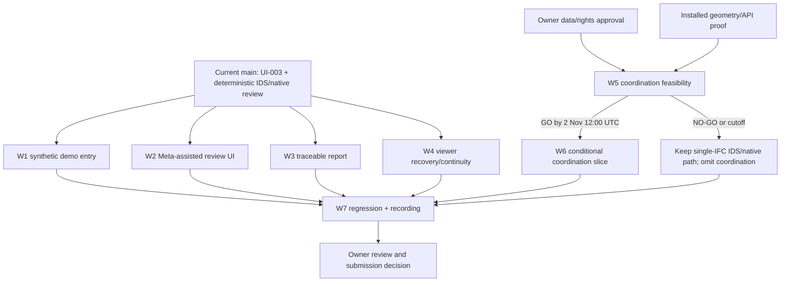

# Final 48-Hour Delivery Plan

**Decision date:** 1 November 2026
**Internal completion target:** 3 November 2026
**Hackathon submission date:** 4 November 2026
**Baseline:** `main` at `1f3d13b78683692317e00f2279c3f0c4ac02f1c2`
**Status:** Owner-approved delivery contract; this plan does not implement features or mark T-7/M3
or T-8/M4 complete.

## 1. Outcome and delivery boundary

Deliver one coherent **BIM Intelligence AI-native AEC model-review application** without replacing
the React shell, single-IFC workflow or working deterministic review engine. Preserve the approved
colour palette and typography, Project Home, immutable model versions, version-pinned reads,
source-backed findings and existing viewer selection.

The verified baseline on `main` already includes the Project Home and single-IFC upload/review
workflow (UI-003), deterministic IDS/native checks, source-linked element evidence, offline-tested
Meta client/planner/explanation safeguards, and a locally measured synthetic T-6 benchmark. UI-003
was merged through PR #18 on 30 October. T-7/M3 and T-8/M4 remain in progress.

The checked-out implementation does **not** include a user-facing Meta objective/explanation
workflow, a complete report/export path, Fit All/Reset/Focus controls, a session history/sample
catalogue, a federation manifest, coordinate validation or a clash engine. The local Python
environment reports IfcOpenShell 0.9.0.post1 and IfcTester 0.9.0; IfcClash is not installed. Do not
describe any of those gaps as implemented.

The two-model coordination demonstration is an optional branch, not a dependency of the single-
model fallback or an existing MVP acceptance criterion. If its gate fails, stop it and retain the
verified IDS/native workflow. A Meta-assisted recording is permitted only after the actual UI
integration is tested and any live request is explicitly approved. Without that approval/evidence,
do not call the fallback Meta-assisted or claim hackathon eligibility.

## 2. Workstreams and ownership

Owners below are **implementation roles**, not assignments to named people or agents. The project
owner approves private-data use, paid/live calls, branch scope, visual changes and the final
submission. One integration lead controls the critical path and evidence; keep workstreams bounded.

| ID | Owner | Scope and likely file boundary | Dependencies | Exit evidence |
|---|---|---|---|---|
| W0 — Integration and release control | Project maintainer / release integrator | Latest `main`; task/PR ordering; status/evidence reconciliation; no product-code ownership by this documentation plan | None | Baseline SHA recorded; branch inventory; test and gate results consolidated; no task/milestone marked complete without its full criteria. |
| W1 — Synthetic demo entry | Frontend implementation agent | Existing Project Home and API boundary; likely `frontend/src/components/ProjectHome.tsx`, sample wiring and focused tests. Reuse an approved synthetic source; do not add a catalogue service or alter existing fixtures. | Current UI-003 baseline; approved asset/provenance decision | One-click synthetic review creates or uses a session, loads one allowed IFC/IDS pair, labels synthetic provenance, and succeeds offline without live calls. If not complete, use the existing manual create/upload route. |
| W2 — Meta-assisted review UI | AI integration agent | Existing frontend review setup/workspace/API client and focused tests; reuse T-5 client, review endpoint, explanation endpoint, grounding and budget safeguards. Avoid generated type edits unless a reviewed backend schema change requires regeneration. | T-4/T-5 baseline; owner approval for any live request; backend credentials only in secured local configuration | UI shows the actual `plan_source`, actual explanation source and fallback state; deterministic findings/criteria remain unchanged. Fake/Replay is not represented as live inference. |
| W3 — Traceable report | Reporting/backend agent | Existing reporting boundary, review routes/schemas and frontend download/inspection boundary; tests and accurate architecture/requirements docs | T-4 run/evidence contracts; W2 only if optional AI content is included | One result/report contains run ID, model and document hashes, requirement revisions, check/rule versions, deterministic findings/evidence and explicit partial/error states. Optional AI interpretation remains separate. |
| W4 — Viewer recovery and continuity | Frontend/viewer agent | `frontend/src/viewer/`, `ViewerCanvas`, `ModelWorkspace`, focused viewer/UI tests and `docs/UI_CHANGELOG.md` | UI-003 baseline; verification of installed That Open Components 3.6 API before selecting controls | Fit All/Reset/Focus only where supported; neutral selection is distinct from issue severity; selection clears coherently; desktop evidence inspection preserves the usable viewport. No inert controls. |
| W5 — Coordination feasibility | BIM geometry lead, with owner rights approval | Isolated feasibility branch; synthetic or explicitly authorised local inputs only. Inspect installed package/version and verify capability before proposing any API or dependency. Do not modify the working review engine. | Owner-approved data scope and rights; exact two-model candidate or permitted synthetic pair; cutoff below | Reproducible, bounded technical proof for geometry, placement, identity, tolerance and viewer loading; pass/fail report with test inputs and no unsupported methods. A failure is an acceptable no-go. |
| W6 — Conditional coordination slice | Backend + viewer implementation agents, separately scoped | Only after W5 passes: separate manifest/result contracts, alignment validation, one A/B run, compact matrix and model-scoped 3D selection; focused tests/docs | W5 **GO**; separate owner approval for any dependency; W4 selection/viewer seam | All coordination gates in §4 pass. Otherwise branch is stopped and excluded from integration/recording. |
| W7 — Verification and recording | QA/evaluation lead + project owner | Existing test runners, ignored/private test evidence, final three-minute recording, rights checklist | W1–W4 and W6 only if selected; approved demo data and live-call decision | Exact command results, required regression/browser evidence, release gate and a functioning video of verified features only. |

### Dependency graph



W1–W4 can proceed in small, non-overlapping branches. W5 may run in parallel, but W6 may not
start until the gate has passed. W6 never blocks the fallback path. The integration lead merges
only reviewed, tested changes from the latest approved `main`; no implementation branch is
authorised by this documentation task.

### Recommended branch names

Use the Conventional Branch format, branch from the latest approved `main`, and keep the
coordination work isolated:

- `chore/t7-final-delivery-docs`
- `feature/t7-synthetic-demo-entry`
- `feature/t7-meta-assisted-review`
- `feature/t7-traceable-report`
- `feature/t7-viewer-recovery`
- `feature/t7-coordination-feasibility` — spike only; do not merge experimental code by default
- `feature/t7-coordination-demo` — create only after a recorded GO
- `chore/t8-release-evidence`

One integrator controls the merge order. Avoid parallel edits to `ModelWorkspace.tsx`, generated
types, `IfcViewer.ts`, the same API routes, or the same docs section. Rebase/merge only with
explicit branch-owner approval; do not amend, push or merge automatically.

## 3. Critical path and integration order

**Critical path:** owner approvals and baseline verification → W2 Meta UI and W3 traceable result
integration → W4 regression → complete browser walkthrough → three-minute recording → rights/rules
check → owner submission decision.

Recommended order:

1. **1 November — freeze baseline and assign scopes.** Verify latest `main`, retain the working
   single-IFC application, choose synthetic fallback inputs, and obtain owner decisions on data
   rights, live-call permission and official event rules. Do not read unrelated private material.
2. **1 November — run W5 feasibility only if authorised.** Verify the exact installed geometry
   capability and its licence/API. Use permitted synthetic or owner-authorised local models. No
   dependency install, model transmission or package method is assumed by this plan.
3. **2 November, 12:00 UTC — coordination GO/NO-GO.** Apply every condition in §4. Default is
   **NO-GO** until affirmative evidence is recorded. Do not extend the cutoff to protect optional
   scope.
4. **2 November after the gate — integrate W1–W4.** Implement the one-click synthetic path first;
   then the bounded Meta UI/report/viewer slices under their file scopes. If live Meta use is
   authorised, run only the approved smoke test. Keep deterministic fallback functional.
5. **2 November end of day — integrate or stop coordination.** Merge W6 only if every gate passed,
   focused tests pass and no core regression is present. Otherwise close/retain the spike
   unmerged and continue the single-model path.
6. **3 November — full regression, acceptance walkthrough and recording.** Freeze code after
   checks; record only the exact states that passed. Capture evidence and complete rights,
   attribution, repository and official-rule checks.
7. **By 3 November — internal completion review.** Project owner reviews blockers and evidence.
   The submission deadline remains 4 November; release, deployment, tagging and submission are
   separate owner actions.

## 4. Exact coordination go/no-go conditions

The gate closes at **2 November 2026, 12:00 UTC**. Coordination is **GO only when every condition
below is true and the evidence is reviewable**. Any missing, ambiguous or failed condition means
**NO-GO**; no partial matrix, synthetic intersection or planned API is shown as a result.

1. **Rights and scope:** the owner has authorised the precise two model sources, local inspection,
   test evidence, recording and any publication. Duplex Apartment is preferred only if model
   compatibility and redistribution rights are verified. No private IFC or derived facts enter
   tracked files or an LLM request without the required separate owner approval and rights.
2. **Dependencies:** the exact deterministic geometry engine and version are identified and already
   installed, or the owner separately approves a dependency addition after its licence and
   compatibility review. IfcClash is absent from the currently installed environment. No
   speculative install is a GO condition.
3. **ModelSet integrity:** exactly two independently uploaded, immutable model versions are
   referenced by model identity and SHA-256; discipline labels and relative/absolute placement
   metadata are explicit. Existing sessions still contain one active IFC each. Model bytes are
   read-only; existing file limits and a documented aggregate cap apply.
4. **Coordinate validation:** both models have a tested, explicit common frame and units; placement
   transforms are validated. Tests prove supported alignment is accepted and unknown, unsupported,
   stale, ambiguous or mismatched alignment is rejected before geometry analysis.
5. **Element identity:** every result identifies both model member/hash pairs and actual element
   references. GlobalId is model-scoped; the only allowed fallback is `(model_member_id,
   model_hash, ifc_type, express_id)`. Duplicate GlobalIds across models cannot merge identities.
6. **Geometric correctness:** deterministic tests cover at least a known intersection, known
   non-intersection, tolerance boundary, configured exclusion, unsupported IFC entity, malformed
   placement and repeat-run stability. Tolerance value/units, algorithm/version, exclusions,
   placement assumptions and tested entity scope are recorded.
7. **Result semantics:** raw intersections, grouped clashes and human-assessed issues are separate.
   An intersection is not automatically an error. States distinguish unavailable, not analysed,
   zero clashes, analysis error and results available. Counts and coordinates come only from the
   successful computation; no AI-generated geometry is accepted.
8. **Actual UI evidence:** matrix row selection loads/highlights the actual pair in the existing
   application shell, with desktop viewport continuity, source hashes and run-linked evidence.
   No separate product redesign, inert camera controls or fabricated loading percentages.
9. **Regression and timing:** focused backend/frontend checks, the existing single-IFC browser
   workflow and selection/version tests all pass by the cutoff. The W6 implementation and recording
   rehearsal fit within the remaining day without cutting W1–W4 acceptance.

### No-go behaviour

- Stop the coordination branch; do not add it to the release branch or the recording.
- Preserve the existing single-IFC review and all working deterministic checks.
- Use the one-click synthetic single-model sample if W1 is complete; otherwise use the current
  tested manual session/upload workflow.
- Continue W2/W3 only within their approved scope. A deterministic-only UI is not a
  Meta-assisted demo. If Meta integration is not approved/verified, disclose it and request the
  project owner's decision rather than claim the fallback meets hackathon requirements.

## 5. Definition of Done

This is the completion contract for the remaining work, **not a declaration that T-7/M3 or T-8/M4
is complete**. The project owner must review actual implementation and evidence before changing
any task or milestone status.

- [ ] The working single-IFC Project Home, upload, immutable-version review, IDS/native findings,
      evidence and 3D selection still pass their focused and full regressions.
- [ ] Product identity remains one BIM Intelligence AEC model-review application; existing visual
      identity, palette, typography and shell are preserved.
- [ ] A one-click synthetic sample exists, is provenance-labelled and is demonstrably safe/offline,
      or the owner has explicitly accepted the existing manual fixture upload as the recording
      path.
- [ ] User-facing Meta assistance is included only if the real path is connected and its actual
      `plan_source`, explanation source, fallback and spend state are honest. Any live request has
      separate owner approval; otherwise no live/provider claim is made.
- [ ] A traceable result/report, if included, preserves run/model/document/check/rule/evidence
      provenance and distinguishes deterministic findings from AI interpretation.
- [ ] Camera recovery/selection/desktop requirements are implemented only where supported and
      regression-tested; unsupported controls remain absent.
- [ ] Coordination is included only if every §4 condition passes. No-go removes it from the
      recording, docs claims and final integrated code path.
- [ ] Backend and frontend commands in §6 pass; exact results and environment are recorded.
- [ ] The functioning video is no longer than three minutes, uses only approved inputs/assets, and
      contains no unverified capability, secret or private data.
- [ ] Public repository claims, README, architecture, requirements, decisions, changelog, licences,
      attribution and applicable event rules agree with tested evidence.
- [ ] The owner reviews the evidence and independently approves any release/submission action.

## 6. Validation commands and acceptance evidence

Run commands from the indicated directory on the project's supported environment. Record exact
exit status, test count, warnings, OS/runtime versions and commit. These commands are planned for
the implementation/release work; they were **not run by this documentation-only task**.

### Backend — repository root, Windows PowerShell

```powershell
.\.venv\Scripts\python.exe -m pytest tests\scenario\test_deterministic_review.py tests\unit\api\test_model_versioning.py tests\unit\api\test_reviews.py -q
.\.venv\Scripts\python.exe -m pytest -q
.\.venv\Scripts\ruff.exe check .
.\.venv\Scripts\ruff.exe format --check .
.\.venv\Scripts\mypy.exe
.\.venv\Scripts\mypy.exe --strict backend\bim_intelligence\schemas backend\bim_intelligence\validation backend\bim_intelligence\orchestration
```

Add focused tests for every new report, sample and coordination contract. Coordination tests must
run against synthetic/approved inputs and block external network use.

### Frontend — `frontend\`

```powershell
npm run lint
npm run format:check
npm run typecheck
npm run types:check
npm test
npm run build
```

The current frontend does not configure Playwright. M3's browser-smoke acceptance remains open;
do not add a dependency without a separate approved architecture/licence decision. Any UI work also
requires actual browser verification at 1920 × 1080 and the affected narrower viewport, with
private captures under `local-private/test-results/`.

### Evaluation, secret scan and documentation

```powershell
.\.venv\Scripts\python.exe -c "import sys; sys.path.insert(0, 'tests'); from evaluation.run_eval import main; raise SystemExit(main())"
.\.venv\Scripts\python.exe -m pytest tests\unit\evaluation tests\evaluation\test_run_eval.py -q
.\.venv\Scripts\python.exe scripts\secret_scan.py --working-tree
.\.venv\Scripts\python.exe scripts\secret_scan.py --staged
.\.venv\Scripts\python.exe scripts\secret_scan.py --history
git diff --check
```

The benchmark runner writes only to ignored generated result paths and makes no live Meta call.
Never commit generated reports, screenshots, traces, IFC outputs, recordings or temporary logs.

### Live Meta smoke test — explicit owner gate; do not run by default

Only after explicit session approval, secured `MODEL_API_KEY`, `LLM_MODE=live`,
`ALLOW_LIVE_LLM=true`, Standard model validation and available budget:

```powershell
$env:BIMI_LIVE_LLM = '1'
$env:BIMI_LIVE_APPROVAL = 'T5-META-MUSE-SPARK-SMOKE'
.\.venv\Scripts\python.exe -m pytest tests\live\test_meta_smoke.py -m live
```

This documentation task authorises **no** live API request or spend. `Off` and `Replay` must never
fall back to Live.

### Named evidence artefacts

Create these only during authorised implementation/rehearsal; none is created by this plan:

| Artefact | Intended location | Purpose |
|---|---|---|
| `final-backend-pytest.txt` | `local-private/test-results/final-48h/` | Exact backend command results and environment. |
| `final-frontend-checks.txt` | `local-private/test-results/final-48h/` | Exact frontend check/build/test results. |
| `final-evaluation.json` and `final-evaluation-summary.md` | `tests/evaluation/runs/latest/` (ignored) | Reproducible T-6 metric output and source hashes. |
| `coordination-feasibility.json` | `local-private/test-results/final-48h/` | Engine/version, synthetic/authorised input identifiers, test outcomes and gate decision; no raw private model content. |
| `ui-home-1920x1080.png`, `ui-workspace-selected-1920x1080.png` | `local-private/test-results/final-48h/` | Actual browser states and viewport evidence. |
| `three-minute-final-master.mp4`, `three-minute-qc.txt` | Owner-approved ignored/private location | Recording master, exact duration, audio/readability and rights checks. Submit only through the owner's event workflow. |
| `submission-rights-and-rules-check.txt` | `local-private/test-results/final-48h/` | Official rules, asset/model rights, attribution and owner decision evidence. |

Keep sensitive evidence private. Tracked changelog entries may contain only an authorised,
non-sensitive summary and neutral evidence identifiers.

## 7. Rollback and scope control

- **Coordination no-go or regression:** leave the feasibility spike unmerged; if implementation
  already merged under separate approval, revert only the coordination-specific commit(s). Preserve
  the one-model review, its tests and its model versions.
- **Meta UI or live provider failure:** disable/remove only the unverified UI path, keep `LLM_MODE`
  off by default and retain the deterministic workflow. Remove any claim of live use; do not
  substitute Replay/Fake as a live result.
- **Report or viewer regression:** revert the smallest affected workstream commit; do not alter
  generated schemas or model records by hand to hide a mismatch.
- **Rights unresolved:** do not inspect, transmit, track, record or publish the candidate. Replace
  it with the synthetic single-model flow or omit the optional segment.
- **General:** inspect `git status` and the diff before rollback, preserve pre-existing owner work,
  and never use destructive reset/checkout operations against unrelated changes. Record the
  rollback and its evidence in the relevant task/changelog.

## 8. Samples, privacy and exclusions

- `examples/` may contain tracked manifests, attribution/provenance, preparation instructions and
  genuinely redistributable small assets. It does not currently exist. Do not create placeholders
  or add an IFC exception to `.gitignore` until an exact asset is rights-checked and owner-approved.
- `local-private/` is for private BIM files, evaluation materials, raw tester evidence and
  unapproved third-party assets. It is owner-managed and ignored; do not inspect unrelated files
  or create placeholders.
- The one-click synthetic demo is the safe fallback. Preserve the existing synthetic benchmark
  and fixtures; do not modify an IFC in place or copy a private model into tracked content.
- Duplex Apartment is the preferred external federation candidate only if compatibility and rights
  verification both pass. No model is assumed to be available or authorised by this plan.
- Excluded: enterprise clash management, general federation, model editing, new services or
  databases, unapproved dependencies, unrestricted data upload, live inference without approval,
  deployment, release/tagging and submission without owner approval.

## 9. Remaining risks and owner decisions

1. **Time:** two days is insufficient for unrestricted feature work. W5/W6 stop at the cutoff;
   protect W1–W4, regression and recording.
2. **Meta:** API compatibility and frontend integration are unverified. Any live feature depends on
   owner approval, secure credentials and a successful bounded request.
3. **Clash capability:** IfcClash is not installed, alignment and the federated viewer are unproven,
   and a dependency/licence decision may not fit. The default gate is no-go.
4. **Sample rights:** Duplex Apartment's redistribution rights and model compatibility have not
   been verified; the synthetic path remains the safe fallback.
5. **M3/M4 acceptance:** hosted CI, Playwright smoke, complete report, integrated Meta path, final
   walkthrough and recording remain evidence gaps. This plan cannot mark T-7/M3 or T-8/M4
   complete.
6. **Hackathon rules:** official requirements, eligibility, submission format and asset terms
   remain owner verification items (OPEN-02). No eligibility claim is made.

**Stop condition:** Complete the scoped documentation and return this plan for owner review. Do
not start implementation, inspect private models, call Meta, install dependencies, create a
branch, record a video, submit, commit, push or merge as part of this task.
