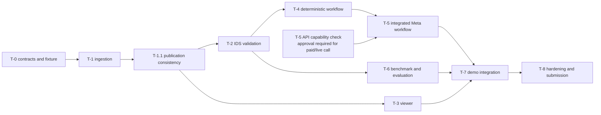

# Delivery Plan and Engineering Task Register

**Reconciled:** 29 October 2026 | **Delivery window:** Monday 26 October – Wednesday 4 November 2026 | **Deadline:** Wednesday 4 November 2026; this plan does not move it.
**Status:** The repository is partially implemented. Task and milestone statuses below reflect available code, tests, commits and merged PR evidence as of this reconciliation.

Requirement IDs refer to [REQUIREMENTS.md](./REQUIREMENTS.md); architectural decisions refer to [DECISIONS.md](./DECISIONS.md). The design baseline and implementation evidence are documented in [ARCHITECTURE.md](./ARCHITECTURE.md), and evaluation objectives and results in [EVALUATION.md](./EVALUATION.md).

## 1. Delivery framework

**Milestones describe delivery capabilities; tasks describe engineering work.** A task can contribute to more than one milestone, and a milestone can depend on several tasks. A completed task is evidence toward a milestone, not proof that its exit criteria have been met.

The original M0–M4 milestones remain in force. T-0–T-8 were added to break the milestone outcomes into bounded engineering work that can be implemented, tested and evidenced. T-1.1 is an additional corrective subtask, not a renumbering of T-2–T-8.

T-1.1 followed the T-1 architecture review. Publishing a new IFC, index and summary as separate visible writes could leave readers observing a mixed model version during a replacement. The corrective task prepares and validates a content-addressed version before atomically activating it through the session record; it also adds upload locking, recovery and version-bound reads. See [ADR-017](./DECISIONS.md#adr-017-content-addressed-model-versions-with-single-pointer-publication) and [PR #5](https://github.com/natnew/BIM-Intelligence/pull/5).

Task status is determined by implementation and acceptance evidence, not by a plan checkbox, a label, or a verbal claim. Milestone status is determined by its full exit criteria. A test result verifies only the behaviour it covers; in particular, a Meta API smoke test alone cannot complete T-5.

Status vocabulary for tasks: `Not started`, `In progress`, `Implemented — verification pending`, `Verified`, `Blocked`, `Deferred`. `Verified` requires the relevant acceptance evidence to be recorded. A milestone is `Verified` only when every exit criterion has evidence; otherwise its status is `In progress` or `Not started`.

## 2. Milestone-to-task mapping

| Milestone | Contributing task IDs | Expected deliverables | Dependencies | Measurable exit criteria | Status | Supporting evidence |
|---|---|---|---|---|---|---|
| **M0 — Foundations** | T-0, T-1, T-1.1; T-3 viewer spike; T-5 Meta API capability spike | Reproducible schemas and fixtures; safe IFC ingestion and a working model API; atomic model publication; initial viewer and Meta API integration risks assessed. | None. The T-3 spike requires the T-1 API and fixture; the T-5 spike requires explicit approval before any paid/live call. | Contract/type-generation and fixture tests pass; fixture upload produces a matching model summary; replacement/read consistency tests pass; a basic viewer load/GlobalId highlight and the authorised structured-output/tool-call API spike are demonstrated or explicitly approved as deferred. The original viewer and LLM spike intent is not silently removed. | **In progress** — the T-3 viewer spike is verified; the T-5 API capability spike remains open. | [T-0–T-1.1 history](../CHANGELOG.md#verified-implementation-history); [T-1.1 ADR](./DECISIONS.md#adr-017-content-addressed-model-versions-with-single-pointer-publication); [T-3 evidence](#t-3--interactive-3d-bim-viewer); README development-status table. |
| **M1 — Deterministic Review** | T-2, T-4, T-6 | IDS validation, required non-overlapping native rule coverage, an end-to-end LLM-free review, benchmark ground truth and reproducible evaluation evidence. | M0; T-4 builds on T-2; T-6 can start after T-2 and run alongside T-4. | IDS results are cross-checked against IfcTester; required P0 native-rule tests pass; fixture review runs without an LLM; benchmark precision/recall, clean-control false positives and determinism are reported from a reproducible labelled dataset. | **In progress** — T-6 evidence passes locally; M1 remains open while its M0 prerequisite and hosted CI evidence are outstanding. | [T-2](https://github.com/natnew/BIM-Intelligence/pull/6); [T-4](#t-4--end-to-end-deterministic-review-workflow); [T-6 measured results](./EVALUATION.md#8-results); [CI evidence outstanding](#t-6--benchmark-and-evaluation). |
| **M2 — AI-Native Review** | T-4, T-5 | Meta Muse Spark-assisted requirement interpretation and objective planning, filtered against confirmed checks, with explanations grounded in deterministic evidence and a usable no-LLM fallback. | M1 deterministic execution; T-5's full integration depends on T-4. API capability verification can run independently. | Scenario tests with FakeClient/Replay cover extraction, quote verification, confirmation, plan filtering, tool caps, grounded explanations and degraded mode; any live test is explicitly authorised. A smoke test alone is insufficient. | **In progress** — T-5 offline interfaces and tests are implemented; live Meta capability, frontend AI workflow and remaining requirements/evaluation evidence are open. | [README development-status table](../README.md#development-status); [T-5 register](#t-5--meta-muse-spark-integration). |
| **M3 — Demo-Ready Product** | T-3, T-4, T-6, T-7 | Owner-directed UI governance framework; interactive viewer and finding coordination; traceable report; integrated workflow, tested fallback and a rehearsed demonstration. | M1 and M2; T-3 can proceed after T-1 and in parallel with T-4–T-6. T-7 integrates T-3, T-4, T-5 and T-6. | A tested browser walkthrough uses the benchmark/fixture, selection and highlighting work for a finding, reports preserve provenance, fallback works, and the smoke test and documented setup pass. | **In progress** — the UI governance framework is established; report, integrated AI workflow and demonstration criteria remain. | [T-3 evidence](#t-3--interactive-3d-bim-viewer); [T-4 evidence](#t-4--end-to-end-deterministic-review-workflow); [T-6 results](./EVALUATION.md#8-results); [T-7 UI governance](./UI_SPEC.md); [Demo requirements](./DEMO_PLAN.md). |
| **M4 — Submission** | T-8, supported by all previous completed tasks | Final hardening, verified documentation, measured evaluation results, recorded demo and owner-approved submission actions. | M3 and evidence from all applicable preceding tasks. | Final test and secret-scan evidence is recorded; claims match measured behaviour; demo and results are available; submission requirements are checked against official rules. Release, tagging or submission actions require owner approval. | **Not started** — T-6 measured results are now available; final hardening, CI, demo and submission evidence remain outstanding. | [Demo plan](./DEMO_PLAN.md); [T-6 results](./EVALUATION.md#8-results); submission requirements remain unverified. |

No milestone is complete solely because its contributing task labels exist. Original exit requirements remain outstanding unless explicitly met or superseded with project-owner approval.

## 3. Engineering task register

### T-0 — Schemas and Minimal IFC Fixture

- **Objective:** Establish the typed domain contract and a small, reproducible IFC/IDS fixture.
- **Responsible components:** `backend/bim_intelligence/schemas/`, `scripts/export_schemas.py`, `frontend/src/api/generated/`, `tests/fixtures/`.
- **Deliverables:** Core Pydantic schemas and generated TypeScript contract; minimal IFC and IDS fixture-generation script.
- **Dependencies:** None.
- **Acceptance tests:** Schema and canonicalisation unit tests pass; generated contract checks pass; fixture is reproducible and has the documented IDS outcomes.
- **Status:** **Verified.**
- **Milestones:** M0.
- **Evidence:** Commit [`be45c7c`](https://github.com/natnew/BIM-Intelligence/commit/be45c7c), 27 October 2026; the implementation record reports 112 passing backend tests at that point. See [ADR-015](./DECISIONS.md#adr-015-contract-model-immutable-checkspec-content-addressed-finding-per-check-checkresult).

### T-1 — IFC Ingestion, Model Indexing and Session Persistence

- **Objective:** Accept a read-only IFC upload, build a queryable model index and persist session state.
- **Responsible components:** `store/`, `bim/`, `schemas/`, `api/`, `tests/unit/`.
- **Deliverables:** Session store; IFC loading/indexing; session, upload, summary and element lookup endpoints; structured errors.
- **Dependencies:** T-0.
- **Acceptance tests:** Fixture and in-memory IFC variants cover indexing, relationships, malformed and duplicate GlobalIds, upload limits and API errors; uploaded bytes remain unchanged; upload-to-summary smoke test passes.
- **Status:** **Verified.**
- **Milestones:** M0.
- **Evidence:** [PR #4](https://github.com/natnew/BIM-Intelligence/pull/4), commit [`de63de8`](https://github.com/natnew/BIM-Intelligence/commit/de63de8), 28 October 2026; the implementation record reports 283 passing backend tests. See [ADR-016](./DECISIONS.md#adr-016-ingestion-contract-staged-upload-content-hash-etag-and-identifier-handling).

### T-1.1 — Model Publication Consistency

- **Objective:** Prevent mixed-version reads when replacing a session's active IFC model.
- **Responsible components:** `store/`, `bim/`, model/session API and their unit tests.
- **Deliverables:** Content-addressed model-version directories, private staging and validation, atomic pointer activation, per-session upload locking, abandoned-stage recovery and version-bound reads.
- **Dependencies:** T-1.
- **Acceptance tests:** Failure injection across publication steps; concurrent upload and reader tests at store and HTTP level; restart/recovery and ETag/If-Match tests.
- **Status:** **Verified.**
- **Milestones:** M0.
- **Evidence:** [PR #5](https://github.com/natnew/BIM-Intelligence/pull/5), commit [`b1fd054`](https://github.com/natnew/BIM-Intelligence/commit/b1fd054), 29 October 2026; the implementation record reports 334 passing backend tests and clean `ruff`/`mypy`. See [ADR-017](./DECISIONS.md#adr-017-content-addressed-model-versions-with-single-pointer-publication).

### T-2 — Deterministic IDS Validation

- **Objective:** Import IDS 1.0 specifications as confirmed requirements and execute each through IfcTester, producing reproducible deterministic results.
- **Responsible components:** `requirements/ids_import.py`, `validation/`, review and findings API, schemas and unit tests.
- **Deliverables:** IDS import and validation, immutable check definitions, per-check results, normalised findings and synchronous review endpoints.
- **Dependencies:** T-0, T-1 and T-1.1.
- **Acceptance tests:** Malformed/non-IDS inputs return structured errors; IDS results are cross-checked against IfcTester's JSON report; the minimal fixture produces its two expected findings; repeated runs produce byte-identical `findings.json`; the default test suite makes no live API call.
- **Status:** **Verified.**
- **Milestones:** M1.
- **Evidence:** [PR #6](https://github.com/natnew/BIM-Intelligence/pull/6), commit [`a480483`](https://github.com/natnew/BIM-Intelligence/commit/a480483), 29 October 2026. The PR validation record reports `ruff`, `mypy`, 461 backend tests and frontend lint, typecheck, tests, build, format and generated-type checks passing. See [ADR-018](./DECISIONS.md#adr-018-ids-import-establishes-confirmed-requirements-checks-are-hydrated-per-run-reviews-run-under-the-session-lock).

### T-3 — Interactive 3D BIM Viewer

- **Objective:** Load the current IFC version in the browser and connect model selection to finding selection/highlighting.
- **Responsible components:** `frontend/src/viewer/`, viewer adapter and frontend panels.
- **Deliverables:** Initial viewer spike (load, GlobalId-to-fragment resolution, highlight, viewer click); then integrated viewer and two-way finding/model selection.
- **Dependencies:** T-1 fixture and model API. The prerequisite is available; viewer development can proceed independently of T-4–T-6.
- **Acceptance tests:** Load the minimal model; highlight a known GlobalId; verify finding-to-viewer and viewer-to-element selection; exercise loading, error and empty states and the planned browser smoke test.
- **Status:** **Verified.**
- **Milestones:** M0 (viewer spike), M3 (finished interface).
- **Evidence:** On 29 October 2026, the minimal IFC and an existing T-2 review run were loaded in the integrated browser. The canvas rendered the three-wall model; selecting the W-002 finding highlighted its wall and displayed GlobalId `0QWMtUzsnUUONCUGc8Sqsa`. Clicking W-001 populated its element record, and clicking W-002 selected the matching finding and loaded its properties. Browser request capture showed the Fragments worker and `/web-ifc/` WASM assets served from localhost; no external requests were observed. These are actual browser observations, separate from the mocked tests.
- **Automated frontend validation:** `npm test` (15 tests passed), `npm run typecheck`, `npm run lint`, `npm run format:check`, `npm run build`, and `npm run types:check` — all passed on the completed change.
- **Scope and licence note:** The viewer does not upload models. T-4 adds a bounded standard-review action to the existing workspace; T-3's viewer selection and model loading remain unchanged. `web-ifc` 0.0.77 is MPL-2.0 and is documented as an exception to the repository's permissive-or-LGPL dependency preference; owner review remains required before public distribution.

### T-4 — End-to-End Deterministic Review Workflow

- **Objective:** Complete the LLM-free path from a model and confirmed checks to a review plan, deterministic execution, findings and traceable results.
- **Responsible components:** `validation/`, `orchestration/`, review API, schemas, scenario tests and findings API.
- **Deliverables:** The non-overlapping P0 native rule; bounded/default deterministic execution over supported checks; complete LLM-off review path, persistent coverage outcomes and a minimal viewer entry point. The IDS-only review delivered in T-2 was a verified slice, not by itself completion of this broader task.
- **Dependencies:** T-2; T-0 and T-1.1 contracts/versioning.
- **Acceptance tests:** Positive, negative and applicability-boundary unit tests for every shipped native rule; fresh-session fixture scenario with LLM off; pinned model, confirmed checks, bounded execution, truthful partial coverage, model/GlobalId consistency and byte-identical findings across repeated reviews; per-check errors never appear as passing checks.
- **Status:** **Verified** — T-4 acceptance evidence below is complete. M1 remains in progress because the separate T-6 evaluation criteria are not met; T-5 AI integration and T-7 product work are unchanged.
- **Milestones:** M1, M2 (integration seam), M3.
- **Evidence:** T-4 scenario `tests/scenario/test_deterministic_review.py` imports `tests/fixtures/minimal.ifc` and `minimal.ids` into a fresh session with `LLM_MODE=off`, explicitly confirms the native rule, runs and repeats the review with identical findings JSON, verifies the pinned model hash and GlobalId element mapping, and blocks non-loopback network access. The fixture produces the IDS FireRating finding on W-002, IDS classification-presence finding on W-003, and native classification-consistency finding on W-002; W-001 is not flagged. The native mismatch evidence is `observed="'W-002' uses Uniclass 2015: WRONG-CODE."`, `expected="Type 'WT-CLASSIFIED' uses Uniclass 2015: Ss_25_10_30."`, `method="native"`, rule `classification.consistent_by_type` v1.0.0. Unit tests cover the native rule's pass/mismatch/not-applicable/invalid-spec outcomes, confirmation idempotency, plan/tool caps, skipped coverage and error continuation.
- **Backend validation (29 October 2026):** `.\.venv\Scripts\python.exe -m pytest -q` — **473 passed, 1 warning** (upstream Starlette `httpx` TestClient deprecation); focused T-4 command `.\.venv\Scripts\python.exe -m pytest tests\unit\validation\test_native_rules.py tests\unit\orchestration\test_review_runner.py tests\unit\api\test_native_requirements.py tests\scenario\test_deterministic_review.py -q` — **25 passed, 1 warning**. `ruff check .` and `ruff format --check .` — passed (98 files already formatted). `.\.venv\Scripts\python.exe -m mypy` — passed for 97 source files. `.\.venv\Scripts\python.exe -m mypy --strict backend\bim_intelligence\schemas backend\bim_intelligence\validation backend\bim_intelligence\orchestration` — passed for 21 source files; mypy emitted an unused `pyproject.toml` module-section note but no type errors.
- **Frontend validation (from `frontend/`, 29 October 2026):** `npm run lint`, `npm run format:check`, `npm run typecheck`, `npm run types:check`, `npm test` (**3 files, 18 tests passed**) and `npm run build` — all passed.

### T-5 — Meta Muse Spark Integration

- **Objective:** Add bounded model-assisted requirement extraction, objective planning and grounded explanations without allowing the model to create findings or bypass human approval.
- **Responsible components:** `llm/`, `requirements/`, `orchestration/`, `reporting/`, versioned prompt files and tests.
- **Deliverables:** Config-gated Meta API client and offline Fake/Recording/Replay interfaces; persistent budget accounting; Markdown/TXT candidate extraction with verbatim quote checks and explicit human confirmation against an existing `CheckSpec`; filtered planner; grounded explanation with deterministic fallback and token accounting. Full BEP-to-IDS authoring, UI panels and live capability verification remain unfinished acceptance.
- **Dependencies:** T-4 for full integration; T-0 schemas. The API capability check can run independently but any paid/live call requires explicit session approval under C-06 and AGENTS.md §9.
- **Acceptance tests:** Offline tests cover valid/invalid structured output; no-key Off/Replay; live configuration gating; budget rejection, persistence and concurrent reservation; sanitised timeout errors; quote/source validation and human confirmation; confirmed/unknown/duplicate/excess check plans; grounding rejection and deterministic fallback; default review correctness. Default pytest does not invoke Live. The named live test requires `-m live`, `BIMI_LIVE_LLM=1`, `BIMI_LIVE_APPROVAL=T5-META-MUSE-SPARK-SMOKE`, valid live settings and owner approval.
- **Status:** **In progress — offline implementation and verification only. No live API request or spend has occurred; M0 capability verification and full M2 acceptance remain open.**
- **Milestones:** M0 (API capability spike), M2 (integrated AI-native workflow).
- **Offline verification (29 October 2026):** `.\.venv\Scripts\python.exe -m pytest -q` — **527 passed, 1 live test skipped, 1 third-party deprecation warning**; `.\.venv\Scripts\ruff.exe check .` — passed; `.\.venv\Scripts\ruff.exe format --check .` — passed; `.\.venv\Scripts\mypy.exe` — passed. From `frontend/`, `npm run types:check`, `npm run lint`, `npm run typecheck`, `npm test` (**3 files, 18 tests passed**), `npm run format:check` and `npm run build` — all passed. The default tests made no live Meta calls.
- **Secret scan (Gitleaks 8.25.0, redacted):** `python scripts/secret_scan.py --working-tree` — no leaks; `python scripts/secret_scan.py --history` — no leaks across 37 commits. `python scripts/secret_scan.py --staged` passed with **no staged changes**. The project owner approved setting repository-local `core.hooksPath=.githooks`; the pre-commit hook ran successfully against the empty index.
- **Evidence:** Implemented contracts and routes are described in [ARCHITECTURE.md §7.6, §9 and §11](./ARCHITECTURE.md), with spend decisions in [ADR-020](./DECISIONS.md#adr-020-t-5-meta-client-spend-ledger-and-human-gates). Planned maximum for one authorised smoke request: model `muse-spark-1.3`, endpoint `https://api.meta.ai/v1/chat/completions`, at most one call, 8,000 estimated input and 500 output tokens, uncached worst-case USD 0.012125. It must return schema-valid `{"status":"T5_SMOKE_OK"}`. This has not been run; measured API usage is USD 0.

### T-6 — Benchmark and Evaluation

- **Objective:** Measure deterministic finding quality and reproducibility on independently labelled, redistributable test data; evaluate the T-5 offline safety contract separately from model quality.
- **Responsible components:** `tests/evaluation/`, `tests/unit/evaluation/`, `datasets/synthetic/generated/`, `docs/EVALUATION.md`.
- **Deliverables:** Deterministic IFC4 generator, versioned injection manifest, independently checked ground truth, matching IDS/BEP/objectives, metric runner and dated machine-readable and human-readable evidence.
- **Dependencies:** T-2 for initial preparation and IDS baseline; T-4 native rules for full rule-family evaluation. Preparation can run in parallel with integration.
- **Acceptance tests:** Dataset and ground truth are byte-reproducible; P0 findings match exact rule/check and GlobalId sets; clean controls yield no false positives; undefined metrics, duplicates, unmatched predictions, misses, errors, skips and non-applicable checks are explicit; IDS is compared with IfcTester; live API calls are absent.
- **Status:** **Verified locally; hosted CI evidence pending.**
- **Milestones:** M1, M3, M4.
- **Evidence:** On 29 October 2026, the documented offline runner completed on source commit `99d04633c517c052f80f87b5f7fb6f2ec640e909` (dirty worktree). It measured 15 P0 defects, seven controls, aggregate TP/FP/FN 15/0/0, precision/recall/F1 1.000/1.000/1.000, byte-identical repeated findings, 14/14 IfcTester IDS entity agreement, zero errors/skips/false positives, 9/9 offline AI contract checks and zero network/live Meta calls or spend. Focused pytest passed 14 tests; the full backend suite passed 541 tests with one live test skipped; repository Ruff and mypy passed. GitHub Actions run [40924566072](https://github.com/natnew/BIM-Intelligence/actions/runs/40924566072) on the base commit ended in `startup_failure` with no jobs, so hosted CI for this worktree remains outstanding. Outputs are regenerated under git-ignored `datasets/synthetic/generated/` and `tests/evaluation/runs/latest/`.

### T-7 — Reporting, Interface Refinement and Demonstration Readiness

- **Objective:** Integrate the review workflow into a usable interface and present traceable findings and reports with a reliable demo fallback.
- **Responsible components:** `frontend/`, `reporting/`, browser/scenario tests and demo artefacts.
- **Deliverables:** Owner-directed UI governance framework (`docs/UI_SPEC.md`, `docs/UI_REFERENCES.md`, `docs/UI_CHANGELOG.md` and `frontend/AGENTS.md`), extended by the [UI constitution](./UI_CONSTITUTION.md), [refinement skill](../.github/skills/bim-ui-refinement/SKILL.md) and restricted [designer](../.github/agents/bim-ui-designer.agent.md)/[implementer](../.github/agents/bim-ui-implementer.agent.md) roles; requirement and objective panels; findings/detail views; model highlighting; JSON/Markdown report with provenance; replay/off mode; rehearsed demo.
- **Dependencies:** T-3, T-4, T-5 and T-6. Begin integration as dependencies become testable, without treating incomplete upstream work as finished.
- **Acceptance tests:** UI changes follow explicit owner approval and are recorded with repeatable visual evidence; full browser walkthrough on the benchmark; findings link to their deterministic checks and model elements; report provenance is complete; replay/degraded mode works; browser smoke test passes.
- **Status:** **In progress — owner-directed UI governance framework established; reporting, interface implementation, browser walkthrough and demo acceptance remain incomplete. No visual redesign or UI-001 implementation has been authorised by this change.**
- **Milestones:** M3.
- **Evidence:** [T-3](#t-3--interactive-3d-bim-viewer) and [T-4](#t-4--end-to-end-deterministic-review-workflow) record verified interface slices; [UI_SPEC.md](./UI_SPEC.md) defines the owner-directed governance framework. The complete integrated workflow, report and demo evidence remain outstanding.
- **Framework extension (30 October 2026):** constitution-driven, bounded concept/prototype evaluation and separate implementation approval are documented; optional Copilot guards are proposed, not installed. Reference metadata checks located an ignored singular-path library; image/provider permissions remain unverified. No UI-001 or visual redesign starts here. T-7/M3 status, dependencies, exit criteria and delivery dates are unchanged.

### T-8 — Final Hardening, Documentation and Submission

- **Objective:** Complete final engineering verification and prepare evidence-backed documentation and owner-approved submission materials.
- **Responsible components:** Whole repository, CI, `README.md`, `docs/`, `CHANGELOG.md`, evaluation and demo evidence.
- **Deliverables:** Final regression/security/hygiene checks; clean-checkout setup verification; measured results; consistent public documentation; recorded demo and submission checklist.
- **Dependencies:** T-0 through T-7 as applicable; M3 exit.
- **Acceptance tests:** Agreed backend and frontend checks pass; secret scan and documentation/link checks are clean; setup reproduces; metrics link to a run and commit; demo is available; official submission requirements are checked. Release/tag/submission actions require project-owner approval.
- **Status:** **In progress — delivery-framework documentation is being reconciled here; final hardening, demo and submission acceptance have not been completed.** This documentation change does not establish product functionality or M4 completion.
- **Milestones:** M4.
- **Evidence:** This plan, [AGENTS.md §11](../AGENTS.md#11-delivery-milestones-engineering-tasks-and-progress-tracking) and [CHANGELOG.md](../CHANGELOG.md) establish the tracking requirements; final task evidence remains outstanding.

## 4. Revised delivery schedule

The original ten-day window is retained. The weekday labels below are corrected to the 2026 calendar: 26 October was Monday, not Sunday; 4 November is Wednesday. Historical completion dates below remain as recorded by commits/PRs; the schedule is not backdated or shifted to disguise slippage.

| Date | Day | Original plan context | Recorded implementation or current target |
|---|---|---|---|
| 26 Oct | Monday — Day 1 | Architecture baseline and initial LLM/viewer spikes planned. | Architecture baseline is recorded in Git on 27 Oct ([PR #1](https://github.com/natnew/BIM-Intelligence/pull/1)); neither integration spike is evidenced as complete. |
| 27 Oct | Tuesday — Day 2 | Repository foundations and T-0. | T-0 and the scaffold landed; see [T-0 commit](https://github.com/natnew/BIM-Intelligence/commit/be45c7c) and [PR #2](https://github.com/natnew/BIM-Intelligence/pull/2). |
| 28 Oct | Wednesday — Day 3 | IFC ingestion and model indexing. | T-1 delivered via [PR #4](https://github.com/natnew/BIM-Intelligence/pull/4). |
| 29 Oct | Thursday — Day 4 | Original plan targeted benchmark/evaluation; its metric exit was not achieved. | T-1.1 and T-2 delivered via [PR #5](https://github.com/natnew/BIM-Intelligence/pull/5) and [PR #6](https://github.com/natnew/BIM-Intelligence/pull/6). No benchmark or measured metric exists. |
| 30 Oct | Friday — Day 5 | Original plan targeted the requirements interpreter. | Target: advance T-4 deterministic workflow; start T-3 viewer and T-6 benchmark preparation; verify Meta API capability only with required owner approval. |
| 31 Oct–1 Nov | Saturday–Sunday — Days 6–7 | Original plan targeted orchestration and frontend integration. | Target: progress T-3 and T-6 in parallel; integrate T-5 after T-4 is testable; record API verification outcome or blocker. |
| 2 Nov | Monday — Day 8 | Original plan targeted report, hardening and docs. | Target: T-7 integration of available viewer/workflow/evaluation pieces; complete T-3 and T-6 acceptance where feasible. |
| 3 Nov | Tuesday — Day 9 | Original plan reserved a buffer and rehearsal. | Target: T-7 demo rehearsal; T-8 regression, documentation, setup and security checks. Protect this as the only full buffer day. |
| 4 Nov | Wednesday — Day 10 | Submission deadline. | T-8 final evidence and demo; any release or submission action only with owner approval. **Deadline unchanged.** |

This is a dependency-aware target, not a claim that the remaining work will fit. The original M1 benchmark exit was due on 29 October and remains unmet; preserve that historical fact in status and later reporting.

### Critical path and parallel work

**Critical path:** T-2 → T-4 deterministic workflow → T-5 Meta integration → T-7 demo integration → T-8 submission. A slip on this path reduces the time available for integration and final evidence; it does not move the deadline.

**Parallel work:** T-3 can start because the T-1 API and fixture are available. T-6 preparation can begin after T-2 and proceed alongside integration. T-5's API capability check can be investigated independently of full T-5 implementation, but no paid/live call may be made without explicit authorisation.

## 5. Delivery risk and scope control

### Critical blockers and effects of slippage

| Blocker or slip | Delivery impact | Response |
|---|---|---|
| T-4 deterministic path does not complete | T-5 cannot be integrated against a complete, stable deterministic workflow; M1 remains open. | Prioritise no-LLM scenarios and native-rule acceptance; do not make an AI-only demonstration stand in for deterministic verification. |
| T-5 API capability or integration fails | M2 cannot be claimed; M3 must use an explicitly labelled replay/off fallback and M4 must not overstate AI functionality or hackathon eligibility. | Record the blocker, keep deterministic review usable, and seek owner direction; no unauthorised paid call. |
| T-3 viewer slips | M0 viewer-spike and M3 interactive-viewer criteria remain unmet. | Start in parallel against the available fixture/API; if scope must change, get approval and state the reduced viewer capability explicitly. |
| T-6 benchmark slips | No measured precision/recall claim is supportable; M1 and M4 evidence remain incomplete. | Prefer a small labelled, reproducible benchmark over unlabelled headline metrics; report limitations and results honestly. |
| T-7 integration slips | No complete browser walkthrough, report or reliable demo is evidenced. | Freeze optional polish first; retain the core review, finding traceability and fallback. |
| Any work slips past 3 Nov | There is no schedule margin before the fixed 4 Nov deadline. | Stop optional scope, report the gap and obtain the owner's decision; do not silently move dates or claim completion. |

### Minimum credible submission

The minimum credible technical demonstration should run the verified IFC/IDS path on the reproducible fixture, show deterministic findings with their check and element provenance, and present only capabilities that have passed their stated tests. A wider demo should add the T-4 no-LLM workflow, T-3 viewer, T-7 report/interface, and measured T-6 evidence as those slices become verified. Hackathon eligibility cannot be confirmed from repository evidence alone because the official rules remain unverified; do not describe a reduced or replay-only path as eligible without checking them.

### Capabilities that must not be cut

- Deterministic-only creation of `Finding`; the model must never assert model facts.
- Read-only IFC handling and model-version consistency.
- Requirement quote verification and human confirmation before any model-proposed requirement runs.
- Plan filtering, tool-call limits and schema validation for model outputs.
- Grounding checks and deterministic explanation fallback.
- Traceability from requirement through check and finding to model element.
- Safe defaults, no secret exposure and no paid/live API call without owner approval.

### Features that may be deferred, subject to owner approval

Optional P1/P2 rules, BCF export, explanation grouping/cache, PDF requirement ingestion, UI polish, and viewer click-to-select may be deferred if the P0 acceptance contract permits it. The original plan's viewer simplification still requires an initial usable GlobalId highlight path. Do not cut an integrity guarantee or silently change an accepted requirement, architecture decision or public scope.

### Evidence required before claiming completion

- Link the implementation commit/PR and the tests that cover the acceptance criteria.
- Record exact test commands and results; distinguish PR-recorded evidence from checks run during this reconciliation.
- For benchmark claims, link the reproducible dataset, run, metrics, date and commit; no result may be inferred from a plan.
- For paid/live model behaviour, record explicit owner approval and use replay/FakeClient tests for the default suite.
- For a milestone, provide evidence for every exit criterion, not merely the mapped task completion.
- Update this task register and `CHANGELOG.md` together when substantive status or scope changes.

## 6. Reconciliation notes and outstanding discrepancies

- The original milestone structure and intent are retained; task IDs supplement rather than replace it.
- The previous plan's weekday labels were incorrect. Correct dates are shown above; commit and PR completion dates are preserved.
- The implementation plan previously described as “nothing implemented” is stale. T-0, T-1, T-1.1 and T-2 are verified against implementation records, tests and PR evidence.
- The pasted reconciliation request asks to verify “all eleven task identifiers”, but its enumerated framework defines T-0 through T-8 (nine IDs) plus T-1.1 (one more): **ten distinct task identifiers**. No eleventh task is defined. This register covers all ten rather than inventing an ID.
- The hackathon rules and any eligibility criteria remain unverified; see [REQUIREMENTS.md §7](./REQUIREMENTS.md#7-open-items). No submission eligibility claim is made here.
- No evaluation has been run; [EVALUATION.md §8](./EVALUATION.md#8-results) remains authoritative for measured results.
