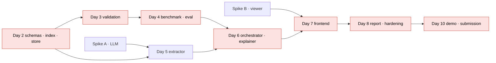

# Implementation Plan

**Window:** Sunday 26 October – Wednesday 4 November 2026 (ten days).
**Status:** v0.1 plan; nothing implemented. Day 1 is the day this plan was written.
**Team assumption:** one engineer with AI coding assistance; effort estimates are for that configuration.

Requirement ids refer to [REQUIREMENTS.md](./REQUIREMENTS.md); ADRs to [DECISIONS.md](./DECISIONS.md).

## 1. Milestones

| Milestone | Target day | Definition |
|---|---|---|
| **M0 Foundations** | Day 2 | Backend skeleton runs; IFC uploads and indexes; LLM smoke test passes; viewer loads an IFC and highlights one GlobalId. Both Day-1 spikes resolved. |
| **M1 Deterministic review** | Day 4 | IDS runner + three native rule families produce schema-valid Findings on the benchmark; benchmark generator and ground truth exist; `run_eval.py` reports precision/recall. |
| **M2 AI-native loop** | Day 6 | Requirement extraction with confirmation UI; planner with default fallback; grounded explanations; SSE progress. End-to-end workflow works on the benchmark with a live or replayed LLM. |
| **M3 Demo-ready** | Day 8 | Findings ↔ viewer sync polished; report (JSON/Markdown); degraded mode; recordings for replay; README setup verified on a clean machine. |
| **M4 Submission** | Day 10 | Demo video recorded; documentation synchronised; evaluation results published as measured; repository tidy. |

## 2. Ten-day schedule

### Day 1 — Sun 26 Oct — Architecture and spikes

- [x] Architecture and engineering documentation (this repository state).
- [ ] **Spike A (LLM):** `openai` SDK against `https://api.meta.ai/v1`; one `muse-spark-1.3` call with `response_format` JSON schema using a nested Pydantic model; one tool-calling round trip. Record raw responses into `evaluation/recordings/`. *Requires API spend approval (OQ-07).*
- [ ] **Spike B (viewer):** Vite + React + `@thatopen/components@3.6.0`: load a small IFC, resolve GlobalId → fragment ids, highlight a set, listen for click → GlobalId. Write findings into `docs/DECISIONS.md` OQ-01.
- **Exit:** both spikes documented; blockers escalated.

### Day 2 — Mon 27 Oct — Backend foundations (M0)

- `backend/pyproject.toml` (Python `>=3.10,<3.13`), `bim_intelligence/` package, settings via `pydantic-settings`, structured logging.
- `schemas/`: `Session`, `ElementRef`, `ModelSummary`, `Requirement`, `CheckSpec`, `Finding`, `EvidenceBundle`, `Explanation`, `Report`, `RunLog`. JSON Schema export script.
- `store/SessionStore` with atomic writes and hashing.
- `bim/`: `IfcLoader`, `ModelIndex` builder, inspection queries. Unit tests against a tiny fixture IFC (FR-ING-01..04).
- `api/`: `/health`, sessions, model upload, elements.
- **Exit:** `pytest` green; upload → summary works via `curl`.

### Day 3 — Tue 28 Oct — Validation core (M1 part 1)

- `validation/ids_runner.py` wrapping `ifctester` (FR-VAL-01) with cross-check against IfcTester's JSON report.
- Native rule engine with `property.required`, `naming.pattern`, `classification.present`, `classification.consistent_by_type` (FR-VAL-02..04); rule versioning.
- `Finding` normaliser; findings endpoint.
- **Exit:** rules unit-tested on hand-built fixtures.

### Day 4 — Wed 29 Oct — Benchmark and evaluation (M1)

- `evaluation/benchmark/generate.py`: clean synthetic model via `ifcopenshell.api`; `inject_defects.py` with defect spec (15–20 defects across the four P0 rule families + clean controls); `ground_truth.json`; a matching `benchmark.ids` and `benchmark_bep.md`. *Requires approval of ADR-011 (OQ-03).*
- `evaluation/run_eval.py`: precision/recall per rule, determinism check (two runs).
- Fix rule gaps revealed by the benchmark.
- **Exit:** metrics printed; results recorded in `EVALUATION.md` as measured values.

### Day 5 — Thu 30 Oct — Requirements interpreter (M2 part 1)

- `requirements/`: text extraction (md/txt; pdf via `pypdf`), paragraph ids; LLM extractor with `RequirementCandidate` structured output; verbatim quote check; IDS compiler via `ifctester.ids` classes with XSD validation (FR-REQ-01..05).
- API: documents upload, extract, PATCH confirm/edit/reject.
- `llm/`: `LLMClient` protocol, Meta client, Fake, Recording, Replay; token accounting; model-id validation (ADR-010).
- **Exit:** extraction on `benchmark_bep.md` yields confirmable candidates; replay fixture stored.

### Day 6 — Fri 31 Oct — Orchestrator and explanations (M2)

- `orchestration/`: tool registry with Pydantic schemas; planner (structured `ReviewPlan`); plan filter; execution loop with caps; default plan; SSE events (FR-REQ-06..07, NFR-06).
- `investigation/EvidenceCollector` (FR-EXP-01).
- `reporting/Explainer` + grounding checker + template fallback (FR-EXP-02..03, ADR-009); finding grouping (FR-EXP-04) if time allows.
- Scenario test: end-to-end run with FakeClient; degraded-mode test (NFR-10).
- **Exit:** `POST /reviews` with an objective produces grounded explanations end to end.

### Day 7 — Sat 1 Nov — Frontend integration (M3 part 1)

- Zustand store; API client with generated types (ADR-014).
- Panels: upload, requirements confirmation, objective + progress, findings list/filters, finding detail (evidence, quote, AI label), degraded banner.
- `ViewerAdapter` from Spike B; selection sync both ways (FR-VIS-01..05).
- Vitest component tests for findings panel states.
- **Exit:** full workflow usable in the browser on the benchmark.

### Day 8 — Sun 2 Nov — Report, hardening, docs (M3)

- `reporting/ReportBuilder`: JSON → Markdown; provenance (FR-REP-01..02); report view in UI.
- Error handling pass (ARCHITECTURE §14); upload limits; loopback binding guard.
- Playwright smoke test (load benchmark, highlight known GlobalId).
- README setup verified on a clean checkout; `docs/` synchronised with reality.
- **Exit:** M3 complete; freeze P0 scope.

### Day 9 — Mon 3 Nov — Buffer and P1/P2

- Reserved buffer for slippage (expect to use it).
- If free: `spatial.contained`, `identity.unique_global_id` (P1); explanation cache; BCF export via `bcf-client` (P2); agent-reliability evaluation over recorded runs (EVALUATION §5).
- Record demo rehearsal; fix anything the rehearsal exposes.

### Day 10 — Tue 4 Nov — Submission (M4)

- Final evaluation run; publish measured metrics in `EVALUATION.md` and README.
- Record the three-minute demo ([DEMO_PLAN.md](./DEMO_PLAN.md)); prepare replay fallback.
- Documentation consistency check; licence table; tag release. *Submission actions require owner approval.*

## 3. Dependency graph and critical path

**Critical path:** schemas/index → validation → benchmark → orchestrator/explainer → frontend integration → report/hardening → demo. Any slip here consumes Day 9's buffer.

**Parallelisable:** Spike B and all frontend panel work can proceed against a mocked API from Day 2 onward; the requirements extractor (Day 5) depends only on schemas and the LLM client.

## 4. Acceptance criteria per milestone

| Milestone | Checks |
|---|---|
| M0 | `pytest` passes; `POST /model` on fixture returns summary; viewer highlights GlobalId from a hard-coded list; LLM structured-output round trip recorded. |
| M1 | `run_eval.py` prints per-rule precision/recall and determinism = identical; all P0 rule tests pass; `findings.json` schema-valid. |
| M2 | Scenario test passes with FakeClient; live run on benchmark yields plan, findings, grounded explanations; grounding rejections logged; degraded-mode test passes. |
| M3 | Manual walkthrough of the full workflow in the browser < 5 minutes; README steps reproduce on a clean machine; Playwright smoke green. |
| M4 | Demo recorded; measured metrics published; no TODOs or unverified claims in public docs; secret scan clean. |

## 5. Scope reduction options (in order of application)

1. Drop finding grouping and explanation cache (FR-EXP-04) — explanations per finding, higher cost, same correctness.
2. Drop the planner; ship default plan only, with objective text shown but not interpreted — loses FR-REQ-06, keeps everything deterministic. *Significant loss of AI-native narrative; apply only if Spike A fails irrecoverably.*
3. Drop PDF ingestion; Markdown/TXT BEP only.
4. Drop requirement extraction UI editing; confirm/reject only.
5. Drop Playwright; manual test script instead.
6. Reduce viewer to list-driven highlighting only (no click-to-select in viewer).
7. Replace Markdown report with JSON download only.

Never cut: deterministic findings, grounding check, human confirmation, evidence traceability, labelled AI output — these are the project's integrity guarantees.

## 6. Definition of done for the MVP

- Workflow IFC → requirements → objective → validation → explanation → 3D → report runs on the benchmark.
- Measured precision and recall published, with the confusion matrix, whether or not the 90 % target is met.
- All P0 requirements have passing acceptance evidence or a documented gap.
- Documentation describes the system as built, not as planned.
