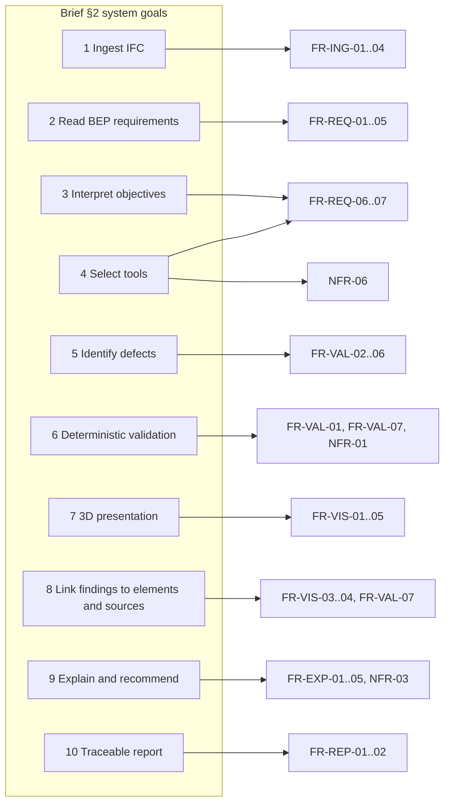

# Requirements

**Status:** Draft v0.1 (26 October 2026). Requirement text is the design baseline; which requirements are implemented and tested is recorded per row in [ARCHITECTURE.md](./ARCHITECTURE.md) (§8, §10.2, §11) and summarised in the README's development status table — as of 29 October 2026 that covers FR-ING-01..04, FR-REQ-05, FR-VAL-01 and FR-VAL-07 on the minimal fixture only.
**Scope:** The professional BIM review workflow defined in the project brief. Broader capabilities from the original hackathon application are recorded as future enhancements, not current requirements.

## 1. Source documents and provenance

| Source ID | Document | Availability at time of writing |
|---|---|---|
| SRC-BRIEF | Technical Architecture and Repository Initialisation brief (26 Oct 2026) | Available; primary source for this version |
| SRC-PPP | Professional Project Proposal | **Not available** in the repository (`hackathon-private/` absent) |
| SRC-HAP | Hackathon Application Proposal | Not available |
| SRC-NTP | Non-Technical Proposal | Not available |
| SRC-EXP | Expected Outcome | Not available |
| SRC-TDR | Technical and Design Requirements | Not available |
| SRC-TT | Technology and Tools | Not available |
| SRC-TEST | Testing | Not available |
| SRC-RULES | Participation Guidelines, Official Rules and Event Waiver, Hackathon Details | Not available; no public event page could be verified |

Every requirement below cites the brief section it derives from. Where the brief implies but does not state a requirement, the row is marked **ASSUMED** and must be confirmed against the private documents when they are added. Reconciliation between the early proposals and the professional project definition is therefore **outstanding** (see [Open items](#7-open-items)).

### Classification used throughout

| Tag | Meaning |
|---|---|
| **EXPLICIT** | Stated in the source |
| **RECOMMENDED** | Architectural recommendation derived from the source |
| **ASSUMED** | Inferred; requires confirmation |
| **FUTURE** | Out of MVP scope; recorded for traceability |

### Priority

- **P0** — required for the MVP end-to-end demonstration.
- **P1** — required for a credible hackathon submission; implement once P0 is stable.
- **P2** — stretch; only if time permits.
- **P3** — future enhancement; not scheduled.

## 2. Product constraints (apply to all requirements)

| ID | Constraint | Source | Tag |
|---|---|---|---|
| C-01 | Model geometry and IFC properties are authoritative for measurable model facts. AI reasoning assists with interpretation, investigation and explanation only. | SRC-BRIEF §2 | EXPLICIT |
| C-02 | The system must not present speculative AI interpretations as verified technical defects. | SRC-BRIEF §2 | EXPLICIT |
| C-03 | The application supports a professional review workflow; it is not a generic chatbot. | SRC-BRIEF §2 | EXPLICIT |
| C-04 | No autonomous modification of the source IFC model. | SRC-BRIEF §10 | EXPLICIT |
| C-05 | No fabricated model measurements; no unverified compliance assertions. | SRC-BRIEF §10 | EXPLICIT |
| C-06 | No paid API calls without explicit authorisation; no exposure of API keys or private project files. | SRC-BRIEF §10 | EXPLICIT |
| C-07 | Python-first backend; type-safe frontend; explicit schemas for all tool input and output. | SRC-BRIEF §10 | EXPLICIT |
| C-08 | Prefer mature libraries and simple interfaces over unnecessary frameworks, services, databases and infrastructure. | SRC-BRIEF §4, §9 | EXPLICIT |
| C-09 | Use Meta Muse models via the Meta Model API as the primary LLM provider. | SRC-BRIEF §4 | EXPLICIT (hackathon eligibility rule ASSUMED — SRC-RULES unavailable) |
| C-10 | Do not copy proprietary code, interface assets or protected implementation details from reference applications. | SRC-BRIEF §3 | EXPLICIT |

## 3. Functional requirements

### 3.1 Model ingestion (FR-ING)

| ID | Requirement | Source | Tag | Priority | Acceptance criteria |
|---|---|---|---|---|---|
| FR-ING-01 | Accept upload of a single IFC file (IFC2X3 or IFC4) and open it with IfcOpenShell. | SRC-BRIEF §2.1, §6 | EXPLICIT | P0 | Upload of the benchmark model returns HTTP 201 with a model summary (schema, element count by type, storeys). Invalid or oversized files return a structured error. |
| FR-ING-02 | Build a queryable Model Index: elements (GlobalId, expressId, IFC type, name), property sets, classification references, spatial containment, material and type relationships. | SRC-BRIEF §5 (Model Inspection) | EXPLICIT | P0 | Unit tests confirm the index for a fixture model matches values read directly from the IFC via IfcOpenShell. |
| FR-ING-03 | Store the uploaded IFC and derived index within an isolated review session; never modify the source IFC. | SRC-BRIEF §10 | EXPLICIT | P0 | SHA-256 of the stored IFC equals the uploaded file after any review run. |
| FR-ING-04 | Expose element lookup by GlobalId with properties, classification and containment. | SRC-BRIEF §2.8 | EXPLICIT | P0 | `GET /elements/{globalId}` returns the element record; unknown id returns 404. |
| FR-ING-05 | Support IFC4X3 schema parsing where IfcOpenShell allows. | SRC-BRIEF §3 (IFC/ISO 16739) | ASSUMED | P3 | — |

### 3.2 Requirement interpretation (FR-REQ)

| ID | Requirement | Source | Tag | Priority | Acceptance criteria |
|---|---|---|---|---|---|
| FR-REQ-01 | Accept upload of a simplified BEP or equivalent requirements document (Markdown, plain text or PDF). | SRC-BRIEF §2.2, §6 | EXPLICIT | P0 | Document is stored, text is extracted and paragraph/section identifiers are assigned. |
| FR-REQ-02 | Extract candidate requirements from the document using an LLM with structured output, each carrying a verbatim source quotation and location reference. | SRC-BRIEF §5 (Requirements Interpreter) | EXPLICIT | P0 | Every candidate has non-empty `source.quote` that appears verbatim in the document text (deterministic check). |
| FR-REQ-03 | For each candidate, propose an executable check: either an IDS facet specification or a named native rule with parameters. Mark candidates that cannot be made executable as `informational`. | SRC-BRIEF §5 | EXPLICIT | P0 | Candidate JSON validates against the `RequirementCandidate` schema; IDS proposals compile to a valid IDS 1.0 XML document. **T-5 scope note:** the current narrative workflow only maps a candidate to an already confirmed immutable `CheckSpec`; it does not author or compile new IDS criteria, so full FR-REQ-03 acceptance remains open. |
| FR-REQ-04 | Require human confirmation (confirm / edit / reject) of each candidate before it is executed as a check. | SRC-BRIEF §2 (C-02), §5 (uncontrolled tool execution) | RECOMMENDED | P0 | A review run only executes checks whose requirement status is `confirmed`. |
| FR-REQ-05 | Accept a pre-authored IDS 1.0 file directly as a set of confirmed requirements. | SRC-BRIEF §6 (one IDS specification) | EXPLICIT | P0 | Uploaded IDS is schema-validated and each specification becomes a confirmed requirement. |
| FR-REQ-06 | Interpret a free-text review objective (e.g. "check fire-rating information on walls for Stage 4 issue") and map it to a bounded review plan over confirmed requirements and standard checks. | SRC-BRIEF §2.3, §5 (Review Orchestrator) | EXPLICIT | P0 | Plan JSON lists the checks to run and the reason each was selected; a plan never references a tool outside the registry. |
| FR-REQ-07 | Provide a default "standard pre-issue review" plan that runs without any LLM call. | SRC-BRIEF §5 (fallback), §10 (cost) | RECOMMENDED | P0 | With the LLM disabled, a review run still produces findings for all built-in checks. |

### 3.3 Validation (FR-VAL)

| ID | Requirement | Source | Tag | Priority | Acceptance criteria |
|---|---|---|---|---|---|
| FR-VAL-01 | Execute IDS 1.0 validation using IfcTester and normalise results into Findings. | SRC-BRIEF §5 (Validation), §6 | EXPLICIT | P0 | For the benchmark IDS, Findings match IfcTester's own JSON report element-for-element. |
| FR-VAL-02 | Required-property validation: detect elements missing a required property set or property, or with empty/placeholder values. | SRC-BRIEF §6 | EXPLICIT | P0 | All injected missing-property defects in the benchmark are detected; no clean element is flagged. |
| FR-VAL-03 | Naming-convention validation: detect element, type or storey names that do not match a configured pattern. | SRC-BRIEF §6 | EXPLICIT | P0 | Injected naming defects detected per benchmark. |
| FR-VAL-04 | Classification consistency: detect missing classification references, references to an unexpected classification system, and inconsistent codes across instances of the same type. | SRC-BRIEF §2.5, §6 | EXPLICIT | P0 | IDS checks cover classification presence/system; the registered `classification.consistent_by_type` native rule detects a type/occurrence code mismatch. Positive, negative and applicability-boundary tests pass; benchmark coverage remains for T-6. |
| FR-VAL-05 | Relationship validity: detect elements with no spatial container, elements contained in the wrong storey relative to their elevation, and openings/doors/windows without a host relationship. | SRC-BRIEF §2.5 | EXPLICIT | P1 | Injected relationship defects detected per benchmark. |
| FR-VAL-06 | Duplicate and invalid identifier checks (duplicate GlobalId, malformed GlobalId). | SRC-BRIEF §2.5 | RECOMMENDED | P1 | Deterministic unit test. |
| FR-VAL-07 | Every Finding records: requirement id, rule id, affected element references, observed value, expected value, severity, and the deterministic method that produced it. | SRC-BRIEF §2.6, §2.8, §10 | EXPLICIT | P0 | Finding schema validation; `method` is never `llm`. |
| FR-VAL-08 | Interdisciplinary clash detection using IfcClash between two models. | SRC-BRIEF §2.5 "selected coordination issues", §6 "only once core workflow reliable" | EXPLICIT (deferred) | P2 | Clash results normalised into Findings with both element references. |

### 3.4 Investigation and explanation (FR-EXP)

| ID | Requirement | Source | Tag | Priority | Acceptance criteria |
|---|---|---|---|---|---|
| FR-EXP-01 | For each Finding, gather deterministic context: the element's type, storey, sibling elements of the same type and their pass/fail status, and the property distribution for the failed property. | SRC-BRIEF §5 (Issue Investigation) | EXPLICIT | P0 | Evidence bundle is produced without any LLM call and is attached to the Finding. |
| FR-EXP-02 | Generate an AI-supported explanation per Finding (or per Finding group) containing: plain-language description, probable cause, corrective action, and the requirement it violates. | SRC-BRIEF §2.9, §5 | EXPLICIT | P0 | Explanation produced via structured output; schema-valid. |
| FR-EXP-03 | Ground-check every explanation: all element identifiers, property names and values cited must exist in the Finding's evidence bundle; otherwise the explanation is rejected and regenerated or replaced by a deterministic template. | SRC-BRIEF §2 (C-02), §5 (hallucinated model facts) | RECOMMENDED | P0 | Grounding test suite with adversarial fixtures; grounding failure rate is logged per run. |
| FR-EXP-04 | Group related Findings (same rule, same type, same storey) to reduce explanation calls and improve readability. | SRC-BRIEF §5 (inference costs) | RECOMMENDED | P1 | Explanation calls per run ≤ number of Finding groups. |
| FR-EXP-05 | Clearly label each explanation as AI-generated and each Finding as deterministically verified in both UI and report. | SRC-BRIEF §2 (C-02) | EXPLICIT | P0 | UI and report snapshots show the labels. |

### 3.5 Visualisation (FR-VIS)

| ID | Requirement | Source | Tag | Priority | Acceptance criteria |
|---|---|---|---|---|---|
| FR-VIS-01 | Load and render the uploaded IFC in an interactive 3D viewer in the browser. | SRC-BRIEF §2.7 | EXPLICIT | P0 | Benchmark model renders; orbit, pan, zoom work. |
| FR-VIS-02 | List Findings with filters by severity, rule and storey. | SRC-BRIEF §2.7 | RECOMMENDED | P0 | Filter changes update list and highlights. |
| FR-VIS-03 | Selecting a Finding highlights and frames all affected elements by GlobalId; selecting an element in the viewer shows its Findings and properties. | SRC-BRIEF §2.7, §2.8, §6 | EXPLICIT | P0 | Manual test script and a Playwright smoke test on the benchmark model. |
| FR-VIS-04 | Show the Finding's evidence (observed vs expected), the source requirement quotation and the AI explanation side by side. | SRC-BRIEF §2.8, §2.9 | EXPLICIT | P0 | UI snapshot. |
| FR-VIS-05 | Accept the review objective as free text and show orchestrator progress (steps, tool calls) during a run. | SRC-BRIEF §2.3 | EXPLICIT | P0 | Progress events render in order. |
| FR-VIS-06 | Voice input for the review objective (transcription). | SRC-BRIEF §4 Optional | FUTURE | P3 | — |
| FR-VIS-07 | Image-based analysis (e.g. screenshot interpretation). | SRC-BRIEF §4 Optional | FUTURE | P3 | — |

### 3.6 Reporting (FR-REP)

| ID | Requirement | Source | Tag | Priority | Acceptance criteria |
|---|---|---|---|---|---|
| FR-REP-01 | Generate a review report containing session metadata, model summary, requirements considered, findings with evidence and explanations, and a traceability matrix (requirement → rule → findings → elements). | SRC-BRIEF §2.10 | EXPLICIT | P0 | JSON report validates against the `Report` schema; Markdown rendering is produced from the same JSON. |
| FR-REP-02 | Record provenance in the report: model file hash, IDS/document hashes, rule versions, LLM model id and prompt version used for explanations. | SRC-BRIEF §2.10, §10 | RECOMMENDED | P0 | Fields present and non-empty. |
| FR-REP-03 | Export Findings as BCF 3.0 for exchange with Solibri, BIMcollab, Navisworks and Revit. | SRC-BRIEF §3, §4 Optional | EXPLICIT (optional) | P2 | BCF zip opens in at least one third-party BCF reader. |

## 4. Non-functional requirements

| ID | Requirement | Source | Tag | Priority | Acceptance criteria |
|---|---|---|---|---|---|
| NFR-01 | **Determinism.** Given the same IFC, requirements and rule versions, the set of Findings is identical across runs. | SRC-BRIEF §2.6, §10 | EXPLICIT | P0 | Two consecutive runs produce byte-identical `findings.json` (excluding timestamps). |
| NFR-02 | **Accuracy target.** ≥ 90 % precision and ≥ 90 % recall on the labelled benchmark (15–20 defects plus clean cases). Reported as measured, never as achieved until measured. | SRC-BRIEF §6 | EXPLICIT | P0 | `tests/evaluation/run_eval.py` prints the confusion matrix and metrics per rule category. |
| NFR-03 | **Grounding.** 100 % of explanations shipped to the UI/report pass the deterministic grounding check. | SRC-BRIEF §2 (C-02) | RECOMMENDED | P0 | Grounding rejection count logged; zero ungrounded explanations in benchmark run. |
| NFR-04 | **Performance.** Ingest and index a ~50 MB architectural IFC in < 60 s; full deterministic review of the benchmark model in < 30 s; viewer first render in < 15 s on a mid-range laptop. | SRC-BRIEF §7.17 | ASSUMED (targets chosen by the architect) | P1 | Timed in CI on the benchmark model; thresholds documented. |
| NFR-05 | **Cost.** A complete benchmark review uses ≤ 10 LLM calls and ≤ 150k input tokens by default; cost is estimated and logged per run. | SRC-BRIEF §5, §10 | RECOMMENDED | P0 | Token usage recorded from API responses and summed in the run log. |
| NFR-06 | **Bounded tool execution.** Orchestrator tool calls are limited to the registered, read-only tool set; a hard cap on iterations per run; all tool arguments schema-validated before execution. | SRC-BRIEF §5 | EXPLICIT | P0 | Tests for unknown tool, invalid arguments, and iteration cap. |
| NFR-07 | **Security.** API keys only via environment variables; uploaded files stored under a git-ignored data directory; file-type and size limits enforced; no outbound calls other than the configured LLM endpoint. | SRC-BRIEF §10 | EXPLICIT | P0 | Secret scan in CI; configuration tests. |
| NFR-08 | **Privacy.** Use Standard-mode Meta model identifiers only (no `-contributor` variants) so uploaded project data is not used for model training. | SRC-BRIEF §10; Meta Model API docs | RECOMMENDED | P0 | Configuration validation rejects `-contributor` model ids unless an explicit override flag is set. |
| NFR-09 | **Observability.** Every review run emits a structured JSON log with plan, tool calls, timings, token usage, grounding results and errors. | SRC-BRIEF §7.15 | RECOMMENDED | P0 | Run log file present per session. |
| NFR-10 | **Graceful degradation.** If the LLM is unavailable, deterministic validation and templated explanations still work, and the UI indicates degraded mode. | SRC-BRIEF §7.14 | RECOMMENDED | P0 | Test with LLM client stubbed to raise. |
| NFR-11 | **Portability.** Backend runs on Windows and Linux with Python 3.10–3.12 (IfcOpenShell wheel availability). | Research note (IfcOpenShell PyPI) | RECOMMENDED | P0 | CI matrix on `windows-latest` and `ubuntu-latest`, Python 3.12. |
| NFR-12 | **Type safety.** Backend type-checked with mypy (strict on `schemas/`), frontend with `tsc --noEmit`; no `any` in domain types. | SRC-BRIEF §10 | EXPLICIT | P1 | CI gates. |
| NFR-13 | **Testing.** pytest for backend; unit tests for parsing, rules, grounding and tool routing; scenario tests for the end-to-end review; frontend component tests for the findings panel. | SRC-BRIEF §4, §7.16 | EXPLICIT | P0 | CI green. |
| NFR-14 | **Documentation.** Architecture, decisions, evaluation and plan documents kept in sync with implementation; README setup instructions verified by running them. | SRC-BRIEF §8 | EXPLICIT | P0 | Reviewer checklist in `AGENTS.md`. |
| NFR-15 | **Licensing.** All dependencies are permissive or LGPL (dynamically linked); benchmark IFC data is self-generated or under a licence permitting redistribution. | SRC-BRIEF §8 (Attribution and licences) | RECOMMENDED | P0 | Licence table in README. |

## 5. Traceability map

## 6. Reconciliation of early proposals vs professional scope

The brief states that the original hackathon application described broader capabilities than the professional project definition and that the professional scope is the current direction. Without the private documents the specific deltas cannot be enumerated. The following items are **recorded as FUTURE** on the strength of the brief's "Optional capabilities" list alone:

| Capability | Brief reference | Status |
|---|---|---|
| Voice transcription of review objectives | §4 Optional | FUTURE (FR-VIS-06) — `muse-voice-transcribe-1.0` exists on the Meta Model API; feasible later |
| BCF export | §4 Optional | P2 (FR-REP-03) |
| Additional multidisciplinary checks (clash) | §4 Optional, §6 | P2 (FR-VAL-08) |
| Image-based analysis | §4 Optional | FUTURE (FR-VIS-07) |

## 7. Open items

| ID | Question | Blocks | Owner |
|---|---|---|---|
| OPEN-01 | Add `hackathon-private/` documents and reconcile every ASSUMED row. | Final requirement baseline | Project owner |
| OPEN-02 | Confirm hackathon rules: mandatory Meta model usage, submission format, video length, team/eligibility constraints. | DEMO_PLAN, C-09 | Project owner |
| OPEN-03 | Confirm API budget authorisation for development and benchmark runs (C-06). | Any live LLM call | Project owner |
| OPEN-04 | Choose benchmark base model: self-generated synthetic building vs an openly licensed sample IFC (licence check needed). | EVALUATION §2 | Project owner + architect |
| OPEN-05 | Confirm NFR-04 performance targets are appropriate for the demonstration hardware. | NFR-04 | Project owner |

## 8. Day 7 acceptance and status register

This owner-approved addendum records the product and delivery decisions as of 1 November 2026.
Statuses below describe evidence present on `main` at
`1f3d13b78683692317e00f2279c3f0c4ac02f1c2`; they do not imply that a requirement is complete
because it is documented. The coordination requirements are a separate, conditional demonstration
scope and are not additions to the deterministic IDS-review MVP exit criteria.

The original **FR-VAL-08** row is retained as historical requirement-baseline text. For this
delivery, it is **Deferred** and superseded by **FR-COORD-01..05** below: geometric results are
not `Finding` records and cannot be accepted as part of the current review MVP.

### 8.1 Existing product and bounded UI requirements

| ID | Requirement and acceptance test | Priority | Status | Evidence / gap |
|---|---|---:|---|---|
| FR-UI-01 | Retain one product identity: **BIM Intelligence**, an AI-native AEC model-review application. The coordination demonstration, if enabled, is a mode in this application, not a second product or rebrand. | P0 | Implemented | Project Home and shell exist in `frontend/src/App.tsx` and `frontend/src/components/ProjectHome.tsx`; README describes architectural BIM review. UI-003 is recorded in `docs/UI_CHANGELOG.md`. |
| FR-VIS-08 | Provide Fit All, Reset View and Focus Selection where the installed viewer supports them. Each control must act on the displayed model and preserve version/selection integrity; unsupported actions must not appear as active controls. | P1 | Implemented | UI-004A verified distinct Fit model, canonical Reset view and Focus selected controls using installed viewer APIs, including fit after extreme zoom/pan, reset after finding focus and W-002/W-003 focus. Browser and automated evidence: `docs/UI_CHANGELOG.md` UI-004A entry; implementation: `frontend/src/viewer/IfcViewer.ts`, `frontend/src/components/ModelWorkspace.tsx`. |
| FR-VIS-09 | Keep viewer and application selection coherent: selecting a finding or element updates the corresponding application state, clearing selection clears linked state, and focus styling remains neutral and distinct from deterministic issue severity. Test both selection directions, clearing, keyboard operation and styling against findings of different severities. | P0 | Implemented | UI-004A verified finding-row and model-pointer selection, clear selection through both paths without camera movement, neutral W-001 selection, preserved red W-003 issue highlighting, repeated element switching, and keyboard activation of camera controls. Automated coverage and browser screenshots: `docs/UI_CHANGELOG.md` UI-004A entry; implementation: `frontend/src/viewer/IfcViewer.ts`, `frontend/src/components/ModelWorkspace.tsx`. |
| FR-VIS-10 | At desktop viewports of 1280 px or wider, keep the 3D viewport rendered and usable while a user selects a finding and inspects its evidence; evidence must not replace the viewport or silently reset the model camera. | P0 | Implemented | UI-003's three-column desktop workspace and finding-to-evidence browser walkthrough are recorded in `docs/UI_CHANGELOG.md`; `frontend/src/components/ModelWorkspace.tsx` renders `ViewerCanvas` with the evidence inspector. |
| FR-VIS-11 | Show truthful upload, indexing, viewer-loading, empty and error states. Progress may be reported only when measured; no invented percentage is displayed. Acceptance uses a fresh upload and a delayed/failed viewer or API response. | P0 | Implemented | UI-003 verified upload/rejection states. UI-004A exposed Downloading model, Preparing geometry, Ready and Failed from observable lifecycle stages; blocked `web-ifc.wasm` requests produced Failed, and restoring requests returned the viewer to Ready. No percentage is fabricated. See the UI-004A evidence in `docs/UI_CHANGELOG.md` and `frontend/src/viewer/ViewerCanvas.tsx`. |
| FR-UI-02 | Offer a recent-session list backed initially by browser-local storage only. Store only non-sensitive session identifiers and minimal user-visible labels; make clear that history is local to this browser and never imply server-wide project persistence. | P1 | Deferred | Project Home explicitly says recent sessions are unavailable; there is no session-list API or browser-local history. `frontend/src/components/ProjectHome.tsx`; `docs/UI_CHANGELOG.md` §UI-003. |
| FR-UI-03 | Provide a one-click synthetic sample review as the safe demonstration fallback. It must identify the synthetic inputs and provenance, use the existing single-IFC/IDS workflow, and make no network or paid-model call unless separately approved. | P0 | Deferred | UI-003 marks sample projects unavailable. The synthetic minimal IFC/IDS fixture exists, but no product sample route or one-click workflow is implemented; see `tests/fixtures/` and `frontend/src/components/ProjectHome.tsx`. |

### 8.2 Meta-assisted review and traceable output

| ID | Requirement and acceptance test | Priority | Status | Evidence / gap |
|---|---|---:|---|---|
| FR-AI-01 | Integrate a bounded, user-facing objective plan and/or grounded finding explanation through the existing Meta Model API client. Show the actual `ReviewRun.plan_source`, the actual explanation source (`ai_generated` or `deterministic_template`), and the fallback state. Test Live only after explicit owner approval; test Off/Replay without network. AI must never create a `Finding` or alter confirmed check criteria. | P0 | In progress | T-5 client/planner/explanation and budget safeguards are offline-tested, but the UI states that AI explanation is not connected; Meta live compatibility is unverified. See ADR-020, `backend/bim_intelligence/api/reviews.py`, and UI-003 evidence. |
| FR-REP-04 | Present or export a run result traceable from model hash and run identity through confirmed requirement/check and rule versions to deterministic findings, affected element references and evidence. A report must distinguish execution status, zero findings, errors and optional AI interpretation. Test a complete result and a partial/error result. | P0 | In progress | `ReviewRun` and its `InputManifest` carry model/IDS hashes, requirement revisions and rule versions, and the UI presents per-check outcomes. A report/export endpoint and complete report surface are not implemented; see `backend/bim_intelligence/schemas/runs.py`, `backend/bim_intelligence/api/reviews.py`, and T-7 in `docs/IMPLEMENTATION_PLAN.md`. |

### 8.3 Conditional two-model coordination demonstration

These P2 requirements are **not part of the existing MVP acceptance criteria**. They remain
Conditional until the feasibility and go/no-go gates in [ADR-021](./DECISIONS.md#adr-021-bounded-model-federation-is-separate-from-a-session),
[ADR-022](./DECISIONS.md#adr-022-deterministic-geometric-coordination-results) and
[FINAL_48_HOUR_PLAN.md](./FINAL_48_HOUR_PLAN.md) pass. Failure of any gate means the features are
omitted, not simulated.

| ID | Requirement and acceptance test | Priority | Status | Evidence / gap |
|---|---|---:|---|---|
| FR-COORD-01 | A separate coordination-set manifest references exactly two separately uploaded, immutable IFC versions with model identity/hash, explicit discipline labels and placement metadata. Preserve the one-active-IFC `Session` contract; never replace one model to represent the second. Test distinct duplicate GlobalIds and model-version changes. | P2 | Conditional | `Session` contains one `model_hash`; no coordination-set contract or two-model workflow exists. See `backend/bim_intelligence/schemas/sessions.py`, `backend/bim_intelligence/bim/ingest.py`, ADR-021. |
| FR-COORD-02 | Validate both sources against one declared common coordinate frame, units and supported placements before analysis. Reject unknown, unsupported, ambiguous or stale alignment; test valid transform, mismatch, missing metadata and unsupported placement. | P2 | Conditional | No alignment validator is implemented. No geometry-only or filename-based alignment assumption is permitted. |
| FR-COORD-03 | Run deterministic geometric analysis on one explicitly selected A/B pair only. Record both model hashes/member IDs, run ID, algorithm/version, explicit tolerance and units, exclusions, placement assumptions and tested IFC entity scope. Test reproducibility, positive/negative/boundary/tolerance/exclusion cases and explicit unavailable/not-analysed/zero/error/results states. | P2 | Conditional | No clash engine is implemented. On the checked-out environment IfcOpenShell 0.9.0.post1 and IfcTester 0.9.0 are installed; no IfcClash distribution/import is installed. |
| FR-COORD-04 | Display a compact matrix whose rows and counts come only from completed computed runs. Keep raw intersections, deterministic groups and human-assessed coordination issues as distinct values; do not treat every intersection as an actionable error. | P2 | Conditional | No matrix or computed coordination result is implemented. |
| FR-COORD-05 | Selecting a computed matrix result identifies and highlights the actual intersecting elements in the 3D investigation and exposes evidence traceable to both model versions and the run. Test duplicate GlobalIds across models, missing GlobalId fallback, selection clearing and stale model rejection. | P2 | Conditional | Current viewer and API handle one IFC at a time; no federated selection or clash evidence contract is implemented. |

Federated element identity is `(model_member_id, model_hash, GlobalId)` or, when GlobalId is absent,
`(model_member_id, model_hash, ifc_type, express_id)`. A `GlobalId` alone is never sufficient.
Coordination output remains distinct from information-quality Findings. The preferred external
candidate is **Duplex Apartment**, subject to compatibility, provenance and redistribution-rights
verification. Do not inspect or copy private materials without the specific authorisation required
by `AGENTS.md`. If the rights or feasibility gate fails, use the documented one-click synthetic
demo only; do not imply that it demonstrates federation or clash detection.
